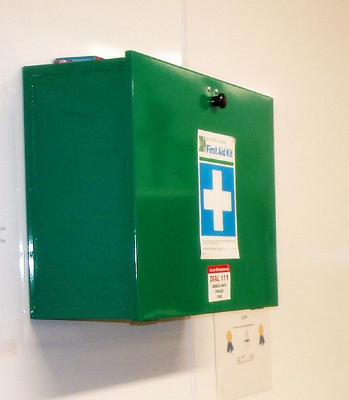
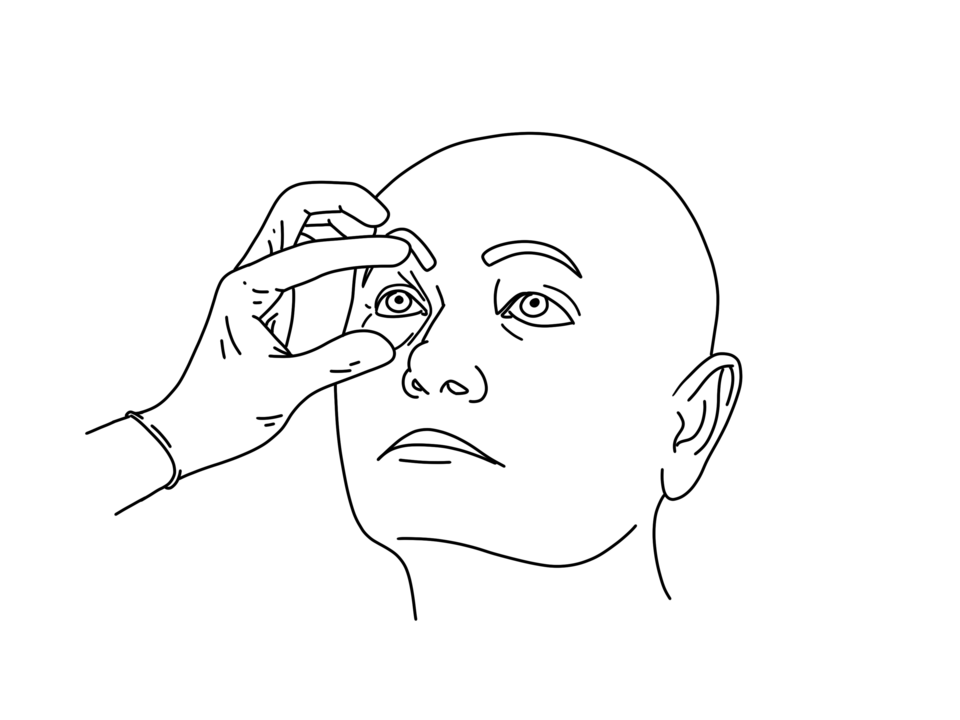

# UNIÃO SERVIÇOS MÉDICOS
## DIRETORIA DE ENSINO, PESQUISA E INSTRUÇÃO PRÉ-HOSPITALAR

---

**MÓDULO C01 — FUNDAMENTOS DOS PRIMEIROS SOCORROS E APH**
*Biblioteca Curricular: Núcleo Compartilhado (Core Skills)*
*Versão Editorial: 1.0.0 — Padrão Editorial USM*
*Carga Horária: 1h Teórica | Público-alvo: Não médicos, educadores, gestores e brigadistas*

---

## SUMÁRIO

- [Seção 1 — Em 30 Segundos](#seção-1--em-30-segundos)
- [Seção 2 — Objetivos de Aprendizagem](#seção-2--objetivos-de-aprendizagem)
- [Seção 3 — Introdução e Relevância](#seção-3--introdução-e-relevância)
- [Seção 4 — Fundamentação Anatômica e Fisiológica](#seção-4--fundamentação-anatômica-e-fisiológica)
- [Seção 5 — Desenvolvimento dos Subtemas](#seção-5--desenvolvimento-dos-subtemas)
  - [5.1 Introdução ao Atendimento Pré-Hospitalar](#51-introdução-ao-atendimento-pré-hospitalar)
  - [5.2 Papel e Limites de Atuação do Socorrista](#52-papel-e-limites-de-atuação-do-socorrista)
  - [5.3 Anatomia e Fisiologia Básica Aplicada](#53-anatomia-e-fisiologia-básica-aplicada)
  - [5.4 Conceitos de Urgência e Emergência](#54-conceitos-de-urgência-e-emergência)
  - [5.5 Princípios Éticos e Legais no Brasil](#55-princípios-éticos-e-legais-no-brasil)
  - [5.6 Prioridades no Atendimento](#56-prioridades-no-atendimento)
- [Seção 6 — Quadros Práticos e Comparativos](#seção-6--quadros-práticos-e-comparativos)
- [Seção 7 — Erros Frequentes e Condutas Proibidas](#seção-7--erros-frequentes-e-condutas-proibidas)
- [Seção 8 — Aplicação Prática (Estudo de Caso)](#seção-8--aplicação-prática-estudo-de-caso)
- [Seção 9 — Pulo do Gato](#seção-9--pulo-do-gato)
- [Seção 10 — Mapa Mental](#seção-10--mapa-mental)
- [Seção 11 — O Que Você Precisa Lembrar](#seção-11--o-que-você-precisa-lembrar)
- [Seção 12 — Referências Bibliográficas e Metadados](#seção-12--referências-bibliográficas-e-metadados)

---

## SEÇÃO 1 — EM 30 SEGUNDOS

> **VISÃO RÁPIDA DE SOBREVIVÊNCIA**
> 1. **Preservação vital temporária:** Primeiros socorros são medidas imediatas prestadas à vítima para manter funções vitais e impedir o agravamento de lesões até a chegada do socorro especializado [1].
> 2. **Segurança em primeiro lugar:** A autoproteção precede qualquer manobra. Jamais se torne uma segunda vítima [2].
> 3. **Emergência versus Urgência:** Emergência envolve risco iminente de morte (ex.: parada cardiorrespiratória e hemorragia maciça), exigindo resposta em segundos. Urgência é grave, mas sem risco de morte instantânea (ex.: fratura fechada estável) [3].
> 4. **Tríade cérebro-coração-pulmão:** A falta de oxigênio destrói células cerebrais a partir de 4 a 6 minutos. O socorro inicial visa manter a perfusão celular dos órgãos nobres [4].
> 5. **Omissão de socorro (Art. 135 do Código Penal):** O dever legal não exige expor a própria vida ao perigo; acionar o socorro público (192 ou 193) já cumpre a exigência jurídica de assistência [5].
> 6. **Cadeia de prioridades:** Controle hemorragias maciças e garanta via aérea antes de imobilizações secundárias.

---

## SEÇÃO 2 — OBJETIVOS DE APRENDIZAGEM

Ao concluir o estudo deste módulo, você será capaz de:

1. **Definir com clareza técnica** o papel e os limites do socorrista leigo treinado no Brasil.
2. **Diferenciar situações de emergência de urgências**, orientando a prioridade do chamado.
3. **Compreender a fisiologia básica** da perfusão tecidual e da hipóxia cerebral.
4. **Identificar os aspectos ético-legais** do socorro, consentimento e proteção do socorrista de boa-fé.
5. **Aplicar a sequência universal de prioridades** no contato inicial com a cena e a vítima.
6. **Evitar mitos e condutas prejudiciais**, adotando práticas baseadas em diretrizes científicas atuais.

---

## SEÇÃO 3 — INTRODUÇÃO E RELEVÂNCIA

O Atendimento Pré-Hospitalar (APH) moderno surgiu da necessidade de reduzir mortes evitáveis entre o momento do agravo e a chegada ao hospital [6]. No Brasil, a estruturação pública consolidou-se com o SAMU 192 (Decreto nº 5.055/2004 e Portaria GM/MS nº 2.048/2002) e o serviço de resgate dos Corpos de Bombeiros Militares (193) [3, 7].

Mesmo com serviços ágeis, ambulâncias levam habitualmente entre 7 e 15 minutos para chegar ao local da ocorrência. Entretanto, a anóxia cerebral definitiva instala-se entre 4 e 6 minutos de parada cardíaca, e uma hemorragia arterial severa pode causar exanguinação fatal em menos de 3 minutos [4, 8].

Por esse motivo, o **primeiro respondente comunitário** — professores, brigadistas, instrutores de academia e colaboradores — forma o elo indispensável da sobrevivência. O socorrista leigo não substitui o médico; ele sustenta a vida biológica até a transferência do cuidado.

---

## SEÇÃO 4 — FUNDAMENTAÇÃO ANATÔMICA E FISIOLÓGICA

Toda ação de primeiros socorros tem por objetivo proteger os sistemas biológicos essenciais, conhecidos como a **Tríade Vital**:

```
           +---------------------------------------+
           |     SISTEMA NERVOSO CENTRAL (SNC)     |
           |      Controle neural e consciência    |
           +-------------------+-------------------+
                               |
            Trocas             |  Comando
          gasosas              |  autônomo
                               |
+--------------------+         |         +--------------------+
| SISTEMA RESPIRATÓRIO| <---------------+ |SISTEMA CARDIOVASC. |
| Hematose alveolar  | ----------------> | Bomba e transporte |
+--------------------+   Oxigenação do   +--------------------+
                           sangue
```

### 4.1 Coração e Hemodinâmica
O sistema circulatório é um circuito fechado formado por bomba (coração), condutores (vasos sanguíneos) e fluido (sangue). Em um adulto de 70 kg, circulam cerca de 5 litros de sangue [9].
- **Perfusão tecidual:** É a passagem contínua de sangue oxigenado pelos leitos capilares para nutrir as células.
- **Choque hipovolêmico:** Em sangramentos graves, o volume vascular cai rapidamente, a pressão arterial despenca e as células entram em falência metabólica por falta de oxigênio [8].

### 4.2 Pulmão e Trocas Gasosas
O ar atmosférico contém aproximadamente 21% de oxigênio. Pela respiração, o oxigênio chega aos alvéolos pulmonares e passa para o sangue (**hematose**), enquanto o gás carbônico é expelido [9].
- **Obstrução de via aérea:** Na vítima inconsciente deitada de costas, o relaxamento muscular faz a base da língua e a epiglote caírem contra o fundo da garganta, bloqueando a passagem do ar [1, 2].

> [!IMPORTANT]
> **ENTENDA O PORQUÊ: A LÍNGUA NÃO É ENGOLIDA**
> É anatomicamente impossível engolir a língua, pois ela está fixada à mandíbula e ao osso hioide. O que ocorre na inconsciência é o **relaxamento muscular passivo**. Estender a cabeça e elevar o queixo (em vítimas clínicas) desloca a base da língua para frente, desobstruindo a via aérea. Tentar puxar a língua com os dedos provoca vômitos, lesões orais e risco de mordedura acidental no socorrista.

### 4.3 Cérebro e Vulnerabilidade à Hipóxia
O encéfalo consome cerca de 20% do oxigênio corporal. Sem suprimento de oxigênio:
- Em **10 a 15 segundos**, a pessoa perde a consciência.
- A partir de **4 a 6 minutos**, iniciam-se lesões neuronais irreversíveis [4].
- Após **10 minutos**, a morte encefálica é a regra geral.

Isso justifica por que o reconhecimento imediato da parada cardiorrespiratória e o início rápido das compressões torácicas são inegociáveis.

---

## SEÇÃO 5 — DESENVOLVIMENTO DOS SUBTEMAS

### 5.1 Introdução ao Atendimento Pré-Hospitalar
O APH divide-se em dois níveis operacionais:
1. **Suporte Básico de Vida (SBV):** Medidas não invasivas de suporte ventilatório e circulatório, desobstrução de via aérea, uso do DEA e controle de hemorragias externas. Pode ser realizado por leigos treinados [1, 2].
2. **Suporte Avançado de Vida (SAV):** Procedimentos invasivos executados privativamente por médicos e enfermeiros, incluindo intubação traqueal, acesso vascular, drogas vasoativas e desfibrilação manual [3].

O salvamento depende da **Cadeia de Sobrevivência**: se as manobras básicas não forem iniciadas imediatamente por quem presencia o evento, os recursos avançados do hospital não serão suficientes para evitar o óbito ou sequelas graves.

### 5.2 Papel e Limites de Atuação do Socorrista
A regra central de conduta é a não maleficência (*primum non nocere* — primeiro não prejudicar) [2].

#### O que o socorrista leigo deve fazer:
- Proteger a cena e a própria integridade.
- Reconhecer precocemente paradas respiratórias e cardíacas.
- Realizar compressões torácicas e usar o DEA.
- Conter hemorragias externas com pressão direta, curativos e torniquetes.
- Manter a vítima imóvel e aquecida.
- Acionar o 192 (SAMU) ou 193 (Bombeiros), transmitindo dados claros.

#### O que o socorrista leigo NÃO pode fazer:
- **Não medicar:** Não prescrever nem administrar qualquer remédio por via oral ou injetável. Exceção única: auxiliar a vítima a usar sua própria medicação de emergência prescrita (ex.: caneta de adrenalina em anafilaxia ou bombinha para asma) [10].
- **Não realizar atos invasivos:** Proibido cortar a pele, tentar drenar feridas, furar bolhas ou recolocar ossos fraturados no lugar.
- **Não atestar óbito:** O socorrista leigo não tem competência para atestar morte. Apenas lesões biológicas indiscutíveis (decapitação, carbonização completa ou rigidez cadavérica total) dispensam o início da RCP [1].

### 5.3 Anatomia e Fisiologia Básica Aplicada
- **Pulso periférico versus leigo:** Diretrizes internacionais (AHA e ILCOR) determinam que o socorrista leigo **não deve checar pulso**. Estudos mostram altas taxas de erro na palpação por leigos, atrasando o início da reanimação. Regra prática: inconsciente + não respira normalmente = **iniciar compressões imediatamente** [1, 2].
- **Padrões de respiração:** A respiração normal em repouso no adulto varia de 12 a 20 incursões por minuto. Movimentos espasmódicos e irregulares de suspiro (*gasping*) são reflexos agônicos de parada cardíaca e exigem início imediato da RCP.

### 5.4 Conceitos de Urgência e Emergência
Conforme a Resolução CFM nº 1.451/1995:
- **Emergência:** Risco iminente de morte ou lesão biológica irreversível. O tempo de resposta tolerado é de segundos ou poucos minutos (ex.: PCR, hemorragia maciça em membro, engasgo total, anafilaxia severa) [11].
- **Urgência:** Agravo à saúde com risco potencial a médio prazo, mas sem risco de morte instantânea. O atendimento pode ocorrer em minutos a poucas horas (ex.: luxações articulares, fraturas fechadas sem déficit circulatório, dores abdominais intensas estáveis).

Compreender essa distinção evita subestimar casos gravíssimos e impede a sobrecarga desnecessária do SAMU com situações puramente ambulatoriais.

### 5.5 Princípios Éticos e Legais no Brasil

#### 5.5.1 Omissão de Socorro (Artigo 135 do Código Penal)
O crime de omissão de socorro ocorre ao deixar de prestar assistência a quem se encontra em grave perigo, quando possível fazê-lo sem risco pessoal, ou não pedir o socorro público [5].
- **Autoproteção legal:** A legislação não obriga ninguém a se lançar em chamas ou poças eletrificadas. Havendo risco pessoal, o dever legal é cumprido integralmente ao **ligar de imediato para o 192 ou 193** e repassar os detalhes da ocorrência.

#### 5.5.2 O Consentimento da Vítima
- **Explícito:** Dado por vítima lúcida e orientada que autoriza verbalmente o atendimento.
- **Presumido (Implícito):** Aplicável a vítimas inconscientes, confusas ou menores desacompanhados. A lei presume que qualquer pessoa em risco de vida aceitaria o socorro [2].
- **Recusa:** A vítima adulta lúcida pode recusar o atendimento físico. Nunca a force fisicamente; mantenha vigilância, ligue para o 192 e registre testemunhas.

#### 5.5.3 Respaldo ao Socorrista de Boa-Fé
No Brasil, o socorrista que atua com boa intenção, dentro dos limites do seu treinamento e das evidências científicas, é respaldado por excludentes de ilicitude (estado de necessidade — Art. 24 do Código Penal). A Lei Lucas (Lei Federal nº 13.722/2018) consolida a obrigatoriedade do treinamento de professores e funcionários escolares para resguardar a vida de crianças e jovens [12].

### 5.6 Prioridades no Atendimento
A abordagem do socorrista obedece a uma ordem operacional clara:
1. **Segurança da cena:** Verifique riscos físicos, químicos, elétricos ou de tráfego antes de se aproximar.
2. **Hemorragias críticas (X):** Sangramentos volumosos em jatos ou poças devem ser contidos imediatamente com pressão direta ou torniquete comercial [8].
3. **Consciência e Respiração (A-B):** Chame pelos ombros. Se não responder e não respirar, acione o socorro e inicie compressões torácicas [1].
4. **Circulação e DEA (C):** Aplique compressões de 100 a 120 por minuto com profundidade de 5 a 6 cm e instale o DEA assim que disponível.

---

### Figuras de Apoio


*Figura 1 - Maleta e estação de primeiros socorros sinalizada. Crédito: Leigh Blackall. Licença: CC BY 2.0 (https://creativecommons.org/licenses/by/2.0/). Fonte: Wikimedia Commons.*


*Figura 2 - Inspeção ocular e abertura palpebral no atendimento inicial. Crédito: Baedr-9439. Licença: CC0. Fonte: Wikimedia Commons.*

---

## SEÇÃO 6 — QUADROS PRÁTICOS E COMPARATIVOS

### Quadro 6.1 — Matriz Decisória Rápida

| Cenário de Suspeita | Como Reconhecer | Ação Crítica (Não Deixe de Fazer) | O Que Evitar |
|---|---|---|---|
| **Parada Cardiorrespiratória** | Vítima desmaiada, não responde ao chamado nos ombros e não respira (ou tem suspiros esparsos/gasping). | Ligar 192, pedir DEA e iniciar compressões torácicas no centro do peito. | Não perca tempo procurando pulso nem tente dar tapas no rosto. |
| **Hemorragia Exsanguinante** | Sangue esguichando ou vertendo rápido em ferida de braço ou perna. | Pressão manual direta com gaze/pano limpo e torniquete acima da ferida. | Não use fios de nylon, arames ou panos soltos sem pressão firme. |
| **Obstrução de Vias Aéreas** | Vítima engasgada levando as mãos ao pescoço, sem conseguir tossir ou falar. | Aplicar compressões abdominais vigorosas (Manobra de Heimlich). | Não dê tapas nas costas de adulto em pé nem ofereça água para beber. |
| **Crise Convulsiva** | Contrações musculares generalizadas involuntárias, olhos virados, salivação. | Proteger a cabeça com apoio macio e afastar objetos perigosos ao redor. | Jamais coloque colher, pano ou os dedos dentro da boca da vítima. |
| **Suspeita de AVC** | Assimetria facial ao sorrir, perda de força em um braço ou fala embolada. | Anotar o horário de início e ligar para o SAMU 192 com urgência máxima. | Não ofereça alimentos, água ou remédios de pressão sob a língua. |

---

### Quadro 6.2 — Escopos de Ação por Nível de Treinamento

| Procedimento | Socorrista Leigo Treinado | Equipe de Suporte Básico | Suporte Avançado (SAMU Médico) |
|---|---|---|---|
| **Vias Aéreas** | Elevação do queixo (sem trauma) e PLS | Cânula orofaríngea (Guedel) e bolsa-máscara | Intubação traqueal e cricotireoidostomia |
| **Hemorragias** | Compressão direta e torniquete de membros | Torniquetes, curativos e estabilizador pélvico | Hemostasia cirúrgica, ácido tranexâmico |
| **Parada Cardíaca** | Compressões contínuas e uso de DEA | RCP em equipe, ventilação e DEA | Fármacos (adrenalina/amiodarona), monitor manual |
| **Medicação** | Vedado prescrever ou aplicar por conta | Oxigênio suplementar por protocolo | Prescrição e administração venosa ampla |

---

## SEÇÃO 7 — ERROS FREQUENTES E CONDUTAS PROIBIDAS

> [!CAUTION]
> ### CONDUTAS CONTRAINDICADAS NA ATUAÇÃO INICIAL
> 1. **Puxar a língua da vítima em convulsão:** A mandíbula contrai com força extrema durante a crise convulsiva. Introduzir dedos ou objetos quebra dentes, lacera mucosas e pode amputar os dedos do socorrista. Proteja apenas a cabeça contra impactos.
> 2. **Oferecer água, álcool para cheirar ou café para vítimas semiconscientes:** Vítimas com rebaixamento da consciência perdem os reflexos de deglutição. Qualquer líquido ingerido pode desviar para a traqueia e os pulmões, provocando asfixia ou pneumonia por aspiração.
> 3. **Usar pó de café, açúcar ou cinzas em cortes e feridas:** Essas substâncias provocam reações inflamatórias por corpo estranho, aceleram infecções bacterianas graves e complicam a cirurgia de limpeza hospitalar. Em cortes sangrantes, use compressas limpas com pressão firme.
> 4. **Fazer torniquetes estreitos improvisados (barbantes, fios de celular, cadarços):** Fios finos não ocluem artérias profundas e provocam necrose de pele e lesões irreversíveis em nervos. Utilize torniquetes comerciais homologados ou compressão manual direta e contínua com tecidos dobrados.
> 5. **Interromper a massagem cardíaca por pausas longas:** Parar as compressões por mais de 10 segundos faz a pressão de perfusão cerebral despencar a zero. Mantenha compressões rítmicas contínuas até a chegada do socorro ou do DEA.

---

## SEÇÃO 8 — APLICAÇÃO PRÁTICA (ESTUDO DE CASO)

### Cenário
Em uma indústria de logística, às 10h, um funcionário de 45 anos desmaia subitamente próximo ao setor de expedição, onde empilhadeiras realizam manobras contínuas.

### Resolução Passo a Passo
1. **Segurança primeiro:** O socorrista da brigada sinaliza imediatamente para o condutor da empilhadeira parar o equipamento, garantindo que o tráfego de máquinas cesse antes de ingressar no corredor. Ele calça as luvas descartáveis de seu kit individual.
2. **Avaliação rápida:** Ajoelhando-se ao lado da vítima, toca com firmeza em seus ombros e pergunta em voz alta: *"Você está me ouvindo?"*. A vítima não responde. Em até 10 segundos, observa que não há movimentos de respiração no peito.
3. **Acionamento direto:** O socorrista aponta para um colega específico: *"Carlos, ligue imediatamente para o SAMU 192 pelo viva-voz, informe que temos um adulto inconsciente sem respirar na Doca 2 e traga o DEA da portaria agora!"*.
4. **Intervenção:** Sem hesitar em busca de pulso, posiciona as mãos sobre a metade inferior do esterno da vítima e inicia compressões torácicas profundas (5 a 6 cm) em ritmo de 100 a 120 por minuto. O DEA chega em 2 minutos, é acoplado e analisa o ritmo, orientando choque. Após o choque, as compressões são retomadas até a equipe do SAMU assumir o caso.

---

## SEÇÃO 9 — PULO DO GATO

> [!TIP]
> ### O PULO DO GATO DA UNIÃO: COMO EVITAR O EFEITO ESPECTADOR
> Quando uma emergência ocorre em local com muitas testemunhas, gritar genericamente *"Alguém chame uma ambulância!"* quase sempre faz com que ninguém ligue, pois cada um imagina que outro já o fez. Esse fenômeno psicológico é conhecido como **Difusão de Responsabilidade** [13].
> 
> **A conduta correta:** Aponte o dedo diretamente para uma pessoa específica, mencione uma peça marcante de roupa e dê uma instrução clara:
> 
> *"Você de camisa vermelha: pegue o seu celular, ligue 192 para o SAMU e traga o desfibrilador que está no corredor!"*
> 
> Essa ordem individualizada elimina a paralisia do grupo e assegura a chegada rápida do socorro.

---

## SEÇÃO 10 — MAPA MENTAL

```
                          FUNDAMENTOS DO PRIMEIRO SOCORRO (C01)
                                            |
         +----------------------------------+----------------------------------+
         |                                  |                                  |
         V                                  V                                  V
  SEGURANÇA DA CENA                 TRIAGEM E IDENTIFICAÇÃO              ASPECTOS ÉTICO-LEGAIS
         |                                  |                                  |
  - Avaliação 360°                   - Emergência x Urgência            - Código Penal Art. 135
  - Riscos físicos,                  - Verificar responsividade         - Omissão de socorro
    químicos e cinéticos             - Verificar respiração              - Limites: não medicar,
  - Uso estrito de EPIs                (não checar pulso)                 não invadir procedimentos
  - Prioridade: socorrista           - Gasping = Parada Cardíaca        - Lei Lucas (13.722/18)
                                            |                           - Consentimento direto
                                            V                             ou presumido
                                   RESPOSTA OPERACIONAL
                                            |
                         +------------------+------------------+
                         |                                     |
                         V                                     V
                  PARADA CARDÍACA                      HEMORRAGIA GRAVE
                  - Iniciar RCP (100-120/min)          - Pressão manual direta
                  - Chamar 192 / Pedir DEA             - Torniquete homologado
                  - Reduzir pausas nas massagens       - Não usar barbantes finos
```

---

## SEÇÃO 11 — O QUE VOCÊ PRECISA LEMBRAR

1. **A sua segurança é soberana:** Se a cena não for segura, não entre. Chame o suporte especializado de resgate (193).
2. **Escopo leigo:** Seu papel é preservar a vida e evitar piora de lesões. Não prescreva remédios nem faça cortes.
3. **Emergências são imediatas:** A parada cardíaca e o sangramento arterial grave matam em minutos se o primeiro respondente não agir antes da ambulância chegar.
4. **Sem respiração normal = massagem imediata:** Não perca tempo procurando pulso. Se a vítima não responde e não respira, comprima o peito com força e velocidade no centro do tórax.
5. **Acione o socorro com clareza:** Ao ligar para 192 ou 193, forneça o endereço exato, ponto de referência e o estado da vítima.

---

## SEÇÃO 12 — REFERÊNCIAS BIBLIOGRÁFICAS E METADADOS

### Referências Consultadas (Padrão ABNT NBR 6023)

[1] AMERICAN HEART ASSOCIATION (AHA). **2020 American Heart Association Guidelines for Cardiopulmonary Resuscitation and Emergency Cardiovascular Care**. *Circulation*, v. 142, supl. 2, p. S366-S468, 2020. DOI: 10.1161/CIR.0000000000000916. [Com atualizações interinas 2021-2025].

[2] INTERNATIONAL LIAISON COMMITTEE ON RESUSCITATION (ILCOR). **Consensus on Science and Treatment Recommendations for Basic Life Support and First Aid**. *Resuscitation*, v. 156, p. A1-A240, 2020. Disponível em: https://www.ilcor.org.

[3] BRASIL. Ministério da Saúde. **Portaria GM/MS nº 2.048, de 5 de novembro de 2002**. Regulamento Técnico dos Sistemas Estaduais de Urgência e Emergência. *Diário Oficial da União*, Brasília, DF, 12 nov. 2002.

[4] PERKINS, Gavin D. et al. **European Resuscitation Council Guidelines 2021: Basic Life Support**. *Resuscitation*, v. 161, p. 98-114, 2021. DOI: 10.1016/j.resuscitation.2021.02.003.

[5] BRASIL. **Decreto-Lei nº 2.848, de 7 de dezembro de 1940**. Código Penal Brasileiro (Art. 135 — Omissão de Socorro; Art. 24 — Estado de Necessidade). *Diário Oficial da União*, Rio de Janeiro, 31 dez. 1940.

[6] NATIONAL ACADEMY OF SCIENCES. **Accidental Death and Disability: The Neglected Disease of Modern Society**. Washington, DC: National Academies Press, 1966.

[7] BRASIL. **Decreto nº 5.055, de 27 de abril de 2004**. Institui o Serviço de Atendimento Móvel de Urgência — SAMU. *Diário Oficial da União*, Brasília, DF, 28 abr. 2004.

[8] AMERICAN COLLEGE OF SURGEONS (ACS). Committee on Trauma. **Prehospital Trauma Life Support (PHTLS)**. 10. ed. Burlington: Jones & Bartlett Learning, 2023.

[9] HALL, John E.; HALL, Michael E. **Guyton and Hall Textbook of Medical Physiology**. 14. ed. Philadelphia: Elsevier, 2021.

[10] AMERICAN RED CROSS; AMERICAN HEART ASSOCIATION. **2020 Focused Updates on First Aid for Basic First Aid and Anaphylaxis Management**. *Circulation*, v. 142, supl. 2, p. S558-S583, 2020.

[11] CONSELHO FEDERAL DE MEDICINA (CFM). **Resolução CFM nº 1.451, de 10 de março de 1995**. Define os conceitos de urgência e emergência. *Diário Oficial da União*, Brasília, DF, 17 mar. 1995.

[12] BRASIL. **Lei nº 13.722, de 4 de outubro de 2018**. Obrigatoriedade de capacitação em noções de primeiros socorros em escolas (Lei Lucas). *Diário Oficial da União*, Brasília, DF, 5 out. 2018.

[13] LATANÉ, Bibb; DARLEY, John M. **The Unresponsive Bystander: Why Doesn't He Help?**. New York: Appleton-Century-Crofts, 1970.

---

### METADADOS EDITORIAIS USM

| Parâmetro | Detalhe |
|---|---|
| **Código e Módulo:** | C01 — Fundamentos dos Primeiros Socorros e APH |
| **Biblioteca:** | Núcleo Compartilhado |
| **Status:** | `Aguardando Aprovação Científica` |
| **Data da Redação:** | 19 de outubro de 2026 |
| **Versão:** | 1.0.0 |
| **Validação Científica por IA:** | Conforme diretrizes AHA/ILCOR/ERC e Legislação Brasileira |
| **Próxima Revisão:** | Outubro de 2027 |
