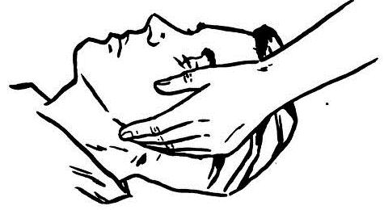

# UNIÃO SERVIÇOS MÉDICOS
## DIRETORIA DE ENSINO, PESQUISA E INSTRUÇÃO PRÉ-HOSPITALAR

---

**MÓDULO C04 — AVALIAÇÃO INICIAL DA VÍTIMA NO APH**
*Biblioteca Curricular: Núcleo Compartilhado (Core Skills)*
*Versão Editorial: 1.0.0 — Padrão Editorial USM*
*Carga Horária Teórica: 1 hora | Público-alvo: Não médicos, educadores, gestores, socorristas e brigadistas*

---

## SUMÁRIO

- [Seção 1 — Em 30 Segundos](#seção-1--em-30-segundos)
- [Seção 2 — Objetivos de Aprendizagem](#seção-2--objetivos-de-aprendizagem)
- [Seção 3 — Introdução e Sistematização do Exame](#seção-3--introdução-e-sistematização-do-exame)
- [Seção 4 — Fundamentação Fisiológica dos Sinais Vitais](#seção-4--fundamentação-fisiológica-dos-sinais-vitais)
- [Seção 5 — Desenvolvimento dos Subtemas](#seção-5--desenvolvimento-dos-subtemas)
  - [5.1 Abordagem Inicial e Impressão Geral](#51-abordagem-inicial-e-impressão-geral)
  - [5.2 Verificação de Responsividade e Escala AVDI](#52-verificação-de-responsividade-e-escala-avdi)
  - [5.3 Avaliação Dinâmica da Respiração](#53-avaliação-dinâmica-da-respiração)
  - [5.4 Reconhecimento de Ameaças Imediatas à Vida (Protocolo XABCDE)](#54-reconhecimento-de-ameaças-imediatas-à-vida-protocolo-xabcde)
  - [5.5 Identificação de Sinais Clínicos de Gravidade](#55-identificação-de-sinais-clínicos-de-gravidade)
  - [5.6 Reavaliação Contínua e Monitoramento](#56-reavaliação-contínua-e-monitoramento)
- [Seção 6 — Quadros Práticos e Matrizes Decisórias](#seção-6--quadros-práticos-e-matrizes-decisórias)
- [Seção 7 — Erros Frequentes e Condutas Proibidas](#seção-7--erros-frequentes-e-condutas-proibidas)
- [Seção 8 — Aplicação Prática Contextualizada (Estudo de Caso)](#seção-8--aplicação-prática-contextualizada-estudo-de-caso)
- [Seção 9 — Pulo do Gato](#seção-9--pulo-do-gato)
- [Seção 10 — Mapa Mental da Avaliação Inicial](#seção-10--mapa-mental-da-avaliação-inicial)
- [Seção 11 — O Que Você Precisa Lembrar](#seção-11--o-que-você-precisa-lembrar)
- [Seção 12 — Referências Bibliográficas e Metadados Editoriais](#seção-12--referências-bibliográficas-e-metadados-editoriais)

---

## SEÇÃO 1 — EM 30 SEGUNDOS

> **VISÃO RÁPIDA DE SOBREVIVÊNCIA**
> 1. **Objetivo primário da avaliação:** Identificar e corrigir imediatamente ameaças iminentes à vida nos primeiros 60 a 90 segundos de contato com a vítima, antes de procurar lesões secundárias como fraturas ou escoriações [1].
> 2. **O primeiro olhar salva:** A "impressão geral" obtida a 3 metros de distância já revela se a vítima está consciente, se sangra ativamente e se respira com desconforto respiratório grave [2].
> 3. **Escala AVDI de responsividade:** Classifica rapidamente o nível neurológico em quatro graus: **A**lerta, responde à **V**oz, responde à **D**or (estímulo tátil firme) ou **I**nconsciente (não responsivo) [3].
> 4. **Sem respiração normal = Parada Cardiorrespiratória (PCR):** Vítima inconsciente com ausência de movimentos torácicos ou apresentando respiração agônica (*gasping*) está em PCR. Não perca tempo checando pulso carotídeo; inicie compressões torácicas [1, 4].
> 5. **O novo paradigma XABCDE:** Em vítimas de trauma, o **X** (Hemorragia Exsanguinante Externa) precede a via aérea. Um sangramento arterial massivo em coxa mata mais rápido do que a falta transitória de ar [5].
> 6. **Reavaliação permanente:** O estado de uma vítima instável pode deteriorar em minutos. Reavalie a respiração e o nível de consciência a cada 2 minutos ou imediatamente após qualquer movimentação [2, 5].

---

## SEÇÃO 2 — OBJETIVOS DE APRENDIZAGEM

Ao concluir o estudo deste módulo, você será capaz de:

1. **Executar a abordagem inicial sistemática**, estabelecendo a impressão geral visual da vítima em menos de 15 segundos.
2. **Aplicar a Escala AVDI** com precisão técnica para estratificar o nível de consciência sem provocar lesões corporais adicionais.
3. **Avaliar clinicamente a mecânica respiratória**, identificando padrões anormais graves como apneia, taquipneia extrema e respiração agônica (*gasping*).
4. **Dominar o algoritmo mnemônico XABCDE**, priorizando intervenções imediatas de controle hemorrágico catastrófico e permeabilidade de via aérea.
5. **Reconhecer sinais precoces de choque circulatório** e hipoperfusão sistêmica através da observação de perfusão capilar, sudorese, palidez e temperatura dérmica.
6. **Estruturar um ciclo de reavaliação periódica**, identificando precocemente sinais de descompensação clínica ou neurológica.

---

## SEÇÃO 3 — INTRODUÇÃO E SISTEMATIZAÇÃO DO EXAME

Em situações de emergência grave, o impulso instintivo da maioria das pessoas sem treinamento é fixar a atenção na lesão visualmente mais chocante — por exemplo, uma fratura exposta de tíbia com osso aparente, um corte profundo na testa com muito sangue no rosto ou uma deformidade ortopédica evidente. Na medicina de emergência, esse fenômeno é conhecido como **distração pela lesão dramática** [5].

Muitas vítimas morrem no APH não pela fratura na perna, mas porque estavam em parada respiratória silenciosa por relaxamento da língua, com hemorragia oculta no abdome ou com asfixia que passou despercebida enquanto os presentes tentavam enfaixar o pé.

Para eliminar essa armadilha fatal, a doutrina mundial de emergência preconiza a **Sistematização da Avaliação Inicial** [1, 5]. Avaliar uma vítima segue uma ordem lógica inflexível: identificamos e tratamos primeiro o que mata mais rápido. Um sangramento arterial massivo mata em 2 a 3 minutos; a obstrução total da via aérea mata em 4 a 6 minutos; a falência ventilatória em 10 minutos; e o choque hemorrágico não tratado em poucas dezenas de minutos [2, 5]. Se essa hierarquia for respeitada, a sobrevida do paciente multiplica-se dramaticamente.

---

## SEÇÃO 4 — FUNDAMENTAÇÃO FISIOLÓGICA DOS SINAIS VITAIS

Os sinais externos apresentados pelo corpo humano refletem a resposta do organismo para manter o fluxo de oxigênio nos órgãos nobres (coração, pulmões e cérebro). Compreender a fisiologia permite ao socorrista antecipar a parada antes que ela aconteça:

### 4.1 O Mecanismo Compensatório do Choque
Quando uma pessoa perde sangue ou sofre colapso cardíaco, os barorreceptores do arco aórtico e do seio carotídeo detectam a queda na pressão de perfusão arterial. O sistema nervoso simpático é ativado instantaneamente, liberando adrenalina e noradrenalina na corrente sanguínea [6]:
- **Vasoconstrição periférica seletiva:** O organismo fecha os vasos sanguíneos da pele, músculos e órgãos abdominais para desviar todo o sangue disponível para o cérebro e o miocárdio.
  - *Manifestação clínica visível:* A pele da vítima torna-se **fria, pálida, acinzentada e pegajosa (sudorese fria)**.
  - *Tempo de Enchimento Capilar (TEC):* Ao pressionar o leito ungueal do dedo da vítima por 5 segundos e soltar, o retorno da coloração rosada em indivíduos normais ocorre em menos de **2 segundos**. No choque, com os capilares contraídos, o enchimento capilar torna-se lento (superior a 2 ou 3 segundos), indicando má perfusão tecidual grave [5, 6].

```
+---------------------------------------------------------------------------------+
|                       CASCATA DE COMPENSAÇÃO DO CHOQUE                          |
|                                                                                 |
|  [ PERDA VOLÊMICA / COLAPSO CARDÍACO ]                                          |
|                 |                                                               |
|                 V                                                               |
|  [ QUEDA DA PRESSÃO ARTERIAL (BARORRECEPTORES) ]                                |
|                 |                                                               |
|                 V                                                               |
|  [ DESCARGA MACIÇA DE ADRENALINA / SIMPÁTICO ]                                  |
|                 |                                                               |
|        +--------+-----------------------+                                       |
|        |                                |                                       |
|        V                                V                                       |
|  [ TAQUICARDIA E TAQUIPNEIA ]    [ VASOCONSTRIÇÃO PERIFÉRICA ]                  |
|  - Coração bate mais rápido      - Vasos da pele e membros se fecham            |
|  - Pulmão ventila mais rápido    - Sangue desviado para o cérebro/coração       |
|  - Tentativa de captar $O_2$     - SINAL: Pele fria, pálida, suor pegajoso e    |
|    e lavar ácido lático                   enchimento capilar lento (> 2s)       |
+---------------------------------------------------------------------------------+
```

### 4.2 A Dinâmica do Nível de Consciência
O córtex cerebral depende de um fluxo sanguíneo contínuo com glicose e oxigênio. Qualquer queda na oxigenação arterial ($PaO_2$) ou na pressão de perfusão cerebral reflete-se imediatamente no comportamento da vítima [6]:
- *Fase inicial de hipóxia cerebral:* Agitação psicomotora, confusão mental, ansiedade inexplicável e fala desconexa. Muitas vezes a vítima é erroneamente rotulada como "agressiva" ou "alcoolizada", quando na verdade seu cérebro está em sofrimento asfixiante ou isquêmico.
- *Fase avançada de hipóxia:* Sonolência progressiva, torpor, resposta apenas a estímulos dolorosos intensos e, finalmente, coma profundo (arresponsividade completa) [3, 6].

---

## SEÇÃO 5 — DESENVOLVIMENTO DOS SUBTEMAS

### 5.1 Abordagem Inicial e Impressão Geral
A avaliação inicia-se antes mesmo de colocar as mãos na vítima. Ao se aproximar a uma distância de 3 a 5 metros, execute a **Impressão Geral da Cena e da Vítima** em 5 segundos [2, 5]:
- **Mecanismo visível:** A vítima está caída no chão de uma escada? Foi ejetada de um veículo? Está caída ao lado de uma barra de supino?
- **Idade e sexo aproximados:** Trata-se de uma criança, gestante, jovem hígido ou idoso frágil?
- **Posição corporal:** Encontra-se em postura antálgica (encolhida de dor), flácida no solo como um boneco de pano (sugestivo de coma/PCR) ou em decúbito ventral (barriga para baixo)?
- **Hemorragias ativas visíveis:** Há poça de sangue em expansão no piso ou vestes ensopadas de vermelho-vivo?
- **Trabalho respiratório audível:** Ouve-se chiado agudo no peito, ronco faríngeo, tosse asfixiante ou silêncio absoluto?

Essa leitura instantânea prepara o socorrista para a prioridade número um ao tocar a vítima.

### 5.2 Verificação de Responsividade e Escala AVDI
Para graduar a integridade funcional do sistema nervoso central, o socorrista ajoelha-se lateralmente ao tronco da vítima e aplica a **Escala AVDI** [3, 5]:

- **A — Alerta:** A vítima está de olhos abertos espontaneamente, acompanha seus movimentos com o olhar e responde de forma lúcida quando você se aproxima.
- **V — Responde à Voz (Verbal):** A vítima está de olhos fechados ou sonolenta, mas abre os olhos, move a cabeça ou balbucia palavras quando você fala em tom firme: *"Olá! Você está me ouvindo? Abra os olhos!"*.
- **D — Responde à Dor / Estímulo Tátil (Doloroso):** A vítima não responde à sua voz. O socorrista realiza estímulo tátil firme, batendo com vigor com as duas mãos sobre ambos os ombros da vítima e chamando em voz alta. Se não responder, aplica-se leve pressão no músculo trapézio (base do pescoço) ou na região supraorbital. A vítima move o braço, contrai o rosto ou emite gemido de dor.
- **I — Inconsciente (Arresponsiva):** A vítima não apresenta qualquer reação motora, ocular ou verbal a estímulos táteis ou dolorosos. Encontra-se completamente flácida.

> [!DANGER]
> **ATENÇÃO: VÍTIMA "I" É UMA EMERGÊNCIA CRÍTICA IMEDIATA**
> Toda vítima classificada como "I" (Inconsciente) tem alto risco de obstrução mecânica de via aérea pela língua e parada respiratória. Deve-se checar a respiração imediatamente e solicitar socorro avançado (192/193) com prioridade máxima [1, 3].

### 5.3 Avaliação Dinâmica da Respiração
Em uma vítima inconsciente, o socorrista deve avaliar a respiração em **no mínimo 5 e no máximo 10 segundos** [1, 4].
- **Como posicionar-se:** Ajoelhe-se ao lado do tórax da vítima. Aproxime seu rosto do nariz e boca dela enquanto fixa seu olhar diretamente na linha do tórax e abdome.
- **O que observar:**
  1. *O tórax expande e retrai de forma simétrica e contínua?*
  2. *Sente-se calor ou fluxo de ar expirado na sua face?*
  3. *Ouve-se murmúrio respiratório regular?*

#### Padrões Críticos de Respiração no APH:
- **Respiração Normal (Eupneia):** Movimento rítmico, silencioso e constante (12 a 20 respirações por minuto no adulto).
- **Apneia:** Ausência total de movimento torácico e de fluxo aéreo por mais de 10 segundos. A vítima está em parada respiratória/PCR [1].
- **Respiração Agônica (Gasping):** O tórax ou o abdome movem-se de forma espasmódica, isolada e com ruído de suspiro sufocado a cada 10, 15 ou 20 segundos. **Gasping NÃO é respiração eficaz.** É um reflexo primitivo de morte encefálica. Trate como Parada Cardiorrespiratória e inicie compressões cardíacas imediatamente [1, 4].
- **Respiração Ruidosa (Ronco ou Estridor):**
  - *Ronco:* Indica obstrução parcial da faringe pela queda da língua em vítimas rebaixadas. Requer alinhamento da cabeça ou abertura de via aérea.
  - *Estridor:* Som metálico agudo estridente na inspiração. Indica edema de glote por anafilaxia ou corpo estranho engasgado na laringe [2].

### 5.4 Reconhecimento de Ameaças Imediatas à Vida (Protocolo XABCDE)
Adotado pelos principais consensos mundiais de trauma (PHTLS 10ª Edição e comitês de APH tático), o protocolo **XABCDE** padroniza a avaliação primária de qualquer vítima traumatizada [5]:

```
+---------------------------------------------------------------------------------+
|                       O ALGORITMO UNIVERSAL XABCDE                              |
|                                                                                 |
|  [ X ] - Hemorragia Exsanguinante Externa (eXsanguinating hemorrhage):          |
|          Controle IMEDIATO com torniquete comercial ou compressão manual direta.|
|                                                                                 |
|  [ A ] - Via Aérea com Controle Cervical (Airway & Cervical spine):             |
|          Abertura manual da via aérea mantendo a cabeça e pescoço alinhados.    |
|                                                                                 |
|  [ B ] - Boa Ventilação e Respiração (Breathing):                               |
|          Verificação de expansão torácica e integridade da parede do tórax.     |
|                                                                                 |
|  [ C ] - Circulação e Perfusão (Circulation):                                   |
|          Avaliação do choque, temperatura de extremidades e enchimento capilar. |
|                                                                                 |
|  [ D ] - Disfunção Neurológica (Disability):                                    |
|          Escala AVDI, verificação de pupilas e movimentação de membros.         |
|                                                                                 |
|  [ E ] - Exposição com Controle Térmico (Exposure & Hypothermia):               |
|          Identificar lesões ocultas e cobrir a vítima com manta para evitar frio.|
+---------------------------------------------------------------------------------+
```

> [!IMPORTANT]
> **ENTENDA O PORQUÊ: O "X" ANTES DO "A" SALVA VIDAS NO TRAUMA**
> Historicamente, o protocolo iniciava-se no "A" (Vias Aéreas). Todavia, a experiência clínica e militar com traumas severos comprovou que um paciente com secção da artéria femoral ou braquial perde 1 litro de sangue a cada 40 segundos. Se o socorrista gastar 2 minutos estabilizando o pescoço e abrindo a boca antes de comprimir a artéria que jorra sangue, o paciente morrerá exsanguinado com a via aérea perfeitamente limpa. O sangue que sai não pode ser reposto no APH; portanto, **estanque o sangue em jato primeiro** [5].

### 5.5 Identificação de Sinais Clínicos de Gravidade
Além das ameaças diretas, o socorrista deve estar atento a indicadores de deterioração iminente que exigem comunicação imediata ao médico do SAMU:
- **Cianose labial ou de extremidades:** Coloração arroxeada ou azulada nas unhas, orelhas e lábios. Sinal inequívoco de dessaturação crítica de oxigênio na hemoglobina circulante [6].
- **Sudorese profusa com palidez cérea:** Paciente pálido, encharcado de suor frio e taquicárdico em repouso. Prenúncio clássico de infarto agudo do miocárdio ou choque hemorrágico interno descompensado.
- **Anisocoria pupilar súbita pós-trauma:** Uma pupila dilatada (midríase) e outra contraída (miose) após batida na cabeça. Sinal de hipertensão intracraniana aguda com herniação cerebral compressiva [5].
- **Respiração com uso de musculatura acessória:** Tiragem intercostal (pele afundando entre as costelas ao respirar) e batimento de asas nasais. Indicativo de falência respiratória exaustiva iminente [2].

### 5.6 Reavaliação Contínua e Monitoramento
A avaliação inicial não é uma foto estática tirada na chegada; ela é um filme em movimento. O estado de uma vítima de trauma ou clínica pode oscilar bruscamente em poucos minutos:
- **Vítima Instável (Inconsciente, com choque ou dificuldade respiratória):** Reavalie a cada **2 minutos** ininterruptamente até a ambulância chegar.
- **Vítima Estável (Consciente, orientada, sinais regulares):** Reavalie a cada **5 a 10 minutos** [2, 5].
- **Gatilhos para reavaliação imediata:** Toda vez que a vítima for movimentada, apresentar piora na fala, vomitar, queixar-se de nova dor ou após a aplicação de uma intervenção (ex.: verificar se o torniquete continua estancando o sangramento após mover a perna).

---

### Figuras de Apoio


*Figura 1 - Tração da mandíbula (jaw thrust) para abertura de via aérea. Crédito: Department of the Army (EUA). Licença: Domínio público. Fonte: Wikimedia Commons.*


*Figura 2 - Inspeção ocular e abertura palpebral no atendimento inicial. Crédito: Baedr-9439. Licença: CC0. Fonte: Wikimedia Commons.*

---

## SEÇÃO 6 — QUADROS PRÁTICOS E MATRIZES DECISÓRIAS

### Quadro 6.1 — Matriz de Triagem Visual Primária (Primeiros 30 Segundos)

| Parâmetro Clínico | Normalidade (Verde) | Alerta Moderado (Amarelo) | Perigo Crítico Imediato (Vermelho) |
|---|---|---|---|
| **Consciência (AVDI)** | Alerta, fala frases completas, orientado no espaço. | Sonolento, responde à voz, fala arrastada ou confusa. | Inconsciente (não responde a chamados nem dor firme nos ombros). |
| **Padrão Respiratório** | 12 a 20 respirações/min, simétrica, silenciosa e suave. | Respiração rápida (> 25/min), ofegante, uso de musculatura do pescoço. | Apneia total, < 8 respirações/min ou suspiros agônicos (*gasping*). |
| **Sangramento** | Ausente ou escoriações leves de capilares sem gotejamento. | Sangramento venoso contínuo moderado estancável por curativo simples. | Sangue jorrando em jato arterial ou ensopando poça rapidamente. |
| **Pele e Perfusão** | Rosada, quente e seca; enchimento capilar < 2 segundos. | Pálida, suor frio nas palmas; enchimento capilar entre 2 e 3 segundos. | Pele acinzentada/marmórea, cianose labial, enchimento capilar > 3s. |

---

### Quadro 6.2 — Protocolo de Manejo da Vítima por Nível de Consciência

| Classificação AVDI | Respiração Presente? | Diagnóstico Presuntivo | Conduta Imediata Obrigatória |
|---|---|---|---|
| **A (Alerta)** | Sim, normal | Vítima lúcida e estável | Manter em repouso confortável, colher histórico (SAMPLE), monitorar e proteger contra o frio. |
| **V ou D (Rebaixado)** | Sim, normal | Trauma craniano, intoxicação, choque inicial ou hipoglicemia | Manter via aérea aberta, acionar SAMU 192, manter imobilização cervical se houve trauma. |
| **I (Inconsciente)** | **SIM, normal** | Coma clínico, síncope profunda, concussão sem parada | **Posição Lateral de Segurança (PLS)** se não houver trauma; manter via aérea pérvia e chamar 192. |
| **I (Inconsciente)** | **NÃO ou Gasping** | **PARADA CARDIORRESPIRATÓRIA (PCR)** | **Iniciar RCP imediatamente (100 a 120 compressões/minuto)** e instalar o DEA com urgência máxima. |

---

## SEÇÃO 7 — ERROS FREQUENTES E CONDUTAS PROIBIDAS

> [!CAUTION]
> ### CATÁLOGO DE ERROS CRÍTICOS NA AVALIAÇÃO INICIAL
> 
> 1. **Fazer a vítima se levantar ou caminhar para "ver se quebrou nada":**
>    - *Por que não fazer:* Em quedas ou colisões, fraturas ocultas na coluna vertebral ou na pelve podem estar sem desvio. Forçar a vítima a ficar em pé projeta fragmentos ósseos afiados contra a medula espinhal ou vasos ilíacos profundos, provocando paralisia permanente instantânea ou choque hemorrágico fatal.
>    - *Conduta correta:* Mantenha a vítima deitada onde caiu até a conclusão da avaliação primária completa e estabilização.
> 
> 2. **Perder mais de 10 segundos procurando pulso carotídeo em vítima inconsciente:**
>    - *Por que não fazer:* Socorristas não médicos falham na localização do pulso carotídeo em quase metade das tentativas reais sob estresse. Atrasar a RCP para "tentar achar o pulso" condena os neurônios da vítima à hipóxia definitiva.
>    - *Conduta correta:* Não procure pulso. Inconsciente + não respira normalmente = massagem cardíaca imediata.
> 
> 3. **Confundir Gasping com respiração normal e não iniciar a RCP:**
>    - *Por que não fazer:* O gasping (suspiro agônico pré-morte) é visualmente interpretado por leigos desavisados como *"ele ainda está respirando fracamente"*. Isso faz com que a reanimação atrase 5 a 10 minutos preciosos, reduzindo a chance de sobrevida a quase zero.
>    - *Conduta correta:* Suspiro isolado, ruidoso e espaçado é sinal de parada cardíaca em curso. Inicie a massagem.
> 
> 4. **Sacudir violentamente a cabeça ou jogar água gelada no rosto da vítima desmaiada:**
>    - *Por que não fazer:* Se houver traumatismo na coluna cervical, sacudir o pescoço lesiona a medula espinhal. Jogar água pode provocar aspiração reflexa do líquido para a traqueia.
>    - *Conduta correta:* Toque com firmeza nos ombros sem mexer no pescoço e chame em voz clara.
> 
> 5. **Abandonar a vítima após a primeira avaliação achando que "já está tudo bem":**
>    - *Por que não fazer:* Choques hipovolêmicos por hemorragias internas ocultas demoram de 10 a 20 minutos para provocar o colapso hemodinâmico completo. Uma vítima que conversa no início pode entrar em parada cardíaca silenciosa minutos depois.
>    - *Conduta correta:* Mantenha vigilância e monitoramento contínuo a cada 2 a 5 minutos até a entrega da ocorrência.

---

## SEÇÃO 8 — APLICAÇÃO PRÁTICA CONTEXTUALIZADA (ESTUDO DE CASO)

### Cenário Simulado
*Local:* Canteiro de obras de um edifício comercial.  
*Horário:* 08h30.  
*Ocorrência:* Um pedreiro de 38 anos despenca de um andaime a 3 metros de altura sobre tábuas e vergalhões metálicos. Seus colegas de trabalho gritam em pânico e cercam a vítima. Um socorrista treinado da brigada da construtora chega ao local 40 segundos após o impacto.

---

### Resolução Técnica Passo a Passo

#### 1. Segurança da Cena e Impressão Geral Rápida (0 a 15 segundos)
- O socorrista para a 4 metros, olha para o andaime para garantir que nenhuma ferramenta ou tábua está em risco de cair sobre sua cabeça.
- Pede aos colegas que se afastem 3 metros para abrir espaço e calça luvas de nitrila.
- **Impressão Geral:** O trabalhador está deitado de costas, imóvel, com poça de sangue vermelho-vivo aumentando em ritmo alarmante ao lado de sua coxa direita, ensopando a calça jeans rasgada. Não há sons vocais audíveis.

#### 2. Prioridade X: Controle da Hemorragia Exsanguinante (15 a 45 segundos)
- O socorrista identifica imediatamente a ameaça crítica de morte: **Hemorragia arterial massiva na coxa (X)**.
- O socorrista não perde tempo avaliando o pulso ou as pupilas. Rasga a calça da vítima, confirma sangramento arterial jorrando por ferimento profundo causado por vergalhão e aplica seu torniquete comercial homologado alto na raiz da coxa direita, apertando a fita e girando o molinete rígido até cessar completamente o jato de sangue. Trava o fuso e anota o horário no fecho.

#### 3. Avaliação Neurológica e Vias Aéreas (A e B) (45 a 70 segundos)
- Com o sangramento contido, o socorrista ajoelha-se no topo da cabeça do trabalhador e segura o pescoço firmemente com as duas mãos em posição neutra (estabilização cervical manual).
- **Aplicação do AVDI:** Chama pelo nome em voz alta: *"José, você me ouve?"*. O trabalhador abre os olhos lentamente, não consegue falar frases completas, mas geme e responde à voz. **Classificação: V (Responde à Voz)**.
- **Avaliação da Respiração (B):** Observa o tórax por 8 segundos. O tórax expande de forma simétrica, com 24 respirações por minuto (taquipneico), sem estridor ou deformidades ósseas visíveis no tórax.

#### 4. Avaliação Circulatória e Choque (C) (70 a 90 segundos)
- Com a cabeça ainda estabilizada por um segundo brigadista instruído pelo líder, o socorrista checa a perfusão: pele fria, sudorese pálida nas bochechas e tempo de enchimento capilar no leito ungueal de 4 segundos (choque hipovolêmico compensado).
- Ordena ao encarregado da obra: *"Ligue 192 para o SAMU agora! Informe queda de 3 metros de altura, vítima sonolenta, hemorragia femoral controlada por torniquete às 08h32 e sinais de choque"*.

#### 5. Proteção Térmica e Monitoramento Contínuo (D e E)
- O socorrista cobre o trabalhador com uma manta térmica aluminizada para evitar hipotermia (fator crítico que agrava a coagulopatia no trauma).
- Mantém o monitoramento da respiração e da consciência a cada 2 minutos até a chegada da equipe de Suporte Avançado do SAMU aos 11 minutos.

---

## SEÇÃO 9 — PULO DO GATO

> [!TIP]
> ### O PULO DO GATO DA UNIÃO: O TESTE DOS 3 DÍGITOS DA CONSCIÊNCIA
> Quando uma vítima está acordada, mas você tem dúvidas se o cérebro dela está sofrendo com falta de oxigênio (hipóxia) ou trauma craniano oculto, fazer perguntas clichês como *"Qual é o seu nome?"* costuma falhar, pois o nome é uma memória biográfica gravada profundamente que pessoas desorientadas repetem no automático.
> 
> **A Técnica das 3 Perguntas Orientadas:**
> Faça três perguntas que exigem cálculo e raciocínio cortical no momento presente:
> 1. *"Você sabe que dia da semana é hoje?"* (Orientação temporal)
> 2. *"Você sabe que lugar é este onde nós estamos?"* (Orientação espacial)
> 3. *"Você se lembra do que estava fazendo logo antes de cair?"* (Memória anterógrada imediata)
> 
> Se a vítima errar o local ou não souber o dia, o cérebro está em sofrimento neurológico importante. Repasse esse dado imediatamente à regulação do SAMU 192.

---

## SEÇÃO 10 — MAPA MENTAL DA AVALIAÇÃO INICIAL

```
                       AVALIAÇÃO INICIAL DA VÍTIMA (C04)
                                       |
    +----------------------------------+----------------------------------+
    |                                  |                                  |
    V                                  V                                  V
IMPRESSÃO GERAL (0-5s)           PROTOCOLO XABCDE                  MONITORAMENTO PERIÓDICO
    |                                  |                                  |
- Varredura da cena              - [X] Estancar sangue em jato      - Instável: a cada 2 min
- Postura e deformidades         - [A] Vias aéreas e cervical       - Estável: a cada 5-10 min
- Trabalho respiratório          - [B] Respiração (Gasping = PCR)   - Gatilhos: vômito, dor,
- Sangramentos maciços           - [C] Choque e perfusão (TEC)        movimentação da vítima
    |                            - [D] AVDI e estado neural         - Manter aquecido (manta)
    +-----------------+          - [E] Exposição e hipotermia                 |
                      |                |                                      |
                      V                V                                      V
             AVALIAÇÃO DA CONSCIÊNCIA E RESPIRAÇÃO NO APH
            - A: Alerta
            - V: Responde à voz
            - D: Responde ao estímulo firme nos ombros
            - I: Inconsciente (Arresponsivo)
                 * Respira normal? ---> Vias livres + PLS
                 * Não respira ou Gasping? ---> INICIAR RCP IMEDIATAMENTE!
```

---

## SEÇÃO 11 — O QUE VOCÊ PRECISA LEMBRAR

1. **Sistematização é vida:** Siga a ordem XABCDE sem pular etapas. Trate primeiro a ameaça mais letal.
2. **O "X" vem antes do "A":** Sangramento arterial pulsátil massivo mata mais rápido que a falta de ar. Estanque o sangue imediatamente com torniquete ou compressão direta firme.
3. **Escala AVDI:** Identifique se a vítima está Alerta, se responde à Voz, se responde à Dor nos ombros ou se está Inconsciente.
4. **Gasping é PCR:** Movimentos respiratórios espasmódicos, agônicos e ruidosos não são respiração. Se a vítima não responde e apresenta gasping, inicie massagem cardíaca imediatamente.
5. **Reconheça o choque:** Pele fria, pálida, suor pegajoso e tempo de enchimento capilar superior a 2 segundos indicam colapso circulatório grave. Aqueça a vítima e acione o SAMU 192.
6. **Nunca abandone a vítima:** A estabilidade aparente é ilusória no trauma; reavalie a respiração e a consciência continuamente até a entrega do paciente aos médicos.

---

## SEÇÃO 12 — REFERÊNCIAS BIBLIOGRÁFICAS E METADADOS EDITORIAIS

### Referências Consultadas (Padrão ABNT NBR 6023)

[1] AMERICAN HEART ASSOCIATION (AHA). **2020 American Heart Association Guidelines for Cardiopulmonary Resuscitation and Emergency Cardiovascular Care**. *Circulation*, Dallas, v. 142, supl. 2, p. S366-S468, 2020. DOI: 10.1161/CIR.0000000000000916. [Com atualizações 2021-2025].

[2] INTERNATIONAL LIAISON COMMITTEE ON RESUSCITATION (ILCOR). **Consensus on Science and Treatment Recommendations for Basic Life Support and First Aid**. *Resuscitation*, v. 156, p. A1-A240, 2020. Disponível em: https://www.ilcor.org.

[3] EUROPEAN RESUSCITATION COUNCIL (ERC). **Guidelines 2021: First Aid**. *Resuscitation*, v. 161, p. 270-290, 2021. DOI: 10.1016/j.resuscitation.2021.02.013.

[4] PERKINS, Gavin D. et al. **European Resuscitation Council Guidelines 2021: Basic Life Support**. *Resuscitation*, v. 161, p. 98-114, 2021. DOI: 10.1016/j.resuscitation.2021.02.003.

[5] AMERICAN COLLEGE OF SURGEONS (ACS). Committee on Trauma. **Prehospital Trauma Life Support (PHTLS)**. 10. ed. Burlington: Jones & Bartlett Learning, 2023.

[6] HALL, John E.; HALL, Michael E. **Guyton and Hall Textbook of Medical Physiology**. 14. ed. Philadelphia: Elsevier, 2021.

---

### METADADOS EDITORIAIS USM

| Parâmetro | Detalhe |
|---|---|
| **Código e Módulo:** | C04 — Avaliação Inicial da Vítima |
| **Biblioteca:** | Núcleo Compartilhado |
| **Status:** | `Aguardando Aprovação Científica` |
| **Data da Redação:** | 19 de outubro de 2026 |
| **Versão:** | 1.0.0 |
| **Validação Científica por IA:** | Conforme diretrizes PHTLS 10ª Ed. e ILCOR/AHA |
| **Próxima Revisão:** | Outubro de 2027 |
