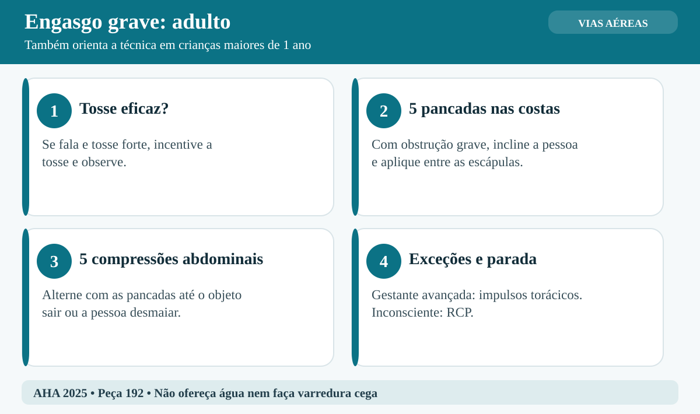
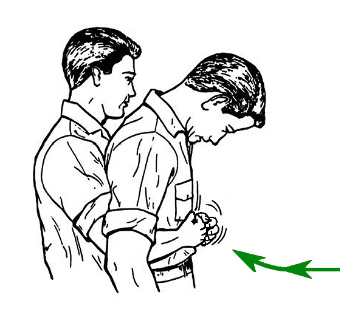
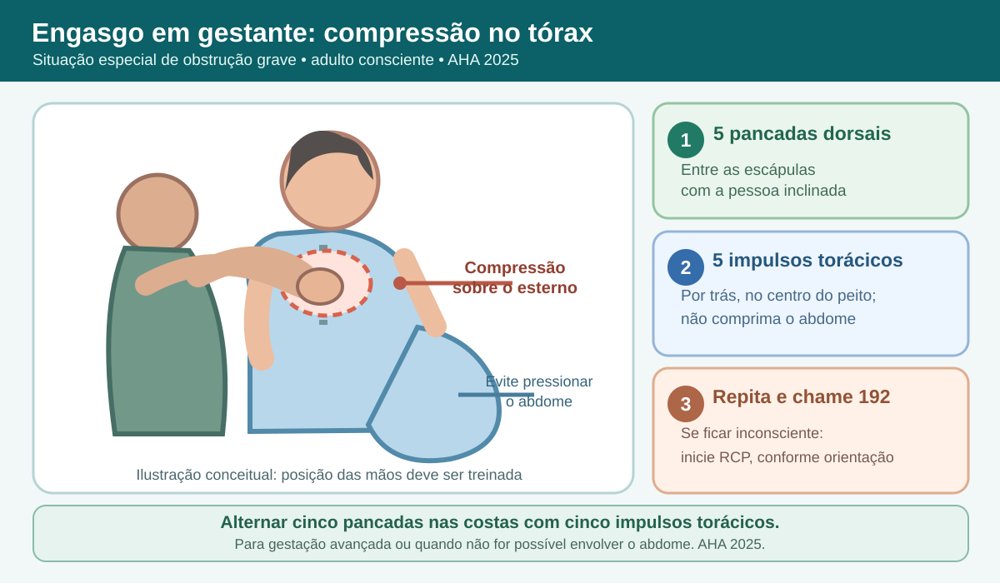
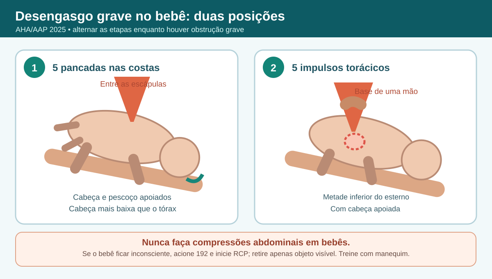
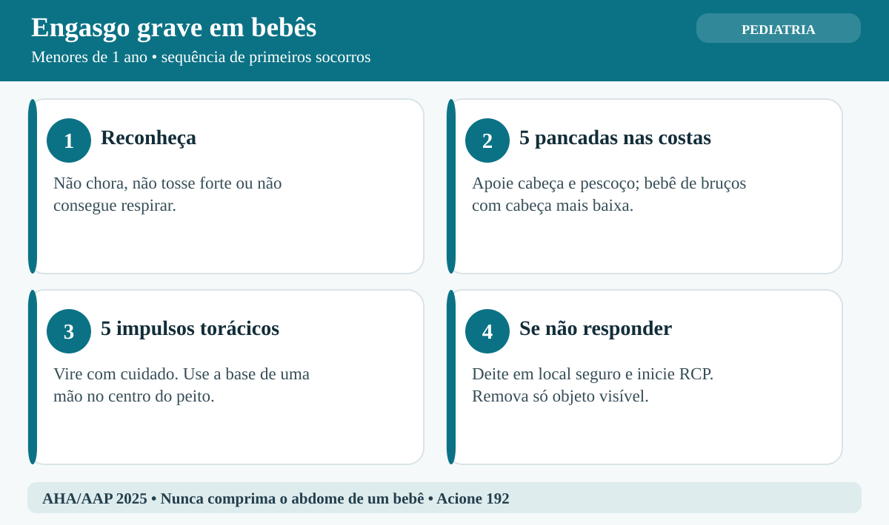
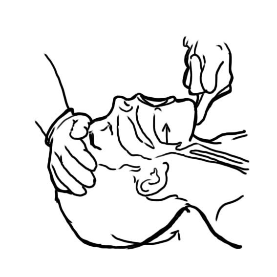

# UNIÃO SERVIÇOS MÉDICOS
## DIRETORIA DE ENSINO, PESQUISA E INSTRUÇÃO PRÉ-HOSPITALAR

---

**MÓDULO C07 — ENGASGO E OBSTRUÇÃO DE VIAS AÉREAS POR CORPO ESTRANHO (OVACE)**
*Biblioteca Curricular: Núcleo Compartilhado (Core Skills)*
*Versão Editorial: 1.0.0 — Padrão Editorial USM*
*Carga Horária Teórica: 1h | Público-alvo: Não médicos, educadores, monitores, gestores e brigadistas*

---

## SUMÁRIO

- [Seção 1 — Em 30 Segundos](#seção-1--em-30-segundos)
- [Seção 2 — Objetivos de Aprendizagem](#seção-2--objetivos-de-aprendizagem)
- [Seção 3 — Introdução e Relevância Epidemiológica da Asfixia](#seção-3--introdução-e-relevância-epidemiológica-da-asfixia)
- [Seção 4 — Anatomia e Fisiopatologia da Obstrução Respiratória](#seção-4--anatomia-e-fisiopatologia-da-obstrução-respiratória)
- [Seção 5 — Desenvolvimento dos Subtemas](#seção-5--desenvolvimento-dos-subtemas)
  - [5.1 Anatomia Funcional e Biofísica das Vias Aéreas](#51-anatomia-funcional-e-biofísica-das-vias-aéreas)
  - [5.2 Diferenciação Diagnóstica: Obstrução Parcial versus Grave](#52-diferenciação-diagnóstica-obstrução-parcial-versus-grave)
  - [5.3 Abordagem Sistemática no Adulto Consciente (Manobra de Heimlich)](#53-abordagem-sistemática-no-adulto-consciente-manobra-de-heimlich)
  - [5.4 Particularidades Críticas: Manejo no Lactente e na Criança](#54-particularidades-críticas-manejo-no-lactente-e-na-criança)
  - [5.5 Atendimento da Vítima com Perda de Consciência](#55-atendimento-da-vítima-com-perda-de-consciência)
  - [5.6 Prevenção de Acidentes e Simulações Educacionais](#56-prevenção-de-acidentes-e-simulações-educacionais)
- [Seção 6 — Quadros Práticos e Algoritmos Comparativos](#seção-6--quadros-práticos-e-algoritmos-comparativos)
- [Seção 7 — Erros Frequentes e Condutas Proibidas](#seção-7--erros-frequentes-e-condutas-proibidas)
- [Seção 8 — Aplicação Prática Contextualizada (Estudo de Caso)](#seção-8--aplicação-prática-contextualizada-estudo-de-caso)
- [Seção 9 — Pulo do Gato](#seção-9--pulo-do-gato)
- [Seção 10 — Mapa Mental da Desobstrução de Vias Aéreas](#seção-10--mapa-mental-da-desobstrução-de-vias-aéreas)
- [Seção 11 — O Que Você Precisa Lembrar](#seção-11--o-que-você-precisa-lembrar)
- [Seção 12 — Referências Bibliográficas e Metadados Editoriais](#seção-12--referências-bibliográficas-e-metadados-editoriais)

---

## GUIA DE ATUAÇÃO — PARA QUEM NÃO É DA ÁREA DA SAÚDE

> **EM UMA EMERGÊNCIA REAL:** Proteja-se, peça ajuda e ligue **192 (SAMU)**. Para fogo, resgate em altura, água, espaço confinado ou ambiente perigoso, ligue **193 (Bombeiros)**. Diga o endereço e siga as instruções da central. Este roteiro orienta as primeiras ações, mas não substitui o treino supervisionado das técnicas práticas.

### Situação: Desengasgo de adultos, crianças e lactentes

**Reconheça os sinais:** Tosse fraca ou silenciosa, incapacidade de falar ou chorar, dificuldade intensa para respirar, possível cianose.

### O que fazer — passo a passo

1. Se a pessoa tosse com força e consegue falar, estimule a tosse e observe.
2. Se a obstrução for grave, peça ajuda e acione 192.
3. Em adultos e crianças acima de 1 ano, alterne 5 pancadas nas costas e 5 compressões abdominais.
4. Em gestante avançada ou quando não é possível comprimir o abdome, use compressões torácicas em vez de abdominais.
5. No bebê menor de 1 ano, alterne 5 pancadas entre as escápulas e 5 impulsos torácicos com a base de uma mão.
6. Apoie cabeça e pescoço do bebê e mantenha a cabeça abaixo do tronco durante essas manobras.
7. Se a vítima perder a consciência, deite-a com segurança e inicie RCP conforme a idade.
8. Ao abrir a boca para ventilar, retire somente objeto claramente visível. Nunca faça varredura cega com o dedo.

### Não faça isto

Não ofereça água. Não pendure bebê pelos pés. Nunca faça compressões abdominais em lactente.

### Exercício prático de aprendizagem

Pratique em manequins adulto e lactente. Treine a diferença entre tosse eficaz e obstrução grave.

**Ao entregar a vítima:** informe horário de início, mudanças na respiração e na consciência, riscos e medidas aplicadas.

**Limites:** não faça procedimentos invasivos, administração de fármacos não prescritos, resgates técnicos ou intervenções que dependam de habilitação profissional. Pratique presencialmente RCP, DEA, controle de sangramento e desengasgo em manequins antes de assumir atendimento.

**Referências operacionais:** Ministério da Saúde — SAMU 192 (https://www.gov.br/saude/pt-br/composicao/saes/samu-192/samu-192); AHA/AAP — RCP e primeiros socorros 2025 (https://cpr.heart.org/en/resuscitation-science/cpr-and-ecc-guidelines); AHA/Cruz Vermelha — Primeiros Socorros 2024 (https://cpr.heart.org/en/resuscitation-science/2024-first-aid-guidelines).

---

## SEÇÃO 1 — EM 30 SEGUNDOS

> **VISÃO RÁPIDA DE SOBREVIVÊNCIA**
> 1. **Diferença vital de conduta:** Se a pessoa estiver tossindo com força, falando ou gemendo, a obstrução é **leve (parcial)**. **NÃO dê tapas nas costas e NÃO faça manobras.** Apenas incentive a vítima a continuar tossindo [1].
> 2. **Sinal universal de asfixia:** Vítima leva as duas mãos ao pescoço com expressão de pânico, tosse inaudível/muda, sem conseguir emitir qualquer som ou respirar. A obstrução é **grave (total)** e requer intervenção imediata [2].
> 3. **Desengasgo no adulto e na criança maior:** Na obstrução grave, alterne 5 pancadas nas costas e 5 compressões abdominais. Para gestantes avançadas, faça compressões torácicas em vez de abdominais [AHA 2025].
> 4. **Protocolo exclusivo do lactente (< 1 ano):** **JAMAIS aplique compressões abdominais em bebês** (risco de ruptura hepática e esplênica). Alterne **5 golpes firmes nas costas** (com o bebê inclinado de cabeça para baixo no antebraço) com **5 compressões torácicas** com a base de uma mão no centro do peito [1, 4].
> 5. **Se a vítima desmaiar (arresponsividade):** Apoie-a suavemente no chão para evitar traumatismo craniano, ligue 192 (ou designe alguém) e **inicie imediatamente ciclos de RCP (30 compressões torácicas)**. A cada abertura de via aérea, olhe a boca; se enxergar o objeto solto, retire-o com pinça digital [1, 2].
> 6. **Nunca faça varredura às cegas:** É terminantemente proibido enfiar o dedo dentro da garganta sem enxergar o corpo estranho, pois isso empurra o objeto contra a glote, vedando a traqueia definitivamente [1, 5].

---

## SEÇÃO 2 — OBJETIVOS DE APRENDIZAGEM

Ao concluir o estudo deste módulo, o participante deverá ser capaz de:

1. **Descrever a anatomia funcional das vias aéreas superiores**, compreendendo a relação entre a faringe, epiglote, laringe e traqueia.
2. **Classificar com rapidez clínica** a obstrução em leve (parcial) ou grave (total) através da tosse e da capacidade fonatória.
3. **Executar as manobras de desengasgo no adulto consciente**: alternar cinco pancadas dorsais e cinco compressões abdominais; em gestantes avançadas ou quando não for possível circundar o abdome, alternar com impulsos torácicos.
4. **Dominar com rigor técnico o protocolo neonatal e pediátrico de desobstrução**, alternando golpes dorsais e compressões torácicas.
5. **Manejar a transição da vítima consciente para a inconsciência**, adaptando a ressuscitação cardiopulmonar à etiologia asfíxica.
6. **Implementar medidas preventivas institucionais em escolas e refeitórios**, conforme as diretrizes da Lei Lucas (Lei Federal nº 13.722/2018).

---

## SEÇÃO 3 — INTRODUÇÃO E RELEVÂNCIA EPIDEMIOLÓGICA DA ASFIXIA

**LEITURA GUIADA — COMECE AQUI:** O engasgo grave acontece quando algo bloqueia a passagem de ar. Uma pessoa que tosse com força pode conseguir eliminar o objeto sozinha. Já quem não consegue falar, chorar ou respirar precisa de ajuda imediata, com técnica adequada à idade.

O engasgo grave ocorre quando um alimento ou objeto bloqueia a passagem de ar. Crianças pequenas têm risco especial porque exploram objetos com a boca e ainda estão aprendendo a mastigar. Adultos também podem se engasgar, especialmente quando têm dificuldade para engolir. O sinal decisivo é a incapacidade de tossir com força, falar ou respirar [1, 6].

Em adultos e idosos, o engasgo grave ocorre comumente associado à ingestão rápida de grandes pedaços de carne pouco mastigados (o clássico "bife de churrasco"), frequentemente agravado pelo uso concomitante de álcool, próteses dentárias mal adaptadas que diminuem a sensibilidade palatina ou doenças neurológicas degenerativas prévias (como sequelas de AVC, Doença de Parkinson ou demências senis) [2, 5].

Uma obstrução grave pode deteriorar rapidamente, mas o tempo até inconsciência ou parada varia com idade, condição clínica e grau de obstrução. Reconheça incapacidade de falar, tossir ou respirar, acione o serviço de emergência cedo e aplique a sequência apropriada à faixa etária. A ação imediata de quem presencia é importante, mas não substitui o acionamento do resgate.

---

## SEÇÃO 4 — ANATOMIA E FISIOPATOLOGIA DA OBSTRUÇÃO RESPIRATÓRIA

> [!NOTE]
> **Por que isso acontece?** As pancadas nas costas e os impulsos abdominais ou torácicos tentam movimentar ar e deslocar o objeto que impede a respiração. No lactente, as compressões abdominais podem causar lesões; por isso, a técnica usa pancadas dorsais e impulsos torácicos.

### 4.1 A Encruzilhada Aerodigestiva
A faringe é um canal anatômico compartilhado tanto pela passagem de alimentos (sistema digestório) quanto pela passagem de ar atmosférico (sistema respiratório). Na sua base, a via aérea bifurca-se:
- Anteriormente localiza-se a **laringe**, que conduz o ar para a traqueia e pulmões.
- Posteriormente localiza-se o **esôfago**, que conduz o bolo alimentar para o estômago [7].

Durante a deglutição normal, uma estrutura fibrocartilaginosa em forma de folha denominada **epiglote** é tracionada para baixo como uma válvula de fechamento mecânico, ocluindo a abertura da laringe (a fenda glótica) e desviando a comida obrigatoriamente para o esôfago. 
- *Quando ocorre o engasgo:* Se a pessoa ri, fala, engole apressadamente ou sofre distúrbio reflexo neuromuscular, a epiglote não se fecha a tempo. O bolo alimentar sólido penetra na via aérea e fica entalado na laringe ou sobre as cordas vocais, impedindo qualquer fluxo aéreo de entrada ou saída [7, 8].

```
+---------------------------------------------------------------------------------+
|                        A ENCRUZILHADA DA GLOTE E EPIGLOTE                       |
|                                                                                 |
|                   [ FARINGE POSTERIOR ]                                         |
|                             |                                                   |
|             +---------------+---------------+                                   |
|             |                               |                                   |
|             V                               V                                   |
|       [ EPIGLOTE ]                    [ ESÔFAGO ]                               |
|             |                   (Passagem normal do alimento)                   |
|      (Falha no fechamento)                  |                                   |
|             V                               V                                   |
|       [ LARINGE ]                      [ ESTÔMAGO ]                             |
|             |                                                                   |
|   [ CORPO ESTRANHO IMPACTADO ] ---> Oclusão mecânica da fenda glótica           |
|             |                                                                   |
|             V                                                                   |
|       [ TRAQUEIA ] <--------------- Vácuo / Impossibilidade de entrada de ar    |
|             |                                                                   |
|             V                                                                   |
|   [ HIPÓXIA AGUDA BRUTAL ] -------> Perda da consciência em 90 a 120 segundos   |
+---------------------------------------------------------------------------------+
```

### 4.2 O Princípio Biofísico da Manobra de Heimlich: A "Tosse Artificial"
Desenvolvida pelo médico norte-americano Henry Heimlich em 1974, a manobra de compressão subdiafragmática baseia-se na **lei da mecânica dos fluidos e compressão de gases** [8]:
- Os pulmões humanos nunca se esvaziam completamente; mesmo após uma expiração forçada, permanece nos alvéolos um **Volume Residual** de aproximadamente 1.000 a 1.200 mL de ar.
- O músculo diafragma separa a cavidade abdominal da cavidade torácica.
- Quando o socorrista aplica uma força súbita para dentro e para cima no abdome (logo abaixo do diafragma), a pressão intra-abdominal eleva-se bruscamente, empurrando o diafragma para cima contra a base dos pulmões.
- Essa pressão positiva súbita comprime o ar contido nos pulmões, gerando uma onda de choque de pressão intratorácica que viaja pela traqueia, funcionando como uma **tosse artificial forçada**. Essa pressão empurra o corpo estranho para fora da laringe em direção à boca [1, 8].

---

## SEÇÃO 5 — DESENVOLVIMENTO DOS SUBTEMAS

### 5.1 Anatomia Funcional e Biofísica das Vias Aéreas
As vias aéreas da criança e do adulto possuem diferenças anatômicas capitais que mudam as técnicas de socorro [4, 7]:
- **No adulto:** O ponto mais estreito da via aérea superior é a fenda glótica (espaço entre as cordas vocais). O diâmetro traqueal médio é de 15 a 20 mm.
- **No lactente (< 1 ano):** O ponto mais estreito é a cartilagem cricoide, abaixo das cordas vocais. A via aérea do bebê tem o diâmetro aproximado do dedo mindinho da própria criança (4 a 5 mm). Qualquer fragmento alimentar sólido (uva inteira, bala dura, moeda, pedaço de salsicha ou tampa de caneta) atua como uma rolha perfeita [4, 6]. Além disso, o abdome do bebê possui o fígado e o baço proporcionalmente maiores e desprotegidos pelas costelas, o que torna as compressões abdominais violentas estritamente proibidas pelo altíssimo risco de laceração e hemorragia interna maciça.

### 5.2 Diferenciação Diagnóstica: Obstrução Parcial versus Grave
Antes de encostar as mãos na vítima, o socorrista deve fazer uma única pergunta em voz clara: *"Você está engasgado? Você consegue falar?"* [1, 2].

#### Obstrução Leve (Parcial):
- **Manifestações clínicas:** A vítima responde verbalmente, consegue falar frases ou palavras (mesmo com voz rouca), tosse com força e consegue inspirar o ar entre as tosses.
- **Conduta mandatória:** **NÃO INTERFIRA.** Não dê tapas nas costas, não aperte a barriga e não ofereça água. A tosse espontânea da própria pessoa gera pressões subglóticas superiores a qualquer manobra externa artificial [1]. Estimule energicamente: *"Tussa com força! Continue tossindo!"*. Permaneça ao lado dela monitorando.

#### Obstrução Grave (Total):
- **Manifestações clínicas:** A vítima não consegue falar uma única palavra; tosse silenciosa, fraca ou totalmente inaudível; não há fluxo de ar saindo da boca ou do nariz; presença de estridor agudo estridente ao tentar inspirar; cianose labial progressiva; e o clássico **Sinal Universal de Asfixia** (levar as mãos espalmadas ao pescoço em desespero) [1, 2].
- **Conduta mandatória:** **AÇÃO IMEDIATA.** Iniciar manobras de desobstrução física sem hesitar.

### 5.3 Abordagem Sistemática no Adulto Consciente (Manobra de Heimlich)


*Figura complementar — Sequência atual de desengasgo no adulto: cinco pancadas dorsais e cinco compressões abdominais. Ilustração original União Serviços Médicos (2026), baseada em AHA 2025; não reproduz material gráfico de terceiros.*

Na obstrução grave em adultos conscientes, as diretrizes AHA 2025 orientam alternar **5 pancadas firmes entre as escápulas** e **5 compressões abdominais**. Repita até a expulsão do objeto ou a perda de consciência. As instruções abaixo descrevem a etapa abdominal [1, 3]:



*Figura 1 — Compressões abdominais em vítima consciente (manobra de Heimlich). Crédito: US Army Medical Department Center and School. Licença: Domínio público. Fonte: Wikimedia Commons.*

1. **Posicionamento do Socorrista:** Posicione-se em pé, atrás da vítima. Passe seus braços ao redor da cintura dela, por baixo das axilas.
2. **Base de Apoio:** Afaste as pernas e coloque um de seus pés entre os pés da vítima. Isso cria uma base sólida de sustentação caso a vítima desmaie repentinamente, permitindo que você a deslize com segurança pelo seu corpo até o chão sem sofrer queda violenta.
3. **Ponto de Compressão:**
   - Feche uma das mãos em punho.
   - Posicione a face plana do polegar da mão fechada contra a parede abdominal da vítima, na linha média, **dois dedos acima da cicatriz umbilical (umbigo) e bem abaixo da ponta do osso esterno (apêndice xifoide)**.
   - Segure o punho firmemente com a outra mão espalmada por cima.
4. **Execução das Compressões:**
   - Aplique uma série de compressões abdominais rápidas, vigorosas e individualizadas, em um movimento direcionado **para dentro e para cima** (movimento em forma de anzol ou "letra J") [1, 3].
   - Cada compressão deve ser um golpe isolado e com força suficiente para tentar expelir o corpo estranho.
   - Alterne os 5 golpes nas costas com 5 compressões abdominais até o objeto sair ou a vítima perder a consciência.

> [!WARNING]
> **VARIAÇÃO ANATÔMICA: GESTANTES AVANÇADAS E PESSOAS COM OBESIDADE MÓRBIDA**
> Em gestantes na fase avançada da gravidez ou quando não é possível envolver o abdome com os braços, **não use compressões abdominais**.
> - Comece com **5 pancadas firmes entre as escápulas**, mantendo a pessoa inclinada para a frente.
> - Se a obstrução grave persistir, posicione os braços ao redor do tórax e faça **5 impulsos torácicos sobre o esterno**, evitando o abdome.
> - Alterne as duas etapas até o objeto sair ou a pessoa perder a consciência. Acione **192**. Se ficar inconsciente, inicie RCP conforme o treinamento e as orientações da central [1, 3].


*Ilustração autoral USM — variação para gravidez avançada ou impossibilidade de envolver o abdome, conforme AHA 2025. Treine a técnica com instrutor.*

### 5.4 Particularidades Críticas: Manejo no Lactente e na Criança


*Ilustração autoral USM — apoio para estudo do desengasgo em lactentes; nunca realizar compressões abdominais em bebês.*



*Figura complementar — Sequência de desengasgo em lactentes: cinco pancadas nas costas e cinco impulsos torácicos. Ilustração original União Serviços Médicos (2026), baseada em AHA/AAP 2025; não reproduz material gráfico de terceiros.*


#### 5.4.1 Protocolo Oficial para Lactentes (Bebês < 1 ano):
Se o bebê parar de chorar, não emitir som, apresentar tosse muda e ficar arroxeado (cianótico), aplique imediatamente o protocolo de **5 Pancadas Dorsais e 5 Compressões Torácicas** [1, 4]:

1. Apoie o bebê de bruços em seu antebraço, sustentando a cabeça e o pescoço. Mantenha a cabeça abaixo do tronco.
2. Aplique **5 pancadas firmes entre as escápulas** com a base da mão livre.
3. Apoie a nuca, vire o bebê cuidadosamente de barriga para cima e mantenha a cabeça abaixo do tronco.
4. Aplique **5 impulsos torácicos com a base de uma mão** sobre a metade inferior do esterno. Essa manobra de desengasgo não segue a regra de profundidade ou ritmo da RCP.
5. Alterne as duas etapas até o objeto sair ou o bebê perder a resposta. Nesse último caso, **inicie RCP** e retire somente objeto claramente visível ao abrir a boca.

**Nunca faça compressões abdominais em lactentes.**

#### 5.4.2 Manejo em Crianças Maiores (> 1 ano):
Em crianças com mais de um ano com obstrução grave e ainda conscientes, alterne 5 golpes nas costas e 5 compressões abdominais; posicione-se de modo estável e adequado ao tamanho da criança. Em lactentes, faça 5 golpes nas costas alternados com 5 compressões torácicas — **nunca compressões abdominais** [1, 4].

### 5.5 Atendimento da Vítima com Perda de Consciência


*Figura 2 — Manobra de inclinação da cabeça e elevação do mento (head-tilt/chin-lift). Crédito: Another-anon-artist-234. Licença: CC0. Fonte: Wikimedia Commons.*

Se o corpo estranho não for desobstruído a tempo e a vítima desmaiar (arresponsividade):
1. **Amparo na queda:** Apoie o corpo da vítima suavemente até o piso firme em decúbito dorsal.
2. **Acione o Suporte Avançado:** Aponte para alguém e mande ligar 192 e trazer o DEA.
3. **Inicie imediatamente a RCP (30 compressões torácicas):** As compressões torácicas manuais geram pressões no ar da traqueia comparáveis às compressões abdominais, além de manterem a perfusão cerebral mínima [1, 2].
4. **Verificação visual da via aérea:** Após cada ciclo de 30 compressões, ao abrir a via aérea para tentar ventilar, **olhe dentro da cavidade oral da vítima**:
   - *Se o corpo estranho estiver VISÍVEL e solto:* Faça a pinça com o indicador e remova o objeto com cuidado.
   - *Se você NÃO enxergar nada:* **NÃO coloque o dedo.** Continue a RCP imediatamente (tente ventilar ou continue as compressões contínuas) [1, 5].

### 5.6 Prevenção de Acidentes e Simulações Educacionais
A prevenção é o pilar mais eficiente da segurança da vida. Conforme preconizado pelas ações da **Lei Lucas (Lei Federal nº 13.722/2018)** nas escolas brasileiras [9]:
- Evitar oferecer alimentos esféricos e lisos a crianças menores de 4 anos sem corte longitudinal (uvas, tomates-cereja e azeitonas devem ser obrigatoriamente cortados em 4 partes no sentido do comprimento).
- Proibir brinquedos pequenos com peças destacáveis sem certificação do INMETRO para a faixa etária.
- Orientar os alunos a não correr, rir ou pular com comida ou pirulitos na boca durante o recreio.
- Estimular a mastigação pausada e atenta em refeitórios corporais e escolares.

---

---

## SEÇÃO 6 — QUADROS PRÁTICOS E ALGORITMOS COMPARATIVOS

### Quadro 6.1 — Matriz Decisória Rápida no Engasgo (OVACE)

| Perfil da Vítima | Padrão Respiratório e Vocal | Diagnóstico Clínico | Conduta Imediata Obrigatória |
|---|---|---|---|
| **Qualquer Idade** | Tosse vigorosa, fala entrecortada, consegue puxar o ar. | **Obstrução Parcial (Leve)** | **Não tocar.** Apenas incentivar a tosse contínua. Manter vigilância visual. |
| **Adulto Consciente** | Não fala, não tosse, mãos no pescoço, cianose labial. | **Obstrução Total (Grave)** | **Alterne 5 pancadas nas costas e 5 compressões abdominais (AHA 2025).** |
| **Gestante avançada ou abdome que não pode ser circundado** | Obstrução grave, sem tosse eficaz. | **Obstrução grave** | **Alterne 5 pancadas nas costas e 5 impulsos torácicos**, conforme AHA 2025. |
| **Lactente (< 1 ano)** | Bebê não chora, tosse muda, boca arroxeada, sem ar. | **Obstrução Total Infantil** | **5 Pancadas Dorsais** alternadas com **5 Compressões Torácicas**. Sem Heimlich! |
| **Vítima Inconsciente** | Desmaiou após o engasgo, arresponsiva no piso. | **Parada Respiratória por OVACE** | Chamar 192 e **iniciar ciclos de RCP (compressões torácicas)**. Olhar a boca antes de soprar. |

---

### Quadro 6.2 — Comparativo das Técnicas de Desobstrução por Faixa Etária

| Parâmetro Técnico | Lactente (< 1 ano) | Criança (1 a 8 anos) | Adulto e Adolescente |
|---|---|---|---|
| **Posicionamento do Socorrista** | Sentado, apoiando o bebê no antebraço e coxa. | Ajoelhado no piso atrás da criança. | Em pé atrás da vítima, com base de pernas aberta. |
| **Técnica Dorsal** | 5 pancadas firmes com calcanhar da mão na escápula. | Parte da sequência AHA 2025: 5 pancadas dorsais alternadas com 5 compressões abdominais [3]. |
| **Técnica Abdominal** | **TERMINANTEMENTE PROIBIDA.** | Manobra de Heimlich suave com punho fechado. | Manobra de Heimlich vigorosa em formato de "J". |
| **Técnica no Inconsciente** | RCP pediátrica (30:2 ou 15:2) no solo; olhar a boca. | RCP pediátrica no solo; olhar a boca. | RCP adulta (compressões contínuas ou 30:2); olhar a boca. |


---

## SEÇÃO 7 — ERROS FREQUENTES E CONDUTAS PROIBIDAS

> [!CAUTION]
> **Erro que pode prejudicar a vítima:** Em obstrução grave, alterne cinco pancadas nas costas e cinco compressões abdominais em adultos e crianças maiores de um ano. Para bebês, são cinco pancadas dorsais e cinco impulsos torácicos com a base de uma mão. Não faça varredura cega na boca.

> [!CAUTION]
> ### CATÁLOGO DE PRÁTICAS EMPÍRICAS NOCIVAS NO ENGASGO
> 
> 1. **Fazer varredura digital às cegas com os dedos dentro da garganta:**
>    - *Por que não fazer:* Em mais de 80% dos casos de varredura cega, a ponta do dedo do socorrista empurra o pedaço de carne ou bala que estava solto na faringe diretamente contra a entrada da laringe, impactando o objeto sob pressão e transformando uma obstrução parcial reversível em obstrução total irreversível. Além disso, a criança morde reflexamente os dedos do socorrista.
>    - *Conduta correta:* Só introduza o dedo se você estiver vendo o objeto nitidamente solto na cavidade oral.
> 
> 2. **Oferecer água, miolo de pão, farinha ou azeite para "empurrar o engasgo":**
>    - *Por que não fazer:* A via aérea está bloqueada. Qualquer alimento sólido ou líquido colocado na boca escorrerá e ficará represado sobre o objeto entalado. Se o paciente respirar ou for comprimido, esse líquido causará broncoaspiração maciça e asfixia fulminante.
>    - *Conduta correta:* Mantenha jejum absoluto. Nada deve ser ingerido.
> 
> 3. **Dar tapas nas costas de um adulto em pé com obstrução parcial:**
>    - *Por que não fazer:* Em um adulto em pé que ainda está tossindo, vibrar as costas sem inclinar o tronco pode fazer com que o objeto solto caia por gravidade ainda mais fundo na traqueia e nos brônquios fontes.
>    - *Conduta correta:* Deixe a pessoa tossir por conta própria.
> 
> 4. **Fazer compressão abdominal (Heimlich) em bebês com menos de 1 ano:**
>    - *Por que não fazer:* No lactente, o gradiente anatômico é frágil. Pressionar o abdome com punho fechado causa estiramento e ruptura do fígado e do baço, gerando hemoperitônio (hemorragia abdominal interna letal).
>    - *Conduta correta:* Utilize estritamente as pancadas dorsais e compressões torácicas com a base de uma mão.
> 
> 5. **Levantar os braços da pessoa engasgada ("levanta os braços que passa"):**
>    - *Por que não fazer:* Trata-se de uma lenda popular sem nenhum fundamento anatômico ou biofísico. Erguer os braços não altera o diâmetro da laringe nem desloca o corpo estranho, apenas posterga o início da Manobra de Heimlich real.

---

## SEÇÃO 8 — APLICAÇÃO PRÁTICA CONTEXTUALIZADA (ESTUDO DE CASO)

> [!TIP]
> **Decisão no caso prático:** Durante o lanche, uma criança de três anos não consegue tossir nem falar. Um adulto pede 192 e inicia a sequência de cinco pancadas nas costas e cinco compressões abdominais. Se ela desmaiar, a conduta muda para RCP.

### Cenário Simulado
*Local:* Cantina de uma escola de ensino fundamental.  
*Horário:* 12h20.  
*Ocorrência:* Durante o almoço escolar, um aluno de 9 anos engasga-se com um pedaço de salsicha de cachorro-quente. O estudante levanta-se bruscamente da cadeira com os olhos arregalados, leva ambas as mãos ao pescoço, não consegue emitir qualquer som ou tossir e apresenta lábios arroxeados. Uma professora treinada pela Lei Lucas encontra-se a 4 metros de distância.

---

### Resolução Técnica Passo a Passo

#### 1. Reconhecimento Diagnóstico Instantâneo (0 a 5 segundos)
- A professora aproxima-se rapidamente, ajoelha-se parcialmente para ficar à altura dos olhos do aluno e pergunta: *"Pedro, você engasgou? Consegue falar com a professora?"*.
- O aluno acena desesperadamente com a cabeça que "sim" (engasgado), mas não emite som algum; não há tosse audível e seus lábios estão cianóticos.
- **Diagnóstico:** Obstrução de Vias Aéreas por Corpo Estranho (OVACE) grave / total.

#### 2. Execução da Manobra de Heimlich Pediátrica (5 a 25 segundos)
- A professora posiciona-se em pé atrás do aluno, afasta os pés colocando um deles entre as pernas da criança para formar base de sustentação.
- Abraça o abdome do aluno passando os braços sob as axilas.
- Fecha o punho da mão direita com o polegar voltado para a barriga do aluno, posicionando-o dois dedos acima do umbigo e abaixo do esterno. Segura o punho firmemente com a mão esquerda.
- Comanda mentalmente e aplica **4 compressões abdominais vigorosas e rápidas para dentro e para cima em forma de anzol**.

#### 3. Desfecho Positivo e Recuperação
- Na quarta compressão, a pressão de ar residual dos pulmões ejeta com força um cilindro sólido de salsicha pela boca do aluno, que cai no chão da cantina.
- O estudante puxa uma inspiração profunda e ruidosa, tosse vigorosamente e começa a chorar de alívio, com a coloração dos lábios retornando instantaneamente ao tom rosado normal.

#### 4. Avaliação e Encaminhamento Pós-Manobra
- A professora acolhe a criança, senta-a em local confortável e arejado e monitora a respiração por 10 minutos.
- **Regra médica pós-Heimlich:** A professora avisa a coordenação e os pais para que a criança seja avaliada por um médico pediatra no pronto-atendimento, visto que compressões abdominais vigorosas justificam checagem clínica preventiva contra contusões abdominais ou microlesões musculares, além de descartar aspiração de pequenos fragmentos residuais [1, 9].

---

## SEÇÃO 9 — PULO DO GATO

> [!TIP]
> ### O PULO DO GATO DA UNIÃO: A AUTO-HEIMLICH (O QUE FAZER SE VOCÊ ENGASGAR SOZINHO)
> Se você estiver sozinho em sua residência ou no escritório, engasgar gravemente com um pedaço de carne e não conseguir respirar ou pedir ajuda por telefone, você tem menos de 60 segundos antes de perder os sentidos.
> 
> **A Técnica da Auto-Heimlich:**
> 1. Feche sua própria mão em punho, coloque o polegar dois dedos acima do seu umbigo, cubra com a outra mão e comprima para dentro e para cima contra o seu próprio corpo com toda a força disponível.
> 2. Se a força dos seus braços for insuficiente, **use o encosto rígido de uma cadeira firme de jantar ou o parapeito de uma mesa**:
>    - Apoie a região do seu abdome (entre o umbigo e a costela) diretamente contra a borda superior do encosto da cadeira.
>    - Projete todo o peso do seu próprio tronco bruscamente contra a cadeira, em impulsos repetidos para cima.
> 
> Esse impacto forçado utiliza a inércia do seu próprio peso corporal para elevar o diafragma e expelir o corpo estranho, salvando a sua própria vida sem necessidade de outra pessoa.

---

## SEÇÃO 10 — MAPA MENTAL DA DESOBSTRUÇÃO DE VIAS AÉREAS

```
                     ENGASGO E OBSTRUÇÃO DE VIAS AÉREAS - OVACE (C07)
                                            |
         +----------------------------------+----------------------------------+
         |                                  |                                  |
         V                                  V                                  V
  OBSTRUÇÃO PARCIAL (LEVE)           OBSTRUÇÃO TOTAL (GRAVE)            VÍTIMA INCONSCIENTE
         |                                  |                                  |
  - Vítima tosse e fala              - Não fala e não tosse             - Desabou no solo
  - Consegue puxar ar                - Sinal universal (mãos no colo)   - Apoiar queda suave
  - NÃO INTERFERIR                   - Agir imediatamente!              - Ligar 192 e pedir DEA
  - NÃO dar tapas                    - Manobra por faixa etária:        - Iniciar RCP (30 compressões)
  - Apenas incentivar a                     |                           - Olhar a cavidade oral
    tosse espontânea                        V                             antes de ventilar
                                +-----------+-----------+               - Se visível: pinçar
                                |                       |               - NÃO varrer às cegas!
                                V                       V
                        ADULTO / CRIANÇA       LACTENTE (< 1 ANO)
                        - Heimlich no abdome   - NÃO comprimir abdome
                        - Para dentro e cima   - 5 pancadas nas costas
                        - Gestante/Obeso:      - 5 compressões no peito
                          compressão no peito  - Cabeça em declive
```

---

## SEÇÃO 11 — O QUE VOCÊ PRECISA LEMBRAR

1. **Tosse forte é sinal de ar passando:** Se a vítima tosse e consegue falar, não dê tapas nem aperte a barriga. Apenas mande ela continuar tossindo.
2. **Sinal universal é ordem de ação:** Mãos no pescoço sem conseguir emitir som indica asfixia total. Inicie manobras imediatas.
3. **Adulto com obstrução grave:** Comece com 5 pancadas nas costas. Depois, faça 5 compressões abdominais. Alterne até sair o corpo estranho ou a vítima perder a resposta.
4. **Gestantes e obesos têm exceção:** Não aperte a barriga; faça compressões vigorosas diretamente no centro do osso esterno (no peito).
5. **Bebês nunca recebem Heimlich:** No lactente menor de 1 ano, alterne 5 pancadas secas nas costas com 5 compressões torácicas no centro do peito, mantendo a cabeça mais baixa que o corpo.
6. **Nunca varra a boca às cegas:** Enfiar o dedo sem enxergar empurra o objeto mais fundo. Retire apenas o que estiver visível e solto.
7. **Desmaiou = Massagem Cardíaca:** Vítima de engasgo que fica inconsciente deve receber RCP imediata no solo, checando a boca a cada ciclo de compressões.

---

## SEÇÃO 12 — REFERÊNCIAS BIBLIOGRÁFICAS E METADADOS EDITORIAIS

### Referências Consultadas (Padrão ABNT NBR 6023)

[1] AMERICAN HEART ASSOCIATION (AHA). **2025 American Heart Association Guidelines for Cardiopulmonary Resuscitation and Emergency Cardiovascular Care: Adult Basic Life Support and Foreign-Body Airway Obstruction**. Disponível em: https://cpr.heart.org/en/resuscitation-science/cpr-and-ecc-guidelines/adult-basic-life-support.

[2] INTERNATIONAL LIAISON COMMITTEE ON RESUSCITATION (ILCOR). **Consensus on Science and Treatment Recommendations for Foreign Body Airway Obstruction**. *Resuscitation*, v. 156, p. A1-A240, 2020. Disponível em: https://www.ilcor.org.

[3] EUROPEAN RESUSCITATION COUNCIL (ERC). **Guidelines 2021: Basic Life Support**. *Resuscitation*, v. 161, p. 98-114, 2021. DOI: 10.1016/j.resuscitation.2021.02.003.

[4] AMERICAN ACADEMY OF PEDIATRICS (AAP); AMERICAN HEART ASSOCIATION (AHA). **Pediatric Basic Life Support and Pediatric Advanced Life Support Guidelines**. *Pediatrics*, v. 147, supl. 1, p. e2020038505, 2021.

[5] SOCIEDADE BRASILEIRA DE PEDIATRIA (SBP). Departamento Científico de Segurança da Criança e do Adolescente. **Sufocamento e Aspiração de Corpo Estranho na Infância: Prevenção e Condutas de Emergência**. *Manual de Orientação*, Rio de Janeiro, n. 4, 2020.

[6] BRASIL. Ministério da Saúde. Secretaria de Vigilância em Saúde. **Mortalidade por Causas Externas em Crianças no Brasil**. *Boletim Epidemiológico*, Brasília, DF, v. 53, n. 12, 2022.

[7] HALL, John E.; HALL, Michael E. **Guyton and Hall Textbook of Medical Physiology**. 14. ed. Philadelphia: Elsevier, 2021.

[8] HEIMLICH, Henry J. **Pop goes the cafe coronary: A life-saving maneuver for food choking**. *Emergency Medicine*, v. 6, p. 154-155, 1974.

[9] BRASIL. Presidência da República. **Lei nº 13.722, de 4 de outubro de 2018 (Lei Lucas)**. Torna obrigatória a capacitação em primeiros socorros em estabelecimentos escolares públicos e privados. *Diário Oficial da União*, Brasília, DF, 5 out. 2018.

---

### METADADOS EDITORIAIS USM

| Parâmetro | Detalhe |
|---|---|
| **Código e Módulo:** | C07 — Engasgo e Obstrução de Vias Aéreas (OVACE) |
| **Biblioteca:** | Núcleo Compartilhado |
| **Status:** | `Aguardando Aprovação Científica` |
| **Data da Redação:** | 19 de outubro de 2026 |
| **Versão:** | 1.0.0 |
| **Situação científica:** | Revisado editorialmente; requer homologação por profissional habilitado antes do uso instrucional. |
| **Próxima Revisão:** | Outubro de 2027 |


---

## ATUALIZAÇÃO CIENTÍFICA — DIRETRIZES AHA/AAP 2025

As técnicas descritas devem ser interpretadas conforme as diretrizes publicadas em 2025. Consulte: American Heart Association, *2025 CPR and ECC Guidelines* — https://cpr.heart.org/en/resuscitation-science/cpr-and-ecc-guidelines; American Academy of Pediatrics, *Pediatric Basic Life Support 2025* — https://publications.aap.org/pediatrics/article/157/1/e2025074350/205235/.
