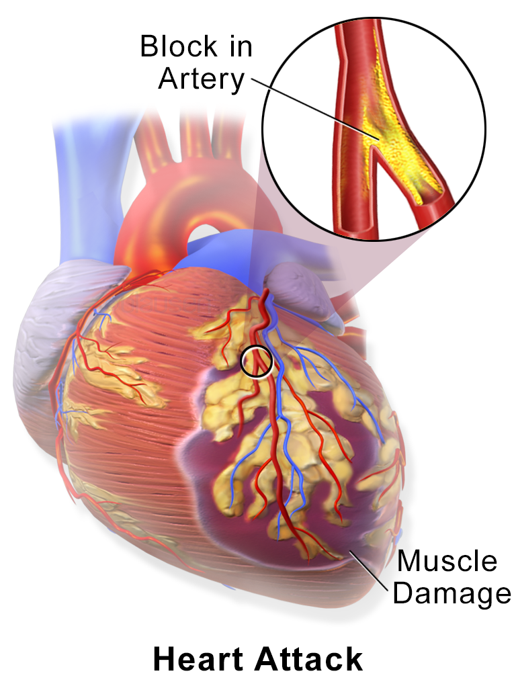
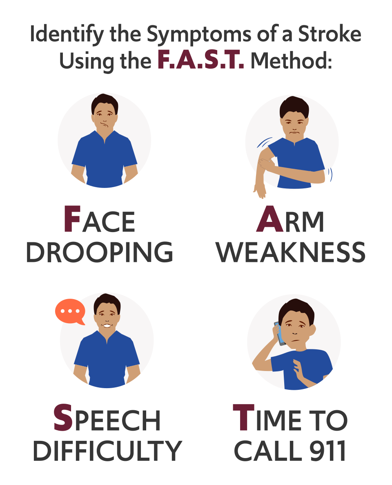
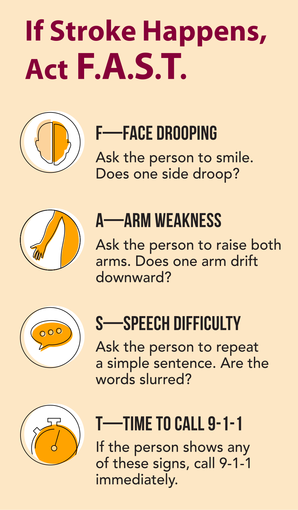
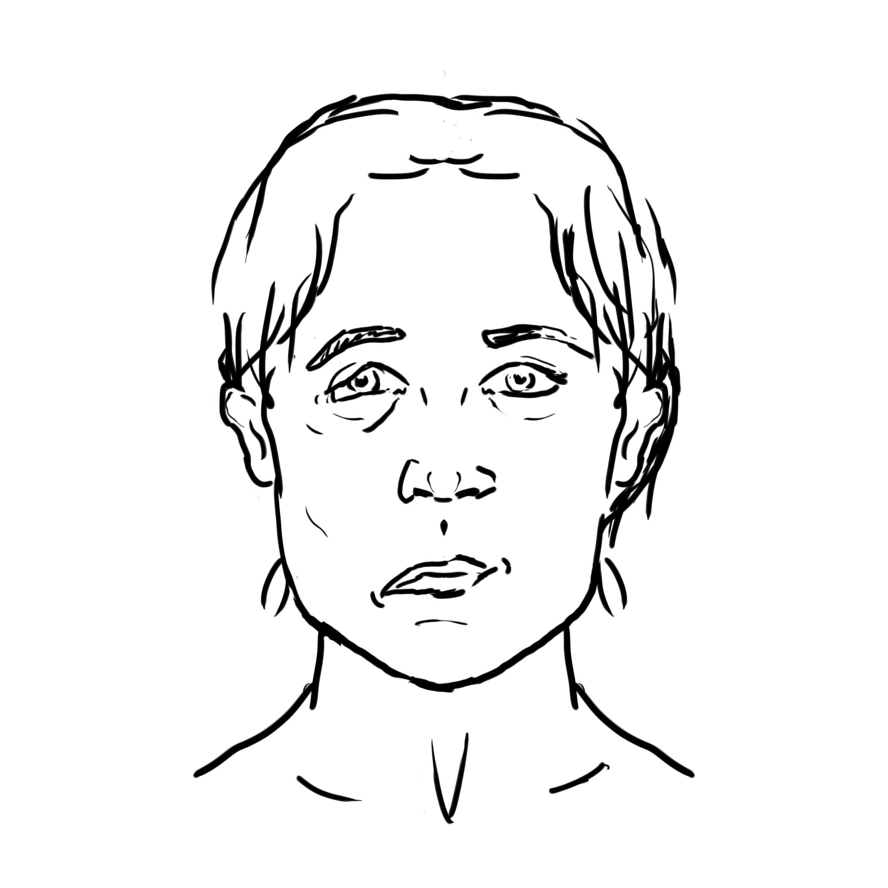

# UNIÃO SERVIÇOS MÉDICOS
## DIRETORIA DE ENSINO, PESQUISA E INSTRUÇÃO PRÉ-HOSPITALAR

---

**MÓDULO C08 — EMERGÊNCIAS CARDIOVASCULARES E NEUROLÓGICAS**
*Biblioteca Curricular: Núcleo Compartilhado (Core Skills)*
*Versão Editorial: 1.0.0 — Padrão Editorial USM*
*Carga Horária Teórica: 1 hora | Público-alvo: Não médicos, educadores, gestores, socorristas e brigadistas*

---

## SUMÁRIO

- [Seção 1 — Em 30 Segundos](#seção-1--em-30-segundos)
- [Seção 2 — Objetivos de Aprendizagem](#seção-2--objetivos-de-aprendizagem)
- [Seção 3 — Introdução e Impacto das Doenças Circulatórias e Cerebrais](#seção-3--introdução-e-impacto-das-doenças-circulatórias-e-cerebrais)
- [Seção 4 — Fundamentação Fisiopatológica do IAM e do AVC](#seção-4--fundamentação-fisiopatológica-do-iam-e-do-avc)
- [Seção 5 — Desenvolvimento dos Subtemas](#seção-5--desenvolvimento-dos-subtemas)
  - [5.1 Dor Torácica Aguda: Características e Sinais de Alarme](#51-dor-torácica-aguda-características-e-sinais-de-alarme)
  - [5.2 Suspeita e Manejo Pré-Hospitalar do Infarto Agudo do Miocárdio (IAM)](#52-suspeita-e-manejo-pré-hospitalar-do-infarto-agudo-do-miocárdio-iam)
  - [5.3 Identificação Precoce do AVC (Escala SAMU / Cincinnati)](#53-identificação-precoce-do-avc-escala-samu--cincinnati)
  - [5.4 Síncope e Lipotimia: Fisiopatologia e Diferenciação](#54-síncope-e-lipotimia-fisiopatologia-e-diferenciação)
  - [5.5 Crises Convulsivas e Epilepsia no APH](#55-crises-convulsivas-e-epilepsia-no-aph)
  - [5.6 Perda de Consciência e Sinais Críticos de Alerta](#56-perda-de-consciência-e-sinais-críticos-de-alerta)
- [Seção 6 — Quadros Práticos e Matrizes Decisórias](#seção-6--quadros-práticos-e-matrizes-decisórias)
- [Seção 7 — Erros Frequentes e Condutas Proibidas](#seção-7--erros-frequentes-e-condutas-proibidas)
- [Seção 8 — Aplicação Prática Contextualizada (Estudo de Caso)](#seção-8--aplicação-prática-contextualizada-estudo-de-caso)
- [Seção 9 — Pulo do Gato](#seção-9--pulo-do-gato)
- [Seção 10 — Mapa Mental das Emergências Clínicas](#seção-10--mapa-mental-das-emergências-clínicas)
- [Seção 11 — O Que Você Precisa Lembrar](#seção-11--o-que-você-precisa-lembrar)
- [Seção 12 — Referências Bibliográficas e Metadados Editoriais](#seção-12--referências-bibliográficas-e-metadados-editoriais)

---

## GUIA DE ATUAÇÃO — PARA QUEM NÃO É DA ÁREA DA SAÚDE

> **EM UMA EMERGÊNCIA REAL:** Proteja-se, peça ajuda e ligue **192 (SAMU)**. Para fogo, resgate em altura, água, espaço confinado ou ambiente perigoso, ligue **193 (Bombeiros)**. Diga o endereço e siga as instruções da central. Este roteiro orienta as primeiras ações, mas não substitui o treino supervisionado das técnicas práticas.

### Situação: Dor no peito e sinais de AVC

**Reconheça os sinais:** Dor/pressão no peito, suor frio, falta de ar; ou boca torta, braço fraco e fala alterada de início súbito.

### O que fazer — passo a passo

1. Interrompa atividade e mantenha a pessoa em posição confortável. Ligue 192 imediatamente.
2. Em suspeita de AVC, peça sorriso, elevação dos dois braços e uma frase simples.
3. Anote a hora em que a pessoa foi vista bem pela última vez.
4. Não ofereça comida, líquidos nem medicamentos. Não transporte por conta própria se o SAMU orientar aguardar.
5. Se for dor torácica, não faça a vítima caminhar ou subir escadas.
6. Observe resposta e respiração. Se perder consciência e não respirar normalmente, inicie RCP e use DEA.

### Não faça isto

Não espere a dor passar nem meça pulso para decidir fazer RCP. Não dê aspirina em suspeita de AVC.

### Exercício prático de aprendizagem

Simule alguém com fala arrastada; o aluno deve aplicar sinais FAST e registrar horário.

**Ao entregar a vítima:** informe horário de início, mudanças na respiração e na consciência, riscos e medidas aplicadas.

**Limites:** não faça procedimentos invasivos, administração de fármacos não prescritos, resgates técnicos ou intervenções que dependam de habilitação profissional. Pratique presencialmente RCP, DEA, controle de sangramento e desengasgo em manequins antes de assumir atendimento.

**Referências operacionais:** Ministério da Saúde — SAMU 192 (https://www.gov.br/saude/pt-br/composicao/saes/samu-192/samu-192); AHA/AAP — RCP e primeiros socorros 2025 (https://cpr.heart.org/en/resuscitation-science/cpr-and-ecc-guidelines); AHA/Cruz Vermelha — Primeiros Socorros 2024 (https://cpr.heart.org/en/resuscitation-science/2024-first-aid-guidelines).

---

## SEÇÃO 1 — EM 30 SEGUNDOS

> **VISÃO RÁPIDA DE SOBREVIVÊNCIA**
> 1. **Tempo é músculo e tempo é cérebro:** No infarto do coração e no derrame cerebral (AVC), a cada minuto sem desobstrução arterial, morrem milhões de células irreversíveis. A rapidez no reconhecimento e no acionamento do SAMU 192 determina a sobrevivência e a ausência de sequelas [1, 2].
> 2. **Dor do infarto:** Dor opressiva em aperto no centro do peito (como um "peso ou garra"), irradiando para o braço esquerdo, mandíbula ou costas, acompanhada de suor frio, náusea e palidez. Em diabéticos, idosos e mulheres, o infarto pode se manifestar sem dor típica, apresentando apenas falta de ar súbita, fraqueza extrema ou queimação no estômago [3].
> 3. **Escala SAMU do AVC:** Três testes rápidos: **S**orriso (assimetria facial/boca torta), **A**braço (perda de força para elevar os dois braços) e **M**úsica/Fala (dificuldade de articular frases simples). Havendo um único sinal alterado, ligue **U**rgente para o 192 [4].
> 4. **Janela terapêutica no AVC:** Anote o horário exato em que a vítima foi vista normal pela última vez. O tratamento trombolítico hospitalar só pode ser realizado em até **4,5 horas** do início dos sintomas [2, 4].
> 5. **Crise convulsiva:** **JAMAIS segure a língua da vítima nem coloque nada na boca.** Apenas proteja a cabeça contra impactos no chão, afaste objetos perfurocortantes, cronometre a crise e vire a pessoa de lado suavemente quando as contrações cessarem [5].
> 6. **Desmaio simples (Síncope vasovagal):** Mantenha a vítima deitada de costas no chão e **eleve suas pernas em 30 a 45 graus** por alguns minutos para facilitar o retorno do sangue ao cérebro [1, 6].

---

## SEÇÃO 2 — OBJETIVOS DE APRENDIZAGEM

Ao concluir o estudo deste módulo, o participante deverá ser capaz de:

1. **Reconhecer as manifestações clínicas típicas e atípicas** da isquemia coronariana aguda e do Infarto Agudo do Miocárdio (IAM).
2. **Aplicar com rigor prático a Escala de Cincinnati / SAMU** para detecção precoce do Acidente Vascular Cerebral.
3. **Compreender a fisiologia da síncope e diferenciar o desmaio benigno** de eventos graves como paradas cardíacas precedidas de síncope ou arritmias ventriculares.
4. **Executar as condutas de proteção do paciente em crise convulsiva**, prevenindo traumas cranianos e aspiração traqueal.
5. **Identificar os sinais de alerta neurológico e hemodinâmico** que exigem remoção imediata por viatura de Suporte Avançado (USA 192).
6. **Combater erros culturais lesivos**, eliminando a administração empírica de remédios caseiros ou automedicação fora do escopo pré-hospitalar.

---

## SEÇÃO 3 — INTRODUÇÃO E IMPACTO DAS DOENÇAS CIRCULATÓRIAS E CEREBRAIS

**LEITURA GUIADA — COMECE AQUI:** Dor no peito e sinais de AVC são situações em que o tempo importa. Quem presta primeiros socorros não precisa diferenciar todos os tipos de infarto ou AVC. Precisa reconhecer sinais preocupantes, acionar 192 e evitar atrasos.

Infarto e acidente vascular cerebral (AVC) são emergências relevantes porque o coração e o cérebro dependem de circulação contínua. Os sintomas podem começar de forma súbita ou se manifestar como dor, fraqueza, alteração de fala ou falta de ar. Reconhecer esses sinais e acionar o 192 rapidamente é mais útil ao socorrista leigo do que memorizar números nacionais de mortalidade [3, 6].

Além do risco de morte, o AVC pode deixar alterações de movimento, linguagem, deglutição e memória. A intensidade das sequelas varia de pessoa para pessoa e depende de vários fatores, incluindo a rapidez do tratamento e a região cerebral atingida. O primeiro respondedor deve registrar a hora de início dos sintomas e evitar atrasar o acesso ao serviço especializado [2, 4].

O cenário da emergência cardiovascular extra-hospitalar possui uma particularidade: **a morte ocorre comumente nas primeiras duas horas do início dos sintomas**, muitas vezes antes de a vítima buscar atendimento médico. O cidadão comum tende a esperar a dor no peito "passar", acreditando ser um simples refluxo gástrico, ou vai dormir achando que a dormência no braço é uma "má postura na cama". Educar o público para reconhecer a gravidade em tempo real é a intervenção de maior custo-efetividade para salvar vidas no Brasil.

---

## SEÇÃO 4 — FUNDAMENTAÇÃO FISIOPATOLÓGICA DO IAM E DO AVC

> [!NOTE]
> **Por que isso acontece?** O coração e o cérebro precisam de circulação contínua. Quando uma artéria deixa de fornecer sangue, o tecido pode sofrer lesão. O tratamento hospitalar varia conforme a causa; oferecer remédios por conta própria pode atrapalhar.

O coração e o cérebro compartilham a característica biológica de serem órgãos nobres extremamente dependentes de um fluxo contínuo de sangue oxigenado através de redes arteriais terminais:



*Figura 1 — Fisiopatologia do Infarto Agudo do Miocárdio por oclusão coronariana. Crédito: Blausen Medical Communications, Inc.. Licença: CC BY 3.0 (https://creativecommons.org/licenses/by/3.0/). Fonte: Wikimedia Commons.*

### 4.1 Fisiopatologia do Infarto Agudo do Miocárdio (IAM)
As artérias coronárias irrigam as paredes musculares do miocárdio. Ao longo de décadas, placas de gordura e colesterol (ateroma) acumulam-se sob o endotélio dessas artérias.
- *O evento agudo:* Por estresse físico, pico pressórico ou inflamação vascular, a capa fibrosa da placa de gordura sofre uma fissura ou ruptura microscópica.
- O sangue reconhece essa ruptura como uma lesão vascular e ativa imediatamente as plaquetas e a cascata de coagulação, formando um trombo agudo (coágulo) que obstrui subitamente o lúmen da artéria coronária [3, 7].
- A jusante da obstrução, as células musculares do ventrículo deixam de receber oxigênio. Instala-se a **isquemia aguda**, gerando dor intensa e liberação de ácido lático.
- Se a artéria permanecer ocluída por mais de 20 a 30 minutos, as células cardíacas começam a sofrer **necrose (morte celular definitiva)**, que se expande do subendocárdio para o epicárdio. Esse miocárdio isquêmico instável torna-se altamente vulnerável a curtos-circuitos elétricos letais, culminando em Fibrilação Ventricular e Parada Cardíaca Súbita [1, 3].

```
+---------------------------------------------------------------------------------+
|                   DA PLACA DE GORDURA AO INFARTO AGUDO                          |
|                                                                                 |
|  [ ARTÉRIA CORONÁRIA COM ATEROMA ]                                              |
|                 |                                                               |
|                 V                                                               |
|  [ RUPTURA AGUDA DA CAPA DA PLACA ]                                             |
|                 |                                                               |
|                 V                                                               |
|  [ FORMAÇÃO DE TROMBO PLAQUETÁRIO MACIÇO ]                                      |
|                 |                                                               |
|                 V                                                               |
|  [ OCLUSÃO DE 100% DO FLUXO SANGUÍNEO CORONARIANO ]                             |
|                 |                                                               |
|        +--------+-----------------------+                                       |
|        |                                |                                       |
|        V                                V                                       |
|  [ ISQUEMIA E NECROSE DO MIOCÁRDIO ]    [ INSTABILIDADE ELÉTRICA VENTRICULAR ]  |
|  - Dor em aperto retroesternal         - Risco iminente de Fibrilação          |
|  - Falência de bomba cardíaca            Ventricular (Morte Súbita)             |
|  - Perda irreversível de tecido muscular - Necessidade precoce de DEA          |
+---------------------------------------------------------------------------------+
```



*Figura 2 — Reconhecimento precoce do AVC pelo método FAST. Crédito: U.S. Food and Drug Administration (vetor: Fvasconcellos). Licença: Domínio público. Fonte: Wikimedia Commons.*

### 4.2 Fisiopatologia do Acidente Vascular Cerebral (AVC)
O AVC subdivide-se em dois tipos clínicos de mecanismos antagônicos [2, 4]:
1. **AVC Isquêmico (Aproximadamente 85% dos casos):** Uma artéria cerebral é ocluída por um trombo local ou por um êmbolo originado no coração (frequente em portadores de fibrilação atrial). A área central do território arterial morre em minutos (**core isquêmico**), mas ao redor existe uma vasta região cerebral viva, porém paralisada por falta de energia (**área de penumbra isquêmica**). O socorro rápido visa restabelecer o sangue a tempo de salvar a penumbra com remédios trombolíticos hospitalares.
2. **AVC Hemorrágico (Aproximadamente 15% dos casos):** Rompimento espontâneo de uma artéria intracraniana, comumente provocado por picos de hipertensão arterial crônica descontrolada ou ruptura de aneurisma congênito. O sangue extravasa sob alta pressão para dentro do parênquima cerebral, gerando hematoma expansivo, compressão do tecido cerebral e hipertensão intracraniana grave [2].

---

## SEÇÃO 5 — DESENVOLVIMENTO DOS SUBTEMAS

### 5.1 Dor Torácica Aguda: Características e Sinais de Alarme
A dor torácica de origem isquêmica cardíaca típica (chamada clinicamente de *Angina Pectoris*) possui traços bem descritos que o socorrista deve saber inquirir [1, 3]:
- **Tipo de dor:** Caráter constritivo, em aperto, pressão pesada, queimação profunda ou sensação de estrangulamento. Não costuma ser uma dor em pontada fina que piora ao respirar fundo.
- **Localização:** Retroesternal (no centro do peito, atrás do osso esterno), podendo irradiar-se para:
  - Braço esquerdo (face interna) ou ambos os braços.
  - Mandíbula, dentes e garganta.
  - Dorso (região entre as escápulas).
  - Epigástrio (região da "boca do estômago").
- **Duração:** A dor do infarto persiste por mais de 10 a 20 minutos, sem alívio pelo repouso ou pela mudança de posição corporal.
- **Sintomas associados (Disautonomia):** Pele fria e pálida, sudorese profusa pegajosa em todo o corpo (*sudorese fria*), náuseas, vômitos, tontura e uma sensação iminente de morte descrita pelo paciente.

> [!IMPORTANT]
> **ENTENDA O PORQUÊ: O INFARTO ATÍPICO OU SILENCIOSO**
> Em **mulheres, pessoas idosas e portadores de diabetes mellitus crônico**, os nervos sensitivos autonômicos viscerais frequentemente encontram-se degenerados (neuropatia autonômica). Nesses pacientes, o infarto pode ocorrer **SEM a dor típica no peito**. O paciente queixa-se subitamente de falta de ar inexplicável (*dispneia súbita*), cansaço avassalador que impede caminhar, dor isolada na mandíbula ou queimação estomacal sem histórico prévio de gastrite. Toda manifestação súbita de fraqueza extrema com palidez em pessoas com fatores de risco deve ser tratada como suspeita de infarto até prova em contrário [3].

### 5.2 Suspeita e Manejo Pré-Hospitalar do Infarto Agudo do Miocárdio (IAM)
Diante de uma suspeita de infarto, a conduta do socorrista comunitário baseia-se em reduzir o trabalho mecânico do coração e agilizar a chegada médica [1, 3]:

1. **Repouso Absoluto Imediato:** Ordene que a vítima cesse qualquer esforço físico imediatamente. Não permita que ela suba escadas, caminhe até a portaria ou dirija o próprio carro. Coloque a vítima sentada ou recostada confortavelmente em uma poltrona (posição semissentada a 45 graus, que reduz o retorno venoso e alivia o esforço do miocárdio).
2. **Conforto e Ventilação:** Afrouxe roupas apertadas (gravatas, cintos, golas), abra janelas para ventilar o recinto e afaste curiosos para reduzir a ansiedade adrenérgica do paciente.
3. **Acionamento Estruturado do SAMU 192:** Ligue imediatamente e informe com clareza: *"Temos um paciente de 55 anos com dor constritiva no peito irradiando para o braço, sudorese fria há 30 minutos, consciente"*. O médico despachará a Unidade com eletrocardiograma a bordo.
4. **Prontidão com o DEA:** Em locais com grande circulação ou empresas, traga o Desfibrilador Externo Automático (DEA) para o lado da poltrona da vítima e deixe-o fechado, pronto para uso imediato. Quase 50% das paradas cardíacas por infarto ocorrem subitamente nos primeiros minutos por fibrilação ventricular na frente do socorrista [1].

### 5.3 Identificação Precoce do AVC (Escala SAMU / Cincinnati)
Para que qualquer cidadão leigo memorize e aplique o exame de triagem neurológica rápida em menos de 60 segundos, o Ministério da Saúde consolidou a **Escala SAMU do AVC** (baseada na consagrada *Cincinnati Prehospital Stroke Scale*) [2, 4]:

```
+---------------------------------------------------------------------------------+
|                         ESCALA SAMU PARA DETECÇÃO DO AVC                        |
|                                                                                 |
|  [ S ] - SORRISO (Paralisia Facial):                                            |
|          Peça para a vítima dar um sorriso largo mostrando os dentes.           |
|          * NORMAL: Ambos os cantos da boca elevam-se simetricamente.            |
|          * ALTERADO: Um dos lados do rosto fica paralisado; a boca entorta para |
|            o lado normal.                                                       |
|                                                                                 |
|  [ A ] - ABRAÇO (Queda do Membro Superior):                                     |
|          Peça para a vítima fechar os olhos e levantar os dois braços retos para|
|          a frente na altura dos ombros por 10 segundos.                         |
|          * NORMAL: Ambos os braços permanecem elevados na mesma altura.         |
|          * ALTERADO: Um dos braços cai involuntariamente ou não consegue subir.|
|                                                                                 |
|  [ M ] - MÚSICA OU MENSAGEM (Déficit Fonatório / Afasia):                       |
|          Peça para a pessoa repetir uma frase simples ou cantar um trecho:       |
|          "O sapo não lava o pé" ou "O céu é azul em Brasília".                  |
|          * NORMAL: Pronúncia correta e palavras claras.                         |
|          * ALTERADO: A fala sai embolada, arrastada, gaguejada ou incompreensível|
|            (como se estivesse alcoolizada), ou não consegue falar nada.         |
|                                                                                 |
|  [ U ] - URGÊNCIA MÁXIMA (Disque 192):                                          |
|          Havendo apenas UM desses sinais alterados, a probabilidade estatística |
|          de AVC agudo ultrapassa 72%. Ligue imediatamente para o SAMU 192!      |
+---------------------------------------------------------------------------------+
```

> [!CRITICAL]
> **O REGISTRO DO TEMPO: O MARCADOR "ICTUS"**
> O dado mais valioso que o socorrista deve fornecer à equipe médica é o **ICTUS**: o horário exato em que o paciente foi visto lúcido e normal pela última vez. A aplicação de remédios trombolíticos venosos no pronto-socorro para dissolver o coágulo no cérebro só pode ser realizada dentro da janela máxima de **4,5 horas**. Passado esse prazo, o medicamento é formalmente contraindicado pelo risco de transformação hemorrágica fatal [2, 4].

### 5.4 Síncope e Lipotimia: Fisiopatologia e Diferenciação
A síncope (o desmaio comum) é definida clinicamente como uma perda temporária, súbita e completa da consciência e do tônus postural, de curta duração (menos de 1 a 2 minutos), com recuperação espontânea, rápida e completa, provocada por **hipoperfusão cerebral global transitória** [1, 6]:
- **Lipotimia (Pré-Síncope):** Sensação iminente de desmaio, com fraqueza muscular, visão turva ("escurecimento da visão"), zumbido nos ouvidos, palidez e náusea, sem que haja a perda definitiva da consciência.
- **Síncope Vasovagal (Benigna):** É a causa mais comum em jovens e crianças. Decorre de hiperestimulação do nervo vago disparada por calor sufocante, dor intensa, estresse emocional agudo, jejum prolongado ou medo de agulhas ao colher sangue. A pressão arterial cai e a frequência cardíaca diminui transitoriamente.
- **Conduta Correta no Desmaio:**
  1. Deite a vítima de costas no chão em local fresco.
  2. Afrouxe golas e roupas apertadas.
  3. **Eleve os membros inferiores em aproximadamente 30 a 45 graus (cerca de 30 cm do solo)** apoiando as pernas em uma cadeira, mochila ou nos seus joelhos. Isso faz com que cerca de 300 a 500 mL de sangue venoso represado nas pernas retornem ao coração por gravidade, elevando a pressão e restabelecendo o fluxo sanguíneo cerebral em segundos [1, 6].
  4. Mantenha a vítima deitada por alguns minutos após ela acordar. Se ela se levantar bruscamente, o sangue despenca novamente e ela sofrerá uma segunda queda com traumatismo de crânio.

### 5.5 Crises Convulsivas e Epilepsia no APH
A crise convulsiva decorre de uma descarga elétrica neuronal hipersincrônica, excessiva e desordenada em regiões do córtex cerebral [5]. Na sua forma mais impressionante — a **Crise Generalizada Tônico-Clônica** —, o paciente sofre perda súbita da consciência e desaba no solo, passando por duas fases motoras:
- *Fase Tônica (10 a 20 segundos):* Contração muscular generalizada rígida contínua. Os dentes travam com força, os olhos reviram e o espasmo diafragmático pode gerar um grito vocal involuntário e interrupção transitória da respiração com cianose labial passageira.
- *Fase Clônica (1 a 3 minutos):* Abalos musculares e contrações espasmódicas rítmicas e simétricas nos braços e pernas, frequentemente acompanhados de salivação espumosa (*sialorreia*) e liberação de esfíncteres (micção involuntária).

#### O Que o Socorrista DEVE Fazer:
1. **Cronometrar o tempo de início da crise:** A grande maioria das crises cessa espontaneamente em **menos de 2 a 3 minutos** sem intervenção externa. Se uma crise durar **mais de 5 minutos contínuos**, instala-se uma emergência médica gravíssima denominada **Estado de Mal Epiléptico (*Status Epilepticus*)**, que provoca lesões neuronais permanentes e exige aplicação venosa de anticonvulsivantes pelo médico do SAMU [5, 8].
2. **Proteger a cabeça contra impactos repetidos:** Acomode algo macio (uma toalha dobrada, agasalho, almofada ou as palmas das suas mãos) sob o crânio da vítima para amortecer os impactos violentos contra o chão duro.
3. **Afastar móveis, vidros e objetos perfurantes ao redor.**
4. **Manejo do Período Pós-Ictal:** Quando os abalos cessarem, a vítima entrará em sono profundo ou confusão mental com respiração ruidosa (período pós-ictal). Posicione a vítima suavemente em **Posição Lateral de Segurança (PLS)** para que a saliva e eventuais vômitos escorram pela boca, mantendo a via aérea livre [1, 5].

---

---

## SEÇÃO 6 — QUADROS PRÁTICOS E MATRIZES DECISÓRIAS

### Quadro 6.1 — Diagnóstico Diferencial Rápido de Alterações da Consciência

| Agravo Clínico | Início e Mecanismo | Sinais e Postura Típica | Conduta Imediata de APH |
|---|---|---|---|
| **Síncope Comum (Desmaio)** | Súbito, precedido de visão turva, palidez e suor frio. | Recuperação em menos de 2 minutos ao deitar; pele pálida e fria. | Manter deitada; **elevar pernas a 30-45°**; não oferecer bebidas; manter vigilância. |
| **Infarto Agudo do Miocárdio** | Gradual ou súbito em repouso ou pós-esforço. | Dor em aperto no peito, falta de ar, náuseas, pele acinzentada. | **Repouso absoluto sentado**; acionar SAMU 192; trazer DEA e mantê-lo pronto ao lado. |
| **Acidente Vascular Cerebral** | Súbito, indolor ou com cefaleia intensa ("a pior dor da vida"). | Assimetria facial, perda de força em um braço, fala embolada/afasia. | Deitar a 30°; **anotar o horário do início (ICTUS)**; ligar 192; jejum absoluto total. |
| **Crise Convulsiva** | Súbito com queda ao solo sem reflexo de defesa. | Movimentos tônico-clônicos rítmicos, dentes travados, saliva espumosa. | Proteger a cabeça; **cronometrar duração**; não por nada na boca; PLS pós-crise. |
| **Parada Cardíaca (PCR)** | Desabamento instantâneo inerte ao piso. | Inconsciente, **ausência de respiração normal** ou suspiros agônicos (*gasping*). | **Iniciar compressões torácicas imediatas** no centro do tórax; pedir DEA e 192. |



*Figura 3 — Sinais de alerta do Acidente Vascular Cerebral (Act FAST). Crédito: U.S. CDC, NCCDPHP. Licença: Domínio público. Fonte: Wikimedia Commons.*

---

### Quadro 6.2 — Checklist da Passagem de Dados no AVC e IAM ao SAMU 192

| Informação Crítica | No Infarto Agudo do Miocárdio (IAM) | No Acidente Vascular Cerebral (AVC) |
|---|---|---|
| **Tempo de Evolução** | Há quantos minutos ou horas a dor teve início? | **Qual o horário exato** em que o paciente foi visto normal pela última vez? |
| **Comportamento Clínico** | A dor melhora com respiração ou piora ao toque? | Houve melhora parcial dos movimentos ou progressão dos déficits? |
| **Escala Aplicada** | Caráter opressivo retroesternal e irradiação presentes. | Escala SAMU: Boca torta? Braço caiu? Fala arrastada? |
| **Medicamentos em Uso** | Usa nitratos? Remédios para disfunção erétil nas últimas 48h? | Usa anticoagulantes orais (Varfarina, Rivaroxabana, Apixabana)? |
| **Doenças de Base** | Hipertensão, tabagismo, diabetes, infarto prévio. | Hipertensão, arritmia cardíaca (Fibrilação Atrial), AVC prévio. |

---

## SEÇÃO 7 — ERROS FREQUENTES E CONDUTAS PROIBIDAS

> [!CAUTION]
> **Erro que pode prejudicar a vítima:** Boca torta, fraqueza em um braço ou fala alterada de início súbito são sinais de AVC. Anote a última hora em que a pessoa foi vista bem. Não dê comida, água ou aspirina em suspeita de AVC.

> [!CAUTION]
> ### CATÁLOGO DE ERROS CRÍTICOS EM EMERGÊNCIAS CLÍNICAS
> 
> 1. **Dar comprimidos de ácido acetilsalicílico (AAS) por conta própria em suspeita de AVC:**
>    - *Por que não fazer:* Em cerca de 15% dos casos, o AVC é hemorrágico (sangramento ativo de artéria cerebral). Administrar anticoagulantes ou antiagregantes plaquetários como o AAS sem tomografia computadorizada prévia acelera a hemorragia intracraniana, provocando herniação cerebral e óbito imediato.
>    - *Conduta correta:* O AAS mastigável só pode ser indicado em casos de infarto cardíaco e **sob recomendação direta do médico regulador do SAMU** pelo telefone [1, 3]. Em suspeita de AVC, jejum medicamentoso absoluto!
> 
> 2. **Tentar conter as contrações musculares de uma pessoa convulsionando:**
>    - *Por que não fazer:* Segurar braços e pernas de alguém convulsionando com força mecânica contrária provoca luxações de ombro, desinserções musculares e fraturas ósseas bilaterais em úmero e fêmur pela força desmedida da contração tônica.
>    - *Conduta correta:* Não lute contra os movimentos. Apenas guie suavemente os membros para longe de obstáculos perfurantes e segure a cabeça com apoio acolchoado.
> 
> 3. **Dar líquidos, café ou açúcar para pessoa sonolenta pós-crise convulsiva ou desmaio:**
>    - *Por que não fazer:* No período pós-ictal ou na síncope profunda, os reflexos de proteção da glote encontram-se deprimidos. Forçar líquidos na boca resulta em broncoaspiração maciça pulmonar, convertendo um desmaio simples em pneumonia química asfixiante.
>    - *Conduta correta:* Mantenha a vítima em decúbito com vias livres até que ela esteja plenamente desperta, orientada no tempo e no espaço.
> 
> 4. **Dar banho gelado, álcool para cheirar ou socar o peito de quem infartou:**
>    - *Por que não fazer:* Choques térmicos com água fria provocam vasoconstrição simpática reflexa violenta, elevando a pressão arterial e a frequência cardíaca, o que dobra o consumo de oxigênio do coração infartado e acelera a necrose. Cheirar álcool provoca broncoespasmo reflexo.
>    - *Conduta correta:* Mantenha o paciente calmo, sentado e aquecido em ambiente ventilado.
> 
> 5. **Tentar furar a ponta dos dedos com agulhas para "tirar sangue no AVC":**
>    - *Por que não fazer:* Mito perigoso divulgado em redes sociais. Furar dedos gera dor aguda desnecessária que dispara a pressão arterial sistêmica e atrasa o acionamento do SAMU em dezenas de minutos preciosos dentro da janela trombolítica.
>    - *Conduta correta:* Aplique a escala SAMU e disque 192 imediatamente.



*Figura 4 — Assimetria facial aguda (queda da rima labial) característica de Acidente Vascular Cerebral. Crédito: Another-anon-artist-234. Licença: CC0. Fonte: Wikimedia Commons.*

---

## SEÇÃO 8 — APLICAÇÃO PRÁTICA CONTEXTUALIZADA (ESTUDO DE CASO)

> [!TIP]
> **Decisão no caso prático:** Uma professora começa a falar de forma incompreensível e um braço fica fraco. Os colegas registram a hora de início, ligam 192 e não tentam fazê-la caminhar ou beber água enquanto aguardam orientações.

### Cenário Simulado
*Local:* Agência bancária em horário de pico.  
*Horário:* 13h15.  
*Ocorrência:* Uma cliente de 64 anos, na fila do caixa, subitamente derruba a bolsa no chão, encosta na parede desorientada e não consegue responder à pergunta de um funcionário. O bancário responsável pela brigada interna de primeiros socorros aproxima-se rapidamente para prestar assistência.

---

### Resolução Técnica Passo a Passo

#### 1. Abordagem Inicial e Aplicação da Escala SAMU (0 a 45 segundos)
O brigadista apoia a senhora pelo braço e senta-a com segurança em uma poltrona do saguão. Percebe que ela está lúcida, mas com expressão confusa:
- **Passo S (Sorriso):** O brigadista pede: *"Dona Maria, por favor, olhe para mim e dê um sorriso largo mostrando os dentes"*. A paciente tenta sorrir: o lado esquerdo da boca se eleva normalmente, mas o **lado direito da boca permanece caído e paralisado** (assimetria facial evidente).
- **Passo A (Abraço):** *"Agora, feche os olhos e levante os dois braços retos para a frente"*. A paciente eleva o braço esquerdo normalmente, mas o **braço direito não sobe e tomba sobre o colo** (hemiparesia braquial direita).
- **Passo M (Música/Fala):** *"Repita comigo esta frase: O dia hoje está ensolarado"*. A paciente tenta falar, mas emite apenas sons enrolados e incompreensíveis (*afasia motora*).
- **Constatação diagnóstica:** 3 de 3 critérios positivos na escala de Cincinnati. **Suspeita imediata de Acidente Vascular Cerebral (AVC) isquêmico em evolução.**

#### 2. Investigação Crítica do Horário (ICTUS) (45 a 90 segundos)
- O brigadista pergunta ao acompanhante da fila: *"O senhor estava conversando com ela antes? Que horas exatamente ela começou a falar assim?"*.
- O acompanhante confirma: *"Ela estava conversando normalmente comigo até 13h10, quando pegou a senha no totem"*.
- **Registro do ICTUS:** 13h10 (apenas 5 minutos de evolução clínica). A paciente encontra-se perfeitamente dentro da janela de trombólise hospitalar de 4,5 horas.

#### 3. Acionamento Qualificado e Gestão de Cena
O brigadista liga para o 192 pelo viva-voz do celular:
> *"Central SAMU, meu nome é Felipe, brigadista do Banco Nacional da Rua XV de Novembro, número 800. Estou com uma paciente de 64 anos com suspeita de AVC agudo, apresentando desvio de rima labial à direita, hemiparesia braquial direita e afasia motora completa. Horário do início confirmado às 13h10, há 8 minutos. Paciente consciente, sem quedas ou trauma"*.

- O médico regulador parabeniza a precisão do chamado e despacha imediatamente a Unidade de Suporte Avançado (USA 02) com aviso de código vermelho ao hospital de referência em neurocirurgia/AVC da região.

#### 4. Cuidados e Posicionamento até a Chegada da Viatura
- O brigadista mantém a paciente sentada confortavelmente com a cabeceira a **30 graus** (evitando deitar totalmente para não aumentar a pressão venosa intracraniana, e não deixando em pé para não piorar a perfusão).
- **Jejum absoluto:** Recusa veementemente sugestões de colegas da agência que queriam dar copo de água ou colocar remédio de pressão sob a língua da paciente.
- Solicita à gerência que abra o portão da garagem privativa do banco e deixe o segurança aguardando na calçada com colete refletivo para orientar a ambulância.

#### Desfecho Clínico
A viatura do SAMU chega em 11 minutos. A paciente é transferida com dados precisos, ingressa no centro de AVC do hospital regional aos 35 minutos do início dos sintomas, realiza tomografia de crânio que descarta hemorragia e recebe infusão de trombolítico venoso (alteplase). A artéria cerebral média é recanalizada com sucesso, revertendo totalmente os déficits motores e motores da fala em 24 horas, recebendo alta hospitalar sem nenhuma sequela física residual.

---

## SEÇÃO 9 — PULO DO GATO

> [!TIP]
> ### O PULO DO GATO DA UNIÃO: A REGRA DA RESPIRAÇÃO NA SÍNCOPE DUVIDOSA
> Em locais públicos, quando uma pessoa desaba de repente no chão após relatar tontura, o erro mais frequente de leigos é assumir que *"foi apenas uma queda de pressão ou desmaio de calor"* e perder minutos preciosos elevando as pernas de uma pessoa que, na verdade, **acabou de entrar em Parada Cardíaca por Fibrilação Ventricular Primária**.
> 
> **A Regra de Ouro da Diferenciação nos Primeiros 5 Segundos:**
> No desmaio simples (síncope):
> - O peito da vítima **continua subindo e descendo com respiração suave**, o pulso periférico existe (mesmo fraco) e, ao elevar as pernas, a pessoa começa a recuperar o tônus ou piscar os olhos em menos de 60 segundos.
> 
> Na Parada Cardíaca (morte súbita mascarada de desmaio):
> - A vítima **NÃO respira normalmente** (está em apneia ou emitindo suspiros agônicos/gasping).
> 
> **O Pulo do Gato:** Se você deitou a pessoa e, em 5 segundos, notou que ela **não respira e não se mexe**, pare de mexer nas pernas! Esqueça o desmaio; assuma imediatamente que é **Parada Cardiorrespiratória**, peça o DEA e inicie compressões torácicas no centro do peito. Tratar PCR como desmaio é fatal; iniciar massagem cardíaca precocemente salva a vida.

---

## SEÇÃO 10 — MAPA MENTAL DAS EMERGÊNCIAS CLÍNICAS

```
                    EMERGÊNCIAS CARDIO E NEUROLÓGICAS (C08)
                                       |
    +----------------------------------+----------------------------------+
    |                                  |                                  |
    V                                  V                                  V
INFARTO AGUDO (IAM)             ACIDENTE VASCULAR (AVC)            CRISE CONVULSIVA
    |                                  |                                  |
- Dor opressiva em aperto        - Escala SAMU:                     - Desabamento no piso
  retroesternal persistente        * [S] Sorriso assimétrico        - Fase tônica e clônica
- Irradiação: braço, dorso,       * [A] Queda do braço               (contrações simétricas)
  mandíbula e estômago             * [M] Música/fala enrolada       - NÃO por nada na boca!
- Sudorese fria e náuseas        - Registrar horário (ICTUS)        - NÃO puxar a língua!
- Mulheres/Diabéticos:           - Janela máxima: 4,5 horas         - Proteger o crânio
  dispneia súbita e fraqueza     - JEJUM ABSOLUTO                   - Cronometrar duração
- Repouso sentado (45°)          - Cabeceira a 30°                  - > 5 min = Mal Epiléptico
- Chamar 192 / Trazer DEA        - Ligar 192 urgente                - PLS após os espasmos
    |                                  |                                  |
    +----------------------------------+----------------------------------+
                                       |
                                       V
                            SÍNCOPE (DESMAIO COMUM)
                           - Hipoperfusão cerebral transitória
                           - Vítima respira normalmente
                           - Deitar no chão e elevar pernas (30-45°)
                           - Recuperação em menos de 2 minutos
```

---

## SEÇÃO 11 — O QUE VOCÊ PRECISA LEMBRAR

1. **Reconheça a dor em aperto:** Dor opressiva no peito que dura mais de 10 minutos com suor frio é suspeita de infarto. Coloque o paciente sentado e acione o SAMU 192.
2. **Infarto em mulheres e diabéticos pode não doer:** Falta de ar repentina e fraqueza avassaladora exigem alerta idêntico ao infarto típico.
3. **Escala SAMU do AVC:** Avalie o Sorriso, a elevação dos Braços e a clareza da Fala. Um único sinal alterado indica emergência cerebrovascular.
4. **Guarde o horário do AVC:** O tempo de início dos sintomas (ICTUS) define se a vítima poderá receber o medicamento desobstrutor no hospital (limite de 4,5 horas).
5. **Convulsão exige proteção e cronômetro:** Jamais coloque a mão na boca da vítima. Proteja a cabeça, afaste perigos e coloque-a de lado (PLS) quando parar de debater.
6. **Desmaio resolve com pernas elevadas:** Na síncope com respiração normal, deite a vítima e levante suas pernas em 30 a 45 graus para oxigenar o cérebro.

---

## SEÇÃO 12 — REFERÊNCIAS BIBLIOGRÁFICAS E METADADOS EDITORIAIS

### Referências Consultadas (Padrão ABNT NBR 6023)

[1] AMERICAN HEART ASSOCIATION (AHA). **2020 American Heart Association Guidelines for Cardiopulmonary Resuscitation and Emergency Cardiovascular Care: Part 3: Adult Basic and Advanced Life Support**. *Circulation*, Dallas, v. 142, supl. 2, p. S366-S468, 2020. DOI: 10.1161/CIR.0000000000000916. [Com atualizações 2021-2025].

[2] POWERS, William J. et al. **Guidelines for the Early Management of Patients With Acute Ischemic Stroke: 2019 Update to the 2018 Guidelines for the Early Management of Acute Ischemic Stroke**. *Stroke*, v. 50, n. 12, p. e344-e418, 2019. DOI: 10.1161/STR.0000000000000211.

[3] SOCIEDADE BRASILEIRA DE CARDIOLOGIA (SBC). **Diretriz da Sociedade Brasileira de Cardiologia sobre Tratamento do Infarto Agudo do Miocárdio com Supradesnível do Segmento ST**. *Arquivos Brasileiros de Cardiologia*, Rio de Janeiro, v. 105, n. 2, supl. 1, p. 1-105, 2015. [Com atualizações estruturais 2020].

[4] BRASIL. Ministério da Saúde. Secretaria de Atenção Especializada à Saúde. **Linha de Cuidado do Acidente Vascular Cerebral (AVC) no Adulto**. Brasília: Ministério da Saúde, 2020.

[5] LIGA BRASILEIRA DE EPILEPSIA (LBE). **Primeiro Atendimento à Crise Convulsiva no Ambiente Comunitário e Pré-Hospitalar**. *Journal of Epilepsy and Clinical Neurophysiology*, São Paulo, v. 26, supl. 1, 2021.

[6] SOCIEDADE BRASILEIRA DE CARDIOLOGIA (SBC). **Diretrizes para Avaliação e Tratamento de Pacientes com Arritmias Cardíacas e Síncope**. *Arquivos Brasileiros de Cardiologia*, v. 117, n. 4, p. 890-955, 2021.

[7] HALL, John E.; HALL, Michael E. **Guyton and Hall Textbook of Medical Physiology**. 14. ed. Philadelphia: Elsevier, 2021.

[8] TRINKA, Eugen et al. **A definition and classification of status epilepticus: Report of the ILAE Task Force on Classification of Status Epilepticus**. *Epilepsia*, v. 56, n. 10, p. 1515-1523, 2015. DOI: 10.1111/epi.13121.

---

### METADADOS EDITORIAIS USM

| Parâmetro | Detalhe |
|---|---|
| **Código e Módulo:** | C08 — Emergências Cardiovasculares e Neurológicas |
| **Biblioteca:** | Núcleo Compartilhado |
| **Status:** | `Aguardando Aprovação Científica` |
| **Data da Redação:** | 19 de outubro de 2026 |
| **Versão:** | 1.0.0 |
| **Validação Científica por IA:** | Conforme diretrizes SBC, AHA/ASA Stroke e Liga Brasileira de Epilepsia |
| **Próxima Revisão:** | Outubro de 2027 |
