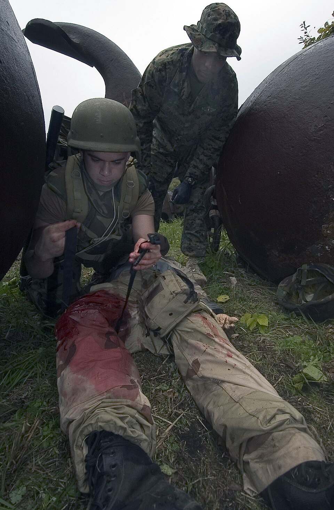

# UNIÃO SERVIÇOS MÉDICOS
## DIRETORIA DE ENSINO, PESQUISA E INSTRUÇÃO PRÉ-HOSPITALAR

---

**MÓDULO C10 — FERIMENTOS E CONTROLE INICIAL DE SANGRAMENTOS**
*Biblioteca Curricular: Núcleo Compartilhado (Core Skills)*
*Versão Editorial: 1.0.0 — Padrão Editorial USM*
*Carga Horária Teórica: 1 hora | Público-alvo: Não médicos, educadores, monitores, gestores e brigadistas*

---

## SUMÁRIO

- [Seção 1 — Em 30 Segundos](#seção-1--em-30-segundos)
- [Seção 2 — Objetivos de Aprendizagem](#seção-2--objetivos-de-aprendizagem)
- [Seção 3 — Introdução e Relevância Epidemiológica do Choque Hemorrágico](#seção-3--introdução-e-relevância-epidemiológica-do-choque-hemorrágico)
- [Seção 4 — Anatomia e Fisiologia do Sistema Vascular e Hemostasia](#seção-4--anatomia-e-fisiologia-do-sistema-vascular-e-hemostasia)
- [Seção 5 — Desenvolvimento dos Subtemas](#seção-5--desenvolvimento-dos-subtemas)
  - [5.1 Tipos e Classificação dos Ferimentos Cutâneos e Profundos](#51-tipos-e-classificação-dos-ferimentos-cutâneos-e-profundos)
  - [5.2 Proteção e Cuidados Básicos com a Ferida](#52-proteção-e-cuidados-básicos-com-a-ferida)
  - [5.3 Reconhecimento e Classificação das Hemorragias Externas](#53-reconhecimento-e-classificação-das-hemorragias-externas)
  - [5.4 A Técnica Padrão Ouro: Compressão Direta Contínua](#54-a-técnica-padrão-ouro-compressão-direta-contínua)
  - [5.5 Curativos Compressivos e Estabilização](#55-curativos-compressivos-e-estabilização)
  - [5.6 Identificação Precoce de Gravidade e Sinais de Choque Hipovolêmico](#56-identificação-precoce-de-gravidade-e-sinais-de-choque-hipovolêmico)
- [Seção 6 — Quadros Práticos e Matrizes Decisórias](#seção-6--quadros-práticos-e-matrizes-decisórias)
- [Seção 7 — Erros Frequentes e Condutas Proibidas](#seção-7--erros-frequentes-e-condutas-proibidas)
- [Seção 8 — Aplicação Prática Contextualizada (Estudo de Caso)](#seção-8--aplicação-prática-contextualizada-estudo-de-caso)
- [Seção 9 — Pulo do Gato](#seção-9--pulo-do-gato)
- [Seção 10 — Mapa Mental do Controle de Sangramentos](#seção-10--mapa-mental-do-controle-de-sangramentos)
- [Seção 11 — O Que Você Precisa Lembrar](#seção-11--o-que-você-precisa-lembrar)
- [Seção 12 — Referências Bibliográficas e Metadados Editoriais](#seção-12--referências-bibliográficas-e-metadados-editoriais)

---

## SEÇÃO 1 — EM 30 SEGUNDOS

> **VISÃO RÁPIDA DE SOBREVIVÊNCIA**
> 1. **Sangramento massivo é a causa número um de morte evitável no trauma:** Um ser humano adulto pode perder todo o seu volume circulante útil e entrar em choque hipovolêmico irreversível em menos de **3 minutos** de sangramento arterial grave [1, 2].
> 2. **Diferença entre sangramentos:**
>    - *Arterial:* Sangue vermelho-vivo que jorra em jatos pulsáteis no ritmo dos batimentos cardíacos (emergência máxima).
>    - *Venoso:* Sangue vermelho-escuro que escorre em fluxo contínuo e laminar abundante.
>    - *Capilar:* Sangramento superficial em "orvalho" que para espontaneamente em poucos minutos [3].
> 3. **Compressão direta é a rainha do socorro:** Pressione firmemente o ponto exato da ferida sangrante com gaze estéril ou pano limpo, utilizando todo o peso do seu corpo. Mantenha a pressão ininterrupta por no mínimo **5 a 10 minutos** [1, 4].
> 4. **Nunca retire o primeiro pano ensopado:** Se o sangue transbordar a primeira compressa, **NÃO a remova** (isso arrancaria o coágulo biológico em formação). Coloque novas compressas por cima e aumente a força da compressão [4, 5].
> 5. **Objetos cravados (empalados):** **JAMAIS retire uma faca, vidro ou vergalhão preso no corpo da vítima.** O objeto atua como um tampão mecânico; retirá-lo provoca hemorragia interna maciça instantânea. Apenas estabilize o objeto no local com ataduras ao redor [2, 3].
> 6. **Prevenção do choque e hipotermia:** Vítimas com perda expressiva de sangue perdem calor rapidamente, o que bloqueia a coagulação sanguínea. Mantenha a pessoa **deitada, quieta e aquecida com manta** [2].

---

## SEÇÃO 2 — OBJETIVOS DE APRENDIZAGEM

Ao concluir o estudo deste módulo, o participante deverá ser capaz de:

1. **Classificar os diferentes tipos de ferimentos cutâneos** (escoriações, incisões, lacerações, perfurações e avulsões), identificando seus riscos infecciosos e vasculares.
2. **Diferenciar hemorragias arteriais, venosas e capilares** com base na coloração, fluxo e dinâmica de extravasamento.
3. **Aplicar com perfeição biomecânica a técnica de compressão manual direta**, mantendo pressão contínua e oclusiva sobre os vasos rompidos.
4. **Confeccionar curativos compressivos eficientes** utilizando ataduras elásticas, gazes e bandagens sem comprometer a circulação periférica distal.
5. **Reconhecer precocemente os sinais clínicos da Tríade Letal do Trauma** (hipotermia, acidose e coagulopatia) no socorro pré-hospitalar básico.
6. **Eliminar crendices populares nocivas** no tratamento de feridas (como uso de pó de café, açúcar, cinzas ou torniquetes estreitos improvisados).

---

## SEÇÃO 3 — INTRODUÇÃO E RELEVÂNCIA EPIDEMIOLÓGICA DO CHOQUE HEMORRÁGICO

No espectro global do traumatismo — originado por acidentes de trânsito, acidentes com maquinários industriais, ferramentas cortantes domésticas, quedas com estilhaçamento de vidros ou violência urbana —, o choque hemorrágico por sangramento externo não controlado destaca-se como a **causa evitável mais comum de óbito precoce** nas primeiras horas pós-evento [1, 2].

Estudos mundiais conduzidos pelo comitê de trauma do *American College of Surgeons* (ACS) e consolidantes da iniciativa mundial **STOP THE BLEED®** demonstraram que a maioria absoluta dos óbitos por sangramento maciço em extremidades ocorre antes mesmo da chegada das viaturas de resgate ao local do fato. Uma artéria femoral ou braquial seccionada pode drenar mais de 1 litro de sangue para o exterior em menos de 60 segundos [1, 4].

Paralelamente aos sangramentos catastróficos, o manejo cotidiano de ferimentos comuns — cortes, ralados e perfurações simples em escolas e escritórios — exige disciplina técnica para prevenir infecções secundárias graves (como celulite bacteriana, tétano e sepse) e garantir cicatrização anatômica sem sequelas funcionais para a vítima [3, 5].

---

## SEÇÃO 4 — ANATOMIA E FISIOLOGIA DO SISTEMA VASCULAR E HEMOSTASIA

O sistema cardiovascular é um circuito pressurizado de alta eficiência que necessita de estanqueidade completa para manter a vida:

### 4.1 As Camadas Vasculares e a Dinâmica Hemorrágica
Os vasos sanguíneos são revestidos por três camadas de tecidos (**túnicas vascular**): a túnica íntima (endotélio liso), a túnica média (composta por musculatura lisa e fibras elásticas) e a túnica adventícia (tecido conjuntivo de sustentação) [7]:
- **Artérias:** Possuem túnica média extremamente espessa e muscular para suportar a alta pressão hidrostática ejetada pelo ventrículo esquerdo (pressões de 80 a 120 mmHg). Quando uma artéria é cortada, a alta pressão interna impede que o sangue coagule passivamente; o sangue jorra em pulsos com grande velocidade.
- **Veias:** Vasos de baixa pressão (menos de 10 a 15 mmHg), com paredes mais finas e válvulas unidirecionais. O sangramento venoso não jorra em esguicho, mas transborda em grande volume escuro e contínuo.
- **Capilares:** Vasos microscópicos de parede unicelular onde ocorrem as trocas de nutrientes. Rompem-se em qualquer escoriação leve [3, 7].

### 4.2 A Cascata Fisiológica da Hemostasia Natural
Quando um vaso sanguíneo sofre ruptura mecânica, o organismo humano inicia instantaneamente um processo biológico triplo para tentar conter a perda de sangue, conhecido como **Hemostasia Fisiológica** [7]:

```
+---------------------------------------------------------------------------------+
|                         FASES DA HEMOSTASIA FISIOLÓGICA                         |
|                                                                                 |
|  [ 1. VASOCONSTRIÇÃO MIOGÊNICA REFLEXA ]                                        |
|  - A musculatura lisa do vaso contrai-se no primeiro segundo                    |
|  - O diâmetro do vaso diminui para tentar reduzir o fluxo local                 |
|                     |                                                           |
|                     V                                                           |
|  [ 2. HEMOSTASIA PRIMÁRIA: TAMPÃO PLAQUETÁRIO ]                                 |
|  - Plaquetas circulantes entram em contato com o colágeno exposto               |
|  - As plaquetas ativam-se, tornam-se pegajosas e agregam-se no orifício         |
|  - Formação do trombo plaquetário inicial (frágil e instável)                   |
|                     |                                                           |
|                     V                                                           |
|  [ 3. HEMOSTASIA SECUNDÁRIA: REDE DE FIBRINA ]                                  |
|  - Ativação das proteínas plasmáticas da cascata de coagulação                  |
|  - A trombina converte o fibrinogênio em fibras insolúveis de FIBRINA           |
|  - A fibrina forma uma "rede de malha" que aprisiona glóbulos vermelhos        |
|  - O coágulo sanguíneo definitivo sela a ruptura vascular                       |
+---------------------------------------------------------------------------------+
```

> [!CRITICAL]
> **ENTENDA O PORQUÊ: O PERIGO DE RETIRAR A GAZE ENSOPADA**
> A formação da rede de fibrina e a agregação das plaquetas levam de **5 a 8 minutos ininterruptos** para adquirir estabilidade mecânica. Se o socorrista pressiona um ferimento por 1 ou 2 minutos, fica curioso e "levanta a gaze" para espiar se o sangramento parou, ele rompe mecanicamente a delicada malha de fibrina microscópica em formação. A cascata é reiniciada do zero e o vaso volta a sangrar profusamente. A compressão deve ser contínua e sem interrupção [4, 7].

### 4.3 A Tríade Letal do Trauma e a Hipotermia
Em pacientes com sangramentos volumosos, o socorrista deve combater ativamente o ciclo vicioso mais temido da medicina de trauma: a **Tríade Letal** [2, 7]:
1. **Hipotermia:** A perda de sangue retira calor do organismo. Se a temperatura corporal cair abaixo de **35 °C**, as enzimas da coagulação sanguínea perdem sua atividade biológica catalítica em mais de 50%. O sangue perde a capacidade de coagular, mesmo que haja plaquetas disponíveis.
2. **Coagulopatia:** Sangue frio e diluído não forma coágulos; a vítima sangra por todos os orifícios.
3. **Acidose Metabólica:** Sem oxigênio nas células, o metabolismo anaeróbico gera ácido láctico em excesso, diminuindo o pH sanguíneo e paralisando a contratilidade miocárdica.
*A regra fundamental de campo:* **Vítima que sangra deve ser obrigatoriamente aquecida com cobertores ou mantas térmicas**, mesmo em dias quentes [2].

---

## SEÇÃO 5 — DESENVOLVIMENTO DOS SUBTEMAS

### 5.1 Tipos e Classificação dos Ferimentos Cutâneos e Profundos
O manejo da ferida depende do mecanismo de trauma e da energia envolvida [3, 5]:
- **Escoriações (Abrasões):** Lesões superficiais que atingem apenas a epiderme e a derme papilar (os clássicos "ralados" em quedas no asfalto ou piso áspero). Sangramento capilar leve em orvalho. Apresentam alto risco de contaminação por partículas de areia, graxa e terra.
- **Ferimentos Incisos (Cortes):** Causados por lâminas ou objetos afiados (bisturis, estiletes, facas, vidros lisos). Bordas lineares, nítidas e regulares. Costumam sangrar abundantemente porque os vasos foram seccionados de forma reta, mas têm menor destruição de tecidos vizinhos.
- **Ferimentos Contusos (Lacerações):** Provocados por impacto de objetos rombos e pesados (pedaços de madeira, barras de ferro, pedras ou choques mecânicos contra superfícies duras). Bordas irregulares, esmagadas e com pontes de tecido intactas. Elevada dor e hematoma ao redor.
- **Ferimentos Perfurantes (Pérfuro-Contusos):** Causados por objetos pontiagudos compridos (pregos, pontas de tesouras, arames, espetos de churrasco, projéteis de arma de fogo). Apresentam pequeno orifício visível de entrada na pele, mas possuem trajeto profundo e invisível com alto risco de perfuração de órgãos vitais internos, grandes vasos e proliferação de bactérias anaeróbicas (*Clostridium tetani*) [3, 5].
- **Avulsões (Esmagamento e Amputação):** Arrancamento parcial ou total de retalhos de pele, orelhas, dedos ou membros inteiros por maquinários com engrenagens ou acidentes de trânsito. Sangramento arterial e venoso maciço com grande choque para a vítima.

### 5.2 Proteção e Cuidados Básicos com a Ferida
Para ferimentos cotidianos menores e sem sangramento arterial jorrante:
1. **Lavagem com Água e Sabão:** A melhor forma de limpar uma escoriação ou corte superficial é com **água corrente abundante e sabonete neutro** [3, 4]. A água corrente lava mecanicamente as partículas de poeira e bactérias. Não use álcool 70%, iodo puro ou água oxigenada dentro de feridas abertas profundas; essas substâncias são citotóxicas, queimam as células teciduais saudáveis e retardam a cicatrização natural.
2. **Cobertura Estéril:** Seque as bordas ao redor da ferida com gaze e cubra com curativo estéril ou gaze limpa fixada com micropore ou esparadrapo.
3. **Imunização Antitetânica:** Verifique sempre o histórico de vacinação contra o tétano da vítima. Em ferimentos sujos com terra, fezes ou metais oxidados, se a última dose de vacina foi há mais de **5 anos** (ou mais de 10 anos em feridas limpas), a vítima deve ser encaminhada a um posto de saúde para reforço vacinal [3, 5].

### 5.3 Reconhecimento e Classificação das Hemorragias Externas
A velocidade de intervenção baseia-se na identificação da dinâmica do sangramento [1, 2]:

```
+---------------------------------------------------------------------------------+
|                       OS TRÊS TIPOS DE HEMORRAGIA EXTERNA                       |
|                                                                                 |
|  [ HEMORRAGIA ARTERIAL ]                                                        |
|  - Cor: Vermelho-vivo / carmesim brilhante (sangue rico em $O_2$).              |
|  - Dinâmica: JORRA EM JATOS PULSÁTEIS violentos acompanhando a sístole cardíaca.|
|  - Gravidade: MÁXIMA / CRÍTICA. Pode esgotar a volemia em 2 a 3 minutos.        |
|  - Conduta: Pressão direta máxima; se em membro e massiva = TORNIQUETE IMEDIATO.|
|                                                                                 |
|  [ HEMORRAGIA VENOSA ]                                                          |
|  - Cor: Vermelho-escuro / violáceo (sangue pobre em $O_2$ e rico em $CO_2$).   |
|  - Dinâmica: ESCORRE EM FLUXO CONTÍNUO, consistente e sem jatos pulsáteis.     |
|  - Gravidade: Moderada a Grave. Se o vaso for calibroso, causa choque rápido.   |
|  - Conduta: Pressão manual direta contínua e curativo compressivo.              |
|                                                                                 |
|  [ HEMORRAGIA CAPILAR ]                                                         |
|  - Cor: Vermelho intermediário.                                                 |
|  - Dinâmica: Gotejamento lento superficial em orvalho em escoriações.           |
|  - Gravidade: Baixa. Cessa espontaneamente pela coagulação natural.             |
|  - Conduta: Lavagem com água corrente e curativo oclusivo simples.              |
+---------------------------------------------------------------------------------+
```

### 5.4 A Técnica Padrão Ouro: Compressão Direta Contínua
A compressão manual direta sobre a ferida é a conduta universal inicial mais eficaz e recomendada pelas diretrizes mundiais (AHA, ILCOR, ACS) para a grande maioria das hemorragias [1, 4]:

1. **Paramentação de Biossegurança:** Calce suas luvas de nitrila ou látex descartáveis e óculos de proteção antes de tocar no sangue da vítima.
2. **Exposição Total da Ferida:** Rasgue ou corte as roupas da vítima com tesoura sem ponta para expor a pele nua. Não tente comprimir por cima de casacos grossos ou calças jeans pesadas; o tecido absorve o sangue e você não sabe se está comprimindo o local certo [1].
3. **Posicionamento da Barreira:** Coloque um maço espesso de gazes estéreis, compressas de curativo ou um pano limpo dobrado diretamente sobre o orifício exato de onde o sangue está brotando.
4. **Aplicação Biomecânica da Força:**
   - Apoie o calcanhar da sua mão dominante diretamente sobre as gazes.
   - Posicione a outra mão por cima e estique os cotovelos travados a 90 graus, alinhando seus ombros verticalmente sobre o ponto do ferimento.
   - **Utilize o peso do seu tronco para empurrar com força constante para baixo**, comprimindo o vaso lesionado diretamente contra a estrutura óssea subjacente.
5. **Tempo Inegociável:** Mantenha a força contínua por **no mínimo 5 a 10 minutos ininterruptos** sem aliviar a pressão e sem levantar o pano para espiar [1, 4].

### 5.5 Curativos Compressivos e Estabilização
Após conter o sangramento inicial com as mãos, ou para permitir a manutenção da pressão durante o transporte da vítima:
1. Mantenha o maço de gazes original sobre a ferida.
2. Envolva o membro firmemente com uma **atadura de crepe ou elástica larga** (10 a 15 cm de largura), iniciando abaixo da ferida e subindo em espiral sobre as gazes, aplicando tensão constante a cada volta [3, 5].
3. **Checagem de Perfusão Distal (Segurança Circulatória):** Um curativo compressivo serve para estancar o sangramento na ferida, mas **NÃO pode bloquear toda a circulação da mão ou do pé**.
   - Após terminar a bandagem, apalpe o pulso distal (pulso radial na mão ou pulso pedioso no pé) ou pressione a unha do dedo da vítima por 5 segundos.
   - Se o dedo ficar azulado, gelado, dormente ou o tempo de enchimento capilar for superior a 3 segundos, o curativo está apertado demais como um garrote acidental. Alivie ligeiramente a tensão da atadura e refaça a fixação [3].

### 5.6 Identificação Precoce de Gravidade e Sinais de Choque Hipovolêmico
Em hemorragias internas ocultas (decorrentes de traumas contusos no tórax, abdome ou fraturas de bacia) ou em sangramentos externos volumosos antes da intervenção, o socorrista deve monitorar os sinais vitais do **Choque Hipovolêmico Descompensado** [2, 7]:
- **Nível de Consciência:** Vítima agitada, muito ansiosa com medo de morrer, evoluindo para confusão mental, sonolência e torpor.
- **Frequência Cardíaca e Pulso:** Taquicardia compensatória rápida (> 100 a 120 batimentos/minuto), com pulso radial tornando-se fino, fraco e difícil de palpar ("pulso filiforme").
- **Padrão Dérmico e Perfusão:** Pele extremamente pálida, fria, pegajosa e acinzentada. Lábios arroxeados. Tempo de enchimento capilar lento (> 3 segundos).
- **Frequência Respiratória:** Respiração rápida, curta e ofegante (taquipneia > 24 incursões/minuto) na tentativa de oxigenar o pouco sangue que sobrou.

Diante desses sinais, acione imediatamente o SAMU 192, deite a vítima de costas, eleve os membros inferiores em 30 cm (se não houver fraturas nas pernas ou bacia) e proteja-a rigorosamente contra o frio com mantas térmicas [1, 2].

---

### Figuras de Apoio


*Figura 1 - Aplicação de torniquete em treinamento TCCC. Crédito: U.S. Navy, MC2 Barry R. Hirayama. Licença: Domínio público. Fonte: Wikimedia Commons.*

---

## SEÇÃO 6 — QUADROS PRÁTICOS E MATRIZES DECISÓRIAS

### Quadro 6.1 — Matriz Decisória: Técnicas de Controle Hemorrágico por Região Corporal

| Região Anatômica da Ferida | Técnica de Escolha Inicial | Segunda Opção / Falha | Conduta Expressamente Proibida |
|---|---|---|---|
| **Membros (Braço, Antebraço, Coxa, Perna)** | Compressão manual direta firme com gazes. | **Torniquete Comercial Homologado** alto e apertado no membro. | Não usar barbantes finos, fios elétricos ou arames. |
| **Áreas de Junção (Axila, Virilha, Base do Pescoço)** | Compressão manual direta vigorosa com dedos em pinça. | **Preenchimento de Ferida (*Wound Packing*)** com gaze hemostática ou comum. | **NUNCA aplicar torniquete** (anatomicamente impossível garrotear junções). |
| **Cabeça e Couro Cabeludo** | Compressão manual direta com compressa espessa plana. | Bandagem compressiva circular na cabeça (touca). | Não pressionar com força excessiva se houver suspeita de afundamento de crânio. |
| **Tórax com Ferimento Soprante (Pneumotórax)** | **Curativo de Três Pontas** (válvula unidirecional que deixa o ar sair). | Curativo valvulado comercial com membrana de alívio. | Não vedar os quatro lados completamente se não houver válvula (risco de pneumotórax hipertensivo). |
| **Abdome com Evisceração (Intestino Exposto)** | Cobrir com compressas limpas **umedecidas em soro** e plástico estéril. | Manter a vítima deitada com joelhos dobrados para relaxar a barriga. | **NUNCA tentar empurrar as alças intestinais de volta para dentro da barriga.** |

---

### Quadro 6.2 — Escala de Gravidade do Choque Hemorrágico no APH

| Parâmetro Clínico | Grau I (Perda Leve < 15%) | Grau II (Perda Moderada 15-30%) | Grau III/IV (Choque Grave > 30-40%) |
|---|---|---|---|
| **Volume de Sangue Perdido** | Até 750 mL no adulto | 750 a 1.500 mL | Acima de 1.500 a 2.000 mL |
| **Frequência Cardíaca** | Normal (< 100 bpm) | Aumentada (100 a 120 bpm) | Muito rápida (> 120 a 140 bpm) ou bradicardia final |
| **Pressão Arterial** | Normal (compensada) | Normal ou discretamente baixa | **Queda severa (Hipotensão grave)** |
| **Frequência Respiratória** | 14 a 20 respirações/min | 20 a 30 respirações/min | Muito rápida (> 35/min) ou superficial |
| **Estado Mental** | Ligeiramente ansioso | Ansioso, inquieto | **Confuso, sonolento ou em coma** |
| **Pele e Extremidades** | Rosada, quente | Pálida, fria, suor frio | **Acinzentada, marmórea, cianose labial** |

---

## SEÇÃO 7 — ERROS FREQUENTES E CONDUTAS PROIBIDAS

> [!CAUTION]
> ### CATÁLOGO DE ERROS CRÍTICOS NO CONTROLE DE SANGRAMENTOS
> 
> 1. **Colocar pó de café, açúcar, teias de aranha ou cinzas dentro de cortes sangrantes:**
>    - *Por que não fazer:* Essas substâncias não têm poder de selar artérias profundas e introduzem bilhões de esporos bacterianos e corpos estranhos na corrente sanguínea. No hospital, os cirurgiões gastam horas raspando o pó de café encrostado nos tecidos desvitalizados sob dor intensa, aumentando enormemente as taxas de infecção sistêmica e necrose tecidual.
>    - *Conduta correta:* Utilize apenas compressas limpas ou gazes estéreis com compressão mecânica firme.
> 
> 2. **Retirar objetos cravados (facas, cacos de vidro, pregos compridos):**
>    - *Por que não fazer:* O objeto perfurante encontra-se comprimindo as paredes dos vasos sanguíneos que ele mesmo lacerou ao entrar. Se você puxar a faca no canteiro de obras ou na cozinha, os vasos rompem-se livremente e o paciente sangra até a morte em menos de 2 minutos por hemorragia incontrolável.
>    - *Conduta correta:* Deixe a faca exatamente onde está. Construa uma "armadura" de gazes dobradas e ataduras enroladas ao redor da lâmina para que ela não se mexa durante o transporte, aguardando extração em bloco cirúrgico sob anestesia.
> 
> 3. **Tentar empurrar órgãos eviscerados de volta para dentro do abdome:**
>    - *Por que não fazer:* Ao empurrar alças de intestino caídas no chão para dentro da cavidade abdominal, você introduz bactérias do solo e contaminações fecais diretamente no peritônio estéril, provocando peritonite bacteriana fulminante e choque séptico. Além disso, as alças incham e sofrem torção isquêmica.
>    - *Conduta correta:* Deixe os órgãos do lado de fora. Apenas envolva-os suavemente com panos limpos ou gazes **umedecidas em soro fisiológico estéril ou água limpa**, cobrindo com plástico estéril para reter o calor e a umidade natural.
> 
> 4. **Tirar a primeira compressa que ensopou de sangue para colocar outra:**
>    - *Por que não fazer:* Remove o coágulo de fibrina que estava quase selando os capilares e arteríolas.
>    - *Conduta correta:* Mantenha o primeiro pano e empilhe novos curativos por cima, comprimindo com mais força física.
> 
> 5. **Fazer torniquetes frouxos com barbantes, fitas adesivas ou cadarços:**
>    - *Por que não fazer:* Fitas estreitas não ocluem artérias profundas, mas bloqueiam o retorno venoso de baixa pressão. O sangue arterial continua entrando no membro, não consegue sair pelas veias garroteadas e o sangramento na ferida quadruplica de volume!
>    - *Conduta correta:* Use torniquetes comerciais homologados rígidos (mínimo de 3,8 cm de largura) ou compressão manual direta ininterrupta.

---

## SEÇÃO 8 — APLICAÇÃO PRÁTICA CONTEXTUALIZADA (ESTUDO DE CASO)

### Cenário Simulado
*Local:* Marcenaria de uma fábrica de móveis planejados.  
*Horário:* 10h15.  
*Ocorrência:* Um marceneiro de 34 anos opera uma serra circular de bancada quando a madeira sofre um contragolpe violento (*kickback*). A mão do trabalhador é projetada contra o disco dentado giratório, sofrendo laceração profunda de 8 cm na face anterior do antebraço esquerdo. O homem recua aos gritos, com sangue vermelho-vivo jorrando em pulsos a cada segundo e cobrindo a bancada de serragem. Um colega de trabalho treinado na brigada de emergência corre até o posto de corte.

---

### Resolução Técnica Passo a Passo

#### 1. Segurança da Cena e Biossegurança Imediata (0 a 15 segundos)
- O brigadista bate no botão vermelho de emergência da bancada, desligando a energia da serra circular e garantindo que o motor parou completamente.
- Calça imediatamente suas luvas de nitrila descartáveis e óculos de proteção que estavam no bolso do uniforme de trabalho.
- **Leitura do Sangramento:** Sangue vermelho-brilhante saindo em jatos com força = **Hemorragia Arterial Crítica da Artéria Radial/Ulnar**.

#### 2. Execução da Compressão Manual Direta de Alta Performance (15 a 60 segundos)
- O brigadista puxa a manga da camisa do marceneiro para cima, expondo o corte profundo na carne viva do antebraço.
- Pega um maço estéril de compressas de gaze do estojo de primeiros socorros da parede e aplica diretamente sobre o corte sangrante.
- Posiciona o calcanhar da mão espalmada sobre as gazes, trava os cotovelos a 90 graus e comprime com força total contra os ossos rádio e ulna do braço do colega.
- O marceneiro queixa-se de dor intensa pela pressão, mas o brigadista mantém a força com firmeza: *"Amigo, eu preciso apertar forte assim para segurar o seu sangue. Aguente firme, está funcionando!"*.
- O jato de sangue é interrompido pela força mecânica externa.

#### 3. Acionamento do Suporte Avançado
- O brigadista comanda outro marceneiro pelo nome:
  > *"Rodrigo! Ligue agora 192 para o SAMU pelo viva-voz, informe corte profundo de serra circular com artéria rompida no antebraço, sangramento controlado por pressão direta manual às 10h17, e avise a portaria para liberar o portão 3 para a ambulância!"*.

#### 4. Confecção de Curativo Compressivo Estabilizador (3 a 5 minutos)
- Após 5 minutos de compressão direta ininterrupta, o sangue estabiliza. O brigadista mantém o maço de gazes sobre o corte e inicia a aplicação de uma atadura de crepe elástica de 12 cm de largura, enrolando com tração firme de baixo para cima ao redor do antebraço.
- **Checagem de Perfusão dos Dedos:** O brigadista aperta a ponta da unha do polegar da vítima: a coloração rosada retorna em 2 segundos e a ponta dos dedos permanece quente, confirmando que o curativo estancou a ferida sem garrotear o fluxo capilar da mão.

#### 5. Prevenção do Choque e Conforto Térmico
- O marceneiro começa a tremer de frio e fica pálido pela adrenalina e perda sanguínea inicial de cerca de 400 mL.
- O brigadista senta o colega confortavelmente em uma poltrona, eleva o braço lesionado suavemente na altura do coração e cobre o tronco do trabalhador com uma manta térmica de emergência aluminizada para reter a temperatura corporal e proteger os fatores de coagulação.

#### Desfecho Clínico
A ambulância do SAMU chega à fábrica em 12 minutos. O paciente encontra-se consciente, hemodinamicamente estável, com curativo compressivo sem vazamentos de sangue. A equipe médica administra analgesia venosa e transporta o paciente ao hospital especializado em cirurgia da mão, onde o cirurgião vascular realiza sutura microcirúrgica arterial e rafia de tendões flexores. O trabalhador recupera integralmente a sensibilidade e a mobilidade da mão em 3 meses.

---

## SEÇÃO 9 — PULO DO GATO

> [!TIP]
> ### O PULO DO GATO DA UNIÃO: A TÉCNICA DO "PONTO DE PRESSÃO CIRCUNSCRITO COM OS DEDOS"
> Quando uma ferida profunda está sangrando muito, colocar uma toalha imensa ou um edredom fofo sobre todo o membro e apertar com as duas mãos abertas quase nunca funciona.
> 
> **Por que panos muito grandes falham:** A força dos seus braços dissipa-se por uma área superficial de 30 ou 40 centímetros quadrados. A pressão real exercida sobre o orifício milimétrico da artéria rompida torna-se fraca, e o sangue continua jorrando por baixo do pano sem você ver.
> 
> **A Técnica do Ponto de Pressão Focal:**
> - Localize visualmente o **ponto exato mais profundo da ferida de onde o sangue está jorrando**.
> - Dobre uma gaze ou pedaço de pano limpo até ficar do tamanho de uma caixa de fósforos (pequeno e compacto).
> - Aplique a força dos seus dedos **diretamente sobre esse ponto focal de 2 centímetros**, concentrando toda a força física do seu peso naquele ponto específico.
> 
> A pressão hidrostática exercida sobre a artéria quadruplica instantaneamente, cessando o sangramento arterial mais violento com muito menos esforço muscular.

---

## SEÇÃO 10 — MAPA MENTAL DO CONTROLE DE SANGRAMENTOS

```
                 FERIMENTOS E CONTROLE DE SANGRAMENTOS (C10)
                                      |
     +--------------------------------+--------------------------------+
     |                                |                                |
     V                                V                                V
CLASSIFICAÇÃO DO VASO          TÉCNICAS DE CONTROLE              CONDUTAS PROIBIDAS
     |                                |                                |
 - ARTERIAL: Vermelho-vivo,       - 1. COMPRESSÃO MANUAL DIRETA   - Pó de café, açúcar, cinzas
   jatos pulsáteis, crítico         * Força no ponto focal          (infecção e necrose)
 - VENOSO: Vermelho-escuro,         * Ininterrupta por 5-10 min   - Retirar objetos cravados
   fluxo contínuo abundante         * NÃO tirar a gaze ensopada     (mantêm o tampão do vaso)
 - CAPILAR: Em orvalho,           - 2. CURATIVO COMPRESSIVO       - Empurrar tripas para dentro
   superficial, para sozinho        * Atadura elástica firme        (evisceração = pano úmido)
     |                              * Checar perfusão no dedo     - Torniquete com barbante fino
     +--------------------------------+                             (aumenta o sangramento)
                                      |
                                      V
                           PREVENÇÃO DO CHOQUE HIPOVOLÊMICO
                          - Manter deitado em repouso
                          - Elevar membros se estável
                          - AQUECER COM MANTA TÉRMICA (Evitar a Tríade Letal)
                          - Ligar 192 (SAMU)
```

---

## SEÇÃO 11 — O QUE VOCÊ PRECISA LEMBRAR

1. **Sangramento massivo mata em 3 minutos:** Aja com rapidez. A prioridade máxima do trauma é o estancamento de sangramentos externos volumosos.
2. **Compressão direta firme e contínua:** Pressione o ponto exato da ferida com gaze limpa e use o peso do corpo por no mínimo 5 a 10 minutos sem aliviar a pressão.
3. **Não retire a primeira gaze ensopada:** Se o sangue vazar, coloque mais panos limpos por cima e aumente a força. Retirar a gaze desfaz o coágulo.
4. **Nunca retire facas ou objetos cravados:** Mantenha o objeto no lugar e estabilize-o com bandagens ao redor. Retirar o objeto provoca hemorragia interna fatal.
5. **Combata a hipotermia da vítima:** Quem perde sangue perde calor e perde a capacidade de coagular. Aqueça a vítima com cobertores ou manta térmica.
6. **Esqueça pós e receitas caseiras:** Pó de café, cinzas ou pastas dentro de cortes provocam infecções graves e complicam a cirurgia hospitalar. Use apenas compressas limpas.

---

## SEÇÃO 12 — REFERÊNCIAS BIBLIOGRÁFICAS E METADADOS EDITORIAIS

### Referências Consultadas (Padrão ABNT NBR 6023)

[1] AMERICAN COLLEGE OF SURGEONS (ACS). Committee on Trauma. **Prehospital Trauma Life Support (PHTLS)**. 10. ed. Burlington: Jones & Bartlett Learning, 2023.

[2] BULGER, Eileen M. et al. **An Evidence-Based Prehospital Guideline for External Hemorrhage Control: American College of Surgeons Committee on Trauma**. *Prehospital Emergency Care*, v. 18, n. 2, p. 163-173, 2014. DOI: https://doi.org/10.3109/10903127.2014.896962.

[3] INTERNATIONAL LIAISON COMMITTEE ON RESUSCITATION (ILCOR). **Consensus on Science and Treatment Recommendations for First Aid: Hemorrhage Control**. *Resuscitation*, v. 156, p. A1-A240, 2020. Disponível em: https://www.ilcor.org.

[4] AMERICAN HEART ASSOCIATION (AHA); AMERICAN RED CROSS. **2020 American Heart Association and American Red Cross Guidelines for First Aid**. *Circulation*, Dallas, v. 142, n. 16, supl. 2, p. S558-S583, 2020. DOI: 10.1161/CIR.0000000000000917.

[5] BRASIL. Ministério da Saúde. Secretaria de Atenção Especializada à Saúde. **Protocolos de Intervenção para o SAMU 192 — Atendimento Pré-Hospitalar de Trauma**. Brasília: Ministério da Saúde, 2016.

[6] STOP THE BLEED®. **Bleeding Control Basic (BCon) Course v. 2.0: Student Handbook**. Chicago: American College of Surgeons, 2020.

[7] HALL, John E.; HALL, Michael E. **Guyton and Hall Textbook of Medical Physiology**. 14. ed. Philadelphia: Elsevier, 2021.

---

### METADADOS EDITORIAIS USM

| Parâmetro | Detalhe |
|---|---|
| **Código e Módulo:** | C10 — Ferimentos e Controle Inicial de Sangramentos |
| **Biblioteca:** | Núcleo Compartilhado |
| **Status:** | `Aguardando Aprovação Científica` |
| **Data da Redação:** | 19 de outubro de 2026 |
| **Versão:** | 1.0.0 |
| **Validação Científica por IA:** | Conforme diretrizes ACS/PHTLS 10ª Ed., STOP THE BLEED® e AHA First Aid |
| **Próxima Revisão:** | Outubro de 2027 |
