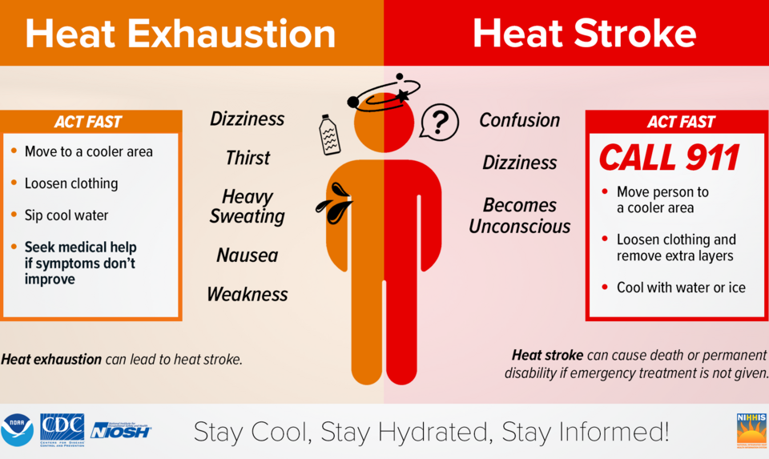
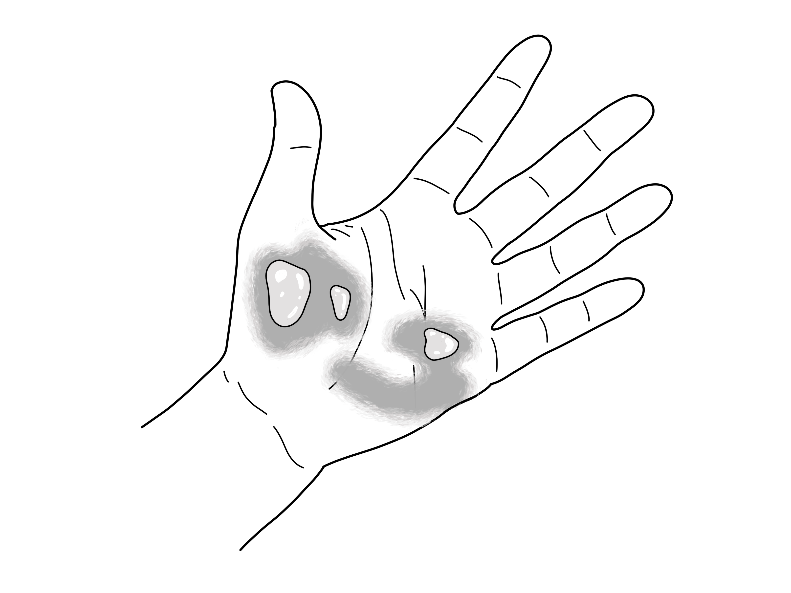
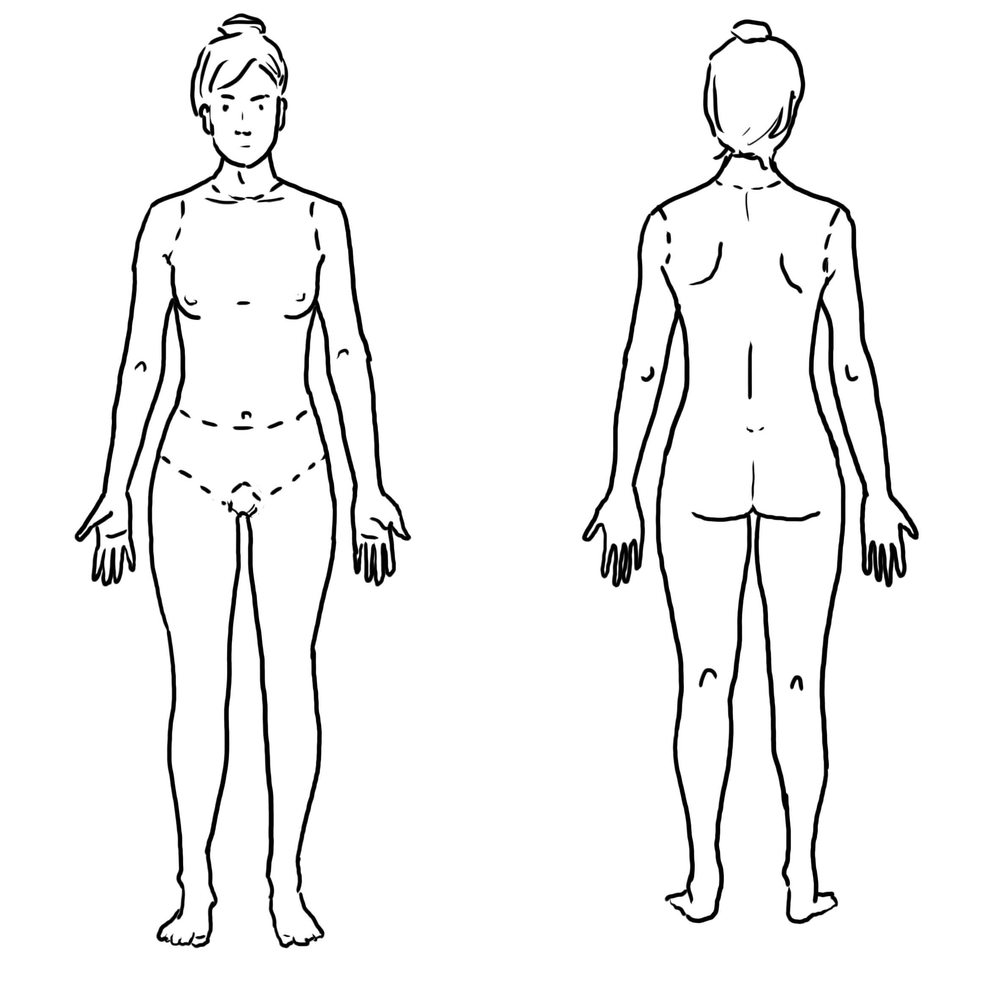
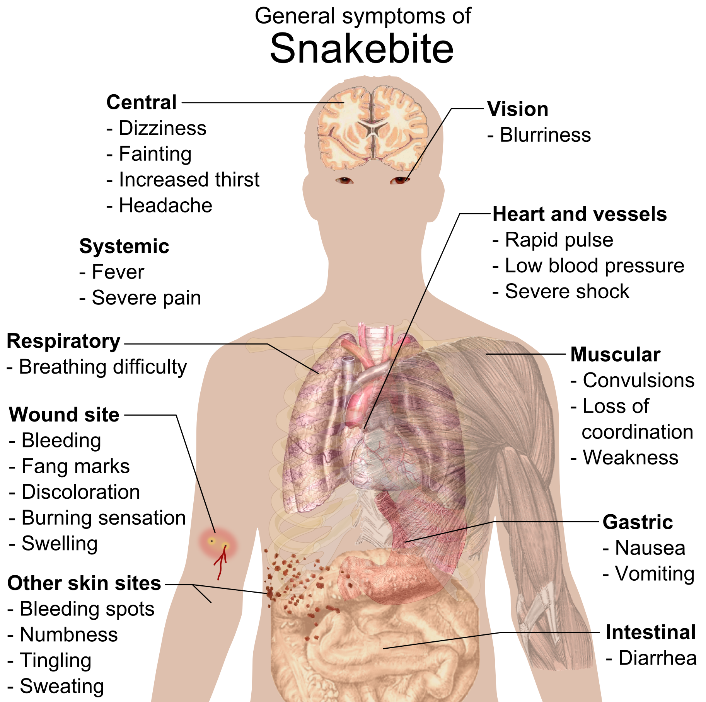
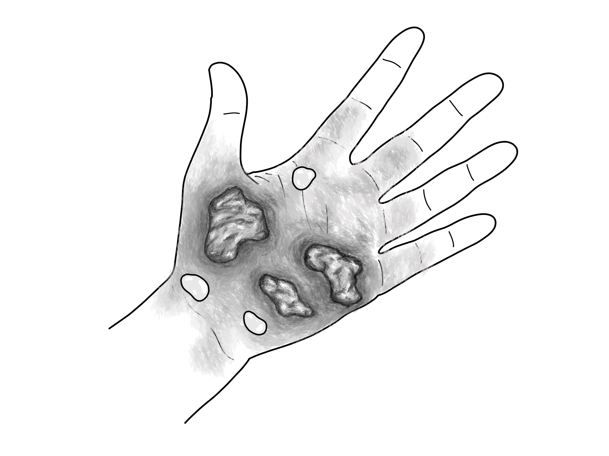
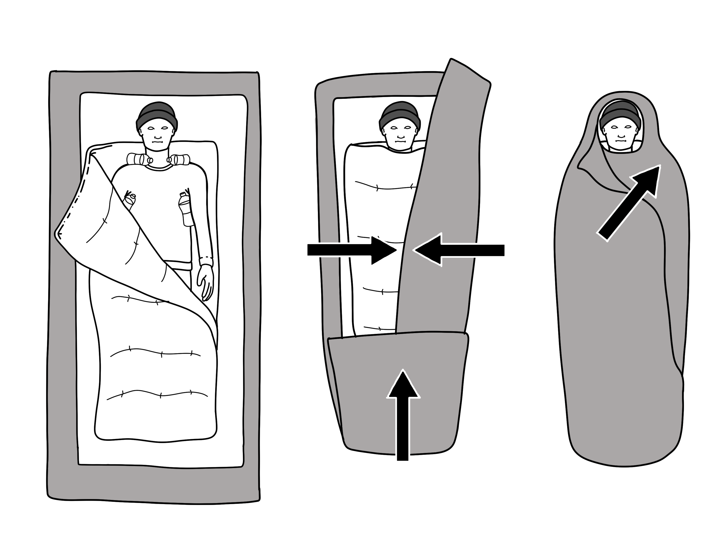

# UNIÃO SERVIÇOS MÉDICOS
## DIRETORIA DE ENSINO, PESQUISA E INSTRUÇÃO PRÉ-HOSPITALAR

---

**MÓDULO C12 — EMERGÊNCIAS AMBIENTAIS E INTOXICAÇÕES**
*Biblioteca Curricular: Núcleo Compartilhado (Core Skills)*
*Versão Editorial: 1.0.0 — Padrão Editorial USM*
*Carga Horária Teórica: 1 hora | Público-alvo: Não médicos, educadores, monitores, gestores e brigadistas*

---

## SUMÁRIO

- [Seção 1 — Em 30 Segundos](#seção-1--em-30-segundos)
- [Seção 2 — Objetivos de Aprendizagem](#seção-2--objetivos-de-aprendizagem)
- [Seção 3 — Introdução e Relevância dos Perigos Ambientais e Toxicológicos](#seção-3--introdução-e-relevância-dos-perigos-ambientais-e-toxicológicos)
- [Seção 4 — Fisiopatologia Térmica, Elétrica, Hídrica e Toxicológica](#seção-4--fisiopatologia-térmica-elétrica-hídrica-e-toxicológica)
- [Seção 5 — Desenvolvimento dos Subtemas](#seção-5--desenvolvimento-dos-subtemas)
  - [5.1 Queimaduras Térmicas e Químicas: Classificação e Regra dos Nove](#51-queimaduras-térmicas-e-químicas-classificação-e-regra-dos-nove)
  - [5.2 Emergências Térmicas: Intermação versus Hipotermia](#52-emergências-térmicas-intermação-versus-hipotermia)
  - [5.3 Acidentes Elétricos: Baixa versus Alta Tensão e Eletrocussão](#53-acidentes-elétricos-baixa-versus-alta-tensão-e-eletrocussão)
  - [5.4 Intoxicações Exógenas Agudas e Envenenamentos](#54-intoxicações-exógenas-agudas-e-envenenamentos)
  - [5.5 Acidentes por Animais Peçonhentos no Brasil (Ofídicos, Aracnídeos e Escorpiônicos)](#55-acidentes-por-animais-peçonhentos-no-brasil-ofídicos-aracnídeos-e-escorpiônicos)
  - [5.6 Afogamento: Cadeia de Sobrevivência Aquática e Segurança do Socorrista](#56-afogamento-cadeia-de-sobrevivência-aquática-e-segurança-do-socorrista)
- [Seção 6 — Quadros Práticos e Matrizes Decisórias](#seção-6--quadros-práticos-e-matrizes-decisórias)
- [Seção 7 — Erros Frequentes e Condutas Proibidas](#seção-7--erros-frequentes-e-condutas-proibidas)
- [Seção 8 — Aplicação Prática Contextualizada (Estudo de Caso)](#seção-8--aplicação-prática-contextualizada-estudo-de-caso)
- [Seção 9 — Pulo do Gato](#seção-9--pulo-do-gato)
- [Seção 10 — Mapa Mental das Emergências Ambientais](#seção-10--mapa-mental-das-emergências-ambientais)
- [Seção 11 — O Que Você Precisa Lembrar](#seção-11--o-que-você-precisa-lembrar)
- [Seção 12 — Referências Bibliográficas e Metadados Editoriais](#seção-12--referências-bibliográficas-e-metadados-editoriais)

---

## GUIA DE ATUAÇÃO — PARA QUEM NÃO É DA ÁREA DA SAÚDE

> **EM UMA EMERGÊNCIA REAL:** Proteja-se, peça ajuda e ligue **192 (SAMU)**. Para fogo, resgate em altura, água, espaço confinado ou ambiente perigoso, ligue **193 (Bombeiros)**. Diga o endereço e siga as instruções da central. Este roteiro orienta as primeiras ações, mas não substitui o treino supervisionado das técnicas práticas.

### Situação: Queimadura, intoxicação, calor, frio e animais peçonhentos

**Reconheça os sinais:** Exposição a produto perigoso, queimadura, confusão pelo calor, hipotermia ou picada com sintomas gerais.

### O que fazer — passo a passo

1. Afaste a pessoa do risco somente se puder fazê-lo sem se expor.
2. Em fogo, gás, eletricidade ou produto desconhecido, ligue 193 e 192. Isole a área.
3. Em queimadura térmica, resfrie com água corrente fresca por cerca de 20 minutos; cubra com material limpo.
4. Em acidente químico na pele ou nos olhos, retire a fonte com proteção adequada e lave com água abundante; siga orientações do produto e centro toxicológico.
5. Em suspeita de intermação, inicie resfriamento rápido e acione 192.
6. Em acidente com animal peçonhento, mantenha repouso, retire adornos apertados e procure urgência.
7. Se a pessoa não responde e não respira normalmente, inicie RCP quando a cena estiver segura.

### Não faça isto

Não aplique gelo diretamente em queimaduras. Não faça cortes, sucção, torniquete ou remédio caseiro em picadas.

### Exercício prático de aprendizagem

Apresente três cartões: queimadura térmica, produto químico e picada. O aluno identifica a primeira ação.

**Ao entregar a vítima:** informe horário de início, mudanças na respiração e na consciência, riscos e medidas aplicadas.

**Limites:** não faça procedimentos invasivos, administração de fármacos não prescritos, resgates técnicos ou intervenções que dependam de habilitação profissional. Pratique presencialmente RCP, DEA, controle de sangramento e desengasgo em manequins antes de assumir atendimento.

**Referências operacionais:** Ministério da Saúde — SAMU 192 (https://www.gov.br/saude/pt-br/composicao/saes/samu-192/samu-192); AHA/AAP — RCP e primeiros socorros 2025 (https://cpr.heart.org/en/resuscitation-science/cpr-and-ecc-guidelines); AHA/Cruz Vermelha — Primeiros Socorros 2024 (https://cpr.heart.org/en/resuscitation-science/2024-first-aid-guidelines).

---

## SEÇÃO 1 — EM 30 SEGUNDOS

> **VISÃO RÁPIDA DE SOBREVIVÊNCIA**
> 1. **Queimadura só se resfria com água:** Resfrie imediatamente a queimadura térmica com **água corrente fria ou em temperatura ambiente por 10 a 20 minutos**. Nunca aplique gelo direto, manteiga, pasta de dente, borra de café ou pomadas [1, 2].
> 2. **Afogamento é parada hipóxica:** Na vítima de afogamento em parada cardíaca, **inicie com 5 ventilações de resgate** antes de iniciar as compressões torácicas, pois a causa primária é a falta de oxigênio pulmonar e não a arritmia coronariana [3, 4].
> 3. **Choque elétrico: desligue a fonte antes de tocar:** Nunca encoste em alguém preso à eletricidade. Desarme a chave geral ou disjuntor. Em alta tensão de rua, mantenha distância de no mínimo 10 metros e chame os bombeiros (193) [5].
> 4. **Intoxicação: NUNCA provoque vômito:** Forçar o vômito em quem ingeriu soda cáustica, ácido, água sanitária ou derivados de petróleo (querosene, gasolina) queima o esôfago uma segunda vez e causa pneumonia química fatal por aspiração [6]. Ligue para o Disque-Intoxicação da ANVISA (**0800-722-6001**) ou SAMU 192.
> 5. **Acidentes com animais peçonhentos:** Lave o local apenas com água e sabão. **JAMAIS faça torniquete, cortes ou sucção na picada** de cobras ou escorpiões. Mantenha a vítima em repouso e encaminhe para o hospital com soro antiveneno [7].
> 6. **Intermação (Golpe de Calor):** Vítima em colapso com pele quente e seca, confusão mental e temperatura corporal acima de 40 °C precisa de **resfriamento corporal agressivo imediato** (imersão em água fria ou panos molhados) para evitar lesão cerebral fatal [1, 8].

---

## SEÇÃO 2 — OBJETIVOS DE APRENDIZAGEM

Ao concluir o estudo deste módulo, o aluno deverá ser capaz de:

1. **Classificar as queimaduras em 1º, 2º e 3º graus**, estimando a área de superfície corporal queimada (SCQ) pela Regra dos Nove de Wallace.
2. **Executar o resfriamento correto de queimaduras térmicas e a irrigação de queimaduras químicas**, prevenindo a hipotermia secundária.
3. **Reconhecer e diferenciar a Exaustão Térmica da Intermação Grave (*Heat Stroke*)**, aplicando protocolos de resfriamento evaporativo e por imersão.
4. **Manejar acidentes elétricos residenciais e industriais**, identificando o trajeto da corrente, pontos de entrada/saída e arritmias cardíacas tardias.
5. **Aplicar a conduta correta em intoxicações agudas por via oral, inalatória e dérmica**, articulando-se com os Centros de Informação e Assistência Toxicológica (CIATox).
6. **Descrever os sinais clínicos e o socorro adequado para acidentes botrópicos, crotálicos e escorpiônicos no Brasil**.
7. **Aplicar a Cadeia de Sobrevivência do Afogamento da SOBRASA / ILS**, realizando o resgate sem se tornar uma segunda vítima na água.

---

## SEÇÃO 3 — INTRODUÇÃO E RELEVÂNCIA DOS PERIGOS AMBIENTAIS E TOXICOLÓGICOS

**LEITURA GUIADA — COMECE AQUI:** Queimaduras, intoxicações e acidentes com animais peçonhentos têm uma pergunta em comum: a fonte do risco ainda está presente? Antes de tratar a lesão, afaste-se do perigo. Depois faça apenas as medidas simples indicadas para aquele agente.

As emergências ambientais e toxicológicas abrangem agravos em que o organismo humano é submetido a energias e agentes externos nocivos: energia térmica extrema (fogo, vapor, líquidos ferventes), energia elétrica de alta intensidade, agentes químicos industriais e domésticos corrosivos, toxinas biológicas de animais peçonhentos e hipóxia por submersão líquida (afogamento) [1, 3, 5].



*Figura 1 — Quadro comparativo clínico entre exaustão térmica e golpe de calor (intermação). Crédito: National Weather Service / CDC / NIOSH. Licença: Domínio público. Fonte: Wikimedia Commons.*

No Brasil, os acidentes por animais peçonhentos representam uma notificação compulsória de magnitude alarmante: são mais de **300 mil acidentes anuais**, com destaque para as picadas de escorpiões da espécie *Tityus serrulatus* (escorpião-amarelo), que lideram os casos fatais em crianças, e serpentes do gênero *Bothrops* (jararacas), responsáveis por mais de 85% dos acidentes ofídicos [7].

Da mesma forma, o afogamento é responsável pelo falecimento de mais de 5.700 brasileiros todos os anos, sendo a segunda causa de morte acidental em crianças de 1 a 4 anos de idade [3]. Nas cozinhas domésticas e nas indústrias, as queimaduras térmicas e químicas produzem sequelas estéticas e funcionais devastadoras se o socorro nas primeiras dezenas de minutos for inadequado [2]. O socorrista leigo bem instruído atua exatamente na janela de ouro que impede que o calor continue cozinhando os tecidos ou que o veneno destrua a função renal da vítima.

---

## SEÇÃO 4 — FISIOPATOLOGIA TÉRMICA, ELÉTRICA, HÍDRICA E TOXICOLÓGICA

> [!NOTE]
> **Por que isso acontece?** Calor, substâncias químicas e toxinas podem danificar tecidos por mecanismos diferentes. Por isso, neutralizar um produto químico na pele ou aplicar receitas caseiras numa picada pode piorar a lesão. O primeiro socorro depende da natureza do risco.

### 4.1 Fisiopatologia da Queimadura e Perda da Barreira Cutânea
A pele é o maior órgão do corpo humano, responsável pela termorregulação, barreira contra microrganismos e retenção hídrica:
- A exposição térmica acima de **44 °C** inicia a desnaturação de proteínas celulares e a necrose tecidual.
- O calor destrói os capilares locais, disparando uma liberação maciça de histamina e cininas inflamatórias. A permeabilidade vascular dispara: o plasma sanguíneo vaza para o espaço intersticial, formando as **bolhas (*flictenas*)** no segundo grau ou o extravasamento sistêmico no terceiro grau [2, 6].
- Em queimaduras extensas (> 20% da superfície corporal), esse vazamento contínuo de plasma para fora dos vasos gera o **Choque do Queimado** (um choque hipovolêmico por desidratação e perda proteica brutal) e perda incontrolável de calor, levando à hipotermia e infecções bacterianas graves por quebra da barreira dérmica [2].

### 4.2 Fisiopatologia do Trajeto da Corrente Elétrica
A eletricidade produz lesões biológicas através de três vias [5]:
1. *Efeito Joule (Conversão de eletricidade em calor):* A resistência dos tecidos humanos (especialmente ossos e tendões) transforma a corrente elétrica em temperaturas superiores a 1.000 °C, cozinhando músculos e vasos profundos de dentro para fora. A pele pode apresentar apenas pequenas marcas de "ponto de entrada" na mão e "ponto de saída" no pé, enquanto o interior da perna foi completamente destruído por rabdomiólise [5, 6].
2. *Tetania Muscular e Asfixia:* A corrente alternada residencial (60 Hz) provoca contrações musculares espasmódicas contínuas a 60 vezes por segundo. Isso trava a mão da vítima contra o fio ("não consegue soltar") e paralisa os músculos respiratórios intercostais, gerando asfixia mecânica.
3. *Disrupção Eletrofisiológica do Coração:* Se a corrente elétrica atravessar o tórax durante a fase vulnerável da repolarização ventricular (onda T do eletrocardiograma), induz instantaneamente **Fibrilação Ventricular letal e Parada Cardíaca** [1, 5].

### 4.3 Fisiopatologia do Afogamento e a Cascateia Hipóxica
Contrário ao mito popular, a grande maioria das vítimas de afogamento morre não por ter "os pulmões cheios de litros de água", mas por **asfixia mecânica e hipóxia celular** [3]:
- Ao submergir, a vítima tenta prender a respiração voluntariamente até o limite fisiológico (*break point* da hipercapnia).
- Quando o nível de $CO_2$ cerebral atinge níveis críticos, o centro respiratório força uma inspiração reflexa involuntária. Uma pequena quantidade de água (frequentemente menos de 1 a 3 mL/kg) penetra na laringe, disparando um espasmo violento reflexo das cordas vocais (**laringoespasmo**) [3].
- O laringoespasmo bloqueia a entrada de ar. A vítima asfixia-se em apneia, o oxigênio alveolar esgota-se e o coração entra em bradicardia extrema, assistolia ou parada cardíaca por anóxia. A água que eventualmente entra nos alvéolos dilui e destrói o **surfactante pulmonar**, provocando atelectasia e edema pulmonar agudo grave [3, 4].

---

## SEÇÃO 5 — DESENVOLVIMENTO DOS SUBTEMAS

### 5.1 Queimaduras Térmicas e Químicas: Classificação e Regra dos Nove
As queimaduras são graduadas pela profundidade tecidual atingida [2]:
- **1º Grau (Superficial):** Atinge apenas a epiderme. Pele avermelhada (*eritema*), quente, seca e muito dolorosa (ex.: queimadura solar típica). Não forma bolhas. Cicatriza em 3 a 6 dias sem cicatriz.
- **2º Grau (Espessura Parcial):** Atinge a epiderme e partes variáveis da derme. Caracteriza-se pela presença de **bolhas intactas ou rompidas (*flictenas*)**, com fundo avermelhado e úmido, extremamente dolorosas ao contato do ar.
- **3º Grau (Espessura Total):** Destrói todas as camadas da pele, atingindo tecido adiposo subcutâneo, músculos ou ossos. Aspecto esbranquiçado (couro cru), acinzentado ou carbonizado escuro e seco. **Geralmente indolor no centro da lesão**, pois as terminações nervosas sensitivas foram completamente destruídas pelo calor (a dor persiste apenas nas bordas de 2º grau adjacentes) [2, 6].



*Figura 2 — Queimadura de segundo grau superficial com formação de flictenas (bolhas). Crédito: Baedr-9439. Licença: CC0. Fonte: Wikimedia Commons.*

#### Cálculo da Superfície Corporal Queimada (Regra dos Nove de Wallace):
Utilizada para estimar o percentual corporal em adultos: Cabeça (9%), Membro Superior Direito (9%), Membro Superior Esquerdo (9%), Tronco Anterior (18%), Tronco Posterior (18%), Membro Inferior Direito (18%), Membro Inferior Esquerdo (18%) e Genitália (1%).
- *Regra da Palma da Mão:* A palma da mão da própria vítima (com os dedos fechados) representa aproximadamente **1% da sua área de superfície corporal**, servindo como excelente régua visual rápida para feridas dispersas [2].

#### Conduta Pré-Hospitalar Correta na Queimadura Térmica:
1. **Interromper a fonte de calor:** Apagar chamas nas roupas (fazer a vítima rolar no chão), desligar o vapor ou afastar o objeto quente.
2. **Resfriamento Imediato:** Coloque a área queimada sob **água corrente fria ou em temperatura ambiente (15 °C a 20 °C) por 10 a 20 minutos** [1, 2]. Isso dissipa o calor residual que continuava queimando as camadas profundas e alivia imediatamente a dor.
3. **Retirar adornos:** Retire anéis, relógios, pulseiras e roupas apertadas antes que o membro inche.
4. **NÃO romper bolhas:** As bolhas formam um curativo biológico estéril perfeito contra bactérias.
5. **Cobertura Úmida/Seca e Limpa:** Cubra com gazes estéreis umedecidas em soro nos primeiros minutos ou plástico filme estéril (tipo PVC culinário limpo sem apertar), protegendo com manta térmica por fora para evitar que a vítima entre em hipotermia [2].

#### Queimaduras Químicas:
Lave a área atingida com **água corrente contínua por no mínimo 20 a 30 minutos ininterruptos** para diluir e remover o reagente. Se o produto for em pó seco (como cal ou soda em pó), **escove o pó a seco com uma toalha antes de jogar água**, pois alguns pós químicos reagem termicamente com a água se não forem retirados antes [1, 2].

### 5.2 Emergências Térmicas: Intermação versus Hipotermia
- **Exaustão Térmica:** Ocorre pelo esforço físico intenso no calor com desidratação e perda de sais. A vítima apresenta fraqueza, sudorese intensa, tontura, dor de cabeça e temperatura corporal normal ou levemente elevada (< 39 °C). Manejo: repouso à sombra, afrouxar roupas e hidratação oral com sais de reidratação ou água fresca [1, 8].
- **Intermação / Golpe de Calor (*Heat Stroke*):** É uma emergência médica de extrema gravidade com mortalidade superior a 50% se não tratada em minutos. O sistema de termorregulação hipotalâmico entra em colapso:
  - *Manifestações:* Temperatura corporal central **acima de 40 °C**, **pele quente, vermelha e frequentemente seca (sem suor)**, confusão mental severa, alucinações, crises convulsivas e coma [8].
  - *Conduta Imediata:* Iniciar **resfriamento corporal agressivo imediato**: retire o excesso de roupas, imerja o corpo da vítima em banheira com água fria (se consciente) ou envolva o tronco com toalhas ensopadas de água gelada, borrifando água e ventilando vigorosamente com ventiladores. Posicione bolsas de gelo protegidas nas axilas, virilhas e pescoço. Acione o SAMU 192 com código vermelho [1, 8].
- **Hipotermia Acidental:** Queda da temperatura corporal central para menos de 35 °C por imersão em água gelada ou exposição prolongada ao frio e vento. Provoca tremores incontroláveis, fala arrastada, rigidez muscular, bradicardia extrema e arritmias cardíacas letais. Manejo: retirar roupas molhadas, aquecer passivamente com mantas e cobertores secos e evitar movimentações corporais bruscas (que podem disparar fibrilação ventricular em corações hipotérmicos) [1].

### 5.3 Acidentes Elétricos: Baixa versus Alta Tensão e Eletrocussão
- **Baixa Tensão (< 1.000 Volts — Residencial / Escritório 110V/220V):**
  - Desligue imediatamente o disjuntor geral da casa ou puxe o plugue da tomada pelo fio isolado. Se não for possível desligar, empurre a vítima ou afaste o fio condutor utilizando material isolante completamente seco (cabo de vassoura de madeira seca, cano de PVC rígido ou tecido seco enrolado).
- **Alta Tensão (> 1.000 Volts — Fiação de Rua, Postes e Subestações):**
  - **JAMAIS SE APROXIME.** A alta tensão pode saltar pelo ar em forma de arco voltaico (*flash*) a mais de 5 metros de distância. A corrente elétrica no solo forma círculos concêntricos de alta voltagem (**tensão de passo**).
  - Mantenha isolamento a no mínimo **10 a 15 metros de raio** e acione imediatamente os Bombeiros (193) e a concessionária elétrica [5].
- Todo paciente que sofreu choque elétrico significativo com perda transitória de consciência precisa de avaliação hospitalar com eletrocardiograma, devido ao risco de arritmias cardíacas tardias nas primeiras 24 horas [1, 5].

### 5.4 Intoxicações Exógenas Agudas e Envenenamentos
As substâncias tóxicas penetram no organismo por quatro vias principais [6]:
1. **Via Oral (Ingestão):** Medicamentos em excesso, raticidas (chumbinho), produtos de limpeza e plantas tóxicas (comigo-ninguém-pode).
   - *A Regra de Ouro:* **NÃO PROVOQUE O VÔMITO.** Se a substância for corrosiva (ácido clorídrico/muriático ou soda cáustica), forçar o vômito faz o corrosivo queimar o esôfago e a boca na volta, podendo romper a parede esofágica. Se for derivado de hidrocarboneto (querosene, querosene, removedor, thinner), o vômito vaporiza e os hidrocarbonetos entram nos alvéolos pulmonares, provocando pneumonite química asfixiante fulminante.
   - Não dê leite, óleo ou vinagre para beber. Mantenha jejum absoluto.
   - Identifique a embalagem, tire foto do rótulo e ligue imediatamente para o **Disque-Intoxicação da ANVISA: 0800-722-6001** ou SAMU 192 [6].
2. **Via Inalatória (Gases Tóxicos):** Monóxido de carbono em incêndios, fumaça de aquecedores a gás, cloro de piscinas ou solventes em espaços confinados.
   - Retire a vítima imediatamente para local arejado ao ar livre (somente se a cena for segura para o socorrista) e ligue 192/193.
3. **Via Cutânea (Absorção pela Pele):** Inseticidas organofosforados e defensivos agrícolas.
   - Retire todas as vestes contaminadas da vítima usando luvas impermeáveis e lave a pele abundantemente com água corrente e sabão por 20 minutos [1, 6].

### 5.5 Acidentes por Animais Peçonhentos no Brasil
O Brasil abriga ampla diversidade de fauna peçonhenta cujo manejo pré-hospitalar exige rigor científico para não agravar a lesão tecidual [7]:



*Figura 3 — Regra dos Nove de Wallace para estimativa da Superfície Corporal Queimada (SCQ). Crédito: Another-anon-artist-234. Licença: CC0. Fonte: Wikimedia Commons.*

- **Acidentes Ofídicos (Serpentes):**
  - *Gênero Bothrops (Jararacas — 85% dos casos):* O veneno tem ação proteolítica, necrosante e coagulante. Causa dor lancinante imediata, inchaço deformante rápido na perna/braço, bolhas com sangue e hemorragias à distância (sangramento na gengiva ou urina escura).
  - *Gênero Crotalus (Cascavéis — 10% dos casos):* Veneno neurotóxico e miotóxico. Dor local fraca ou nula, mas a vítima apresenta "fácies miastênica" (pálpebras caídas, visão dupla/turva), urina cor de coca-cola (mioglobinúria por destruição muscular) e paralisia respiratória.
  - *Gênero Lachesis (Surucucus) e Micrurus (Corais Verdadeiras).*
- **Acidentes por Escorpiões (Tityus) e Aranhas (Loxosceles / Armadeiras):**
  - A picada do escorpião-amarelo provoca dor local intensa instantânea sem inchaço aparente. Em crianças menores de 7 anos, a toxina atua no sistema nervoso autônomo, provocando salivação excessiva, vômitos profusos, sudorese, arritmias e edema agudo de pulmão grave com risco iminente de morte em poucas horas [7].

```
+---------------------------------------------------------------------------------+
|               O QUE FAZER E O QUE NUNCA FAZER EM PICADAS DE PEÇONHENTOS         |
|                                                                                 |
|  [ O QUE FAZER (CONDUTA CORRETA) ]                                              |
|  1. Manter a vítima calma e em repouso absoluto (evitar caminhar ou correr).    |
|  2. Lavar o local da picada apenas com ÁGUA CORRENTE E SABÃO neutro.            |
|  3. Retirar anéis, pulseiras e sapatos antes que o membro inche.                |
|  4. Manter o membro acidentado nivelado ao tronco ou ligeiramente elevado.      |
|  5. Levar imediatamente ao hospital de referência regional com soro específico. |
|  6. Se possível e com segurança, tirar foto do animal para identificação médica.|
|                                                                                 |
|  [ O QUE NUNCA FAZER (PROIBIÇÕES ABSOLUTAS) ]                                   |
|  - NÃO fazer torniquete ou garrotear o membro (acelera a necrose e amputação).   |
|  - NÃO cortar a pele nem tentar furar o local da picada com lâminas.           |
|  - NÃO tentar chupar ou sugar o veneno com a boca ou ventosas.                  |
|  - NÃO aplicar querosene, fumo, borra de café, folhas, urina ou alho no corte.  |
|  - NÃO oferecer bebidas alcoólicas à vítima.                                    |
+---------------------------------------------------------------------------------+
```

### 5.6 Afogamento: Cadeia de Sobrevivência Aquática e Segurança do Socorrista
A Sociedade Brasileira de Salvamento Aquático (SOBRASA) e a *International Life Saving Federation* (ILS) padronizam a resposta ao afogamento através de cinco elos operacionais vitais [3]:

```
+---------------------------------------------------------------------------------+
|                   CADEIA DE SOBREVIVÊNCIA DO AFOGAMENTO (SOBRASA)               |
|                                                                                 |
|  [ ELO 1: PREVENÇÃO ]                                                           |
|  - Respeitar placas de perigo, correntes de retorno e boias; vigiar crianças.  |
|                                                                                 |
|  [ ELO 2: RECONHECER O AFOGADO E PEDIR SOCORRO ]                                |
|  - Vítima batendo os braços na água sem sair do lugar; ligar 193 (Bombeiros).   |
|                                                                                 |
|  [ ELO 3: FORNECER FLUTUAÇÃO SEM ENTRAR NA ÁGUA ]                               |
|  - Jogar boias, pranchas, galões vazios de água ou cordas para a vítima boiar.  |
|                                                                                 |
|  [ ELO 4: REMOVER DA ÁGUA COM SEGURANÇA ]                                      |
|  - Só entre na água se for salva-vidas treinado e com flutuador. Resgate seguro.|
|                                                                                 |
|  [ ELO 5: SUPORTE DE VIDA NA AREIA / BORDA ]                                    |
|  - Se inconsciente e sem respiração: INICIAR RCP COM 5 VENTILAÇÕES DE RESGATE!  |
+---------------------------------------------------------------------------------+
```



*Figura 4 — Manifestações clínicas locais e sistêmicas nos acidentes ofídicos (peçonhentos). Crédito: Mikael Häggström. Licença: Domínio público. Fonte: Wikimedia Commons.*

> [!IMPORTANT]
> **ENTENDA O PORQUÊ: AS 5 VENTILAÇÕES INICIAIS NO AFOGADO**
> No afogamento, o coração parou porque os pulmões ficaram sem oxigênio (parada primariamente hipóxica/asfíxica), e não por infarto ou fibrilação cardíaca primária. Portanto, enquanto na parada súbita comum do adulto nós começamos pelas compressões, no **AFOGADO a prioridade é oxigenar o sangue imediatamente**. Posicione a vítima na areia firme de barriga para cima, abra a via aérea e aplique **5 ventilações de resgate com Pocket Mask** (ou boca a boca se não houver dispositivo). Em seguida, continue ciclos de **30 compressões torácicas para 2 ventilações** [3, 4]. Não perca tempo tentando "tirar a água da barriga" apertando o estômago; isso induz vômito e broncoaspiração imediata.

---

---

## SEÇÃO 6 — QUADROS PRÁTICOS E MATRIZES DECISÓRIAS

### Quadro 6.1 — Classificação e Conduta em Queimaduras

| Grau da Lesão | Camadas da Pele | Sinais Clínicos Típicos | Conduta Obrigatória no APH |
|---|---|---|---|
| **1º Grau** | Apenas Epiderme | Vermelhidão intensa, calor, dor suportável, sem bolhas. | Resfriar com água corrente fria (10 a 20 min); hidratar a pele após o banho. |
| **2º Grau** | Epiderme e Derme | **Presença de bolhas (*flictenas*)**, fundo úmido e muito doloroso. | Resfriar em água corrente; **NÃO romper bolhas**; cobrir com gaze estéril ou plástico limpo. |
| **3º Grau** | Pele total, gordura e músculos | Couro esbranquiçado, cinza ou carbonizado seco; centro indolor. | Resfriar suavemente; cobrir com pano limpo e seco; **chamar 192/193**; manter aquecido contra hipotermia. |
| **Química** | Variável com corrosão ácida/base | Queimação progressiva com alteração de cor da pele. | **Irrigar com água corrente contínua por 20 a 30 minutos** ininterruptos. Tirar roupas. |



*Figura 5 — Queimadura de terceiro grau (espessura total) com destruição epidérmica e dérmica. Crédito: Baedr-9439. Licença: CC0. Fonte: Wikimedia Commons.*

---

### Quadro 6.2 — Classificação de Gravidade do Afogamento (Tabela SOBRASA)

| Grau Clínico | Manifestação da Vítima Retirada da Água | Conduta Pré-Hospitalar Recomendada |
|---|---|---|
| **Grau 1** | Apenas tosse seca, sem espuma na boca, sinais estáveis. | Aquecer, tranquilizar, repouso e liberar com orientação. |
| **Grau 2** | Pouca espuma na boca ou nariz; respiração audível. | Aquecer, posição lateral de segurança, oxigênio e hospital. |
| **Grau 3** | Muita espuma na boca e nariz; pulso radial palpável. | Posição semissentada se consciente; suporte de oxigênio 192. |
| **Grau 4** | Muita espuma na boca; **pulso radial ausente** (choque). | Deitar reto; ambulância USA 192 urgente para UTI. |
| **Grau 5** | Vítima em **Parada Respiratória isolada** (tem pulso carotídeo). | **Iniciar 10 ventilações de resgate por minuto** até respirar. |
| **Grau 6** | **Parada Cardiorrespiratória (PCR)** (sem pulso e sem respiração). | **5 ventilações iniciais + ciclos de RCP 30:2 contínuos + DEA.** |

---

## SEÇÃO 7 — ERROS FREQUENTES E CONDUTAS PROIBIDAS

> [!CAUTION]
> **Erro que pode prejudicar a vítima:** Em queimadura térmica, use água corrente fresca e procure atendimento quando houver sinais de gravidade. Em picadas de cobras, não faça cortes, sucção ou torniquete. Em gás ou produto desconhecido, não entre na área contaminada.

> [!CAUTION]
> ### CATÁLOGO DE ERROS CRÍTICOS EM EMERGÊNCIAS AMBIENTAIS
> 
> 1. **Passar manteiga, pasta de dente, pomadas caseiras ou clara de ovo na queimadura:**
>    - *Por que não fazer:* Substâncias gordurosas retêm o calor dentro da pele como uma estufa, aprofundando a queimadura. Além disso, introduzem bactérias oportunistas e formam uma crosta aderente que terá de ser arrancada a seco com escova cirúrgica no hospital sob dor intolerável.
>    - *Conduta correta:* Utilize exclusivamente água limpa corrente em temperatura ambiente.
> 
> 2. **Aplicar gelo direto sobre queimaduras térmicas:**
>    - *Por que não fazer:* O gelo em contato direto com a derme exposta provoca vasoconstrição violenta e queimadura térmica por congelamento (*frostbite*), necrosando o leito celular que ainda estava vivo.
>    - *Conduta correta:* Use água corrente em temperatura ambiente (15 a 20 °C).
> 
> 3. **Fazer torniquete ou garrote após picada de cobra ou escorpião:**
>    - *Por que não fazer:* Prender a circulação aprisiona as enzimas necrosantes e proteolíticas do veneno em uma única região anatômica, destruindo músculos e nervos e levando à amputação obrigatória da perna ou braço da vítima.
>    - *Conduta correta:* Mantenha a circulação livre, lave com água e sabão e desloque a vítima com urgência para o hospital com soro antiveneno.
> 
> 4. **Tentar retirar água do pulmão do afogado apertando a barriga de cabeça para baixo:**
>    - *Por que não fazer:* Pressionar o abdome do afogado empurra o conteúdo gástrico de volta pelo esôfago. A água e os restos alimentares do estômago inundam a faringe e são broncoaspirados diretamente para a traqueia, piorando a asfixia.
>    - *Conduta correta:* Deite a vítima reta e inicie as ventilações e compressões torácicas no solo.
> 
> 5. **Tocar em uma pessoa recebendo choque de baixa tensão com as mãos desnudadas:**
>    - *Por que não fazer:* O corpo da vítima torna-se um condutor energizado. A corrente passará para o socorrista, travando os dois na rede elétrica.
>    - *Conduta correta:* Desligue o disjuntor na caixa de força ou use material de madeira completamente seco.



*Figura 6 — Envoltório de isolamento térmico passivo e ativo para prevenção da hipotermia no trauma. Crédito: Baedr-9439. Licença: CC0. Fonte: Wikimedia Commons.*

---

## SEÇÃO 8 — APLICAÇÃO PRÁTICA CONTEXTUALIZADA (ESTUDO DE CASO)

> [!TIP]
> **Decisão no caso prático:** Alguém derrama produto de limpeza concentrado nos olhos. Primeiro afasta-se a fonte e pede-se ajuda; em local seguro, começa-se irrigação abundante com água, seguindo a ficha do produto e orientação da emergência.

### Cenário Simulado
*Local:* Cozinha industrial de uma empresa de refeições coletivas.  
*Horário:* 11h10.  
*Ocorrência:* Durante a preparação do almoço, um caldeirão de 20 litros de sopa fervente escorrega do fogão industrial e entorna sobre os braços, tórax anterior e abdome de uma cozinheira de 42 anos. O uniforme de algodão fica ensopado de líquido fervente e a mulher grita em desespero, tentando puxar as roupas grudadas. Um brigadista da empresa chega ao setor em 15 segundos.

---

### Resolução Técnica Passo a Passo

#### 1. Neutralização da Fonte e Resfriamento Imediato (0 a 30 segundos)
- O brigadista afasta o caldeirão caído para evitar novos acidentes na poça quente do chão e calça luvas de proteção.
- Conduz a trabalhadora imediatamente para a pia de lavagem de panelas com torneira industrial de água fria em fluxo contínuo.
- **Manejo das Roupas:** O brigadista usa uma tesoura sem ponta para cortar as roupas ensopadas de caldo quente.
  - *Regra Crítica de Segurança:* Onde o tecido de algodão estiver solto, ele é retirado imediatamente. **Onde o tecido estiver grudado e fundido na pele queimada, o brigadista corta ao redor com a tesoura e NÃO puxa o pano grudado**, para não arrancar a pele viva junto [2].
- Posiciona o jato suave de água corrente fria sobre os braços e peito da cozinheira, mantendo a água escorrendo continuamente por **15 minutos ininterruptos**.

#### 2. Avaliação de Gravidade e Superfície Corporal Queimada
- Durante o resfriamento, o brigadista acalma a vítima e avalia as lesões:
  - Tórax anterior e abdome: eritema intenso e formação imediata de bolhas grandes intactas (*2º grau*). Área estimada: 18% pela Regra dos Nove.
  - Antebraço direito e esquerdo: bolhas extensas rompidas e pele descolada (*2º grau*). Área estimada: cerca de 6% (metade dos dois braços).
  - **Superfície Corporal Queimada Total:** Aproximadamente **24% de 2º grau** (Queimadura Grave / Grande Queimada).

#### 3. Acionamento Qualificado do SAMU 192 (1 minuto)
- O brigadista comanda o técnico de segurança:
  > *"Ligue 192 para o SAMU pelo viva-voz! Informe grande queimada por líquido fervente, 24% de área de segundo grau em tórax e braços, vias aéreas preservadas, resfriamento em curso com água desde às 11h11"*.

#### 4. Curativo Protetor e Prevenção Ativa da Hipotermia (15 a 20 minutos)
- Após 15 minutos, a dor em queimação alivia consideravelmente pelo resfriamento tecidual. O brigadista desliga a água.
- **Proteção da Pele:** Cobre as áreas queimadas com rolos de plástico filme transparente culinário limpo (PVC), aplicando camadas soltas sem apertar ou tracionar o tórax. O plástico protege as terminações nervosas do contato com o ar (reduzindo a dor em 80%) e impede que bactérias ambientais colonizem as bolhas abertas [2].
- **Combate à Hipotermia:** Como a paciente teve 24% da pele molhada e queimada, começa a tremer de frio. O brigadista envolve o corpo dela com um cobertor seco por cima do plástico e cobre com uma manta térmica aluminizada.

#### Desfecho Clínico
A Unidade de Suporte Avançado (USA) do SAMU chega em 12 minutos. O médico da viatura elogia o resfriamento correto e a proteção com filme plástico sem substâncias contaminantes caseiras. A paciente recebe analgesia com opioides e hidratação venosa vigorosa guiada pela Fórmula de Parkland no transporte, sendo admitida diretamente no Centro de Tratamento de Queimados (CTQ) de referência, evoluindo para enxertia pontual e cicatrização completa sem infecções graves.

---

## SEÇÃO 9 — PULO DO GATO

> [!TIP]
> ### O PULO DO GATO DA UNIÃO: O PLÁSTICO FILME DE PVC COMO CURATIVO IDEAL DE QUEIMADURAS
> Em emergências com queimaduras extensas com bolhas rompidas de 2º e 3º graus, aplicar ataduras de algodão comum ou gazes secas diretamente sobre a carne viva é um erro gravíssimo: a gaze seca absorve o plasma úmido, gruda como cimento na ferida e terá de ser arrancada sob anestesia no hospital.
> 
> **A Técnica do Plástico Filme Culinário (PVC):**
> 1. Resfrie a queimadura com água corrente por 15 minutos.
> 2. Desenrole o plástico filme transparente de cozinha (que é fabricado industrialmente em altas temperaturas e é praticamente estéril no interior do rolo).
> 3. Aplique o plástico **de forma solta e plana sobre a queimadura**, sem dar voltas apertadas que possam garrotear o membro quando ele inchar.
> 
> O plástico filme não gruda na ferida, veda o contato do ar com as terminações nervosas (aliviando a dor instantaneamente), retém a umidade natural da pele e permite que os médicos do hospital examinem a lesão com os olhos sem precisar retirar o curativo.

---

## SEÇÃO 10 — MAPA MENTAL DAS EMERGÊNCIAS AMBIENTAIS

```
                 EMERGÊNCIAS AMBIENTAIS E INTOXICAÇÕES (C12)
                                      |
     +--------------------------------+--------------------------------+
     |                                |                                |
     V                                V                                V
QUEIMADURAS TÉRMICAS             AFOGAMENTO (SOBRASA)            ACIDENTES PEÇONHENTOS
     |                                |                                |
 - Resfriar com água corrente     - Resgate seguro com boia       - Lavar apenas com água e sabão
   por 10 a 20 minutos              (não entrar sem flutuador)    - Repouso absoluto (não correr)
 - NÃO usar pasta, café, gelo     - Se em Parada Cardíaca:        - Hospital com soro específico
 - Cobrir com plástico filme        * 5 VENTILAÇÕES INICIAIS      - NÃO fazer torniquete!
 - Retirar anéis antes de inchar    * Depois: Ciclos RCP 30:2     - NÃO furar, cortar ou sugar!
     |                                |                                |
     +--------------------------------+--------------------------------+
                                      |
                                      V
                           INTOXICAÇÕES EXÓGENAS AGUDAS
                          - Identificar a substância / embalagem
                          - NUNCA provocar vômito (risco cáustico/aspirativo)
                          - Jejum absoluto total
                          - Ligar Disque-Intoxicação: 0800-722-6001 ou 192
```

---

## SEÇÃO 11 — O QUE VOCÊ PRECISA LEMBRAR

1. **Queimadura se trata com água corrente:** Resfrie por 10 a 20 minutos com água fria limpa. Não use gelo, pastas, borra de café ou pomadas.
2. **Afogado em parada recebe 5 ventilações primeiro:** A causa é a falta de oxigênio. Inicie com 5 insuflações antes de massagear o peito.
3. **Nunca provoque vômito em intoxicações:** Produtos químicos corrosivos ou derivados de petróleo queimam e asfixiam se voltarem pelo esôfago. Ligue 0800-722-6001.
4. **Desligue a energia antes de tocar no eletrocutado:** Não encoste na vítima em contato com a rede elétrica. Desarme os disjuntores da casa.
5. **Picada de cobra ou escorpião não se amarra:** Lave apenas com água e sabão. Nunca faça torniquetes, cortes ou sucções na ferida. Vá direto ao hospital com soro.
6. **Intermação (calor extremo) exige resfriamento urgente:** Vítima quente, confusa e com febre acima de 40 °C precisa de banho frio imediato e bolsas de gelo para não morrer.

---

## SEÇÃO 12 — REFERÊNCIAS BIBLIOGRÁFICAS E METADADOS EDITORIAIS

### Referências Consultadas (Padrão ABNT NBR 6023)

[1] AMERICAN HEART ASSOCIATION (AHA); AMERICAN RED CROSS. **2020 American Heart Association and American Red Cross Guidelines for First Aid: Environmental Emergencies**. *Circulation*, Dallas, v. 142, supl. 2, p. S558-S583, 2020. DOI: 10.1161/CIR.0000000000000917.

[2] SOCIEDADE BRASILEIRA DE QUEIMADURAS (SBQ). **Cartilha de Primeiros Socorros em Queimaduras**. São Paulo: SBQ, 2021. Disponível em: https://sbqueimaduras.org.br.

[3] SZPILMAN, David et al. **Drowning: A systematic review and current concepts**. *Resuscitation*, v. 106, p. 1-10, 2016. [Consenso Atualizado SOBRASA / ILS 2021].

[4] PERKINS, Gavin D. et al. **European Resuscitation Council Guidelines 2021: Basic Life Support and Special Circumstances**. *Resuscitation*, v. 161, p. 98-114, 2021. DOI: 10.1016/j.resuscitation.2021.02.003.

[5] AMERICAN COLLEGE OF SURGEONS (ACS). Committee on Trauma. **Prehospital Trauma Life Support (PHTLS): Burn and Electrical Trauma**. 10. ed. Burlington: Jones & Bartlett Learning, 2023.

[6] AGÊNCIA NACIONAL DE VIGILÂNCIA SANITÁRIA (ANVISA). **Manual de Diagnóstico e Tratamento das Intoxicações Agudas**. Brasília: Ministério da Saúde / ANVISA, 2020.

[7] BRASIL. Ministério da Saúde. Secretaria de Vigilância em Saúde. **Guia de Vigilância em Saúde: Animais Peçonhentos de Importância Médica**. 5. ed. Brasília: Ministério da Saúde, 2022.

[8] LIPMAN, Grant S. et al. **Wilderness Medical Society Clinical Practice Guidelines for the Prevention and Treatment of Heat Illness: 2019 Update**. *Wilderness & Environmental Medicine*, v. 30, n. 4, supl., p. S33-S46, 2019. DOI: 10.1016/j.wem.2018.10.004.

---

### METADADOS EDITORIAIS USM

| Parâmetro | Detalhe |
|---|---|
| **Código e Módulo:** | C12 — Emergências Ambientais e Intoxicações |
| **Biblioteca:** | Núcleo Compartilhado |
| **Status:** | `Aguardando Aprovação Científica` |
| **Data da Redação:** | 19 de outubro de 2026 |
| **Versão:** | 1.0.0 |
| **Validação Científica por IA:** | Conforme diretrizes SBQ, SOBRASA/ILS, ANVISA CIATox e Guia MS Peçonhentos |
| **Próxima Revisão:** | Outubro de 2027 |
