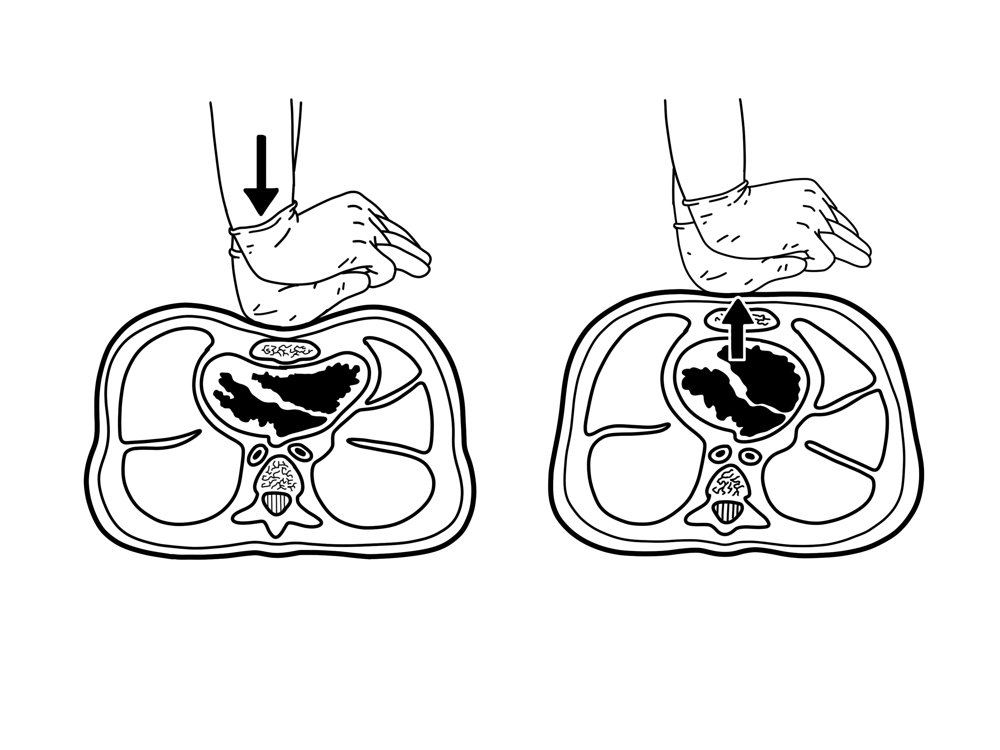
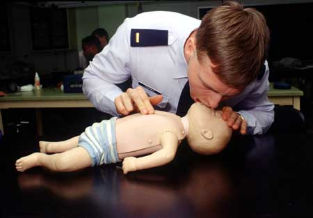
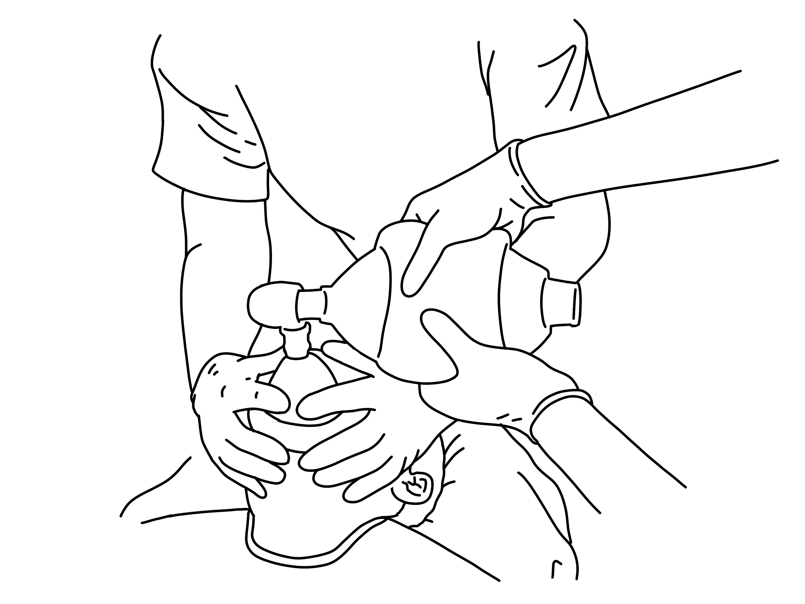
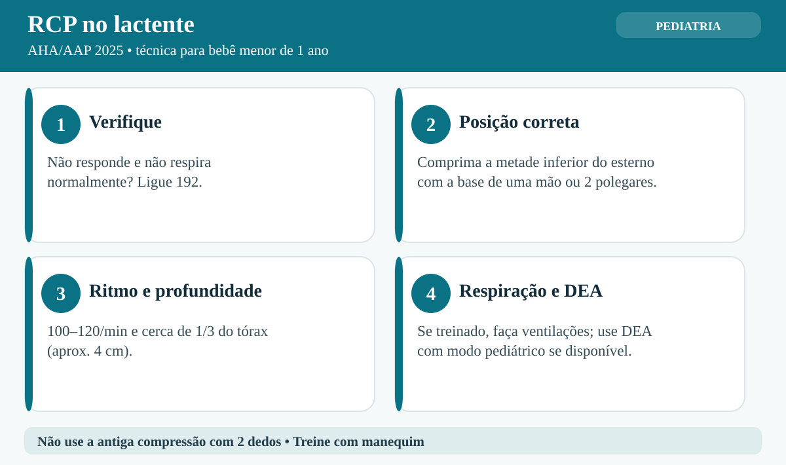

# UNIÃO SERVIÇOS MÉDICOS
## DIRETORIA DE ENSINO, PESQUISA E INSTRUÇÃO PRÉ-HOSPITALAR

---

**MÓDULO E02 — SUPORTE BÁSICO DE VIDA PEDIÁTRICO**
*Biblioteca Curricular: Primeiros Socorros em Escolas (School Safety)*
*Versão Editorial: 1.0.0 — Padrão Editorial USM*
*Carga Horária Teórica: 1h | Prática: 1h | Diretrizes: AHA PALS 2020-2025 / SBP / ILCOR*

---

## SUMÁRIO

- [Seção 1 — Em 30 Segundos](#seção-1--em-30-segundos)
- [Seção 2 — Objetivos de Aprendizagem](#seção-2--objetivos-de-aprendizagem)
- [Seção 3 — Introdução e Epidemiologia da Parada Pediátrica](#seção-3--introdução-e-epidemiologia-da-parada-pediátrica)
- [Seção 4 — Anatomia e Fisiologia Comparativa: O Que Muda na Criança e no Bebê](#seção-4--anatomia-e-fisiologia-comparativa-o-que-muda-na-criança-e-no-bebê)
- [Seção 5 — Desenvolvimento dos Subtemas](#seção-5--desenvolvimento-dos-subtemas)
  - [5.1 Particularidades Anatômicas e Fisiológicas Pediátricas](#51-particularidades-anatômicas-e-fisiológicas-pediátricas)
  - [5.2 Reconhecimento Precoce da PCR em Crianças e Lactentes](#52-reconhecimento-precoce-da-pcr-em-crianças-e-lactentes)
  - [5.3 Técnica da Ressuscitação na Criança (1 ano até a Puberdade)](#53-técnica-da-ressuscitação-na-criança-1-ano-até-a-puberdade)
  - [5.4 Técnica da Ressuscitação no Lactente (Bebês < 1 ano)](#54-técnica-da-ressuscitação-no-lactente-bebês--1-ano)
  - [5.5 Utilização Segura do DEA em Pediatria](#55-utilização-segura-do-dea-em-pediatria)
  - [5.6 Treinamento Prático, Simulações Escolares e Troca de Socorristas](#56-treinamento-prático-simulações-escolares-e-troca-de-socorristas)
- [Seção 6 — Quadros Práticos e Algoritmos Comparativos](#seção-6--quadros-práticos-e-algoritmos-comparativos)
- [Seção 7 — Erros Frequentes e Condutas Proibidas](#seção-7--erros-frequentes-e-condutas-proibidas)
- [Seção 8 — Aplicação Prática Contextualizada (Estudo de Caso)](#seção-8--aplicação-prática-contextualizada-estudo-de-caso)
- [Seção 9 — Pulo do Gato](#seção-9--pulo-do-gato)
- [Seção 10 — Mapa Mental da Ressuscitação Pediátrica](#seção-10--mapa-mental-da-ressuscitação-pediátrica)
- [Seção 11 — O Que Você Precisa Lembrar](#seção-11--o-que-você-precisa-lembrar)
- [Seção 12 — Referências Bibliográficas e Metadados Editoriais](#seção-12--referências-bibliográficas-e-metadados-editoriais)

---

## GUIA DE ATUAÇÃO — PARA QUEM NÃO É DA ÁREA DA SAÚDE

> **EM UMA EMERGÊNCIA REAL:** Proteja-se, peça ajuda e ligue **192 (SAMU)**. Para fogo, resgate em altura, água, espaço confinado ou ambiente perigoso, ligue **193 (Bombeiros)**. Diga o endereço e siga as instruções da central. Este roteiro orienta as primeiras ações, mas não substitui o treino supervisionado das técnicas práticas.

### Situação: RCP em criança e bebê

**Reconheça os sinais:** Criança ou bebê não responde e não apresenta respiração normal. Gasping não conta como respiração normal.

### O que fazer — passo a passo

1. Garanta segurança. Chame a criança e toque o ombro; em lactente, toque suavemente a planta do pé.
2. Ligue 192 em viva-voz e peça DEA com pás pediátricas, se disponíveis.
3. Comece compressões no centro do peito, com 100–120 por minuto e profundidade aproximada de um terço do tórax.
4. Na criança, use a base de uma ou duas mãos conforme o tamanho; a profundidade costuma ser cerca de 5 cm.
5. No bebê, use dois polegares envolvendo o tórax ou a base de uma mão; cerca de 4 cm. Não use dois dedos.
6. Se você consegue ventilar, combine 30 compressões com 2 ventilações quando estiver sozinho; 15:2 com dois socorristas treinados.
7. Se não conseguir ventilar, faça compressões enquanto recebe orientação do 192. Em crianças, ventilações são especialmente importantes.
8. Use o DEA assim que disponível, preferindo atenuador pediátrico quando indicado; siga os desenhos para evitar sobreposição das pás.

### Não faça isto

Não balance o bebê, não faça compressões com a ponta de dois dedos e não espere confirmar ausência de pulso.

### Exercício prático de aprendizagem

Treine separadamente no manequim de bebê e de criança. Confira posição de mãos, profundidade e ventilação.

**Ao entregar a vítima:** informe horário de início, mudanças na respiração e na consciência, riscos e medidas aplicadas.

**Limites:** não faça procedimentos invasivos, administração de fármacos não prescritos, resgates técnicos ou intervenções que dependam de habilitação profissional. Pratique presencialmente RCP, DEA, controle de sangramento e desengasgo em manequins antes de assumir atendimento.

**Referências operacionais:** Ministério da Saúde — SAMU 192 (https://www.gov.br/saude/pt-br/composicao/saes/samu-192/samu-192); AHA/AAP — RCP e primeiros socorros 2025 (https://cpr.heart.org/en/resuscitation-science/cpr-and-ecc-guidelines); AHA/Cruz Vermelha — Primeiros Socorros 2024 (https://cpr.heart.org/en/resuscitation-science/2024-first-aid-guidelines).

---

## SEÇÃO 1 — EM 30 SEGUNDOS

> **VISÃO RÁPIDA DE SOBREVIVÊNCIA**
> 1. **A etiologia pediátrica é diferente do adulto:** Enquanto no adulto a parada cardíaca quase sempre nasce no coração (infarto/arritmia ventricular primária), na criança a parada é secundária à **asfixia e hipóxia respiratória** (engasgo, afogamento, bronquiolite, asma e choque séptico) [1, 2].
> 2. **Oxigenação é mandatória:** Em pediatria, a abordagem *Hands-Only* (apenas massagem) não é o padrão ouro. **As ventilações de resgate são essenciais para salvar a criança**. Se houver barreira, utilize ciclos de **30 compressões para 2 ventilações** (1 socorrista) ou **15:2** (2 socorristas treinados) [1, 3].
> 3. **Definições de faixa etária:**
>    - *Lactente:* Bebê com menos de 1 ano de vida.
>    - *Criança:* De 1 ano de idade até o início dos sinais de puberdade (pelos axilares/peito nos meninos; desenvolvimento de mamas nas meninas).
>    - *Adulto:* Da puberdade em diante [1].
> 4. **Técnica de massagem por tamanho:**
>    - *No Lactente (< 1 ano):* 2 dedos (indicador e médio) no centro do tórax ou técnica dos 2 polegares abraçando o tórax. Profundidade de **4 cm** [1, 2].
>    - *Na Criança (1 ano à puberdade):* 1 ou 2 mãos no centro do esterno, com profundidade de **5 cm** [1].
> 5. **Socorrista sozinho:** Se houver telefone, ligue 192 em viva-voz e inicie RCP. Sem telefone nem ajudante, a sequência de afastamento após cerca de 2 minutos de RCP depende de o colapso ter sido presenciado e da disponibilidade de DEA; treine essa decisão no curso presencial [AHA/AAP 2025].
> 6. **Uso do DEA em crianças:** Use o atenuador pediátrico ou pás infantis em menores de 8 anos. Se não houver pás pediátricas, **use as pás de adulto na posição anteroposterior (sanduíche: frente e costas)** [1, 4].

---

## SEÇÃO 2 — OBJETIVOS DE APRENDIZAGEM

Ao concluir o estudo deste módulo, o educador e socorrista escolar serão capazes de:

1. **Explicar a fisiopatologia da parada hipóxica pediátrica**, diferenciando-a do colapso arrítmico súbito do adulto.
2. **Reconhecer imediatamente a PCR no lactente e na criança** através da avaliação combinada de consciência e ausência de respiração normal.
3. **Executar a biomecânica correta das compressões torácicas pediátricas**, ajustando profundidade (4 cm no lactente, 5 cm na criança) e posicionamento das mãos.
4. **Dominar a técnica de abertura de vias aéreas e ventilações suaves com Pocket Mask pediátrica**, prevenindo a hiperinsuflação gástrica.
5. **Aplicar a relação 30:2 (1 socorrista) e 15:2 (2 socorristas)** conforme as diretrizes internacionais da AHA e Sociedade Brasileira de Pediatria (SBP).
6. **Operar o DEA em crianças e lactentes**, utilizando atenuadores de carga ou posicionamento anteroposterior das pás.

---

## SEÇÃO 3 — INTRODUÇÃO E EPIDEMIOLOGIA DA PARADA PEDIÁTRICA

**LEITURA GUIADA — COMECE AQUI:** Crianças podem parar de respirar antes de sofrer parada cardíaca. Por isso, a RCP pediátrica combina compressões e, sempre que possível para quem foi treinado, ventilações. O primeiro passo é reconhecer rapidamente inconsciência e respiração anormal.

A parada cardiorrespiratória em bebês e crianças é uma emergência que exige resposta organizada dos adultos presentes. Os problemas respiratórios são uma causa importante de deterioração em pediatria, mas não a única. Reconhecimento precoce, acionamento do 192, RCP e DEA conforme indicação podem melhorar as chances de atendimento oportuno [1, 5].

Em muitas crianças, a parada cardíaca é precedida por falta de oxigênio ou falência circulatória. Em outras, causas cardíacas podem provocar colapso súbito. Por isso, não é seguro presumir a origem do evento somente pela aparência. A técnica de RCP deve considerar a idade, o tamanho e a capacitação de quem socorre [1, 2].

A criança asfixia-se por engasgo com comida ou brinquedo, afoga-se na piscina da escola, sofre choque séptico por infecção bacteriana galopante ou entra em exaustão ventilatória por crise asmática descontrolada. À medida que o oxigênio no sangue cai (**hipoxemia severa**), o músculo cardíaco infantil começa a bater cada vez mais devagar (**bradicardia extrema**), até entrar em assistolia definitiva [5]. Dessa realidade biológica decorre a regra mestra do socorro infantil: **em crianças, o ar nos pulmões (oxigenação e ventilação) é tão importante quanto a massagem no peito**.



*Figura 1 — Mecanismo de bomba cardíaca e ejeção sanguínea durante a compressão torácica externa. Crédito: Baedr-9439. Licença: CC0. Fonte: Wikimedia Commons.*

---

## SEÇÃO 4 — ANATOMIA E FISIOLOGIA COMPARATIVA: O QUE MUDA NA CRIANÇA E NO BEBÊ

> [!NOTE]
> **Por que isso acontece?** O coração da criança depende de oxigenação adequada. Compressões ajudam a circular sangue; ventilações ajudam a levar oxigênio aos pulmões. A técnica muda com o tamanho da vítima, especialmente entre bebê e criança maior.

O organismo infantil não é uma réplica em miniatura do corpo adulto; ele possui proporções biométricas, reservas fisiológicas e respostas hemodinâmicas únicas [5, 6]:

```
+---------------------------------------------------------------------------------+
|               ANATOMIA COMPARATIVA: ADULTO VERSUS LACTENTE / CRIANÇA            |
|                                                                                 |
|  [ CABEÇA E COLUNA ]                                                            |
|  - Lactente possui o OCCIPITAL (nuca) proporcionalmente muito volumoso e pesado.|
|  - Ao deitar de costas reto, a cabeça dobra para a frente, ocluindo a via aérea!|
|  - Ação: Manter o pescoço em POSIÇÃO NEUTRA (olhar para o teto, sem estender). |
|                                                                                 |
|  [ VIAS AÉREAS E LÍNGUA ]                                                       |
|  - A língua da criança é proporcionalmente muito grande para a cavidade oral.   |
|  - A traqueia é estreita e flexível (como um canudo de refrigerante fino).      |
|  - Qualquer hiperextensão forçada dobra a traqueia para trás e fecha a via aérea|
|                                                                                 |
|  [ MECÂNICA RESPIRATÓRIA E FADIGA ]                                             |
|  - Costelas infantis são cartilaginosas, horizontais e muito flexíveis.         |
|  - A respiração depende quase 100% do movimento do diafragma (barriga sobe).    |
|  - Qualquer distensão da barriga com ar impede o pulmão de expandir!            |
|                                                                                 |
|  [ FREQUÊNCIA CARDÍACA E DÉBITO ]                                               |
|  - Coração infantil não consegue aumentar muito a força de contração (inotropia)|
|  - O fluxo sanguíneo depende exclusivamente da frequência cardíaca rápida:      |
|    * Frequência normal no bebê: 100 a 160 batimentos por minuto.                |
|    * Bradicardia no bebê (< 60 bpm com má perfusão) é tratada como PARADA!      |
+---------------------------------------------------------------------------------+
```

---

## SEÇÃO 5 — DESENVOLVIMENTO DOS SUBTEMAS

### 5.1 Particularidades Anatômicas e Fisiológicas Pediátricas
- **A Posição "Olfativa" (*Sniffing Position*) de Abertura de Vias Aéreas:** No adulto inconsciente, para abrir a via aérea nós inclinamos a cabeça bastante para trás (*head tilt-chin lift*). **No lactente (bebê < 1 ano), essa extensão máxima é proibida**, pois dobra a traqueia cartilaginosa mole contra a coluna vertebral, ocluindo o ar. No bebê, mantém-se a cabeça na **posição neutra ou de farejador** (o canal auditivo externo alinhado horizontalmente com a ponta do ombro) [1, 2].
- Para manter a posição neutra no bebê deitado de costas, frequentemente coloca-se uma **toalhinha dobrada de 2 cm sob os ombros** do lactente (coxim subescapular), compensando o tamanho grande da nuca.



*Figura 2 — Treino de RCP em manequim de lactente. Crédito: Uniformed Services University. Licença: Domínio público. Fonte: Wikimedia Commons.*

### 5.2 Reconhecimento Precoce da PCR em Crianças e Lactentes
O diagnóstico de parada deve ser feito em **menos de 10 segundos** [1]:
1. **Verificar a responsividade:**
   - *Na Criança:* Bater nos dois ombros com firmeza e chamar em voz alta: *"Filho! Você me ouve?"*.
   - *No Lactente (Bebê):* **Toque suavemente a planta de um pé do bebê** e observe se ele responde. Nunca sacuda o tronco ou o pescoço do bebê (risco de lesão medular e hemorragia cerebral por Síndrome do Bebê Sacudido) [1, 2].
2. **Observar a respiração simultaneamente:**
   - Olhe o tórax e abdome por 5 a 10 segundos: ausência total de movimento torácico ou presença de respiração agônica (*gasping*).
   - **DIAGNÓSTICO: PCR PEDIÁTRICA.**

> [!WARNING]
> **A REGRA DOS PROFISSIONAIS: BRADICARDIA SEVERA NO BEBÊ É PCR**
> Se a criança ou bebê estiver inconsciente, não respirando normalmente, e um profissional de saúde apalpar o pulso central (pulso braquial no bebê ou carotídeo na criança) e encontrar **frequência cardíaca inferior a 60 batimentos por minuto acompanhada de má perfusão** (pele pálida/azulada e fria), as diretrizes da AHA e SBP determinam: **INICIAR COMPRESSÕES TORÁCICAS IMEDIATAMENTE**. Em pediatria, um coração batendo a menos de 60 vezes por minuto não gera débito cardíaco compatível com a sobrevivência cerebral [1, 2].

### 5.3 Técnica da Ressuscitação na Criança (1 ano até a Puberdade)
A biomecânica na criança equilibra força e delicadeza para deprimir o tórax na profundidade correta sem fraturar a parede condrocostal flexível [1, 3]:

1. **Posicionamento:** Criança deitada sobre piso plano e rígido. Socorrista ajoelhado ao lado do peito.
2. **Ponto de Compressão:** Metade inferior do osso esterno (no centro do peito, na linha intermamilar), evitando pressionar o apêndice xifoide inferior.
3. **Uso de Uma ou Duas Mãos:**
   - *Crianças menores (1 a 4 anos / magras):* Utilize o **calcanhar de apenas 1 mão** apoiada no centro do esterno, mantendo o braço esticado a 90 graus.
   - *Crianças maiores (acima de 5 anos ou encorpadas):* Utilize a técnica de **2 mãos entrelaçadas**, exatamente como no adulto [1].
4. **Métricas das Compressões:**
   - **Profundidade:** Deprimir cerca de **5 centímetros (2 polegadas)**, correspondendo a pelo menos um terço do diâmetro anteroposterior do tórax da criança.
   - **Frequência:** **100 a 120 compressões por minuto** ininterruptas.
   - Permitir o retorno elástico completo da caixa torácica a cada ciclo.
5. **Ciclo de Relação Compressão / Ventilação:**
   - **1 Socorrista:** **30 compressões para 2 ventilações de resgate**.
   - **2 Socorristas treinados:** **15 compressões para 2 ventilações de resgate** (a relação 15:2 fornece maior suporte ventilatório e menor acúmulo de $CO_2$ no sangue da criança) [1, 3].



*Figura 3 — Técnica executada por equipe habilitada; o primeiro respondedor leigo deve seguir RCP apropriada à idade e seu treinamento. Crédito: Baedr-9439. Licença: CC0. Fonte: Wikimedia Commons.*

### 5.4 Técnica da Ressuscitação no Lactente (Bebês < 1 ano)


*Figura complementar — Posicionamento e etapas da RCP em bebê conforme atualização pediátrica. Ilustração original União Serviços Médicos (2026), baseada em AHA/AAP 2025; não reproduz material gráfico de terceiros.*

No lactente, a AHA/AAP 2025 recomenda compressões com dois polegares envolvendo o tórax ou com a base de uma mão. A técnica de dois dedos não é recomendada, pois pode não atingir a profundidade adequada [1, 2]:

```
+---------------------------------------------------------------------------------+
|                       TÉCNICAS DE RCP NO LACTENTE (< 1 ANO)                     |
|                                                                                 |
|  [ TÉCNICA 1: DOIS DEDOS (1 SOCORRISTA) ]                                       |
|  - Posicione os dedos INDICADOR E MÉDIO (ou médio e anelar) perpendiculares     |
|    sobre o esterno do bebê, logo abaixo da linha intermamilar.                  |
|  - Comprima verticalmente a uma profundidade de 4 CENTÍMETROS (1,5 polegada).   |
|  - Relação: 30 compressões torácicas para 2 ventilações suaves.                 |
|                                                                                 |
|  [ TÉCNICA 2: DOIS POLEGARES COM AS MÃOS ENVOLVENTES (2 SOCORRISTAS - PADRÃO OURO) |
|  - Os dois socorristas operam juntos:                                          |
|    * O socorrista das compressões abraça o tórax do bebê com as duas mãos,      |
|      apoiando os dedos nas costas e posicionando os DOIS POLEGARES lado a lado  |
|      sobre o centro do esterno do bebê.                                         |
|    * Comprime com os polegares para dentro, deprimindo 4 cm.                    |
|  - Relação: 15 compressões para 2 ventilações de resgate.                       |
|  - Vantagem: Gera maior pressão arterial coronariana e menor fadiga muscular.   |
+---------------------------------------------------------------------------------+
```

#### Como Ventilar no Lactente:
- **Técnica Boca-Boca-e-Nariz:** Se você for realizar ventilação direta ou com barreira flexível no bebê, a sua boca deve cobrir **simultaneamente a boca E o nariz do bebê**, formando uma vedação hermética única [1, 2].
- Sopre uma quantidade de ar suave — **apenas o volume de ar contido nas suas bochechas** (não sopre com a força dos seus pulmões inteiros). Observe o peito do bebê subir suavemente durante 1 segundo e pare. Soprar com força excessiva estoura os alvéolos infantis frágeis (**barotrauma / pneumotórax**) [1, 5].

### 5.5 Utilização Segura do DEA em Pediatria
O Desfibrilador Externo Automático pode e deve ser utilizado em crianças de qualquer idade em parada cardiorrespiratória [1, 4]:
- **Em crianças de 1 a 8 anos:** O ideal é utilizar o **Atenuador de Carga Pediátrico** (chave pediátrica que reduz a energia do choque para 50 a 75 Joules) ou pás pediátricas adesivas próprias.
- **Se não houver pás ou atenuador pediátrico na escola:** **UTILIZE O DEA DE ADULTO COM AS PÁS DE ADULTO NORMALMENTE.** O choque em carga de adulto é muito mais seguro do que deixar a criança morrer sem desfibrilação em fibrilação ventricular [1, 4].
- **Posicionamento Anteroposterior Obrigatório com Pás de Adulto em Criança Pequena:**
  - Se você usar as pás grandes de adulto em uma criança de 2 anos, colar as duas na frente fará as pás se tocarem.
  - Cole **uma pá no meio do peito** e a **outra pá no meio das costas** (técnica do sanduíche). Nenhuma pá encostará na outra e o coração ficará no centro da corrente elétrica.


### 5.6 Treinamento Prático, Simulações Escolares e Troca de Socorristas
Em ambiente escolar e de creches, o cansaço ao realizar compressões com 2 dedos no lactente instala-se rapidamente nos tendões da mão. A cada **2 minutos de RCP (cerca de 5 ciclos 30:2 ou 10 ciclos 15:2)**, os socorristas devem trocar de função em menos de 5 segundos para garantir que a profundidade de 4 ou 5 cm não seja perdida [1, 3].

---

---

## SEÇÃO 6 — QUADROS PRÁTICOS E ALGORITMOS COMPARATIVOS

### Quadro 6.1 — Resumo Mnemônico das Métricas do Suporte Básico de Vida Pediátrico

| Parâmetro Técnico | Lactente (Bebês < 1 ano) | Criança (1 ano até Puberdade) | Adulto (Pós-Puberdade) |
|---|---|---|---|
| **Verificação de Resposta** | Estímulo firme na **sola dos pés**. | Chamar nos ombros com vigor. | Bater com força em ambos os ombros. |
| **Abertura de Via Aérea** | **Posição Neutra** (coxim nos ombros). | Inclinação suave da cabeça e queixo. | Extensão completa da cabeça e queixo. |
| **Profundidade da Massagem** | Exatamente **4 cm** (1/3 do tórax). | Exatamente **5 cm** (1/3 do tórax). | De **5 cm a no máximo 6 cm**. |
| **Posicionamento das Mãos** | 2 dedos no peito ou 2 polegares. | Calcanhar de 1 mão ou 2 mãos. | 2 mãos entrelaçadas no esterno. |
| **Relação com 1 Socorrista** | **30 compressões : 2 ventilações** | **30 compressões : 2 ventilações** | **30 compressões : 2 ventilações** (ou Hands-Only) |
| **Relação com 2 Socorristas** | **15 compressões : 2 ventilações** | **15 compressões : 2 ventilações** | **30 compressões : 2 ventilações** contínuas |
| **Frequência da Massagem** | 100 a 120 por minuto | 100 a 120 por minuto | 100 a 120 por minuto |
| **Pás do DEA em Tórax Pequeno** | Posição Anteroposterior (Sanduíche) | Posição Anteroposterior ou Anterolateral | Posição Anterolateral (Clavícula/Axila) |

---

### Quadro 6.2 — Algoritmo do Socorrista Pediátrico Sozinho versus Acompanhado

| Cenário de Socorro | Ordem Operacional Obrigatória | Justificativa Fisiológica |
|---|---|---|
| **Socorrista ACOMPANHADO** | Socorrista 1 inicia a RCP imediatamente; Socorrista 2 liga 192 e busca o DEA. | Não há atraso nas manobras nem no chamado do socorro avançado. |
| **Socorrista SOZINHO em Colapso Súbito Presenciado** | Presenciou a criança cair dura e desacordar: Ligar 192 e buscar o DEA primeiro! | Provável parada cardíaca súbita primária arrítmica (precisa de choque rápido). |
| **Socorrista SOZINHO em Parada NÃO Presenciada / Asfíxica** | Encontrou a criança já desacordada, afogada ou asfixiada: **Se não houver telefone acessível nem outra pessoa, aplique a sequência para socorrista sozinho ensinada no curso e providencie o 192 assim que possível. Com celular, ligue em viva-voz sem atrasar a RCP.** | O cérebro está em anóxia extrema. Dois minutos de oxigenação imediata salvam os neurônios antes do chamado [1, 3]. |

---

## SEÇÃO 7 — ERROS FREQUENTES E CONDUTAS PROIBIDAS

> [!CAUTION]
> **Erro que pode prejudicar a vítima:** Nas diretrizes de 2025, a compressão torácica do lactente usa a base de uma mão ou dois polegares envolvendo o tórax, não a antiga técnica de dois dedos. Use manequins apropriados para praticar profundidade, ritmo e ventilações.

> [!CAUTION]
> ### CATÁLOGO DE ERROS CRÍTICOS NA RESSUSCITAÇÃO PEDIÁTRICA
> 
> 1. **Fazer RCP "Hands-Only" (apenas compressões sem ventilar) como primeira escolha em crianças:**
>    - *Por que não fazer:* Em adultos em parada súbita, o sangue ainda tem oxigênio residual. Na criança, o coração parou porque o oxigênio do sangue acabou completamente minutos antes por asfixia. Fazer massagem sem ventilar apenas empurra sangue sem oxigênio para um cérebro que está morrendo sufocado.
>    - *Conduta correta:* Em pediatria, utilize sempre a relação com ventilações (30:2 ou 15:2) com máscara de barreira.
> 
> 2. **Soprar ar com força excessiva nos pulmões do bebê:**
>    - *Por que não fazer:* A capacidade pulmonar do lactente é minúscula (cerca de 50 a 80 mL de volume corrente). Soprar todo o ar dos seus pulmões adultos arrebenta a estrutura alveolar delicada do bebê, provocando pneumotórax bilateral compressivo letal em segundos e distensão gástrica severa.
>    - *Conduta correta:* Sopre apenas o ar contido nas suas bochechas ("sopro de velinha"), observando o tórax subir suavemente por 1 segundo.
> 
> 3. **Sacudir o bebê pelo tronco para ver se ele acorda:**
>    - *Por que não fazer:* O peso da cabeça do lactente é desproporcional ao tônus muscular do pescoço. Sacudir a criança projeta o encéfalo contra a calota craniana, provocando ruptura de veias pontes meníngeas, hemorragia subdural, edema cerebral e lesões medulares cervicais irreversíveis.
>    - *Conduta correta:* Estimule com toques firmes e vigorosos na planta dos pés.
> 
> 4. **Hipersuavizar as compressões com medo de machucar a criança:**
>    - *Por que não fazer:* Comprimir apenas 1 ou 2 centímetros com medo de "quebrar costelas" não gera pressão aórtica suficiente para perfundir as coronárias e o cérebro. O débito cardíaco permanece zero.
>    - *Conduta correta:* Comprima com determinação biomecânica: 4 cm no bebê e 5 cm na criança (1/3 da profundidade do peito).
> 
> 5. **Hipersuportar a cabeça do bebê para trás dobrando o pescoço:**
>    - *Por que não fazer:* Estender a cabeça do bebê fecha a via aérea. Mantenha a cabeça em posição neutra com a face voltada diretamente para cima.

---

## SEÇÃO 8 — APLICAÇÃO PRÁTICA CONTEXTUALIZADA (ESTUDO DE CASO)

> [!TIP]
> **Decisão no caso prático:** Um bebê da creche está inconsciente e não respira normalmente. A cuidadora pede ajuda e liga 192 em viva-voz; inicia RCP segundo seu treinamento. Outro funcionário traz o DEA e chama os responsáveis.

### Cenário Simulado
*Local:* Berçário de uma creche municipal.  
*Horário:* 13h40 (período de sono dos bebês).  
*Ocorrência:* Durante a ronda periódica no dormitório, a educadora infantil aproxima-se do berço de um bebê de 8 meses e nota que a criança está deitada de bruços, imóvel, com coloração labial pálida acinzentada. Ao tocá-la, o corpo está flácido. A professora capacitada na Lei Lucas atua imediatamente.

---

### Resolução Técnica Passo a Passo

#### 1. Reconhecimento Imediato no Berçário (0 a 10 segundos)
- A educadora vira o bebê imediatamente de barriga para cima sobre a bancada firme do trocador.
- Bate com firmeza na sola dos dois pés do bebê com os dedos: *"Lucas! Acorda, Lucas!"*. O bebê não emite choro, não move os olhos e permanece inerte.
- Simultaneamente, a educadora aproxima o rosto da face do bebê e olha o tórax por 6 segundos: não há nenhuma expansão torácica e nenhum fluxo aéreo saindo da boca ou nariz.
- **Diagnóstico:** Parada Cardiorrespiratória em Lactente.

#### 2. Acionamento em Equipe
- A educadora grita em tom firme para a auxiliar da sala ao lado:
  > *"Mariana! O bebê está em parada cardíaca! Ligue 192 para o SAMU pelo viva-voz, traga a maleta da Lei Lucas com a máscara infantil e peça para a diretoria trazer o DEA agora!"*.

#### 3. Início das Manobras de RCP Pediátrica (10 segundos a 2 minutos)
- A educadora posiciona uma toalhinha dobrada sob as escápulas do bebê para manter o pescoço em posição neutra.
- Como a auxiliar está na linha com o 192, a educadora atua inicialmente como socorrista única:
  - Posiciona a ponta dos dedos indicador e médio no centro do esterno do bebê (logo abaixo da linha imaginária entre os dois mamilos).
  - Executa **30 compressões torácicas rápidas e rítmicas**, deprimindo o peito a **4 centímetros de profundidade** no ritmo de 110 por minuto, aliviando o peso para o tórax retornar 100%.
  - Pega a máscara de bolso infantil (Pocket Mask pediátrica com válvula), veda sobre o nariz e boca do bebê e aplica **2 ventilações suaves de 1 segundo cada**, apenas com a força de sopro de suas bochechas. O peito do bebê expande suavemente.
  - Retorna imediatamente aos dedos no esterno. Executa ciclos 30:2 ininterruptos.

#### 4. Transição para 2 Socorristas (Alta Performance Pediátrica) (2 minutos)
- A auxiliar retorna com o chamado do SAMU confirmado a caminho e junta-se ao atendimento:
  - A educadora assume as ventilações na cabeceira com a máscara de barreira.
  - A auxiliar posiciona-se ao lado e adota a **técnica dos dois polegares com mãos envolventes**: abraça o tórax do bebê pelas laterais com os dedos nas costas e comprime o esterno com os dois polegares juntos.
  - A relação é convertida imediatamente para **15 compressões para 2 ventilações de resgate**.

#### 5. Chegada e Instalação do DEA Pediátrico
- A coordenadora chega com o DEA aos 3 minutos. O aparelho possui chave atenuadora pediátrica:
  - A coordenadora vira a chave para o modo "Criança/Lactente" (reduzindo a descarga para 50 Joules).
  - Cola a pá frontal no centro do peito do bebê e a pá posterior no meio das costas (posição anteroposterior), sem interromper as massagens até o DEA emitir o comando de análise: *"Analisando ritmo... Afaste-se da criança!"*.
  - Análise: *"Choque não recomendado. Reinicie a ressuscitação"*. (Ritmo de assistolia/AESP típico da parada asfíxica do lactente).
  - A equipe reinicia imediatamente os ciclos 15:2 com as mãos e ventilações.

#### Desfecho Clínico
Em um possível desfecho do caso didático, após vários ciclos de RCP, o bebê emite uma tosse reflexa, move os braços, puxa uma inspiração profunda espontânea e começa a chorar em tom alto, com o tom rosado retornando à face. As socorristas suspendem a massagem, mantêm o bebê acolhido no colo no trocador com a via aérea alinhada e monitoram até a entrada da equipe médica do SAMU aos 9 minutos. O bebê é conduzido à UTI pediátrica para tratamento de bronquiolite viral oculta e recebe alta em 4 dias com integridade neurológica preservada.

---

## SEÇÃO 9 — PULO DO GATO

> [!TIP]
> ### O PULO DO GATO DA UNIÃO: O COXIM DE OMBROS NO LACTENTE
> Em bebês com menos de 1 ano, a parte de trás da cabeça (occipital) é desproporcionalmente grande. Quando você deita o bebê de costas em uma mesa rígida ou trocador, a cabeça tomba naturalmente para a frente, queixo colado no peito, **dobrando a traqueia como uma mangueira de jardim amassada**.
> 
> **A Técnica do Coxim de Toalha:**
> - Dobre uma fralda de pano, toalhinha de rosto ou camiseta em uma espessura de **2 centímetros**.
> - Deslize essa toalha dobrada sob os **ombros e parte superior das costas do bebê** (deixando a cabeça apoiada atrás da toalha).
> 
> O tórax do bebê eleva-se ligeiramente, e a cabeça cai suavemente para trás por gravidade, atingindo a **posição neutra perfeita de abertura de via aérea** de forma automática e sem que o socorrista precise ficar segurando a mandíbula com as mãos durante as compressões.

---

## SEÇÃO 10 — MAPA MENTAL DA RESSUSCITAÇÃO PEDIÁTRICA

```
                   SUPORTE BÁSICO DE VIDA PEDIÁTRICO (E02)
                                      |
     +--------------------------------+--------------------------------+
     |                                |                                |
     V                                V                                V
ETIOLOGIA PEDIÁTRICA             LACTENTE (< 1 ANO)              CRIANÇA (1 ANO À PUBERDADE)
     |                                |                                |
 - Parada Hipóxica/Asfíxica       - Checar solas dos pés          - Checar ombros e fala
 - Causas: engasgo, afogamento,   - Cabeça em posição NEUTRA      - Inclinação suave de cabeça
   bronquiolite, choque séptico     (coxim de 2 cm nos ombros)    - Massagem no centro do esterno
 - Oxigenação é mandatória!       - Massagem:                      * 1 ou 2 mãos no peito
 - Não fazer Hands-Only puro        * 2 dedos (1 socorrista)       * Deprimir 5 CENTÍMETROS
                                    * 2 polegares envolventes      * 100 a 120 compressões/min
                                      (2 socorristas)             - Relação:
                                    * Deprimir 4 CENTÍMETROS        * 1 socorrista: 30:2
                                  - Ventilar boca-boca-e-nariz      * 2 socorristas: 15:2
                                    suave (sopro de bochecha)          |
     +--------------------------------+--------------------------------+
                                      |
                                      V
                             USO DO DEA EM PEDIATRIA
                            - Chave atenuadora ou pás pediátricas
                            - Se só houver DEA adulto: USAR O DEA ADULTO!
                            - Posição Anteroposterior (Peito e Costas)
```

---

## SEÇÃO 11 — O QUE VOCÊ PRECISA LEMBRAR

1. **Criança para por falta de ar:** A causa é quase sempre respiratória. Ventilações com máscara de barreira são indispensáveis na reanimação infantil.
2. **Profundidade certa:** 4 cm no bebê (com 2 dedos ou polegares) e 5 cm na criança (com 1 ou 2 mãos), sempre em ritmo de 100 a 120 por minuto.
3. **Cabeça do bebê em posição neutra:** Não incline o pescoço do bebê para trás; use uma toalhinha sob os ombros para manter a via aérea aberta.
4. **Relação 30:2 e 15:2:** Se estiver sozinho, faça 30 compressões e 2 ventilações. Se houver 2 socorristas capacitados, use 15 compressões para 2 ventilações.
5. **Ventilação suave:** Sopre no bebê apenas o volume das suas bochechas. Não insufle com força para não estourar os pulmões da criança.
6. **O DEA pode ser usado em bebês:** Use chave pediátrica ou cole as pás de adulto na frente do peito e no meio das costas (sanduíche).

---

## SEÇÃO 12 — REFERÊNCIAS BIBLIOGRÁFICAS E METADADOS EDITORIAIS

### Referências Consultadas (Padrão ABNT NBR 6023)

[1] TOPJIAN, Alexis A. et al. **Part 4: Pediatric Basic and Advanced Life Support: 2020 American Heart Association Guidelines for Cardiopulmonary Resuscitation and Emergency Cardiovascular Care**. *Circulation*, Dallas, v. 142, n. 16, supl. 2, p. S469-S523, 2020. DOI: 10.1161/CIR.0000000000000901. [Com atualizações interinas 2021-2025].

[2] INTERNATIONAL LIAISON COMMITTEE ON RESUSCITATION (ILCOR). **Pediatric Basic and Advanced Life Support Consensus on Science and Treatment Recommendations**. *Resuscitation*, v. 156, p. A120-A155, 2020. Disponível em: https://www.ilcor.org.

[3] EUROPEAN RESUSCITATION COUNCIL (ERC). **Guidelines 2021: Paediatric Life Support**. *Resuscitation*, v. 161, p. 327-387, 2021. DOI: 10.1016/j.resuscitation.2021.02.015.

[4] AMERICAN ACADEMY OF PEDIATRICS (AAP). **Pediatric Education for Prehospital Professionals (PEPP)**. 4. ed. Burlington: Jones & Bartlett Learning, 2021.

[5] SOCIEDADE BRASILEIRA DE PEDIATRIA (SBP). **Reanimação Cardiopulmonar Pediátrica: Atualizações das Diretrizes e Treinamento Prático**. *Documento Científico*, Rio de Janeiro, n. 3, 2021.

[6] HALL, John E.; HALL, Michael E. **Guyton and Hall Textbook of Medical Physiology**. 14. ed. Philadelphia: Elsevier, 2021.

---

### METADADOS EDITORIAIS USM

| Parâmetro | Detalhe |
|---|---|
| **Código e Módulo:** | E02 — Suporte Básico de Vida Pediátrico |
| **Biblioteca:** | Primeiros Socorros em Escolas (*School Safety*) |
| **Status:** | `Aguardando Aprovação Científica` |
| **Data da Redação:** | 19 de outubro de 2026 |
| **Versão:** | 1.0.0 |
| **Validação Científica por IA:** | Conforme diretrizes AHA PALS 2020-2025, SBP e ERC Paediatrics |
| **Próxima Revisão:** | Outubro de 2027 |


---

## ATUALIZAÇÃO CIENTÍFICA — DIRETRIZES AHA/AAP 2025

As técnicas descritas devem ser interpretadas conforme as diretrizes publicadas em 2025. Consulte: American Heart Association, *2025 CPR and ECC Guidelines* — https://cpr.heart.org/en/resuscitation-science/cpr-and-ecc-guidelines; American Academy of Pediatrics, *Pediatric Basic Life Support 2025* — https://publications.aap.org/pediatrics/article/157/1/e2025074350/205235/.
