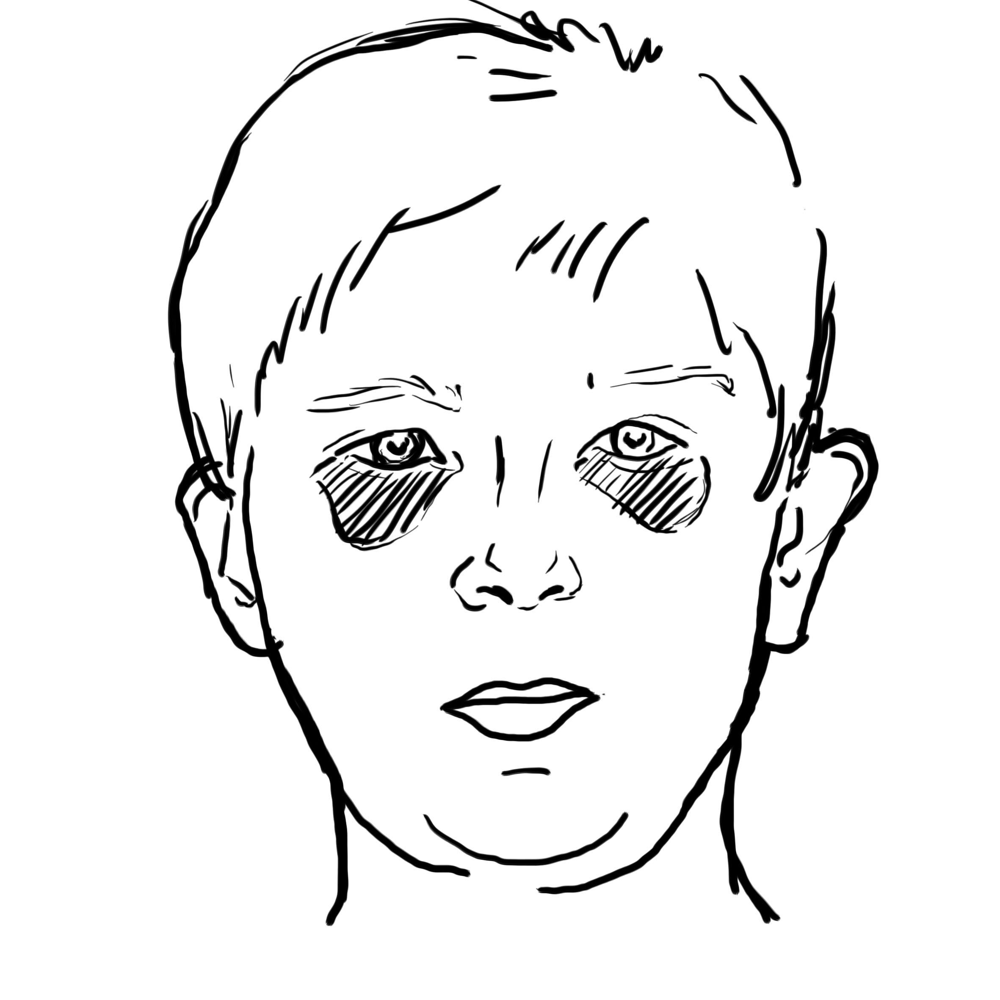

# UNIÃO SERVIÇOS MÉDICOS
## DIRETORIA DE ENSINO, PESQUISA E INSTRUÇÃO PRÉ-HOSPITALAR

---

**MÓDULO E05 — ACIDENTES E TRAUMAS NO AMBIENTE ESCOLAR**
*Biblioteca Curricular: Primeiros Socorros em Escolas (School Safety)*
*Versão Editorial: 1.0.0 — Padrão Editorial USM*
*Carga Horária Teórica: 1 hora | Público-alvo: Educadores, professores de educação física, monitores e gestores*

---

## SUMÁRIO

- [Seção 1 — Em 30 Segundos](#seção-1--em-30-segundos)
- [Seção 2 — Objetivos de Aprendizagem](#seção-2--objetivos-de-aprendizagem)
- [Seção 3 — Introdução e Epidemiologia dos Acidentes Escolares](#seção-3--introdução-e-epidemiologia-dos-acidentes-escolares)
- [Seção 4 — Anatomia e Fisiopatologia do Trauma Craniano e Ósseo Infantil](#seção-4--anatomia-e-fisiopatologia-do-trauma-craniano-e-ósseo-infantil)
- [Seção 5 — Desenvolvimento dos Subtemas](#seção-5--desenvolvimento-dos-subtemas)
  - [5.1 Quedas e Acidentes em Playgrounds e Parquinhos](#51-quedas-e-acidentes-em-playgrounds-e-parquinhos)
  - [5.2 Traumatismo Cranioencefálico (TCE) Leve a Moderado](#52-traumatismo-cranioencefálico-tce-leve-a-moderado)
  - [5.3 Ferimentos, Cortes e Sangramentos Cutâneos e Mucosos](#53-ferimentos-cortes-e-sangramentos-cutâneos-e-mucosos)
  - [5.4 Lesões Dentárias Traumáticas e Avulsão Dentária](#54-lesões-dentárias-traumáticas-e-avulsão-dentária)
  - [5.5 Queimaduras Térmicas e Intoxicações no Perímetro Escolar](#55-queimaduras-térmicas-e-intoxicações-no-perímetro-escolar)
  - [5.6 Acidentes Durante Atividades Físicas e Esportivas](#56-acidentes-durante-atividades-físicas-e-esportivas)
- [Seção 6 — Quadros Práticos e Protocolos de Conduta](#seção-6--quadros-práticos-e-protocolos-de-conduta)
- [Seção 7 — Erros Frequentes e Condutas Proibidas](#seção-7--erros-frequentes-e-condutas-proibidas)
- [Seção 8 — Aplicação Prática Contextualizada (Estudo de Caso)](#seção-8--aplicação-prática-contextualizada-estudo-de-caso)
- [Seção 9 — Pulo do Gato](#seção-9--pulo-do-gato)
- [Seção 10 — Mapa Mental do Trauma Escolar](#seção-10--mapa-mental-do-trauma-escolar)
- [Seção 11 — O Que Você Precisa Lembrar](#seção-11--o-que-você-precisa-lembrar)
- [Seção 12 — Referências Bibliográficas e Metadados Editoriais](#seção-12--referências-bibliográficas-e-metadados-editoriais)

---

## SEÇÃO 1 — EM 30 SEGUNDOS

> **VISÃO RÁPIDA DE SOBREVIVÊNCIA**
> 1. **Dente de leite versus dente permanente:** Se um dente permanente cair inteiro por batida (*avulsão dentária*), **NUNCA pegue pela raiz, não esfregue e não passe sabão**. Segure pela coroa branca, lave em soro ou leite e **armazene em copo com leite integral frio** até o dentista (janela de ouro de 60 minutos para reimplante). Dente de leite (decíduo) **nunca** se tenta reimplantar [1, 2].
> 2. **O perigo do "galo na cabeça":** O inchaço externo na testa (*hematoma subgaleal*) é comum e melhora com gelo protegido. O perigo real é o sangramento interno: **vômitos em jato, sonolência profunda, pupilas de tamanhos diferentes ou choro contínuo inconsolável = SAMU 192 urgente** [3, 4].
> 3. **Queda de brinquedo alto (> 1,5 a 2 metros):** Presuma traumatismo na coluna cervical. **Segure a cabeça e o pescoço da criança com as mãos alinhados** e não permita que ela se levante ou caminhe até a avaliação [3].
> 4. **Sangramento no nariz (Epistaxe):** Sente a criança com a **cabeça ligeiramente inclinada para a FRENTE** e aperte as narinas com os dedos em pinça por 10 minutos ininterruptos. **JAMAIS jogue a cabeça da criança para trás** (isso faz o sangue descer pela garganta, causando engasgo e vômitos sanguinolentos) [4, 5].
> 5. **Cortes no couro cabeludo sangram muito:** A cabeça infantil é ricamente vascularizada. Pressione firmemente o corte com gaze limpa por 5 minutos contínuos; o sangramento costuma estancar com compressão direta simples [5].
> 6. **Comunicação obrigatória:** Todo trauma de crânio na escola, mesmo leve, deve ser comunicado formalmente aos pais por escrito para monitoramento em casa nas 24 horas seguintes [6].

---

## SEÇÃO 2 — OBJETIVOS DE APRENDIZAGEM

Ao concluir o estudo deste módulo, o educador e monitor escolar serão capazes de:

1. **Reconhecer a cinemática das quedas em brinquedos escolares**, identificando forças de aceleração e desaceleração na infância.
2. **Diferenciar o traumatismo craniano leve daquele com suspeita de lesão intracraniana expansiva**, aplicando a regra de decisão PECARN.
3. **Executar a conduta pré-hospitalar correta na avulsão de dentes permanentes**, garantindo a viabilidade das células do ligamento periodontal.
4. **Manejar epistaxes (sangramentos nasais)** e ferimentos lacerantes comuns em pátios e quadras de esportes.
5. **Prestar o primeiro atendimento seguro a entorses e suspeitas de fratura**, aplicando gelo protegido e imobilização provisória.
6. **Preencher adequadamente a ficha escolar de notificação de acidente infantil**, estabelecendo comunicação transparente com a família.

---

## SEÇÃO 3 — INTRODUÇÃO E EPIDEMIOLOGIA DOS ACIDENTES ESCOLARES

Os acidentes traumáticos representam a principal causa de atendimento médico de emergência em crianças e adolescentes em idade escolar no Brasil. De acordo com a Sociedade Brasileira de Pediatria (SBP) e dados do Ministério da Saúde, aproximadamente metade de todos os traumas infantis ocorre durante o período escolar ou no trajeto entre a residência e o colégio [1, 6].

A natureza da infância envolve a exploração física do espaço, o teste de limites corporais e a socialização dinâmica em jogos e esportes coletivos. Brinquedos de parquinhos (*escorregadores, balanços, trepa-trepas e gangorras*), escadarias, pisos molhados e quadras poliesportivas constituem os principais locais de ocorrência de quedas, fraturas em galho verde, luxações e ferimentos na face [1, 3].

A responsabilidade da equipe escolar fundamenta-se na **Lei Lucas (Lei Federal nº 13.722/2018)** e no dever legal de custódia [6, 7]. O professor que sabe como conter uma hemorragia no couro cabeludo sem desespero, como preservar um dente quebrado para reimplante pelo odontólogo e como identificar sinais sutis de sangramento cerebral evita sequelas estéticas e neurológicas definitivas no aluno.

---

## SEÇÃO 4 — ANATOMIA E FISIOPATOLOGIA DO TRAUMA CRANIANO E ÓSSEO INFANTIL

O corpo da criança apresenta particularidades biométricas que alteram a distribuição das lesões traumáticas [3, 8]:

### 4.1 O Crânio Infantil e a Massa Encefálica
- **Centro de Gravidade Alto:** A cabeça da criança pequena é proporcionalmente muito maior e mais pesada em relação ao tronco do que a do adulto. Por essa razão, em quase todas as quedas de brinquedos, escorregadores ou tropeços, **a criança tomba de cabeça**, sendo o crânio o primeiro ponto de impacto contra o chão [3, 8].
- **Suturas Cranianas e Flexibilidade Óssea:** Os ossos da calota craniana infantil são mais finos e flexíveis. Isso permite que o osso amorteça impactos leves deformando-se ligeiramente, mas faz com que a energia cinética transmita-se com facilidade para a massa encefálica subjacente.
- *O Hematoma Extradural Infantil:* Pequenos traumas temporais podem romper a artéria meníngea média. A criança chora, acalma-se, parece bem por algumas horas (o chamado **intervalo lúcido**), mas o sangue acumula-se sob pressão entre o osso e a dura-máter. Seis a oito horas depois, a criança entra em coma súbito em casa. Isso justifica a obrigatoriedade da vigilância pós-trauma nas primeiras 24 horas [3].

### 4.2 A Elasticidade Óssea: As Fraturas em "Galho Verde"
Os ossos de crianças pequenas contêm maior teor de colágeno orgânico e menor mineralização de cálcio que os ossos adultos, além de possuírem um periósteo espesso e resistente [8].
- Quando uma criança cai com a mão espalmada, o osso rádio ou a ulna frequentemente **não se quebra em duas partes separadas**; ele se curva e racha em apenas um dos lados, exatamente como um graveto de planta verde que é dobrado com as mãos (**fratura em galho verde**).
- *Apresentação clínica:* O braço da criança fica ligeiramente torto, doloroso e com inchaço moderado, mas a criança ainda pode conseguir mexer os dedinhos. O educador nunca deve presumir que *"não quebrou só porque ela consegue mexer a mão"*. Toda deformidade ou dor intensa persistente pós-queda exige raio-X hospitalar [1, 3].

```
+---------------------------------------------------------------------------------+
|                       A FRATURA INFANTIL EM GALHO VERDE                         |
|                                                                                 |
|  [ FORÇA DE IMPACTO NO MEMBRO ]                                                 |
|                 |                                                               |
|                 V                                                               |
|  [ OSSO INFANTIL FLEXÍVEL (Rico em colágeno e periósteo espesso) ]              |
|                 |                                                               |
|                 V                                                               |
|  [ DEFORMAÇÃO COM RACHADURA UNILATERAL ]                                        |
|  - Um lado do osso rompe-se; o lado oposto apenas encurva-se                    |
|  - Deformidade visível discreta ou moderada                                     |
|  - Dor focal e inchaço, mas os dedos podem manter mobilidade parcial            |
|                 |                                                               |
|                 V                                                               |
|  [ CONDUTA NO APH: IMOBILIZAR COM TALA NA POSIÇÃO ENCONTRADA ]                  |
+---------------------------------------------------------------------------------+
```

---

## SEÇÃO 5 — DESENVOLVIMENTO DOS SUBTEMAS

### 5.1 Quedas e Acidentes em Playgrounds e Parquinhos
O parquinho escolar é o epicentro do trauma ortopédico infantil [1]:
- **Quedas de Trepa-Trepa e Balanço:** A altura crítica de perigo para trauma grave em crianças é qualquer queda de **altura superior a 1,5 metro** (ou mais que o dobro da altura da própria criança) [3].
- Se a criança despencar de um escorregador alto sobre piso duro de concreto:
  1. Ajoelhe-se imediatamente e comande: *"Não se levante, fique paradinho!"*.
  2. **Segure a cabeça e o pescoço da criança com as duas mãos** alinhados em posição neutra.
  3. Avalie a consciência e a respiração.
  4. Inspecione braços e pernas procurando deformidades antes de permitir qualquer movimento. Se houver dor no pescoço, formigamento ou sonolência, mantenha a imobilização manual e acione o SAMU 192 [1, 3].

### 5.2 Traumatismo Cranioencefálico (TCE) Leve a Moderado
Após uma pancada na cabeça, o educador deve aplicar a regra de observação clínica consolidada pelo protocolo **PECARN** (*Pediatric Emergency Care Applied Research Network*) [3]:

#### Sinais de Alarme de TCE Grave (Ligar 192 Imediatamente):
- **Vômitos repetidos:** Dois ou mais episódios de vômitos após a batida na cabeça (especialmente vômitos em jato sem náusea prévia).
- **Perda de consciência presenciada:** A criança ficou desmaiada por mais de 5 a 10 segundos logo após o impacto.
- **Sonolência anormal ou letargia:** Criança que não quer brincar, tem dificuldade para manter os olhos abertos, fala arrastada ou não reconhece a professora.
- **Assimetria pupilar (Anisocoria):** Uma pupila visivelmente maior que a outra.
- **Hematoma volumoso amolecido ("galo gigante mole"):** Em crianças menores de 2 anos, hematomas grandes fora da região frontal indicam risco de fratura óssea craniana subjacente [3].

#### Conduta no TCE Leve (Criança que chorou logo, está lúcida e ativa):
- Aplique **bolsa de gelo protegida por pano limpo** sobre o local do inchaço por 15 a 20 minutos para conter o hematoma superficial.
- Mantenha a criança em repouso sob vigilância na enfermaria ou secretaria.
- **Preencha a ficha escolar e entregue o comunicado por escrito aos pais** alertando para que observem a criança em casa durante as próximas 24 horas [1, 6].

### 5.3 Ferimentos, Cortes e Sangramentos Cutâneos e Mucosos
- **Cortes no Couro Cabeludo:** Sangram de forma assustadora devido à densa rede de arteríolas sob a pele da cabeça. Ajoelhe-se, afaste os cabelos da criança com gaze estéril e aplique **pressão manual direta firme e contínua com maço de gazes por 5 a 8 minutos**. Na grande maioria dos casos, a hemorragia cessa sem necessidade de torniquetes.
- **Sangramento Nasal (Epistaxe Infantil):** Ocorre frequentemente por batidas leves no nariz, tempo seco ou ato de coçar a narina (rompendo vasinhos do plexo de Kiesselbach na ponta do septo nasal) [4, 5]:
  1. Sente a criança confortavelmente em uma cadeira com o tronco e a **cabeça ligeiramente inclinados para a FRENTE**.
  2. Com o polegar e o indicador protegidos por luva, **aperte firmemente a parte mole do nariz da criança** (logo abaixo do osso nasal, comprimindo as duas narinas juntas).
  3. Instrua a criança a respirar calmamente pela boca aberta.
  4. **Mantenha a pressão ininterrupta por no mínimo 10 minutos no relógio** sem soltar para espiar.
  5. Coloque uma compressa fria ou gelo protegido na testa ou na nuca para estimular a vasoconstrição reflexa [4, 5].

### 5.4 Lesões Dentárias Traumáticas e Avulsão Dentária
Colisões contra o chão ou contra a cabeça de outro colega frequentemente lesionam a arcada dentária frontal (dentes incisivos) [1, 2]:
- **Diferença Vital: Dente de Leite versus Dente Permanente:**
  - *Dente de Leite (Decíduo — crianças até 5 ou 6 anos):* **NUNCA tente reimplantar um dente de leite no alvéolo da gengiva.** O reimplante do dente decíduo pode infectar e lesionar permanentemente o germe do dente permanente definitivo que está crescendo logo abaixo na gengiva. Apenas estanque o sangue com gaze úmida [2].
  - *Dente Permanente (Definitivo — a partir de 6 a 7 anos):* Se o dente permanente sair inteiro com a raiz por traumatismo (**Avulsão Dentária**), trata-se de uma **emergência odontológica com janela de ouro de 60 minutos** para salvar a raiz [1, 2]!

```
+---------------------------------------------------------------------------------+
|                       PROTOCOLO DE SALVAMENTO DO DENTE PERMANENTE               |
|                                                                                 |
|  1. LOCALIZAR O DENTE NO CHÃO E SEGURAR PELA COROA:                             |
|     - Pegue o dente EXCLUSIVAMENTE pela parte branca da coroa.                  |
|     - JAMAIS toque, aperte ou esfregue a raiz amarelada com os dedos!           |
|                                                                                 |
|  2. LIMPEZA RÁPIDA E SUAVE:                                                     |
|     - Se o dente estiver sujo de terra, passe-o sob jato suave de SORO          |
|       FISIOLÓGICO ou LEITE FRIO por apenas 5 segundos.                          |
|     - NÃO raspe, não esfregue e não passe sabão, álcool ou escova!              |
|                                                                                 |
|  3. ARMAZENAMENTO E MEIO DE TRANSPORTE LÍQUIDO:                                 |
|     - Coloque o dente imediatamente em um copinho plástico contendo:            |
|       * 1ª Opção: LEITE INTEGRAL FRIO (mantém as células da raiz vivas por 6h). |
|       * 2ª Opção: SORO FISIOLÓGICO a 0,9%.                                      |
|       * 3ª Opção: Saliva da própria criança (cuspir no copo) ou água limpa.    |
|     - NUNCA transporte o dente embrulhado em guardanapo ou papel seco!          |
|                                                                                 |
|  4. TRANSPORTE URGENTE AO DENTISTA (LIMITE: 60 MINUTOS):                        |
|     - Encaminhe a criança e o copinho ao consultório odontológico imediatamente.|
+---------------------------------------------------------------------------------+
```

### 5.5 Queimaduras Térmicas e Intoxicações no Perímetro Escolar
- **Queimaduras Térmicas em Cantinas e Feiras de Ciências:** Resfrie imediatamente em água corrente fria por 10 a 15 minutos. Cubra com plástico filme limpo ou gaze úmida. Proibido pomadas e pastas de dente [1].
- **Ingestão Acidental de Produtos de Limpeza em Creches:** Produtos como água sanitária, desinfetantes ou removedores deixados indevidamente em garrafas de refrigerante por equipes de limpeza:
  - **NÃO provoque o vômito.**
  - Não dê leite ou vinagre.
  - Guarde a embalagem do produto e ligue imediatamente para o **Disque-Intoxicação da ANVISA: 0800-722-6001** ou SAMU 192 [4, 5].

### 5.6 Acidentes Durante Atividades Físicas e Esportivas
Nas aulas de educação física e treinos de futebol/vôlei:
- **Entorses de Tornozelo e Joelho:** Aplique o protocolo **PRICE**: repouso imediato (não force o aluno a continuar jogando), compressas de gelo protegido por pano por 20 minutos, compressão elástica suave e membro elevado [1, 4].
- **Fraturas e Deformidades:** Imobilize provisoriamente com talas de papelão ou tala moldável da maleta da Lei Lucas, abrangendo a articulação acima e abaixo, mantendo os dedos visíveis para checar a circulação rosada [1].

---

### Figuras de Apoio


*Figura 1 - Imobilização de membro superior com tala moldável. Crédito: Baedr-9439. Licença: CC0. Fonte: Wikimedia Commons.*


*Figura 2 - Enfaixamento compressivo funcional em entorse articular de tornozelo. Crédito: Baedr-9439. Licença: CC0. Fonte: Wikimedia Commons.*


*Figura 3 - Imobilização solidária (buddy taping) em trauma fechado de falanges. Crédito: Baedr-9439. Licença: CC0. Fonte: Wikimedia Commons.*


*Figura 4 - Estabilização manual alinhada (in-line) da cabeça e coluna cervical no trauma. Crédito: Baedr-9439. Licença: CC0. Fonte: Wikimedia Commons.*


*Figura 5 - Equimose periorbitária bilateral (sinal do guaxinim) sugestiva de fratura de base de crânio. Crédito: Another-anon-artist-234. Licença: CC0. Fonte: Wikimedia Commons.*

---

## SEÇÃO 6 — QUADROS PRÁTICOS E PROTOCOLOS DE CONDUTA

### Quadro 6.1 — Matriz de Decisão: Quando Encaminhar ao Hospital no Trauma Escolar

| Lesão Encontrada | Sinais de Gravidade Imediata | Ação da Escola | Destino e Transporte |
|---|---|---|---|
| **Pancada na Cabeça (TCE)** | Vômitos em jato, sonolência anormal, pupila dilatada, perda de memória. | Ligar 192 pelo viva-voz; manter cabeça imóvel com as mãos. | **SAMU 192 com urgência máxima.** |
| **Queda de Parquinho (> 1,5m)** | Dor forte nas costas ou pescoço, formigamento nos pés, incapacidade de mover membros. | Estabilizar a coluna cervical manualmente; não mover o corpo. | **Corpo de Bombeiros 193 / SAMU.** |
| **Avulsão de Dente Permanente** | Dente definitivo arrancado inteiro da gengiva por impacto. | Guardar no leite frio; não tocar na raiz; estancar gengiva. | **Consultório Odontológico em < 60 min.** |
| **Suspeita de Fratura em Braço** | Deformidade óssea evidente, dor aguda, inchaço rápido. | Fazer tala provisória pegando cotovelo e punho; gelo local. | **Pronto-Socorro Ortopédico (com os pais).** |
| **Sangramento Nasal (Epistaxe)** | Sangramento contínuo por mais de 15 a 20 minutos de compressão firme. | Manter cabeça para a frente e pinçar narinas; avisar pais. | **Pronto-Atendimento Infantil.** |

---

### Quadro 6.2 — Checklist do Educador no Atendimento ao Aluno Ferido

| Passo | Ação Obrigatória | Verificação Técnica |
|:---:|---|---|
| **1** | **Segurança da Cena** | Afastar os outros alunos da quadra ou pátio para não aglomerar. |
| **2** | **Biossegurança** | Calçar luvas descartáveis antes de tocar no sangue da criança. |
| **3** | **Avaliação da Consciência** | Conversar em tom calmo e carinhoso; avaliar se o aluno sabe onde está. |
| **4** | **Intervenção Focal** | Comprimir corte sangrante / Imobilizar membro fraturado / Preservar dente. |
| **5** | **Comunicação aos Pais** | Ligar para os pais em 3 etapas (vida, fato, providência já tomada). |
| **6** | **Ficha de Ocorrência** | Preencher o relatório assinado arquivado na secretaria escolar. |

---

## SEÇÃO 7 — ERROS FREQUENTES E CONDUTAS PROIBIDAS

> [!CAUTION]
> ### CATÁLOGO DE ERROS CRÍTICOS EM TRAUMAS ESCOLARES
> 
> 1. **Jogar a cabeça da criança para trás durante um sangramento nasal:**
>    - *Por que não fazer:* Inclinar a cabeça para trás não para o sangramento; apenas desvia o fluxo de sangue pela orofaringe para o estômago e para a laringe. O sangue deglutido irrita violentamente a mucosa gástrica, provocando vômitos escuros e risco de broncoaspiração mecânica pulmonar.
>    - *Conduta correta:* Mantenha o queixo ligeiramente inclinado para baixo e para a frente, pinçando as narinas com firmeza por 10 minutos ininterruptos.
> 
> 2. **Esfregar a raiz do dente avulsionado com escova ou sabão para "desinfetar":**
>    - *Por que não fazer:* A raiz do dente arrancado é recoberta por células vivas microscópicas extremamente frágeis do ligamento periodontal. Se você esfregar a raiz ou passar sabão, raspa e mata essas células. Sem células vivas, o dente não consegue se fixar de volta ao osso e é expulso pelo organismo.
>    - *Conduta correta:* Apenas enxágue suavemente em soro ou leite sem esfregar e guarde no leite frio.
> 
> 3. **Deixar o dente avulsionado secar embrulhado em guardanapo de papel:**
>    - *Por que não fazer:* Em ambiente seco, as células da raiz do dente desidratam-se e morrem irreversivelmente em menos de 15 minutos, inviabilizando o reimplante.
>    - *Conduta correta:* O dente deve viajar sempre imerso em meio líquido (preferencialmente leite integral frio).
> 
> 4. **Fazer a criança caminhar até a enfermaria após queda alta de brinquedo:**
>    - *Por que não fazer:* Se houver fissura ou fratura instável na bacia, fêmur ou coluna vertebral, o ato de caminhar desloca os fragmentos ósseos com risco de hemorragia interna ou compressão medular.
>    - *Conduta correta:* Examine a criança onde ela caiu. Se houver dor forte ou mecanismo de alta energia, o atendimento vai até a criança.
> 
> 5. **Omitir batidas na cabeça dos pais por medo de represálias:**
>    - *Por que é perigoso:* Traumatismos cranianos infantis podem evoluir com sangramento lento horas depois em casa.
>    - *Conduta correta:* Avise a família com clareza e forneça o termo de orientação pós-TCE.

---

## SEÇÃO 8 — APLICAÇÃO PRÁTICA CONTEXTUALIZADA (ESTUDO DE CASO)

### Cenário Simulado
*Local:* Quadra de esportes de uma escola de ensino fundamental.  
*Horário:* 10h15 (aula de educação física).  
*Ocorrência:* Durante uma disputa de bola no vôlei escolar, dois alunos de 8 anos colidem as cabeças frontalmente em alta velocidade. Um dos alunos cai sentado chorando com sangramento nasal intenso; o outro aluno, de 8 anos, colide o rosto contra o solo de cimento da quadra, chora com a boca sangrando e cospe na quadra um dente incisivo central superior permanente com a raiz intacta. O professor de educação física capacitado pela Lei Lucas assume o controle imediato dos dois atendimentos.

---

### Resolução Técnica Passo a Passo

#### 1. Triagem e Divisão de Papéis (0 a 30 segundos)
- O professor comanda os demais 25 alunos da turma que se sentem na arquibancada com tranquilidade.
- Calça luvas descartáveis do kit de quadra.
- Pede ao estagiário de educação física que cuide do aluno com sangramento nasal:
  > *"Lucas, sente o Pedro na sombra, incline a cabeça dele para a frente e aperte as duas narinas com gaze por 10 minutos no relógio!"*.
- O professor volta-se para o aluno com o trauma dentário e bucal (Mateus, 8 anos).

#### 2. Salvamento e Acondicionamento do Dente Permanente Avulsionado (30 a 90 segundos)
- O professor localiza o dente no piso da quadra.
- **Manuseio Preciso:** Abaixa-se e pega o dente **exclusivamente pela coroa branca** (a parte mastigatória). **Não toca na raiz amarelada**.
- O dente apresenta uma pequena sujeira de areia da quadra. O professor pega um frasco de soro fisiológico do kit e joga um jato suave de soro sobre a raiz por 3 segundos para retirar a areia solta, sem esfregar.
- O professor pega o copo de leite frio integral que havia pedido da cantina escolar e **imerge o dente completamente dentro do leite**.
- Olha para o relógio: **10h18**. A janela de 60 minutos está aberta.

#### 3. Manejo da Hemorragia Oral e Avaliação do Crânio
- O professor entrega uma gaze estéril dobrada para Mateus morder suavemente sobre a gengiva de onde o dente saiu, fazendo compressão direta do sangramento por 5 minutos.
- Inspeciona o crânio e a face do aluno: não há deformidades no nariz ou mandíbula, pupilas normais, o aluno responde com clareza e sabe o dia e a hora. Não houve perda de consciência.

#### 4. Comunicação Ágil e Encaminhamento Odontológico (2 a 10 minutos)
- O professor liga para a mãe de Mateus informando o ocorrido e pede para a secretaria escolar acionar a clínica odontológica conveniada da família ou a UPA Odontológica Municipal mais próxima.
- A coordenadora da escola transporta o aluno e o copo com o dente imerso no leite frio com a mãe até o cirurgião-dentista, chegando ao consultório às 10h42 (apenas 24 minutos pós-acidente).

#### Desfecho Clínico
O cirurgião-dentista parabeniza o professor pela conservação exemplar no leite e pelo manuseio exclusivo pela coroa. Como as células do ligamento periodontal estavam 100% viáveis, o odontopediatra anestesia o alvéolo, reposiciona o dente permanente no local anatômico e realiza uma esplintagem flexível com resina aos dentes vizinhos. O dente fixa-se com sucesso à arcada sem necessidade de implante metálico futuro. O outro aluno teve a epistaxe nasal estancada em 8 minutos de compressão, sem fraturas.

---

## SEÇÃO 9 — PULO DO GATO

> [!TIP]
> ### O PULO DO GATO DA UNIÃO: A TÉCNICA DO "LEITE INTEGRAL FRIO" COMO MEIO BIOLÓGICO DE RESGATE DENTÁRIO
> Por que o leite integral frio é considerado mundialmente pela Associação Internacional de Traumatologia Dentária (IADT) como o melhor líquido acessível para transportar um dente arrancado?
> 
> **A Fisiologia do Leite:**
> - A água da torneira comum é hipotônica: ela entra por osmose nas células da raiz do dente e faz as células estourarem (*lise celular*) em menos de 15 minutos.
> - O **leite integral de caixinha**, por sua vez, possui osmolaridade, pH neutro e concentração de cálcio e proteínas quase idênticos aos do plasma sanguíneo humano.
> - Ele mantém as células microscópicas do ligamento periodontal nutridas e vivas em suspensão por **até 6 horas** fora da boca [1, 2].
> 
> Em toda escola, creche ou academia, sempre há leite na cantina ou geladeira. Colocar o dente no leite frio salva o sorriso permanente da criança para o resto da vida.

---

## SEÇÃO 10 — MAPA MENTAL DO TRAUMA ESCOLAR

```
                   ACIDENTES E TRAUMAS NO AMBIENTE ESCOLAR (E05)
                                          |
         +--------------------------------+--------------------------------+
         |                                |                                |
         V                                V                                V
QUEDAS E PARQUINHOS              TRAUMA CRANIANO (TCE)            AVULSÃO DENTÁRIA
         |                                |                                |
 - Queda > 1,5m = Risco de        - Sinais de Alarme:              - Dente de Leite:
   lesão cervical grave             * Vômitos em jato                NUNCA reimplantar!
 - Imobilização manual neutra       * Sonolência profunda          - Dente Permanente:
   da cabeça com as duas mãos       * Anisocoria pupilar             * Pegar só pela coroa
 - Fraturas em galho verde:         * Líquor no ouvido/nariz         * NÃO esfregar a raiz
   tala na posição encontrada       * ALERTA: LIGAR 192              * Guardar no LEITE FRIO
     |                            - Se leve: gelo local e            * Dentista em < 60 min!
     +------------------------------------+ aviso escrito aos pais         |
                                          |                                |
                                          V                                V
                               SANGRAMENTO NASAL (EPISTAXE)       COMUNICAÇÃO AOS PAIS
                              - Cabeça para a FRENTE (sempre)     - Em 3 etapas humanas
                              - Pinçar narinas por 10 minutos     - Ficha de registro
                              - NÃO jogar a cabeça para trás!     - Auditoria do parquinho
```

---

## SEÇÃO 11 — O QUE VOCÊ PRECISA LEMBRAR

1. **Dente permanente vai no leite frio:** Se o dente definitivo cair, segure apenas pela coroa branca, não raspe a raiz e coloque em copo com leite. Corra ao dentista em até 60 minutos.
2. **Dente de leite não se recoloca:** Tentar reimplantar dente de leite destrói o dente definitivo de baixo.
3. **Sangramento no nariz = Cabeça para a frente:** Incline o queixo para baixo e aperte as narinas com os dedos por 10 minutos. Nunca jogue a cabeça para trás.
4. **Quedas altas exigem cabeça imóvel:** Em quedas de brinquedos com mais de 1,5 metro, mantenha a coluna cervical alinhada com as mãos e chame o resgate.
5. **Cuidado com vômitos após bater a cabeça:** Vômitos em jato ou sonolência pós-TCE indicam sangramento intracraniano grave. Ligue 192 imediatamente.
6. **Registre e comunique toda batida de cabeça:** Mesmo acidentes aparentemente leves devem ser comunicados formalmente aos pais no mesmo dia.

---

## SEÇÃO 12 — REFERÊNCIAS BIBLIOGRÁFICAS E METADADOS EDITORIAIS

### Referências Consultadas (Padrão ABNT NBR 6023)

[1] INTERNATIONAL ASSOCIATION OF DENTAL TRAUMATOLOGY (IADT). **Guidelines for the Management of Traumatic Dental Injuries: 1. Fractures and Luxations; 2. Avulsion of Permanent Teeth**. *Dental Traumatology*, v. 36, n. 4, p. 314-340, 2020. DOI: 10.1111/edt.12578.

[2] SOCIEDADE BRASILEIRA DE PEDIATRIA (SBP); ASSOCIAÇÃO BRASILEIRA DE ODONTOPEDIATRIA. **Traumatismo Dentário na Infância: Condutas de Emergência para Educadores e Pediatras**. *Guia Prático*, Rio de Janeiro, n. 2, 2021.

[3] KUPPERMANN, Nathan et al. **Identification of children at very low risk of clinically-important brain injuries after head trauma: a prospective cohort study (PECARN)**. *The Lancet*, v. 374, n. 9696, p. 1160-1170, 2009. [Diretriz Revalidada 2021]. DOI: 10.1016/S0140-6736(09)61558-0.

[4] AMERICAN HEART ASSOCIATION (AHA); AMERICAN RED CROSS. **2020 Guidelines for First Aid: Pediatric Trauma and Medical Emergencies**. *Circulation*, Dallas, v. 142, supl. 2, p. S558-S583, 2020.

[5] AMERICAN COLLEGE OF SURGEONS (ACS). Committee on Trauma. **Prehospital Trauma Life Support (PHTLS): Pediatric Trauma**. 10. ed. Burlington: Jones & Bartlett Learning, 2023.

[6] BRASIL. Ministério da Educação (MEC). **Manual de Promoção da Saúde e Prevenção de Acidentes na Escola**. Brasília: MEC/CNE, 2021.

[7] BRASIL. Presidência da República. **Lei nº 13.722, de 4 de outubro de 2018 (Lei Lucas)**. Capacitação em noções de primeiros socorros nas escolas. *Diário Oficial da União*, Brasília, DF, 5 out. 2018.

[8] HALL, John E.; HALL, Michael E. **Guyton and Hall Textbook of Medical Physiology**. 14. ed. Philadelphia: Elsevier, 2021.

---

### METADADOS EDITORIAIS USM

| Parâmetro | Detalhe |
|---|---|
| **Código e Módulo:** | E05 — Acidentes e Traumas no Ambiente Escolar |
| **Biblioteca:** | Primeiros Socorros em Escolas (*School Safety*) |
| **Status:** | `Aguardando Aprovação Científica` |
| **Data da Redação:** | 19 de outubro de 2026 |
| **Versão:** | 1.0.0 |
| **Validação Científica por IA:** | Conforme IADT Dental Traumatology, PECARN Head Trauma e SBP |
| **Próxima Revisão:** | Outubro de 2027 |
