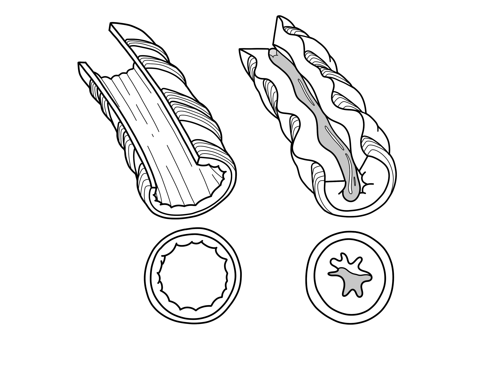
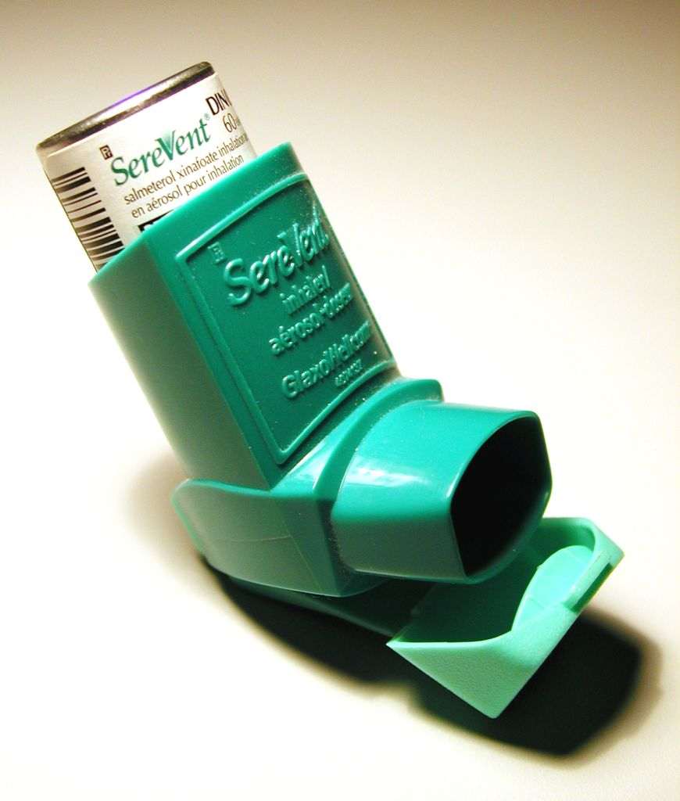
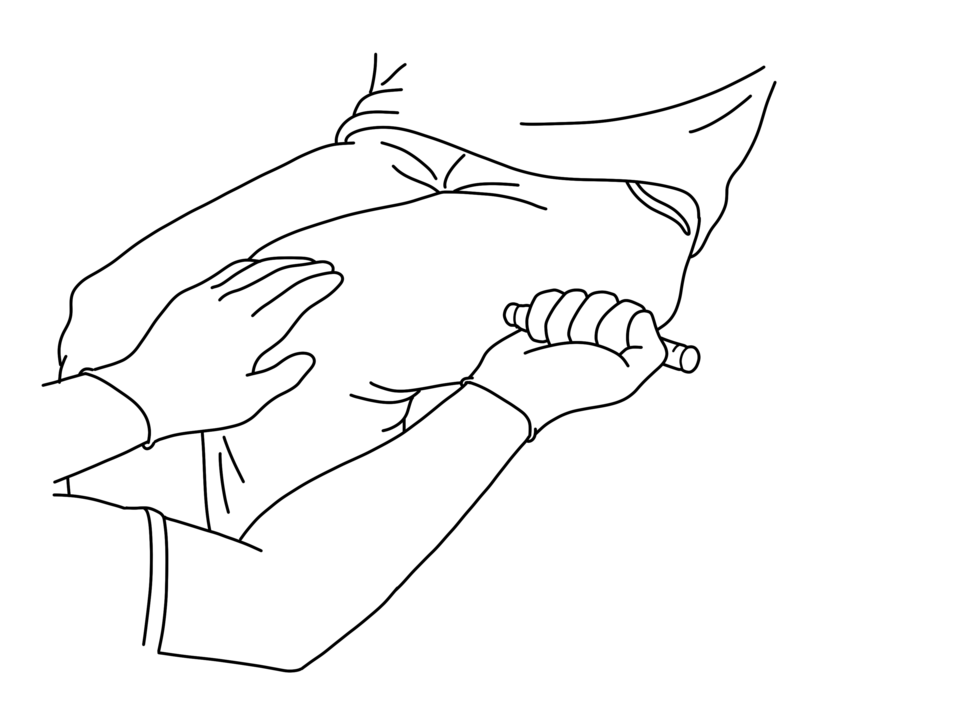

# UNIÃO SERVIÇOS MÉDICOS
## DIRETORIA DE ENSINO, PESQUISA E INSTRUÇÃO PRÉ-HOSPITALAR

---

**MÓDULO E06 — ALUNOS COM CONDIÇÕES DE SAÚDE ESPECÍFICAS**
*Biblioteca Curricular: Primeiros Socorros em Escolas (School Safety)*
*Versão Editorial: 1.0.0 — Padrão Editorial USM*
*Carga Horária Teórica: 1 hora | Público-alvo: Educadores, cuidadores escolares e equipes diretivas*

---

## SUMÁRIO

- [Seção 1 — Em 30 Segundos](#seção-1--em-30-segundos)
- [Seção 2 — Objetivos de Aprendizagem](#seção-2--objetivos-de-aprendizagem)
- [Seção 3 — Introdução e Relevância da Saúde Escolar Crônica](#seção-3--introdução-e-relevância-da-saúde-escolar-crônica)
- [Seção 4 — Fisiopatologia Básica das Condições Crônicas](#seção-4--fisiopatologia-básica-das-condições-crônicas)
- [Seção 5 — Desenvolvimento dos Subtemas](#seção-5--desenvolvimento-dos-subtemas)
  - [5.1 Alergias Severas e Anafilaxia no Ambiente Escolar](#51-alergias-severas-e-anafilaxia-no-ambiente-escolar)
  - [5.2 Diabetes Mellitus Tipo 1 no Cotidiano Escolar](#52-diabetes-mellitus-tipo-1-no-cotidiano-escolar)
  - [5.3 Epilepsia e Crises Convulsivas em Alunos Diagnosticados](#53-epilepsia-e-crises-convulsivas-em-alunos-diagnosticados)
  - [5.4 Condições Respiratórias Crônicas e Asma](#54-condições-respiratórias-crônicas-e-asma)
  - [5.5 Planos Individuais de Emergência (PIE)](#55-planos-individuais-de-emergência-pie)
  - [5.6 Comunicação com Familiares, Médicos e Serviços de Resgate](#56-comunicação-com-familiares-médicos-e-serviços-de-resgate)
- [Seção 6 — Quadros Práticos e Matrizes Decisórias](#seção-6--quadros-práticos-e-matrizes-decisórias)
- [Seção 7 — Erros Frequentes e Condutas Proibidas](#seção-7--erros-frequentes-e-condutas-proibidas)
- [Seção 8 — Estudo de Caso Prático](#seção-8--estudo-de-caso-prático)
- [Seção 9 — Pulo do Gato](#seção-9--pulo-do-gato)
- [Seção 10 — Mapa Mental de Resposta Escolar](#seção-10--mapa-mental-de-resposta-escolar)
- [Seção 11 — O Que Você Precisa Lembrar](#seção-11--o-que-você-precisa-lembrar)
- [Seção 12 — Referências Bibliográficas e Metadados Editoriais](#seção-12--referências-bibliográficas-e-metadados-editoriais)

---

## GUIA DE ATUAÇÃO — PARA QUEM NÃO É DA ÁREA DA SAÚDE

> **EM UMA EMERGÊNCIA REAL:** Proteja-se, peça ajuda e ligue **192 (SAMU)**. Para fogo, resgate em altura, água, espaço confinado ou ambiente perigoso, ligue **193 (Bombeiros)**. Diga o endereço e siga as instruções da central. Este roteiro orienta as primeiras ações, mas não substitui o treino supervisionado das técnicas práticas.

### Situação: Plano individual do aluno com condição de saúde

**Reconheça os sinais:** Aluno com asma, diabetes, epilepsia ou alergia apresenta sinais previstos em seu plano de emergência.

### O que fazer — passo a passo

1. Antes da aula, saiba onde ficam os planos individuais, contatos e medicamentos prescritos autorizados.
2. Na crise, interrompa atividade e confira se a criança responde e respira normalmente.
3. Para asma, auxilie o uso do inalador prescrito conforme plano e regras da escola.
4. Para hipoglicemia, ofereça glicose apenas se a criança estiver acordada e engolir com segurança.
5. Para anafilaxia, ligue 192 imediatamente e siga as instruções do autoinjetor prescrito, se disponível.
6. Em convulsão, proteja de lesões, cronometre e não ponha nada na boca.
7. Registre o que foi usado, doses fornecidas pelo dispositivo e horários; entregue à equipe de saúde.

### Não faça isto

Não substitua a prescrição por improvisos. Não aplique medicamento injetável não prescrito sem autorização e treinamento.

### Exercício prático de aprendizagem

Simule duas condições por aluno, com os profissionais realmente localizando o plano individual e o material.

**Ao entregar a vítima:** informe horário de início, mudanças na respiração e na consciência, riscos e medidas aplicadas.

**Limites:** não faça procedimentos invasivos, administração de fármacos não prescritos, resgates técnicos ou intervenções que dependam de habilitação profissional. Pratique presencialmente RCP, DEA, controle de sangramento e desengasgo em manequins antes de assumir atendimento.

**Referências operacionais:** Ministério da Saúde — SAMU 192 (https://www.gov.br/saude/pt-br/composicao/saes/samu-192/samu-192); AHA/AAP — RCP e primeiros socorros 2025 (https://cpr.heart.org/en/resuscitation-science/cpr-and-ecc-guidelines); AHA/Cruz Vermelha — Primeiros Socorros 2024 (https://cpr.heart.org/en/resuscitation-science/2024-first-aid-guidelines).

---

## SEÇÃO 1 — EM 30 SEGUNDOS

> **VISÃO RÁPIDA DE SOBREVIVÊNCIA E RESPOSTA IMEDIATA**
> 1. **Doenças crônicas na escola:** Cerca de 10% a 15% dos estudantes convivem com asma, diabetes tipo 1, epilepsia ou alergias severas com risco de descompensação no período letivo [1, 2].
> 2. **Anafilaxia exige adrenalina imediata:** O único fármaco capaz de conter o choque e o edema de glote é a **adrenalina (epinefrina) intramuscular na face anterolateral da coxa** [3, 4]. Anti-histamínicos orais não revertem obstrução laríngea.
> 3. **Hipoglicemia no diabetes tipo 1:** Glicemia < 70 mg/dL provoca tremores, suor frio e confusão mental. Consciente: **15 g de carboidrato simples** (150 ml de suco ou refrigerante comum). Inconsciente: **nada pela boca**, posição lateral e acionamento do 192 (SAMU) [5, 6].
> 4. **Crise convulsiva epiléptica:** Apoie a cabeça com objeto macio, afaste obstáculos, lateralize o corpo para drenagem de secreções, cronometre o tempo e **nunca coloque objetos ou dedos na boca** [7, 8].
> 5. **Broncoespasmo na asma:** Sente a criança com o tronco para frente, auxilie no uso da bombinha de alívio acoplada a espaçador e chame socorro se houver tiragem ou fala entrecortada [9, 10].
> 6. **Plano Individual de Emergência (PIE):** Documento recomendado para alunos com condições que exigem resposta específica. Deve incluir contatos, sinais de alerta e medicações prescritas, respeitando consentimento, confidencialidade e regras locais [1, 11].

---

## SEÇÃO 2 — OBJETIVOS DE APRENDIZAGEM

Ao concluir o estudo deste módulo, o profissional da escola será capaz de:

1. Reconhecer sinais precoces de descompensação aguda em alunos com asma, diabetes tipo 1, epilepsia e alergias.
2. Diferenciar reações alérgicas localizadas de episódios anafiláticos sistêmicos com indicação de autoinjetor de adrenalina.
3. Conduzir episódios de hipoglicemia leve e grave respeitando a regra dos 15 gramas e as restrições a alimentos por via oral.
4. Proteger a integridade do aluno durante convulsões, monitorando o tempo para prevenção do estado de mal epiléptico.
5. Operacionalizar o Plano Individual de Emergência (PIE) e organizar o armazenamento acessível de medicamentos de resgate.
6. Estruturar a comunicação de emergência com regulação do SAMU (192) e responsáveis legais.

---

## SEÇÃO 3 — INTRODUÇÃO E RELEVÂNCIA DA SAÚDE ESCOLAR CRÔNICA

A inclusão educacional garante que estudantes com condições de saúde crônicas frequentem normalmente o ambiente de ensino regular. Durante a permanência na escola, essas crianças participam de refeições, práticas esportivas e brincadeiras que envolvem potenciais gatilhos ambientais [1, 2].

A Lei Lucas (Lei Federal nº 13.722/2018) estabelece a obrigatoriedade de capacitação da comunidade escolar em primeiros socorros. Saber conduzir crises de hipoglicemia, anafilaxia, crises convulsivas e crises respiratórias reduz internações, evita sequelas cerebrais irreversíveis e assegura a integração do estudante sem isolamento discriminatório [1, 12].

---

## SEÇÃO 4 — FISIOPATOLOGIA BÁSICA DAS CONDIÇÕES CRÔNICAS

```
+---------------------------------------------------------------------------------+
|               MECANISMOS FISIOPATOLÓGICOS DAS CRISES ESCOLARES                  |
|                                                                                 |
|  [ ALERGIA SEVERA ] -> Desgranulação de mastócitos -> Choque e edema de glote   |
|  [ DIABETES TIPO 1 ] -> Queda glicêmica (< 70 mg/dL) -> Sofrimento neuronal     |
|  [ EPILEPSIA ]      -> Descargas corticais síncronas -> Convulsão tônico-clônica|
|  [ ASMA CRÔNICA ]   -> Broncoespasmo e muco espesso -> Obstrução expiratória    |
+---------------------------------------------------------------------------------+
```



*Figura 1 — Fisiopatologia da crise asmática: broncoespasmo, edema de mucosa e hipersecreção. Crédito: Baedr-9439. Licença: CC0. Fonte: Wikimedia Commons.*

- **Anafilaxia:** Liberação maciça de histamina mediada por IgE, provocando vasodilatação sistêmica, colapso pressórico e edema submucoso laríngeo. A adrenalina reverte a vasodilatação e relaxa a musculatura brônquica [3, 4].
- **Hipoglicemia:** Queda rápida da glicose circulante priva os neurônios do substrato energético primário, gerando reações adrenérgicas (sudorese, taquicardia) seguidas de neuroglicopenia (confusão, convulsão e coma) [5, 6].
- **Epilepsia:** Despolarização paroxística neuronal sincrônica com fase tônica (rigidez e apneia) sucedida por fase clônica (abalos rítmicos) e estado pós-ictal [7, 8].
- **Asma:** Hiper-reatividade inflamatória brônquica que obstrui a passagem aérea diante de ar frio, esforço ou alérgenos [9, 10].

---

## SEÇÃO 5 — DESENVOLVIMENTO DOS SUBTEMAS

### 5.1 Alergias Severas e Anafilaxia no Ambiente Escolar

A anafilaxia é desencadeada habitualmente por alimentos (amendoim, leite, ovo, castanhas), picadas de insetos ou medicamentos. Manifesta-se subitamente pelo comprometimento simultâneo de múltiplos sistemas [3, 4]:
- **Pele:** Placas pruriginosas (urticária), rubor cutâneo e angioedema labial e periorbitário.
- **Vias Aéreas:** Rouquidão, estridor laríngeo inspiratório, tosse seca e sensação de garganta travada.
- **Circulatório:** Tontura, hipotensão, sudorese pegajosa e síncope.

**Manejo da Adrenalina Autoinjetável:**
1. Retirar a trava plástica de segurança no topo do aparelho.
2. Posicionar a ponta perpendicularmente à face lateral da coxa (músculo vasto lateral), podendo ser através da roupa.
3. Pressionar firmemente até o clique e segurar por 5 segundos.
4. Manter o estudante deitado com membros inferiores elevados (evitando a postura ortostática súbita).
5. Acionar o SAMU 192 imediatamente informando o uso de adrenalina [3, 4].

---

### 5.2 Diabetes Mellitus Tipo 1 no Cotidiano Escolar

Crianças com diabetes tipo 1 dependem de insulina e necessitam de flexibilidade para aferição glicêmica, hidratação e idas ao sanitário [5, 6].

- **Hipoglicemia Leve/Moderada (Aluno Consciente):**
  - Glicemia inferior a 70 mg/dL com sudorese, palidez e tremores.
  - Oferecer **15 g de carboidrato simples**: 150 ml de suco de fruta, meio copo de refrigerante tradicional ou 3 sachês de açúcar diluídos.
  - Repetir a medição após 15 minutos. Se permanecer < 70 mg/dL, administrar nova porção de 15 g [5].
- **Hipoglicemia Grave (Aluno Inconsciente ou Sonolento):**
  - **Jamais introduzir substâncias na cavidade oral** devido ao risco imediato de broncoaspiração fatal.
  - Lateralizar a vítima em decúbito e chamar o SAMU 192 com urgência. Se houver glucagon prescrito e pessoal treinado, seguir protocolo médico [5, 6].
- **Hiperglicemia:** Glicemia elevada (> 250 mg/dL) com sede excessiva e urina frequente. Fornecer água e contatar responsáveis para checagem da dose de insulina.

---

### 5.3 Epilepsia e Crises Convulsivas em Alunos Diagnosticados

As crises tônico-clônicas generalizadas na escola demandam calma para proteger o estudante de traumatismos e garantir vias aéreas desobstruídas [7, 8].

**Conduta Imediata:**
1. Afastar cadeiras, mesas e objetos pontiagudos ao redor.
2. Posicionar blusa dobrada ou apoio sob a cabeça do aluno para mitigar impactos no chão.
3. Afrouxar o colarinho e retirar óculos.
4. **Colocar a criança de lado (decúbito lateral)** logo após o início da crise para que secreções e saliva não obstruam a glote.
5. **Proibição absoluta:** Nunca segurar os membros à força e **jamais enfiar objetos ou dedos na boca** sob alegação de puxar a língua.
6. Cronometrar o evento: Acionar o 192 se a crise durar mais de **5 minutos** ou se encadear em episódios repetitivos [7, 8].



*Figura 2 — Inalador pressurizado dosimetrado para crise de broncoespasmo. Crédito: Wikimedia Commons (Mendel, assumido). Licença: Domínio público. Fonte: Wikimedia Commons.*

---

### 5.4 Condições Respiratórias Crônicas e Asma

A asma pode manifestar crises agudas de broncoespasmo durante práticas esportivas ou mudanças climáticas no pátio [9, 10].

**Sinais de Alerta Vermelho:** Tiragem de fúrcula e intercostal, batimento de asas de nariz, lábios arroxeados e incapacidade de articular sentenças completas sem interrupção para inspirar.

**Conduta:**
1. Acomodar o aluno sentado levemente inclinado para a frente (posição em tripé).
2. Auxiliar na inalação do broncodilatador de alívio (ex.: Salbutamol 100 mcg) **sempre com espaçador**.
3. Administrar os jatos prescritos (1 jato a cada 30–60 segundos, com 4 respirações lentas por jato).
4. Persistindo dispneia intensa ou ausência de resposta em 10 minutos, chamar o SAMU 192 [9, 10].

---

### 5.5 Planos Individuais de Emergência (PIE)

O Plano Individual de Emergência consolida as condutas autorizadas perante intercorrências clínicas do estudante [1, 11]:
- **Conteúdo Essencial:** Identificação, fotografia recente, patologia de base, gatilhos conhecidos, medicamentos de resgate com posologia detalhada e contatos telefônicos de pais e médico assistente.
- **Armazenamento:** Documento em envelope visível na secretaria e cópia com o corpo docente responsável pela turma.
- **Medicamentos:** Autoinjetores e sprays devem ficar em local seco, fresco e prontamente acessível aos funcionários autorizados, com monitoramento periódico da validade [1, 11].

---

### 5.6 Comunicação com Familiares, Médicos e Serviços de Resgate

A atuação coordenada requer alinhamento contínuo:
- **Diálogo Preventivo:** Reunião semestral para validação dos planos, autorização de lanches escolares e esclarecimento de rotinas em excursões.
- **Chamada ao SAMU 192:** Informar com precisão o quadro clínico (ex.: "aluno asmático em insuficiência respiratória aguda refratária a 4 jatos de salbutamol"), endereço escolar exato e manter um funcionário na calçada para receber a ambulância [1, 12].

---

---

## SEÇÃO 6 — QUADROS PRÁTICOS E MATRIZES DECISÓRIAS

### Matriz de Decisão: Abordagem das Quatro Principais Condições Crônicas

| CONDIÇÃO | SINAIS PRECOCES DE ALERTA | AÇÃO IMEDIATA RECOMENDADA | CONDUTA PROIBIDA |
| :--- | :--- | :--- | :--- |
| **Anafilaxia** | Urticária difusa, rouquidão, inchaço labial, sensação de asfixia. | Aplicar adrenalina autoinjetável na face lateral da coxa e ligar 192. | Dar comprimidos ou xaropes orais; permitir que o aluno caminhe. |
| **Hipoglicemia** | Tremores, suor frio, palidez, alterações de humor e confusão. | 15 g de carboidrato rápido se acordado. Se inconsciente: posição lateral e 192. | Fornecer alimentos ou líquidos se o aluno estiver inconsciente. |
| **Epilepsia** | Perda súbita de consciência, rigidez e abalos motores rítmicos. | Proteger o crânio, afastar móveis, lateralizar o corpo e cronometrar. | Colocar as mãos na boca da vítima; tentar segurar os membros. |
| **Crise de Asma** | Tosse insistente, chiado no peito, tiragem entre as costelas. | Sentar a criança em repouso e auxiliar na bombinha com espaçador. | Deitar a criança de barriga para cima; forçar corrida para "abrir o pulmão". |

---

## SEÇÃO 7 — ERROS FREQUENTES E CONDUTAS PROIBIDAS



*Figura 3 — Aplicação intramuscular de autoinjetor de adrenalina na face anterolateral da coxa. Crédito: Baedr-9439. Licença: CC0. Fonte: Wikimedia Commons.*

1. **Atrasar a aplicação da adrenalina:** Aguardar evolução de edema de glote para acionar o autoinjetor eleva drasticamente o risco de parada respiratória [3, 4].
2. **Introduzir líquidos na boca de vítima em coma hipoglicêmico:** Provoca obstrução de vias aéreas e aspiração de fluidos para a traqueia [5, 6].
3. **Tentar aplicar insulina durante crises de hipoglicemia:** Ação letal que consome qualquer glicose residual restante no organismo [5].
4. **Introduzir objetos entre os dentes em convulsões:** Risco de esmagamento dental, obstrução aérea por fragmentos e lesões aos dedos do socorrista [7, 8].
5. **Utilizar broncodilatador sem câmara espaçadora:** Grande parte da medicação deposita-se na orofaringe em vez de penetrar na árvore brônquica [9, 10].
6. **Excluir estudantes de atividades pedagógicas por receio de crises:** Prática ilegal que infringe direitos educacionais básicos [1, 2].

---

## SEÇÃO 8 — ESTUDO DE CASO PRÁTICO

### Ocorrência com Alergia Alimentar em Festa Escolar
Em evento de encerramento letivo, Pedro, 9 anos, com alergia diagnosticada a oleaginosas e portador de PIE, ingere pedaço de bolo com recheio de castanha não identificado. Em cinco minutos, manifesta prurido perioral e lesões de urticária no pescoço, seguidas de rouquidão e aperto na laringe.

### Resposta da Equipe Escolar:
- **Ação Rápida:** A professora identifica sintomas em múltiplos sistemas e aciona o plano individual.
- **Resgate:** Um auxiliar busca a caneta de adrenalina na enfermaria enquanto a coordenadora liga para o SAMU 192 detalhando choque anafilático.
- **Injeção:** A educadora pressiona o autoinjetor na face lateral da coxa de Pedro por 5 segundos.
- **Posicionamento:** O aluno é colocado em repouso no banco com membros inferiores elevados.
- **Desfecho:** O inchaço e a rouquidão estabilizam em 4 minutos. A equipe do SAMU chega em 12 minutos e conduz o aluno para acompanhamento hospitalar, salvando a vida da criança com a rapidez da conduta.

---

## SEÇÃO 9 — PULO DO GATO

> **DETALHES OPERACIONAIS DE ALTO IMPACTO**
>
> 1. **O Ruído do Espaçador:** Se a válvula do espaçador emitir um zumbido agudo durante a inalação de salbutamol, o estudante está aspirando com força excessiva. Oriente-o a respirar suave e prolongadamente para conduzir a droga aos bronquíolos [9, 10].
> 2. **Validação do Sensor Contínuo:** Em caso de divergência entre a leitura do sensor de glicose e os sintomas visíveis do aluno, execute sempre o teste de ponta de dedo antes de qualquer medida de emergência [5].
> 3. **Reserva Dupla de Adrenalina:** Para estudantes anafiláticos de alto risco, assegure que a família mantenha dois autoinjetores na escola para os casos de reação bifásica ou ausência de resposta inicial [3, 4].

---

## SEÇÃO 10 — MAPA MENTAL DE RESPOSTA ESCOLAR

```
                        CONDUTAS EM DOENÇAS CRÔNICAS NA ESCOLA
                                          │
       ┌────────────────────┬─────────────┴─────────────┬────────────────────┐
       ▼                    ▼                           ▼                    ▼
 [ ANAFILAXIA ]       [ DIABETES T1 ]             [ EPILEPSIA ]        [ CRISE DE ASMA ]
       │                    │                           │                    │
 Urticária + Dispneia   Hipo (< 70 mg/dL)          Convulsão Motora      Tosse + Sibilos
       │                    │                           │                    │
 Adrenalina IM na coxa  Consciente: 15g açúcar     Proteger crânio       Posição em tripé
 + Deitar e ligar 192   Inconsciente: Posição      e lateralizar corpo   + Salbutamol com
                        lateral e 192              (NADA na boca)        espaçador + 192
```

---

## SEÇÃO 11 — O QUE VOCÊ PRECISA LEMBRAR

- Alunos com doenças crônicas devem dispor de Plano Individual de Emergência (PIE) atualizado anualmente.
- Na anafilaxia, a adrenalina intramuscular na coxa é o único tratamento imediato eficaz.
- Hipoglicemia em indivíduo consciente é tratada com 15 g de açúcar rápido; em indivíduo inconsciente, nada deve ser dado pela boca.
- Em crises epilépticas, proteja o crânio, coloque em decúbito lateral e nunca force a abertura da boca.
- Nas crises asmáticas, utilize sempre o espaçador acoplado à medicação inalatória de alívio.
- A comunicação com o SAMU 192 deve ser objetiva, destacando o diagnóstico e as ações já tomadas.

---

## SEÇÃO 12 — REFERÊNCIAS BIBLIOGRÁFICAS E METADADOS EDITORIAIS

### Referências Científicas e Normativas

1. BRASIL. **Lei Federal nº 13.722, de 4 de outubro de 2018 (Lei Lucas)**. Dispõe sobre a capacitação em noções básicas de primeiros socorros em estabelecimentos de ensino. Brasília, DF: Diário Oficial da União, 2018.
2. SOCIEDADE BRASILEIRA DE PEDIATRIA (SBP). **Guia Prático: A Criança com Doença Crônica na Escola**. Departamento Científico de Saúde Escolar. Rio de Janeiro: SBP, 2021.
3. WORLD ALLERGY ORGANIZATION (WAO). **Anaphylaxis Guidelines 2020: Practical Guidance for Anaphylaxis Management**. Cardona, V. et al. *World Allergy Organization Journal*, v. 13, n. 10, p. 100472, 2020.
4. AMERICAN ACADEMY OF PEDIATRICS (AAP). **Management of Food Allergies in the School Setting**. *Pediatrics*, v. 126, n. 6, p. 1232-1239, 2010. Reafirmado em 2022.
5. SOCIEDADE BRASILEIRA DE DIABETES (SBD). **Diretrizes da Sociedade Brasileira de Diabetes 2023-2024: Manejo do Diabetes Tipo 1 na Infância**. São Paulo: Editora Clannad, 2023.
6. AMERICAN DIABETES ASSOCIATION (ADA). **Standards of Care in Diabetes — 2024: Children and Adolescents**. *Diabetes Care*, v. 47, suppl. 1, p. S258-S281, 2024.
7. SOCIEDADE BRASILEIRA DE PEDIATRIA (SBP). **Crise Convulsiva na Infância: Abordagem Escolar e Ambulatorial**. Rio de Janeiro: SBP, 2022.
8. INTERNATIONAL LEAGUE AGAINST EPILEPSY (ILAE). **Operational Clinical Definition of Epilepsy and Guidelines for First Aid in Seizures**. *Epilepsia*, v. 55, n. 4, p. 475-482, 2014. Atualizado em 2021.
9. GLOBAL INITIATIVE FOR ASTHMA (GINA). **Global Strategy for Asthma Management and Prevention: Pocket Guide for Schools**. Fontana, WI: GINA, 2023.
10. SOCIEDADE BRASILEIRA DE PNEUMOLOGIA E TISIOLOGIA (SBPT). **Manejo da Asma Pediátrica e Dispositivos Inalatórios com Espaçadores**. *Jornal Brasileiro de Pneumologia*, v. 46, n. 1, p. e20200003, 2020.
11. AMERICAN ACADEMY OF PEDIATRICS (AAP). **Individualized Healthcare Plans for the School Nurse**. Elk Grove Village: AAP, 2021.
12. CONSELHO REGIONAL DE MEDICINA DO ESTADO DE SÃO PAULO (CREMESP). **Parecer nº 142.312/2019: Medicamentos de Resgate em Ambiente Escolar por Leigos sob Prescrição Médica**. São Paulo: CREMESP, 2019.

---

### Metadados Editoriais Institucionais

| CAMPO | ESPECIFICAÇÃO TÉCNICA |
| :--- | :--- |
| **Identificador do Módulo** | MÓDULO E06 — Alunos com Condições de Saúde Específicas |
| **Biblioteca Curricular** | Primeiros Socorros em Escolas (*School Safety*) |
| **Instituição Responsável** | União Serviços Médicos — Ensino e Instrução Pré-Hospitalar |
| **Padrão Gráfico e Editorial** | Diretrizes Editoriais Integradas LURIA / USM |
| **Status Editorial** | Aguardando Aprovação Científica |
| **Data da Revisão Técnica** | Outubro de 2026 |
| **Versão Curricular** | Versão 1.0.0 — Revisão Quinquenal Vigente |
| **Classificação de Acesso** | Conteúdo Didático Restrito aos Treinamentos e Capacitações da União Serviços Médicos |
