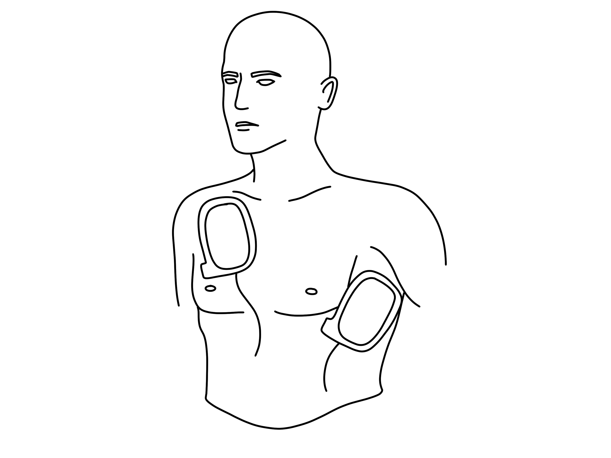
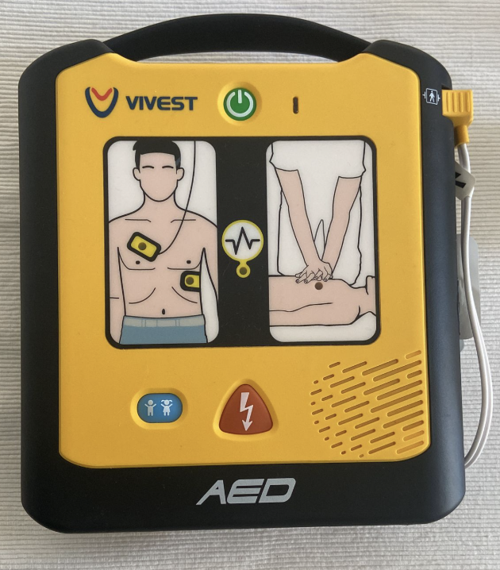
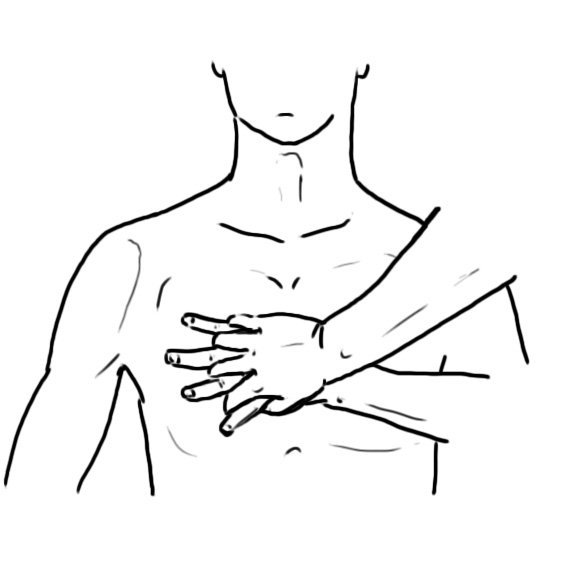

# UNIÃO SERVIÇOS MÉDICOS
## DIRETORIA DE ENSINO, PESQUISA E INSTRUÇÃO PRÉ-HOSPITALAR

---

**MÓDULO A02 — EMERGÊNCIAS CARDIOVASCULARES DURANTE O EXERCÍCIO**
*Biblioteca Curricular: Emergências em Academias (Fitness & Sports Emergency)*
*Versão Editorial: 1.0.0 — Padrão Editorial USM*
*Carga Horária: 1 hora teórica + 1 hora prática | Público-alvo: Educadores físicos, treinadores, fisioterapeutas esportivos e socorristas de centros de treinamento*

---

## SUMÁRIO

- [Seção 1 — Em 30 Segundos](#seção-1--em-30-segundos)
- [Seção 2 — Objetivos de Aprendizagem](#seção-2--objetivos-de-aprendizagem)
- [Seção 3 — Introdução e Epidemiologia da Morte Súbita no Esporte](#seção-3--introdução-e-epidemiologia-da-morte-súbita-no-esporte)
- [Seção 4 — Fisiopatologia Cardiovascular do Exercício e Mecanismos da PCR Esportiva](#seção-4--fisiopatologia-cardiovascular-do-exercício-e-mecanismos-da-pcr-esportiva)
- [Seção 5 — Desenvolvimento dos Subtemas](#seção-5--desenvolvimento-dos-subtemas)
  - [5.1 Dor Torácica no Treino: Isquemia Miocárdica e Diagnóstico Diferencial](#51-dor-torácica-no-treino-isquemia-miocárdica-e-diagnóstico-diferencial)
  - [5.2 Sinais Sugestivos de Infarto Agudo do Miocárdio (IAM) no Salão](#52-sinais-sugestivos-de-infarto-agudo-do-miocárdio-iam-no-salão)
  - [5.3 Síncope Durante e Pós-Atividades Físicas: Fisiologia e Gravidade](#53-síncope-durante-e-pós-atividades-físicas-fisiologia-e-gravidade)
  - [5.4 Parada Cardiorrespiratória (PCR) no Esporte: Reconhecimento Imediato](#54-parada-cardiorrespiratória-pcr-no-esporte-reconhecimento-imediato)
  - [5.5 RCP de Alta Qualidade e Aplicação Ultrarrápida do DEA em Academias](#55-rcp-de-alta-qualidade-e-aplicação-ultrarrápida-do-dea-em-academias)
  - [5.6 Simulação de Emergência Cardiovascular no Ambiente Esportivo](#56-simulação-de-emergência-cardiovascular-no-ambiente-esportivo)
- [Seção 6 — Quadros Práticos e Algoritmos Decisórios de Suporte à Vida](#seção-6--quadros-práticos-e-algoritmos-decisórios-de-suporte-à-vida)
- [Seção 7 — Erros Críticos e Mitos no Atendimento a Eventos Cardíacos no Salão](#seção-7--erros-críticos-e-mitos-no-atendimento-a-eventos-cardíacos-no-salão)
- [Seção 8 — Estudo de Caso Prático Contextualizado (Colapso no Treino Intervalado)](#seção-8--estudo-de-caso-prático-contextualizado-colapso-no-treino-intervalado)
- [Seção 9 — Pulo do Gato](#seção-9--pulo-do-gato)
- [Seção 10 — Mapa Mental de Emergências Cardiovasculares no Esporte](#seção-10--mapa-mental-de-emergências-cardiovasculares-no-esporte)
- [Seção 11 — O Que Você Precisa Lembrar](#seção-11--o-que-você-precisa-lembrar)
- [Seção 12 — Referências Bibliográficas e Metadados Editoriais](#seção-12--referências-bibliográficas-e-metadados-editoriais)

---

## GUIA DE ATUAÇÃO — PARA QUEM NÃO É DA ÁREA DA SAÚDE

> **EM UMA EMERGÊNCIA REAL:** Proteja-se, peça ajuda e ligue **192 (SAMU)**. Para fogo, resgate em altura, água, espaço confinado ou ambiente perigoso, ligue **193 (Bombeiros)**. Diga o endereço e siga as instruções da central. Este roteiro orienta as primeiras ações, mas não substitui o treino supervisionado das técnicas práticas.

### Situação: Colapso e possível parada cardíaca durante exercício

**Reconheça os sinais:** Colapso súbito, ausência de resposta, respiração ausente ou apenas suspiros ocasionais (gasping).

### O que fazer — passo a passo

1. Verifique se o local está seguro. Se houver uma barra prendendo a vítima, peça ajuda para retirar a carga sem se machucar.
2. Chame a pessoa e toque seus ombros. Não gaste tempo procurando o pulso se você é leigo.
3. Acione 192 em viva-voz. Peça a alguém para buscar o DEA.
4. Sem respiração normal, comprima a metade inferior do esterno a 100–120 vezes por minuto, com 5–6 cm em adultos.
5. Deixe o tórax retornar após cada compressão. Revezem-se, quando possível, sem pausas longas.
6. Ligue o DEA, exponha e seque o tórax, cole as pás conforme desenho e siga a voz do aparelho.
7. Afaste todos durante análise e eventual choque. Retome compressões quando o DEA mandar.

### Não faça isto

Não trate gasping como respiração normal. Não espere a ambulância para começar a RCP. Não faça diagnóstico de infarto para decidir agir.

### Exercício prático de aprendizagem

Treine o reconhecimento do gasping, a ligação em viva-voz, as compressões no manequim e o DEA de treinamento.

**Ao entregar a vítima:** informe horário de início, mudanças na respiração e na consciência, riscos e medidas aplicadas.

**Limites:** não faça procedimentos invasivos, administração de fármacos não prescritos, resgates técnicos ou intervenções que dependam de habilitação profissional. Pratique presencialmente RCP, DEA, controle de sangramento e desengasgo em manequins antes de assumir atendimento.

**Referências operacionais:** Ministério da Saúde — SAMU 192 (https://www.gov.br/saude/pt-br/composicao/saes/samu-192/samu-192); AHA/AAP — RCP e primeiros socorros 2025 (https://cpr.heart.org/en/resuscitation-science/cpr-and-ecc-guidelines); AHA/Cruz Vermelha — Primeiros Socorros 2024 (https://cpr.heart.org/en/resuscitation-science/2024-first-aid-guidelines).

---

## SEÇÃO 1 — EM 30 SEGUNDOS

> **VISÃO RÁPIDA DE SOBREVIVÊNCIA CARDIOVASCULAR NO SALÃO**
> 1. **O exercício não causa a doença, ele revela a doença oculta:** Em mais de 80% das paradas cardíacas em academias, a vítima não sabia que possuía miocardiopatia hipertrófica ou coronariopatia aterosclerótica prévia [1, 2].
> 2. **Dor no peito sob esforço é emergência médica até prova em contrário:** Sensação de opressão, queimação retroesternal irradiada para mandíbula ou braço esquerdo exige **parada imediata do treino**. Não permita que o aluno "descanse 5 minutos e volte para a esteira" [2, 3].
> 3. **Síncope *DURANTE* o exercício é sinal vermelho absoluto:** Desmaiar *enquanto corre ou levanta peso* indica falha hemodinâmica grave ou arritmia ventricular potencialmente fatal. É muito mais perigosa do que a tontura vasovagal que ocorre minutos *após* o fim da série [3, 4].
> 4. **Gasping (respiração agônica) É PARADA CARDÍACA:** Se o aluno colapsar e apresentar respirações ruidosas, lentas e espaçadas parecendo "peixe fora d'água", **inicie a RCP imediatamente**. Gasping não é respiração normal, é o último suspiro do tronco encefálico desprovido de oxigênio [5, 6].
> 5. **O DEA precisa disparar antes de 3 minutos:** A cada 60 segundos de atraso no choque para Fibrilação Ventricular (FV), a chance de sobrevivência desaba de 7% a 10%. Ter o DEA na recepção acessível a menos de 90 segundos do salão de pesos é mandatório [5, 7].
> 6. **RCP contínua com ênfase no tórax:** Comprima forte (5 a 6 cm) e rápido (100 a 120 compressões por minuto) no centro do tórax, permitindo o retorno completo da parede torácica e minimizando interrupções [5, 6].

---

## SEÇÃO 2 — OBJETIVOS DE APRENDIZAGEM

Ao concluir o estudo deste módulo, o profissional de Educação Física e a equipe técnica da academia serão capazes de:

1. **Compreender as alterações hemodinâmicas do miocárdio sob sobrecarga de esforço**, identificando os mecanismos que precipitam isquemia e fibrilação ventricular.
2. **Reconhecer e diferenciar os sintomas clássicos e atípicos de Infarto Agudo do Miocárdio (IAM)** em praticantes de musculação e modalidades aeróbicas.
3. **Avaliar a gravidade clínica de episódios de síncope esportiva**, distinguindo causas vasovagais benignas pós-esforço de síncopes arritmogênicas intra-esforço.
4. **Diagnosticar a Parada Cardiorrespiratória (PCR) no salão em menos de 10 segundos**, neutralizando a confusão diagnóstica gerada pelo *gasping*.
5. **Executar com perfeição técnica a ressuscitação cardiopulmonar (RCP)** e a operação segura do Desfibrilador Externo Automático (DEA) conforme as diretrizes AHA/SBC.
6. **Liderar simulações periódicas de colapso cardiovascular** integrando os setores de atendimento, professores e serviços do SAMU 192.

---

## SEÇÃO 3 — INTRODUÇÃO E EPIDEMIOLOGIA DA MORTE SÚBITA NO ESPORTE

**LEITURA GUIADA — COMECE AQUI:** Uma parada cardíaca pode parecer apenas um desmaio. A diferença que importa ao leigo é observar se a pessoa responde e respira normalmente. Se não responde e não respira normalmente, comece a ressuscitação enquanto alguém chama o socorro.

A prática regular de atividade física é um dos pilares mais sólidos para a saúde metabólica e prevenção de eventos cardiovasculares crônicos. paradoxalmente, o período transitório durante o qual o indivíduo realiza esforço físico vigoroso representa uma **janela de risco relativo aumentado (de 2 a 5 vezes maior)** para a ocorrência de parada cardíaca súbita e infarto agudo do miocárdio [1, 2].

Epidemiologicamente, a morte súbita relacionada ao exercício divide-se em duas populações distintas [2, 3]:
- **Praticantes Jovens (< 35 anos):** Incidência de 1 para cada 50.000 a 80.000 atletas/ano. As etiologias dominantes são doenças genéticas e anomalias congênitas silenciosas, encabeçadas pela **Miocardiopatia Hipertrófica (MCH)** — responsável por até um terço dos casos —, origem anômala de artérias coronárias, displasia arritmogênica do ventrículo direito e canalopatias elétricas (Síndrome do QT Longo, Síndrome de Brugada).
- **Praticantes Adultos e Idosos (≥ 35 anos):** Incidência consideravelmente maior, estimada em 1 para cada 15.000 a 20.000 praticantes/ano. Mais de 80% dos eventos fatais decorrem de **Doença Arterial Coronariana (DAC) aterosclerótica prévia**, frequentemente não diagnosticada pelo praticante de musculação ou corrida [2, 4].

A imensa maioria desses colapsos ocorre sob ritmo chocável: **Fibrilação Ventricular (FV)** ou Taquicardia Ventricular sem Pulso (TVSP). Trata-se de uma tempestade elétrica caótica na qual o miocárdio treme desordenadamente sem bombear um único mililitro de sangue. Nesses cenários, a sobrevivência é uma equação estritamente matemática dependente de duas variáveis executadas pela equipe da academia: **RCP precoce de qualidade + Desfibrilação com DEA nos primeiros 180 segundos** [5, 7].

---

## SEÇÃO 4 — FISIOPATOLOGIA CARDIOVASCULAR DO EXERCÍCIO E MECANISMOS DA PCR ESPORTIVA

> [!NOTE]
> **Por que isso acontece?** O coração leva sangue e oxigênio ao cérebro. Quando ele deixa de bombear de modo eficaz, o cérebro rapidamente perde esse suprimento. As compressões ajudam a manter alguma circulação; o DEA identifica ritmos que podem precisar de choque.

Para agir preventivamente, o educador físico precisa compreender as demandas mecânicas e metabólicas impostas ao sistema cardiovascular durante diferentes modalidades de treino [1, 4]:

```
+---------------------------------------------------------------------------------+
|                    DINÂMICA HEMODINÂMICA E PONTOS DE RUPTURA                    |
|                                                                                 |
|  [ EXERCÍCIO DINÂMICO AERÓBICO ] (Corrida, Spinning, HIIT)                     |
|  - Aumento maciço do Débito Cardíaco (Volume Sistólico x FC)                    |
|  - Consumo miocárdico de oxigênio (MVO2) sobe até 5 vezes                       |
|  - Encurtamento da Diástole -> Diminui o tempo de perfusão coronariana          |
|                                                                                 |
|  [ EXERCÍCIO ESTÁTICO / CARGA ELEVADA ] (Leg Press, Agachamento, Supino)        |
|  - Compressão vascular periférica pela massa muscular contraída                 |
|  - Elevação colossal da Resistência Vascular Periférica (PA até 280/160 mmHg)   |
|  - Aumento abrupto da pós-carga e estresse parietal sobre a parede ventricular  |
|                                                                                 |
|  [ ESTRESSE ADRENÉRGICO + VALSALVA ]                                            |
|  - Descarga maciça de Adrenalina/Noradrenalina circulantes                      |
|  - Ruptura de capa fibrosa de placa aterosclerótica estável                     |
|  - Trombose aguda intraluminal -> Fibrilação Ventricular fulminante (PCR)       |
+---------------------------------------------------------------------------------+
```

### 4.1 O Encurtamento da Diástole sob Frequência Cardíaca Elevada
Diferentemente dos outros órgãos do corpo humano que recebem perfusão sanguínea contínua durante a sístole cardíaca, o próprio músculo do coração (miocárdio) recebe sangue através das artérias coronárias **quase que exclusivamente durante a fase de diástole (relaxamento ventricular)**.
- Quando a frequência cardíaca atinge 160 a 180 bpm no treino anaeróbico ou aeróbico máximo, o tempo total de diástole encurta-se de forma dramática.
- Se o aluno possuir um estreitamento coronariano aterosclerótico prévio (ex.: placa de gordura de 60%), a passagem de sangue fica insuficiente para suprir a demanda celular.
- A isquemia aguda gera acidose celular, acúmulo de potássio extracelular e instabilidade elétrica de membrana, disparando batimentos ectópicos (extrassístoles ventriculares agrupadas) que degeneram rapidamente para fibrilação ventricular [1, 4].

### 4.2 A Ruptura de Placas Moles por Estresse de Cisalhamento (*Shear Stress*)
Durante o levantamento de peso extenuante, os picos brutais de pressão intra-arterial geram forças mecânicas de atrito e cisalhamento sobre a camada íntima dos vasos.
- Uma placa aterosclerótica com capa fibrosa fina e rica em lipídios pode fissurar ou romper sob essa pressão pulsátil.
- O sangue entra em contato com o núcleo trombogênico da placa, desencadeando a formação de um trombo oclusivo em questão de minutos.
- O vaso fecha subitamente: é o **Infarto Agudo do Miocárdio no Salão**, manifestando-se por dor opressiva e sudorese fria [2, 3].

---


*Figura 1 — Fisiopatologia do Infarto Agudo do Miocárdio por oclusão coronariana. Crédito: Blausen Medical Communications, Inc.. Licença: CC BY 3.0 (https://creativecommons.org/licenses/by/3.0/). Fonte: Wikimedia Commons.*

## SEÇÃO 5 — DESENVOLVIMENTO DOS SUBTEMAS

### 5.1 Dor Torácica no Treino: Isquemia Miocárdica e Diagnóstico Diferencial

A queixa de desconforto torácico no salão de musculação é relativamente comum, mas exige triagem técnica rigorosa pelo educador físico para diferenciar dores musculoesqueléticas benignas de eventos isquêmicos letais [2, 3]:

| CRITÉRIO CLÍNICO | DOR ISQUÊMICA CARDÍACA (INFARTO / ANGINA) | DOR MUSCULOESQUELÉTICA (PAREDE TORÁCICA) |
| :--- | :--- | :--- |
| **Sensação Descrita** | Aperto, peso, esmagamento, queimação profunda retroesternal ("garra no peito"). | Pontada aguda, agulhada, facada superficial bem delimitada. |
| **Localização** | Difusa, retroesternal; a vítima aponta com a mão espalmada ou punho fechado (Sinal de Levine). | Pontual; o aluno aponta com a ponta de um único dedo o local exato da dor. |
| **Irradiação** | Frequente para ombro e face medial do braço esquerdo, mandíbula, pescoço ou dorso. | Rara; concentra-se nas articulações condroesternais ou músculo peitoral. |
| **Reprodução à Palpação** | **NÃO piora** ao apertar as costelas ou o músculo peitoral com os dedos. | **PIORA NITIDAMENTE** quando o avaliador pressiona a musculatura ou articulação. |
| **Relação com o Esforço** | Piora com o esforço contínuo e melhora lentamente com o repouso absoluto. | Piora com movimentos articulares específicos do braço ou respiração funda. |
| **Sintomas Associados** | Sudorese fria e abundante, palidez, náuseas, tontura, falta de ar e sensação de morte. | Ausência de sinais sistêmicos vegetativos; o aluno mantém cor e ritmo normais. |

---

### 5.2 Sinais Sugestivos de Infarto Agudo do Miocárdio (IAM) no Salão

O reconhecimento precoce do IAM no ambiente de treino reduz o tempo até a angioplastia coronariana desobstrutiva hospitalar ("tempo porta-balão"), salvando músculo cardíaco da necrose [2, 4]:

#### Manifestações Clínicas Típicas e Atípicas:
- **Quadro Clássico:** Homem com mais de 40 anos, interrompendo subitamente a esteira com a mão no peito, pálido, transpirando suor frio, referindo queimação que sobe para o pescoço e braço esquerdo.
- **Apresentações Atípicas (Mais comuns em Mulheres, Idosos e Diabéticos):**
  - Ausência de dor torácica lancinante.
  - Queixa isolada de fadiga súbita inexplicável, fraqueza extrema que impede de ficar em pé, falta de ar súbita sem chiado, queimação estomacal simulando indigestão ou refluxo pós-treino e dor interescapular (entre as escápulas no dorso) [3, 4].

#### Conduta Imediata no Salão:
1. **Interrupção Absoluta:** Retire o aluno do equipamento imediatamente. Proíba qualquer movimento.
2. **Posição de Conforto:** Acomode-o sentado no chão com as costas apoiadas na parede ou em um banco com encosto. Não deite a vítima de barriga para cima se houver falta de ar.
3. **Acionamento do SAMU 192:** Ligue informando: *"Homem de X anos com dor torácica isquêmica típica em aperto, sudorese fria no salão da academia, suspeita de infarto em evolução"*.
4. **Prontidão do DEA:** Posicione o DEA desligado ao lado do aluno. Esteja preparado: um terço dos IAMs degenera para Fibrilação Ventricular nos primeiros 60 minutos [5, 7].

---

### 5.3 Síncope Durante e Pós-Atividades Físicas: Fisiologia e Gravidade

A perda transitória da consciência seguida de recuperação espontânea e rápida (síncope) no ambiente esportivo exige diferenciação cronológica imediata [3, 4]:



*Figura 2 — Posicionamento anterolateral padrão das pás adesivas do DEA no tórax desnudo. Crédito: Baedr-9439. Licença: CC0. Fonte: Wikimedia Commons.*

```
+---------------------------------------------------------------------------------+
|                       AVALIAÇÃO DA SÍNCOPE NO EXERCÍCIO                         |
|                                                                                 |
|  [ SÍNCOPE PÓS-ESFORÇO ] (Minutos após terminar a série / Parar de correr)      |
|  - Mecanismo: Estase venosa periférica nas pernas + Vasodilatação reflexa       |
|  - Queda transitória do retorno venoso (Síncope Neurocardiogênica / Benigna)   |
|  - Conduta: Deitar a vítima de barriga para cima com as pernas elevadas a 45º   |
|  - Recuperação rápida da consciência em menos de 60 segundos.                   |
|                                                                                 |
|  [ SÍNCOPE INTRA-ESFORÇO ] (Durante a execução da série / No pico da esteira)   |
|  - Mecanismo: Obstrução mecânica da via de saída do ventrículo (MCH)            |
|    OU Arritmia Ventricular Maligna / Isquemia Miocárdica aguda                  |
|  - SINAL DE ALTÍSSIMO RISCO DE MORTE SÚBITA FUTURA                             |
|  - Conduta: Avaliar pulso/respiração imediatamente; Proibir retorno ao treino;  |
|    Encaminhar obrigatoriamente para investigação cardiológica urgente.         |
+---------------------------------------------------------------------------------+
```

---

### 5.4 Parada Cardiorrespiratória (PCR) no Esporte: Reconhecimento Imediato

Diante de um aluno que desmaia ou cai inconsciente no chão da academia, cada segundo de hesitação é fatal. O socorrista tem uma janela máxima de **10 segundos** para tomar a decisão clínica de iniciar a reanimação [5, 6]:

#### As Três Etapas do Reconhecimento:
1. **Verificação de Segurança e Responsividade:** Ajoelhe-se ao lado da vítima, bata firmemente com as duas mãos nos ombros dela e chame em voz alta: *"Fulano! Você está me ouvindo?!"*.
2. **Avaliação Simultânea de Respiração e Pulso Central:**
   - Olhe para o tórax do atleta procurando expansão respiratória normal.
   - Profissionais de saúde ou socorristas treinados podem palpar o pulso carotídeo (no pescoço) simultaneamente por no máximo 10 segundos.
   - *Se a vítima não responde e NÃO respira normalmente (está sem respirar OU apenas com gasping), ASSUMA QUE ESTÁ EM PARADA CARDÍACA!* [5, 6].

#### O Perigo Mortal do Gasping
O *gasping* é um padrão reflexo de respiração agônica em que a vítima emite ruídos guturais, abre a boca de tempos em tempos e movimenta o queixo de forma irregular. Ele ocorre em até 40% das paradas cardíacas por Fibrilação Ventricular nos primeiros 2 minutos.
- **Erro Fatal:** O treinador pensa: *"Ele está respirando, só está com ar preso"* e não inicia a massagem.
- **Doutrina USM:** **GASPING É SINÔNIMO DE PARADA CARDÍACA.** Inicie as compressões torácicas no mesmo milésimo de segundo [5, 6].

---

### 5.5 RCP de Alta Qualidade e Aplicação Ultrarrápida do DEA em Academias

A sobrevivência na PCR esportiva depende da execução estrita dos parâmetros da ressuscitação de alta qualidade [5, 6, 7]:

```
+---------------------------------------------------------------------------------+
|                       PARÂMETROS DE ALTA QUALIDADE NA RCP                       |
|                                                                                 |
|  1. POSICIONAMENTO: Calcanhar de uma mão no centro do peito (metade inferior    |
|     do osso esterno); a outra mão entrelaçada por cima; braços retos a 90º.     |
|  2. PROFUNDIDADE: Comprimir no mínimo 5 cm e no máximo 6 cm no tórax do adulto. |
|  3. FREQUÊNCIA: 100 a 120 compressões por minuto (ritmo de "Stayin' Alive").    |
|  4. RETORNO TORÁCICO: Permitir a descompressão total do peito entre as batidas. |
|     Não se apoie sobre o peito da vítima (impede o enchimento do coração).      |
|  5. INTERRUPÇÕES MÍNIMAS: Manter a fração de compressão torácica acima de 80%.  |
|  6. TROCA DE SOCORRISTA: Revezar a cada 2 minutos para evitar fadiga muscular.  |
+---------------------------------------------------------------------------------+
```



*Figura 3 — Desfibrilador Externo Automático (DEA). Crédito: VoLid27. Licença: CC0. Fonte: Wikimedia Commons.*

#### Uso do Desfibrilador Externo Automático (Passo a Passo Crítico):
1. **Ligue o DEA imediatamente** ao chegar à cena.
2. **Exponha o tórax da vítima:** Rasgue ou corte a camiseta com a tesoura do kit.
3. **Seque o tórax se houver suor excessivo:** Alunos em academias frequentemente estão ensopados de suor. Passe uma toalha ou compressa rapidamente para que o adesivo das pás grude perfeitamente na pele [5, 7].
4. **Tricotomia de Urgência:** Se o atleta tiver pelos grossos no peito, passe a lâmina descartável puxando no sentido dos pelos onde as pás serão coladas. Pás sobre pelos não conduzem a corrente elétrica e queimam a superfície.
5. **Fixe as Pás Adesivas:**
   - Pá 1: Abaixo da clavícula direita, junto ao esterno.
   - Pá 2: Na linha axilar média esquerda, abaixo do mamilo esquerdo (posição ântero-lateral).
6. **Afaste todos durante a Análise e Choque:** Grite em voz alta e estenda os braços: *"AFASTADOS!"*. Garanta que ninguém encoste na vítima.
7. **Dispare o Choque e Retome a RCP Imediatamente:** Assim que o choque for entregue, não perca tempo checando pulso; retome as compressões torácicas no mesmo instante por mais 2 minutos até o novo comando do DEA [5, 7].

---

### 5.6 Simulação de Emergência Cardiovascular no Ambiente Esportivo

A competência técnica sob estresse só se consolida mediante treinamentos realísticos programados [1, 9]:
- **Periodicidade:** A academia deve realizar exercícios de simulação prática a cada **três meses**.
- **Cenários Realísticos:**
  - PCR na esteira rolante em alta velocidade (necessidade de desligar e puxar a vítima para o chão firme).
  - PCR preso sob a barra de supino (remoção coordenada do peso e início de manobras).
  - Colapso no vestiário com piso molhado (arraste rápido para área seca para aplicação segura do DEA).
- **Indicador Chave de Desempenho (KPI):** O tempo cronometrado entre o grito de "vítima caiu" e o primeiro choque disparado pelo DEA deve ser sistematicamente **inferior a 2 minutos e 30 segundos** [1, 5].

---

---

## SEÇÃO 6 — QUADROS PRÁTICOS E ALGORITMOS DECISÓRIOS DE SUPORTE À VIDA

### Algoritmo de Decisão no Colapso do Aluno

```
                        COLAPSO SÚBITO DO ALUNO NA ACADEMIA
                                         │
                   ┌─────────────────────┴─────────────────────┐
                   ▼                                           ▼
          RESPONDE AO CHAMADO?                       NÃO RESPONDE AO CHAMADO
                   │                                           │
         ┌─────────┴─────────┐                       ┌─────────┴─────────┐
         ▼                   ▼                       ▼                   ▼
    DOR TORÁCICA?      TIPO SÍNCOPE?           TEM RESPIRAÇÃO      NÃO RESPIRA OU
    Interromper        Deitar pernas           NORMAL E PULSO?     APENAS COM GASPING?
    treino, repouso    elevadas, hidratar.           │                   │
    sentado, 192 já.   Avaliação médica.      Posição Lateral     PCR CONFIRMADA!
                                              de Segurança.       1. Gritar por ajuda!
                                              Vigilância.         2. Ligar 192 (SAMU)!
                                                                  3. Pedir o DEA!
                                                                  4. RCP: 100-120/min!
                                                                  5. Chocar com DEA!
```

---

### Matriz Comparativa: Causas Comuns de Desmaio em Academias

| CONDIÇÃO | MECANISMO | CARACTERÍSTICA TEMPORAL | CONDUTA IMEDIATA | RISCO DE VIDA |
| :--- | :--- | :--- | :--- | :--- |
| **Síncope Vasovagal** | Vasodilatação e estase venosa nas pernas. | Ocorre minutos *após* terminar a série. | Elevar pernas a 45º, repouso em decúbito dorsal. | Muito baixo. |
| **Hipoglicemia Aguda** | Falta de glicose circulante no cérebro. | Instalação gradual: suor frio, tremores, fraqueza. | 15 g de açúcar se consciente. Se desacordado: 192. | Baixo a Moderado. |
| **Síncope Cardíaca** | Arritmia ventricular ou estenose da aorta. | Ocorre *durante* a execução do esforço máximo. | RCP imediata se PCR; avaliação cardiológica urgente. | **ALTÍSSIMO.** |
| **Intermação / Calor** | Falência aguda dos mecanismos térmicos. | Pele muito quente, confusão mental grave, delírio. | Resfriamento corporal agressivo imediato + 192. | **ALTÍSSIMO.** |



*Figura 4 — Posicionamento correto das mãos na metade inferior do esterno durante a RCP. Crédito: Another-anon-artist-234. Licença: CC0. Fonte: Wikimedia Commons.*

---

## SEÇÃO 7 — ERROS CRÍTICOS E MITOS NO ATENDIMENTO A EVENTOS CARDÍACOS NO SALÃO

> [!CAUTION]
> **Erro que pode prejudicar a vítima:** Suspiros espaçados, boca abrindo e ruídos respiratórios ocasionais podem ser gasping. Isso não equivale à respiração normal. Não espere encontrar pulso: para o leigo, inconsciência e ausência de respiração normal indicam início imediato de RCP.

1. **Achar que o atleta jovem não tem problema cardíaco:** A juventude não confere imunidade à morte súbita. Miocardiopatias congênitas matam indivíduos de 18 a 30 anos com físico escultural. Colapso sem respiração é PCR sempre [1, 2].
2. **Confundir gasping com retorno espontâneo:** Interromper a massagem cardíaca porque a vítima "suspirou fundo ou abriu a boca" é uma das maiores causas de morte evitável no APH leigo [5, 6].
3. **Tentar aplicar respiração boca a boca sem barreira e atrasar as compressões:** Para o socorrista leigo em adultos na academia, as diretrizes preconizam **RCP com ênfase nas mãos (Hands-Only CPR)**: compressões contínuas e ininterruptas até a chegada do DEA ou do resgate [5].
4. **Colocar o DEA e não colar as pás por medo de dar choque errado:** O DEA é 100% automatizado por computador. Ele só emite choque se detectar fibrilação ventricular ou taquicardia ventricular. Se o coração estiver batendo normalmente ou em parada por assistolia pura, o DEA não libera choque mecânico algum [5, 7].
5. **Permitir que o aluno volte dirigindo para casa após dor torácica:** A dor no peito que cessa momentaneamente após sentar pode ser o prelúdio de um infarto transmural com colapso no volante do automóvel minutos depois [2, 3].

---

## SEÇÃO 8 — ESTUDO DE CASO PRÁTICO CONTEXTUALIZADO (COLAPSO NO TREINO INTERVALADO)

> [!TIP]
> **Decisão no caso prático:** Durante a corrida na esteira, um adulto cai e apresenta apenas suspiros irregulares. O instrutor desliga o aparelho, verifica segurança e resposta, aciona 192 em viva-voz e inicia compressões. Um colega traz o DEA sem interromper o atendimento.

### Cenário: Colapso Súbito na Pista de Spinning
Durante a aula das 19h00 de ciclismo indoor (spinning) na Academia Corpo & Movimento, o aluno Roberto, 46 anos, executava uma subida simulada de alta resistência com frequência cardíaca elevada. No meio do tiro, Roberto solta o guidom da bicicleta estática, desmaia lateralmente e colide contra o piso de madeira da sala, ficando desacordado.

A instrutora Camila paralisa imediatamente a música da sala e acende as luzes centrais.

### Resposta Rápida e Aplicação do Protocolo USM:
1. **Reconhecimento da PCR em 8 Segundos:**
   - Camila ajoelha-se ao lado de Roberto: *"Roberto! Você me ouve?!"*. Nenhuma resposta.
   - Observa o peito: ausência de expansão torácica; a vítima apresenta ruídos ocasionais de ar nos lábios (*gasping* irregular). Pulso carotídeo ausente.
2. **Distribuição Explícita de Ordens:**
   - Camila aponta para o aluno Fábio (policial militar da turma): *"Fábio, vá à recepção e traga o DEA agora mesmo!"*.
   - Aponta para a aluna Larissa: *"Larissa, ligue 192 do SAMU! Diga que temos uma parada cardíaca confirmada no spinning da academia!"*.
3. **Início da RCP de Alta Qualidade:**
   - Camila posiciona as mãos no centro do tórax de Roberto e inicia compressões firmes a 110 por minuto, contando em voz alta.
4. **Instalação do DEA aos 80 Segundos do Colapso:**
   - Fábio retorna correndo com o DEA. Camila mantém as compressões enquanto Fábio abre a maleta e liga o aparelho.
   - O peito do atleta está completamente empapado de suor. Fábio pega a toalha do kit do DEA e seca o tórax em 5 segundos.
   - Cola as pás na posição correta (subclavicular direita e linha axilar esquerda).
   - O DEA anuncia: *"Analisando o ritmo cardíaco... Não toque no paciente"*. Camila suspende as compressões e afasta-se erguendo as mãos: *"Todos afastados!"*.
   - O DEA apita: *"Choque recomendado! Carregando... Afaste-se do paciente. Pressione o botão piscando agora!"*.
   - Fábio confere a cena e aperta o botão. O choque é entregue aos 105 segundos do evento.
5. **Retomada Imediata e Desfecho:**
   - Camila reinicia as compressões torácicas no milésimo de segundo seguinte.
   - Ao final dos 2 minutos do ciclo, antes da reanálise do DEA, Roberto apresenta movimentos respiratórios profundos espontâneos, tosse e move o braço na direção do peito.
   - O ritmo cardíaco reverteu para sinusal. Roberto é colocado em posição lateral de segurança, consciente embora desorientado.
   - A Unidade de Suporte Avançado do SAMU chega em 10 minutos e conduz a vítima para o centro de hemodinâmica, onde uma oclusão de 95% na artéria descendente anterior é desobstruída com stent. Roberto sobreviveu sem sequelas graças ao choque elétrico em menos de 2 minutos.

---

## SEÇÃO 9 — PULO DO GATO

> **MACETES OPERACIONAIS PARA EMERGÊNCIAS CARDÍACAS NO TREINO**
>
> 1. **A Toalha Pré-Embalada no DEA:** Mantenha sempre uma toalha de rosto de microfibra de alta absorção embalada a vácuo dentro da bolsa do DEA. Em academias, 95% das vítimas colapsam encharcadas de suor corporal. Tentar colar as pás em pele molhada sem secar faz com que os eletrodos descolem durante as compressões, atrasando a desfibrilação em minutos cruciais [5, 7].
> 2. **O Teste da Fala na Dor no Peito:** Se um aluno queixar de cansaço ou aperto no peito após uma série, peça para ele contar de 1 até 10 em voz alta sem respirar no meio. O aluno com angina isquêmica grave ou infarto não consegue passar do número 4 ou 5 devido ao broncoespasmo reflexo e congestão miocárdica incipiente [2, 3].
> 3. **Pás Pediátricas vs. Adultas no Salão:** O salão de musculação e treinamento funcional de adultos utiliza exclusivamente as pás adultas do DEA. Se houver escolinhas esportivas infantis na mesma academia, mantenha os eletrodos pediátricos armazenados no mesmo compartimento, mas certifique-se de que o conector padrão instalado seja sempre o adulto [5].

---

## SEÇÃO 10 — MAPA MENTAL DE EMERGÊNCIAS CARDIOVASCULARES NO ESPORTE

```
                        EMERGÊNCIAS CARDIOVASCULARES NO ESFORÇO
                                           │
         ┌─────────────────────────────────┴─────────────────────────────────┐
         │                                                                   │
  [ COLAPSO INCONSCIENTE ]                                           [ ALUNO CONSCIENTE ]
         │                                                                   │
  Avaliar em < 10 seg                                                ┌───────┴───────┐
         │                                                           │               │
  ┌──────┴──────┐                                              [ DOR NO PEITO ] [ SÍNCOPE ]
  ▼             ▼                                                    │               │
Sem pulso /   Respira e tem pulso                              Opressão /      Durante esforço:
Gasping       │                                                Irradiação      ALTO RISCO!
  │           Posição Lateral de Segurança                           │               │
  ▼           Monitorar via aérea                               Interromper     Pós-esforço:
[ PCR ]       Ligar 192 se não acordar                          treino          Elevar pernas
  │                                                             Repouso 192     Investigar
 ┌┴───────────────────────────┐
 ▼                            ▼
RCP 100-120/min          DEA em < 3 min
Forte e Rápido           Secar tórax +
Retorno total            Choque se FV/TV
```

---

## SEÇÃO 11 — O QUE VOCÊ PRECISA LEMBRAR

- Morte súbita no esporte é real e decorre predominantemente de miocardiopatias em jovens e doença coronariana em adultos.
- Dor torácica com irradiação sob esforço exige suspensão imediata do treino e acionamento médico; nunca permita o retorno ao exercício.
- Síncope intra-esforço é sinal vermelho grave de arritmia ou cardiopatia obstrutiva.
- Gasping não é respiração; é sinal patente de parada cardiorrespiratória e exige início de RCP imediata.
- A desfibrilação entregue pelo DEA nos primeiros 3 minutos é o fator isolado que mais salva vidas na academia.
- Seque o tórax do atleta antes de fixar os eletrodos adesivos e tricotomize se houver pelos densos.
- Pratique simulações trimestrais para que a equipe aja de forma automática e sincronizada.

---

## SEÇÃO 12 — REFERÊNCIAS BIBLIOGRÁFICAS E METADADOS EDITORIAIS

### Referências Científicas e Normativas

1. AMERICAN COLLEGE OF SPORTS MEDICINE (ACSM). **ACSM's Guidelines for Exercise Testing and Prescription**. 11. ed. Philadelphia: Wolters Kluwer, 2021.
2. SOCIEDADE BRASILEIRA DE CARDIOLOGIA (SBC). **Diretriz em Cardiologia do Esporte e do Exercício da Sociedade Brasileira de Cardiologia e da Sociedade Brasileira de Medicina do Exercício e do Esporte**. *Arquivos Brasileiros de Cardiologia*, v. 112, n. 3, p. 326-368, 2019.
3. AMERICAN HEART ASSOCIATION (AHA). **Exercise Standards for Testing and Training: A Scientific Statement From the American Heart Association**. *Circulation*, v. 128, n. 8, p. 873-934, 2013. Reafirmado em 2022.
4. EUROPEAN SOCIETY OF CARDIOLOGY (ESC). **2020 ESC Guidelines on Sports Cardiology and Exercise in Patients with Cardiovascular Disease**. *European Heart Journal*, v. 42, n. 1, p. 17-96, 2021.
5. AMERICAN HEART ASSOCIATION (AHA). **2020 American Heart Association Guidelines for Cardiopulmonary Resuscitation and Emergency Cardiovascular Care: Adult Basic and Advanced Life Support**. *Circulation*, v. 142, suppl. 2, p. S366-S468, 2020.
6. INTERNATIONAL LIAISON COMMITTEE ON RESUSCITATION (ILCOR). **2022 International Consensus on Cardiopulmonary Resuscitation and Emergency Cardiovascular Care Science With Treatment Recommendations**. *Resuscitation*, v. 181, p. 165-207, 2022.
7. BRASIL. **Lei Federal nº 14.428, de 29 de julho de 2022**. Dispõe sobre a obrigatoriedade da disponibilidade de desfibrilador externo automático em locais de grande concentração humana. Brasília, DF: Presidência da República, 2022.
8. CONSELHO FEDERAL DE EDUCAÇÃO FÍSICA (CONFEF). **Resolução CONFEF nº 307/2015: Código de Ética dos Profissionais de Educação Física**. Rio de Janeiro: CONFEF, 2015.
9. DREZNER, J. A. et al. **Cardiovascular Preparticipation Screening and Emergency Action Planning in Athletics: The National Athletic Trainers' Association Position Statement**. *Journal of Athletic Training*, v. 50, n. 3, p. 317-333, 2015. Reafirmado em 2021.
10. MARON, B. J. et al. **Eligibility and Recommendations for Competitive Athletes and Other Exercising Individuals: Associated with Risk for Sudden Death**. *Circulation*, v. 132, n. 22, p. e256-e261, 2015.
11. SOCIEDADE BRASILEIRA DE CARDIOLOGIA (SBC). **Diretrizes da Sociedade Brasileira de Cardiologia sobre Tratamento do Infarto Agudo do Miocárdio com Supradesnível do Segmento ST**. *Arquivos Brasileiros de Cardiologia*, v. 105, n. 2, supl. 1, p. 1-105, 2015. Atualizado em 2020.
12. MINISTÉRIO DA SAÚDE (BRASIL). **Portaria GM/MS nº 2.048, de 5 de novembro de 2002**. Regulamento Técnico dos Sistemas Estaduais de Urgência e Emergência e Atendimento Pré-Hospitalar Móvel. Brasília, DF: Ministério da Saúde, 2002.

---

### Metadados Editoriais Institucionais

| CAMPO | ESPECIFICAÇÃO TÉCNICA |
| :--- | :--- |
| **Identificador do Módulo** | MÓDULO A02 — Emergências Cardiovasculares Durante o Exercício |
| **Biblioteca Curricular** | Emergências em Academias (*Fitness & Sports Emergency*) |
| **Instituição Responsável** | União Serviços Médicos — Ensino e Instrução Pré-Hospitalar |
| **Padrão Gráfico e Editorial** | Diretrizes Editoriais Integradas LURIA / USM |
| **Status Editorial** | Aguardando Aprovação Científica |
| **Data da Revisão Técnica** | Outubro de 2026 |
| **Versão Curricular** | Versão 1.0.0 — Revisão Quinquenal Vigente |
| **Classificação de Acesso** | Conteúdo Didático Restrito aos Treinamentos e Capacitações da União Serviços Médicos |
