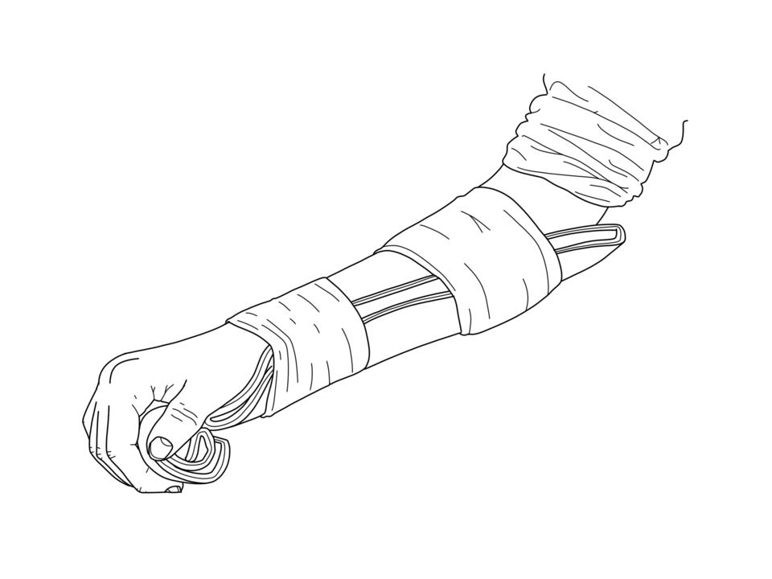
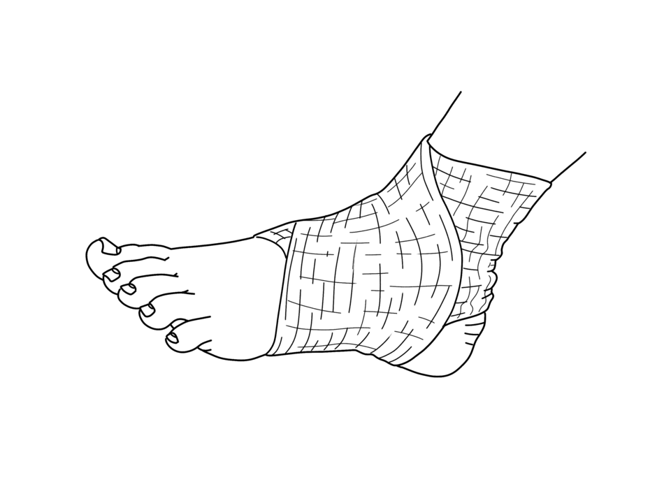
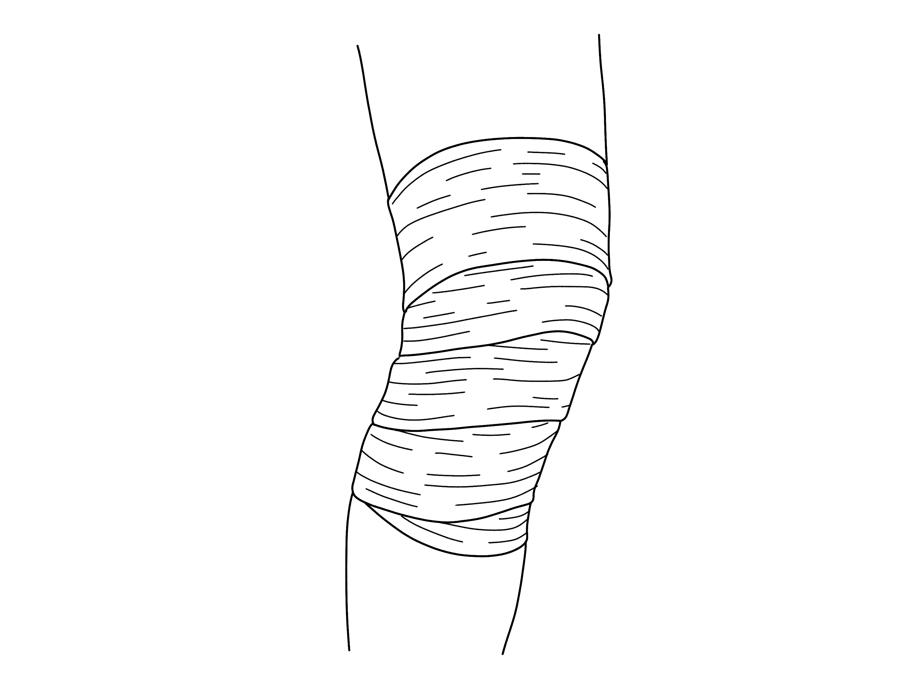
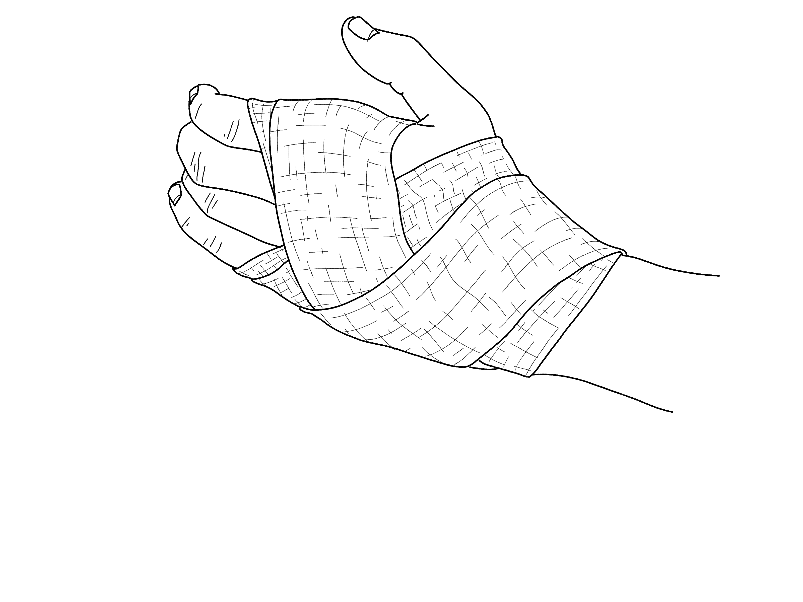
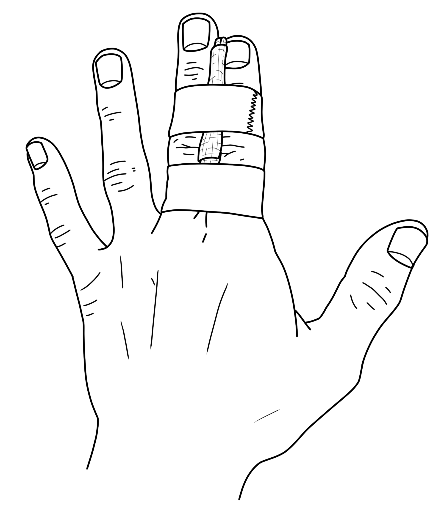

# UNIÃO SERVIÇOS MÉDICOS
## DIRETORIA DE ENSINO, PESQUISA E INSTRUÇÃO PRÉ-HOSPITALAR

---

**MÓDULO A03 — LESÕES MUSCULOESQUELÉTICAS NO ESPORTE**
*Biblioteca Curricular: Emergências em Academias (Fitness & Sports Emergency)*
*Versão Editorial: 1.0.0 — Padrão Editorial USM*
*Carga Horária Teórica: 1 hora | Público-alvo: Educadores físicos, treinadores esportivos, fisioterapeutas e instrutores de academias*

---

## SUMÁRIO

- [Seção 1 — Em 30 Segundos](#seção-1--em-30-segundos)
- [Seção 2 — Objetivos de Aprendizagem](#seção-2--objetivos-de-aprendizagem)
- [Seção 3 — Introdução e Relevância do Trauma Ortopédico no Treinamento Físico](#seção-3--introdução-e-relevância-do-trauma-ortopédico-no-treinamento-físico)
- [Seção 4 — Anatomia Funcional e Biomecânica das Lesões Esportivas](#seção-4--anatomia-funcional-e-biomecânica-das-lesões-esportivas)
- [Seção 5 — Desenvolvimento dos Subtemas](#seção-5--desenvolvimento-dos-subtemas)
  - [5.1 Entorses Articulares: Fisiopatologia Ligamentar e Manejo Inicial](#51-entorses-articulares-fisiopatologia-ligamentar-e-manejo-inicial)
  - [5.2 Distensões e Estiramentos Musculotendíneos Agudos](#52-distensões-e-estiramentos-musculotendíneos-agudos)
  - [5.3 Luxações e Subluxações Articulares: Perigos da Redução Inadvertida](#53-luxações-e-subluxações-articulares-perigos-da-redução-inadvertida)
  - [5.4 Fraturas Ósseas no Esporte: Impacto Direto, Sobrecarga e Avulsão](#54-fraturas-ósseas-no-esporte-impacto-direto-sobrecarga-e-avulsão)
  - [5.5 Traumatismo Cranioencefálico (TCE) e Concussão Esportiva](#55-traumatismo-cranioencefálico-tce-e-concussão-esportiva)
  - [5.6 Cuidados Iniciais no Salão: Protocolo POLICE/PEACE & LOVE e Encaminhamento](#56-cuidados-iniciais-no-salão-protocolo-policepeace--love-e-encaminhamento)
- [Seção 6 — Quadros Práticos e Matrizes Decisórias de Lesões Ortopédicas](#seção-6--quadros-práticos-e-matrizes-decisórias-de-lesões-ortopédicas)
- [Seção 7 — Erros Frequentes e Mitos Perigosos no Atendimento ao Atleta](#seção-7--erros-frequentes-e-mitos-perigosos-no-atendimento-ao-atleta)
- [Seção 8 — Estudo de Caso Prático Contextualizado (Entorse com Suspeita de Fratura)](#seção-8--estudo-de-caso-prático-contextualizado-entorse-com-suspeita-de-fratura)
- [Seção 9 — Pulo do Gato](#seção-9--pulo-do-gato)
- [Seção 10 — Mapa Mental das Lesões Musculoesqueléticas no Esporte](#seção-10--mapa-mental-das-lesões-musculoesqueléticas-no-esporte)
- [Seção 11 — O Que Você Precisa Lembrar](#seção-11--o-que-você-precisa-lembrar)
- [Seção 12 — Referências Bibliográficas e Metadados Editoriais](#seção-12--referências-bibliográficas-e-metadados-editoriais)

---

## SEÇÃO 1 — EM 30 SEGUNDOS

> **VISÃO RÁPIDA DE SOBREVIVÊNCIA E SUPORTE TRAUMÁTICO NO TREINO**
> 1. **Diferencie ligamento de músculo:** **Entorse** é lesão de ligamento (que conecta osso a osso em articulações como tornozelo e joelho). **Distensão** é lesão de fibras musculares ou tendões (como posterior de coxa e panturrilha) sob contração excêntrica violenta [1, 2].
> 2. **Luxação articular NUNCA se coloca no lugar no salão:** A articulação deslocada (ombro, patela ou dedo) pode comprimir feixes vasculares e nervos. Tentar "puxar o osso para estalar no lugar" causa lesão permanente da artéria axilar ou plexo braquial. **Imobilize na posição em que se encontra e encaminhe ao pronto-socorro** [2, 3].
> 3. **Fratura suspeita exige alinhamento e estabilização passiva:** Deformidade óssea, crepitação (som de atrito de ossos) e dor incapacitante exigem imobilização com tala moldável envolvendo uma articulação acima e uma abaixo da lesão [3, 4].
> 4. **Concussão cerebral é trauma invisível:** Pancada na cabeça ou desaceleração súbita (quedas no jiu-jítsu ou choque de cabeças no futebol) seguida de tontura, visão turva, amnésia ou náusea significa **concussão**. O atleta deve ser **retirado imediatamente da atividade e proibido de retornar no mesmo dia** (*"When in doubt, sit them out"*) [5, 6].
> 5. **O moderno protocolo POLICE substituiu o antigo RICE:** Proteção (*Protect*), Carga Ótima (*Optimal Loading*), Gelo (*Ice*), Compressão (*Compression*) e Elevação (*Elevation*). Gelo deve ser aplicado por 15 a 20 minutos envolto em tecido, **nunca direto sobre a pele nua** [1, 7].
> 6. **Avalie a circulação periférica:** Antes e após imobilizar qualquer membro fraturado ou luxado, cheque o pulso periférico (radial no punho ou pedioso no pé) e o enchimento capilar da extremidade dos dedos (< 2 segundos) [3, 4].

---

## SEÇÃO 2 — OBJETIVOS DE APRENDIZAGEM

Ao concluir o estudo aprofundado deste módulo, o treinador e instrutor esportivo serão capazes de:

1. **Diferenciar fisiopatologicamente as lesões de tecidos moles** (entorses, distensões e contusões) de patologias ósseas e articulares graves.
2. **Reconhecer deformidades anatômicas sugestivas de fraturas e luxações**, identificando sinais de comprometimento neurovascular agudo.
3. **Aplicar as proibições absolutas de redução incruenta leiga** em luxações escapuloumerais, patelares e interfalangianas no ambiente de academia.
4. **Triar e gerenciar episódios de Traumatismo Cranioencefálico (TCE) e concussão desportiva** com base no protocolo internacional SCAT/Concussion Recognition Tool.
5. **Executar imobilizações provisórias funcionais com talas moldáveis e bandagens**, respeitando o alinhamento neutro e a estabilização biomecânica.
6. **Implementar as diretrizes contemporâneas de reabilitação e suporte inicial (POLICE e PEACE & LOVE)**, evitando o uso precoce prejudicial de calor e anti-inflamatórios.

---

## SEÇÃO 3 — INTRODUÇÃO E RELEVÂNCIA DO TRAUMA ORTOPÉDICO NO TREINAMENTO FÍSICO

O ambiente de treinamento de força, crossfit, lutas e esportes coletivos é caracterizado por cargas mecânicas elevadas, acelerações, mudanças abruptas de direção e impactos corporais diretos. De acordo com o Conselho Federal de Educação Física e a Sociedade Brasileira de Medicina do Exercício e do Esporte, as lesões do aparelho locomotor representam **mais de 85% de todas as intercorrências médicas atendidas em academias e centros esportivos** [1, 2].

Embora a maioria das lesões musculoesqueléticas não ameace imediatamente a vida (ao contrário da parada cardíaca abordada no Módulo A02), **a conduta adotada nos primeiros 15 minutos pelo educador físico determina o prognóstico funcional definitivo do atleta** [1, 3]:
- Uma entorse grave de tornozelo tratada incorretamente com calor ou massagens vigorosas pode transformar um estiramento parcial de ligamentos em uma instabilidade articular crônica invalidante.
- Uma fratura fechada de perna manipulada de forma desajeitada por pessoas destreinadas pode perfurar a pele (transformando-se em fratura exposta contaminada) ou dilacerar a artéria tibial anterior, provocando síndrome compartimental e risco de amputação do membro [3, 4].
- Uma concussão cerebral subestimada em uma luta de artes marciais pode culminar na letal **Síndrome do Segundo Impacto**, na qual um novo trauma craniano menor provoca edema cerebral fulminante e óbito em poucos minutos [5, 6].

---

## SEÇÃO 4 — ANATOMIA FUNCIONAL E BIOMECÂNICA DAS LESÕES ESPORTIVAS

Para agir com assertividade, o instrutor deve compreender a física tecidual do sistema musculoesquelético [1, 4]:

```
+---------------------------------------------------------------------------------+
|               BIOMECÂNICA DAS LESÕES DO APARELHO LOCOMOTOR                      |
|                                                                                 |
|  [ LIGAMENTO ] (Osso com Osso) -> Fibras colágenas densas sem contratilidade    |
|  - Falha por sobrecarga de torção e tração elástica excessiva                  |
|  - Mecanismo: Inversão forçada do tornozelo / Valgo forçado do joelho           |
|  - Lesão: ENTORSE (Graus I, II e III)                                           |
|                                                                                 |
|  [ MÚSCULO / TENDÃO ] (Osso com Músculo) -> Unidade contrátil ativa             |
|  - Falha na transição miotendínea sob contração excêntrica rápida              |
|  - Mecanismo: Tiro de velocidade no tiro / Frenagem abrupta no agachamento     |
|  - Lesão: DISTENSÃO / ESTIRAMENTO MUSCULAR (Ruptura fibrilar)                   |
|                                                                                 |
|  [ ARTICULAÇÃO ] (Cápsula + Cartilagem) -> Perda da congruência das superfícies |
|  - Deslocamento ósseo com ruptura capsular: LUXAÇÃO COMPLETA                    |
|                                                                                 |
|  [ OSSO CORTICAL ] -> Falência sob cisalhamento, torção ou impacto direto       |
|  - Fratura fechada (sem corte de pele) ou Fratura exposta (osso exposto)        |
+---------------------------------------------------------------------------------+
```

### 4.1 A Zona de Transição Miotendínea e a Contração Excêntrica
A maioria das distensões musculares agudas não ocorre no meio do ventre do músculo, mas sim na junção miotendínea — a área onde o músculo carnoso se ancora no tendão fibroso.
- Durante a contração excêntrica (quando o músculo tenta frear o movimento enquanto está sendo esticado pela carga, como a descida de um agachamento pesado ou a desaceleração na corrida), a tensão por milímetro quadrado atinge o ponto crítico de ruptura elástica.
- O praticante relata uma sensação de "pedrada" súbita na parte posterior da coxa (isquiotibiais) ou na panturrilha (gastrocnêmio/sóleo), acompanhada de impotência funcional imediata [1, 2].

---

## SEÇÃO 5 — DESENVOLVIMENTO DOS SUBTEMAS

### 5.1 Entorses Articulares: Fisiopatologia Ligamentar e Manejo Inicial

A entorse é a lesão traumática dos ligamentos que estabilizam uma articulação, decorrente de uma força rotacional ou angular que ultrapassa a amplitude articular anatômica normal [1, 7].

#### Classificação Clínica das Entorses:
- **Grau I (Leve):** Microlesão fibrilar sem ruptura macroscópica. Dor leve, inchaço mínimo localizado, sem instabilidade da articulação. O aluno consegue apoiar o pé no chão.
- **Grau II (Moderado):** Ruptura parcial das fibras ligamentares. Dor moderada a severa, edema evidente, equimose (mancha roxa) que surge em poucas horas, claudicação (mancar acentuado) e instabilidade articular moderada.
- **Grau III (Grave):** Ruptura ligamentar completa. O atleta frequentemente relata ter ouvido ou sentido um "estalo" oco. Dor intensa inicial que pode diminuir paradoxalmente após alguns minutos devido à destruição das terminações nervosas livres do ligamento. Instabilidade articular grosseira; incapacidade absoluta de apoiar o membro no solo [1, 3].

#### Conduta Inicial no Salão:
1. **Interrompa a atividade imediatamente:** Proíba o aluno de "tentar andar para ver se passa".
2. **Retire calçados e meias com cuidado:** Avalie a anatomia do tornozelo ou joelho antes que o inchaço mascare deformidades.
3. **Aplique o protocolo POLICE:** Proteja a articulação, aplique compressa fria (gelo com barreira) por 15 a 20 minutos e enfaixe com atadura elástica suave [1, 7].

---

### 5.2 Distensões e Estiramentos Musculotendíneos Agudos

As distensões musculares ocorrem tipicamente em esportes de velocidade explosiva ou levantamentos pesados com técnica deficiente [1, 2]:
- **Sinais e Sintomas:** Dor súbita em fisgada ou queimação localizada, espasmo muscular reflexo de defesa, perda de força e, em rupturas graves (Grau III), visualização de um "degrau" ou depressão na massa muscular (sinal do vácuo muscular com retração do ventre).
- **Proibições Absolutas nas Primeiras 48 Horas:**
  - **NÃO aplique calor:** Bolsas de água quente ou pomadas que esquentam dilatam os vasos sanguíneos rompidos, aumentando o sangramento interno e o hematoma intramuscular.
  - **NÃO faça massagens profundas:** Tentar "soltar o nó do músculo" esmaga fibras já lesionadas e pode induzir miosite ossificante (calcificação patológica dentro do músculo) [1, 7].

---

### 5.3 Luxações e Subluxações Articulares: Perigos da Redução Inadvertida

A luxação ocorre quando as extremidades ósseas de uma articulação sofrem desencaixe completo, perdendo o contato anatômico normal. No ambiente de academias e crossfit, as luxações mais frequentes ocorrem no **ombro (escapuloumeral)** durante movimentos como *snatch*, *muscle-up* ou desenvolvimento com halteres, e nos **dedos da mão** em aulas de jiu-jítsu e basquete [2, 3].

```
+---------------------------------------------------------------------------------+
|                    A REGRA SUPREMA DAS LUXAÇÕES NO SALÃO                        |
|                                                                                 |
|   NUNCA, EM HIPÓTESE ALGUMA, TENTE "COLOCAR O OSSO NO LUGAR" (REDUÇÃO)!        |
|                                                                                 |
|   1. A articulação deslocada frequentemente aprisiona ou estira feixes de      |
|      nervos e grandes vasos sanguíneos contra as bordas do osso.                |
|   2. A tração leiga sem analgesia profunda e relaxamento muscular provoca:     |
|      - Ruptura de artérias profundas (hemorragia interna maciça);               |
|      - Laceração de troncos nervosos (paralisia definitiva do braço);           |
|      - Fraturas ósseas por cisalhamento da borda articular da glenoide.         |
|   3. A redução articular é um ato médico hospitalar exclusivo, realizado sob   |
|      anestesia e precedido por radiografias de checagem.                        |
+---------------------------------------------------------------------------------+
```

#### Protocolo de Socorro em Luxações:
1. **Imobilize na Posição Encontrada:** Não tente forçar o braço encostado ao corpo se o ombro estiver travado aberto. Utilize almofadas, toalhas dobradas e uma tipoia para sustentar o membro na posição exata em que o atleta sente menos dor.
2. **Checagem Neurovascular Periférica:** Palpe o pulso radial no punho e observe a sensibilidade e a coloração dos dedos da mão. Se os dedos estiverem frios, arroxeados ou sem pulso, trata-se de uma emergência cirúrgica urgente: acione o SAMU 192 de imediato [3, 4].
3. **Encaminhamento Médico Rápido:** Conduza o atleta com imobilização firme até um pronto-socorro ortopédico.

---

### 5.4 Fraturas Ósseas no Esporte: Impacto Direto, Sobrecarga e Avulsão

As fraturas em ambientes esportivos podem decorrer de quedas de altura considerável (barra fixa, argolas), impacto direto de cargas pesadas (queda de barra com anilhas sobre o corpo) ou forças de torção biomecânica extrema [3, 4].

#### Reconhecimento dos Sinais Clínicos de Fratura:
- **Dor Aguda Intolerável:** Piora a qualquer tentativa de palpação ou movimentação mínima.
- **Deformidade Anatômica Visível:** Desalinhamento angular, encurtamento do membro ou rotação anormal do osso em relação ao eixo corporal.
- **Crepitação Óssea:** Sensação de rangido áspero percebida ao toque quando fragmentos ósseos fraturados roçam entre si. *(Não force a crepitação de propósito)*.
- **Mobilidade Anormal:** O osso dobra em um ponto intermediário onde não existe articulação.
- **Fratura Exposta (Emergência Infecciosa e Hemorrágica):** O topo do osso rompe a pele ou existe ferida lacerante sangrante comunicando-se diretamente com o foco da fratura.

#### Manejo Prático de Imobilização Provisória:
- **Regra das Duas Articulações:** A tala deve imobilizar obrigatoriamente **a articulação acima e a articulação abaixo** do osso quebrado (ex.: para fratura de tíbia/fíbula na perna, imobilize o tornozelo e o joelho).
- **Em Fraturas Expostas:** Não tente empurrar o osso para dentro da pele. Cubra o osso exposto com compressas de gaze estéril embebidas em soro fisiológico, estanque sangramentos com compressão cuidadosa nas bordas da ferida e imobilize o membro externamente [3, 4].

---

### 5.5 Traumatismo Cranioencefálico (TCE) e Concussão Esportiva

A concussão desportiva é uma lesão cerebral traumática funcional induzida por forças biomecânicas de impacto direto na cabeça, face ou pescoço, ou transmitidas indiretamente ao cérebro por desaceleração brusca do tronco (quedas violentas no solo) [5, 6].

#### Reconhecimento da Concussão no Salão ou Tatame:
Diferente do mito popular, **mais de 90% das concussões no esporte NÃO envolvem desmaio ou perda de consciência**. Os sinais são sutis e comportamentais [5, 6]:
- **Sintomas Físicos:** Cefaleia (dor de cabeça intensa), sensação de pressão craniana, tontura, zumbido nos ouvidos, náuseas ou vômitos, visão dupla ou turva, hipersensibilidade à luz do salão e ao ruído da música.
- **Sinais Cognitivos:** Lentidão para responder perguntas simples, confusão mental quanto à data ou série do treino, olhar vago e vidrado, amnésia retrógrada (não se lembra do que aconteceu logo antes do golpe).
- **Sinais de Alerta Vermelho no TCE (Indicação Imediata de SAMU 192 e Tomografia):**
  - Desmaio ou perda de consciência prolongada (> 30 segundos);
  - Vômitos repetidos em jato;
  - Sonolência progressiva com dificuldade crescente para acordar;
  - Pupilas de diâmetros desiguais (anisocoria);
  - Fraqueza, formigamento ou dormência nos braços e pernas;
  - Convulsão motora pós-impacto [5, 6].

```
+---------------------------------------------------------------------------------+
|                        REGRA DE OURO DA CONCUSSÃO                               |
|                                                                                 |
|               "NA DÚVIDA, RETIRE O ATLETA!" (IF IN DOUBT, SIT THEM OUT)         |
|                                                                                 |
|   Atleta com suspeita de concussão JAMAIS retorna ao treino no mesmo dia.       |
|   O risco de um segundo trauma menor desencadear a Síndrome do Segundo Impacto  |
|   (edema cerebral fatal com herniação) é uma das maiores causas de óbito        |
|   em esportes de contato.                                                       |
+---------------------------------------------------------------------------------+
```

---

### 5.6 Cuidados Iniciais no Salão: Protocolo POLICE/PEACE & LOVE e Encaminhamento

A moderna medicina esportiva atualizou as clássicas diretrizes de atendimento a lesões agudas de partes moles [1, 7]:

#### O Protocolo POLICE:
- **P - Protect (Proteger):** Proteger o tecido machucado de nova sobrecarga nas primeiras 24 a 48 horas (uso de tipoia, muleta ou tala).
- **OL - Optimal Loading (Carga Ótima):** Estimular o movimento suave e precoce quando tolerado, acelerando a orientação das novas fibras colágenas sem causar dor aguda.
- **I - Ice (Gelo):** Crioterapia local por **15 a 20 minutos a cada 2 a 3 horas**, promovendo vasoconstrição periférica temporária para controlar o edema excessivo e atuar como analgésico natural. **Sempre com uma toalha ou tecido entre o gelo e a pele**.
- **C - Compression (Compressão):** Enfaixamento compressivo elástico no sentido distal para proximal (da ponta do membro em direção ao corpo) para limitar o acúmulo de líquido intersticial.
- **E - Elevation (Elevação):** Manter o membro machucado acima do nível do coração sempre que a vítima estiver em repouso, favorecendo a drenagem venosa e linfática [1, 7].

#### Evite o Uso Indiscriminado de Anti-Inflamatórios (AINEs) nas Primeiras 48h:
Pesquisas recentes em fisiologia tecidual comprovam que a inflamação inicial pós-trauma é um processo biológico indispensável e orquestrado por macrófagos para a cicatrização dos tecidos. O uso precoce de anti-inflamatórios orais nas primeiras 48 horas bloqueia fatores de crescimento celular e atrasa a recuperação ligamentar e muscular definitiva [7].

---

### Figuras de Apoio


*Figura 1 - Imobilização de membro superior com tala moldável. Crédito: Baedr-9439. Licença: CC0. Fonte: Wikimedia Commons.*


*Figura 2 - Enfaixamento compressivo funcional em entorse articular de tornozelo. Crédito: Baedr-9439. Licença: CC0. Fonte: Wikimedia Commons.*


*Figura 3 - Bandagem de contenção e estabilização articular em trauma de joelho. Crédito: Baedr-9439. Licença: CC0. Fonte: Wikimedia Commons.*


*Figura 4 - Imobilização funcional elástica em entorse ou contusão de punho. Crédito: Baedr-9439. Licença: CC0. Fonte: Wikimedia Commons.*


*Figura 5 - Imobilização solidária (buddy taping) em trauma fechado de falanges. Crédito: Baedr-9439. Licença: CC0. Fonte: Wikimedia Commons.*

---

## SEÇÃO 6 — QUADROS PRÁTICOS E MATRIZES DECISÓRIAS DE LESÕES ORTOPÉDICAS

### Matriz Decisória de Triagem Traumática no Esporte

| TIPO DE LESÃO | SINAIS CARACTERÍSTICOS | CONDUTA IMEDIATA REQUERIDA | DESTINO DO ATLETA |
| :--- | :--- | :--- | :--- |
| **Entorse Leve** | Dor articular ao pisar, edema mínimo, sem instabilidade. | Protocolo POLICE (Gelo 20 min + Enfaixamento suave). | Suspender treino; reavaliar em 24h. |
| **Entorse Grave** | "Estalo" audível, hematoma imediato, incapacidade de apoiar. | Imobilização com tala moldável + Gelo + Proibir apoio. | Pronto-socorro para radiografia. |
| **Luxação** | Articulação desencaixada, deformidade angular, dor extrema. | **NUNCA REDUZIR!** Imobilizar na posição exata + Avaliar pulso. | **Pronto-socorro ortopédico imediato.** |
| **Fratura Óssea** | Deformidade evidente, crepitação ao toque, osso móvel. | Imobilizar articulação acima e abaixo + Alinhar passivamente. | **SAMU 192 ou Transporte imobilizado.** |
| **Concussão** | Tontura pós-impacto, confusão, cefaleia, náusea sem desmaio. | Retirada definitiva do treino + Vigilância contínua. | Avaliação médica neurológica. |

---

## SEÇÃO 7 — ERROS FREQUENTES E MITOS PERIGOSOS NO ATENDIMENTO AO ATLETA

1. **"Puxar o dedo ou o ombro no salão para colocar no lugar":** Erro grosseiro que pode transformar uma luxação simples em uma lesão neurovascular cirúrgica definitiva [2, 3].
2. **Aplicar gelo diretamente sobre a pele nua por 1 hora:** O gelo sem proteção queima a pele por congelamento (*frostbite* químico), lesiona nervos cutâneos superficiais e desencadeia vasodilatação reflexa rebote [1, 7].
3. **Fazer massagens vigorosas ou alongar músculo com distensão aguda:** Tracionar ou massagear um músculo que acabou de sofrer microrrupturas abre ainda mais o hematoma interno [1, 7].
4. **Liberar o atleta para continuar jogando após "ficar tonto por uma pancada":** É a principal causa de mortes evitáveis por concussão cerebral secundária em modalidades esportivas [5, 6].
5. **Permitir que o aluno caminhe apoiando peso sobre fratura de tornozelo:** Destrói a congruência dos maléolos tibial e fibular, convertendo uma fratura passível de tratamento conservador em uma fratura cirúrgica complexa [3, 4].

---

## SEÇÃO 8 — ESTUDO DE CASO PRÁTICO CONTEXTUALIZADO (ENTORSE COM SUSPEITA DE FRATURA)

### Cenário: Queda na Área de Treinamento Funcional
No Box Cross Training União, durante um treino matinal com salto em caixa de madeira (*box jump* de 60 cm), a aluna Juliana, 28 anos, erra aterrissagem na borda superior da caixa. Seu pé direito dobra violentamente para dentro em flexão plantar e inversão forçada, seguido por um estalo audível a dois metros de distância. Juliana desaba no chão gritando de dor, segurando a região lateral do tornozelo direito.

O treinador Gustavo aproxima-se rapidamente e pede que a turma interrompa a passagem pela área de saltos.

### Aplicação da Abordagem Ortopédica USM:
1. **Inspeção Inicial e Segurança:** Gustavo tranquiliza Juliana e impede que ela tente levantar ou girar o pé: *"Juliana, fique deitada tranquila, não mova o pé nem tente apoiar no chão"*.
2. **Remoção Controlada do Calçado:**
   - Com o membro sustentado pelas mãos de um auxiliar de salão, Gustavo desamarra os cadarços do tênis esportivo e afrouxa totalmente a lingueta.
   - Retira o calçado e a meia suavemente, cortando a meia com a tesoura de ponta romba da maleta para não tracionar o tornozelo.
3. **Avaliação Física do Membro:**
   - Observa-se edema voluminoso em formato de "ovo de pombo" sobre o maléolo lateral (fíbula distal), associado a equimose avermelhada inicial.
   - Gustavo avalia os critérios de risco (Regras de Ottawa para Tornozelo): dor intensa à palpação nos últimos 6 cm do bordo posterior do maléolo lateral e incapacidade absoluta de dar 4 passos com o membro [1, 8]. Há forte suspeita de fratura fibular associada à entorse de Grau III.
4. **Checagem Neurovascular:**
   - Gustavo palpa o pulso da artéria pediosa dorsal (no peito do pé): pulso forte e simétrico.
   - Pressiona a unha do hálux (dedão do pé): o leito ungueal volta da palidez ao rosa em 1,5 segundo (enchimento capilar normal).
5. **Aplicação do Suporte e Imobilização:**
   - Aplica uma bolsa de gelo químico instantâneo envolvida em uma toalha fina sobre o tornozelo por 15 minutos para analgesia local e contenção do edema.
   - Pega a tala moldável de alumínio e espuma (SAM Splint) da maleta, molda a tala em formato de "U" (passando sob a planta do pé e subindo pelas laterais da perna até a metade da panturrilha).
   - Enfaixa firmemente com atadura de crepom de 15 cm sem apertar em demasia, mantendo o tornozelo a 90 graus neutros.
6. **Desfecho:** Juliana é conduzida em cadeira de rodas ao pronto-socorro ortopédico com a perna elevada. As radiografias confirmaram fratura por avulsão da ponta do maléolo lateral sem desvio ósseo e ruptura ligamentar. A imobilização impecável realizada no box preveniu o desvio dos fragmentos ósseos e garantiu recuperação completa sem intervenção cirúrgica.

---

## SEÇÃO 9 — PULO DO GATO

> **MACETES OPERACIONAIS DE ALTO VALOR NO SALÃO DE TREINO**
>
> 1. **O Teste da Moeda na Tala Moldável:** Ao aplicar uma tala de alumínio com atadura no antebraço ou tornozelo fraturado, deslize uma moeda ou uma caneta entre a atadura e a pele do aluno. Se a caneta passar com leve resistência, a compressão está perfeita. Se entrar frouxa, a tala não estabiliza; se você não conseguir introduzir nem a ponta da unha, a atadura está operando como um torniquete garroteando as veias e precisa ser afrouxada imediatamente [3, 4].
> 2. **A "Regra dos 4 Passos de Ottawa":** Diante de uma entorse feia de tornozelo, se o atleta for fisicamente incapaz de dar 4 passos completos (mesmo mancando) logo após o trauma e na hora da avaliação no salão, há 98% de chance de existir fratura óssea oculta associada. Não trate como "apenas um estiramentozinho"; envie diretamente ao raio-X [8].
> 3. **A Toalha Úmida no Gelo:** Para acelerar a troca térmica do gelo com a articulação lesionada sem queimar a pele, umedeça levemente a toalha de tecido antes de envolver a bolsa de gelo. O tecido úmido conduz a temperatura fria 4 vezes mais rápido para o tecido inflamado do que uma toalha totalmente seca [1, 7].

---

## SEÇÃO 10 — MAPA MENTAL DAS LESÕES MUSCULOESQUELÉTICAS NO ESPORTE

```
                           LESÕES DO APARELHO LOCOMOTOR NO TREINO
                                             │
        ┌────────────────────────┬───────────┴───────────┬────────────────────────┐
        │                        │                       │                        │
  [ TECIDOS MOLES ]        [ ARTICULAÇÕES ]        [ FRATURAS ]             [ CABEÇA / TCE ]
        │                        │                       │                        │
 ┌──────┴──────┐          ┌──────┴──────┐         ┌──────┴──────┐          ┌──────┴──────┐
 │ Entorse     │          │ Luxação     │         │ Deformidade │          │ Concussão   │
 │ Ligamentar  │          │ Deslocamento│         │ e Crepitação│          │ Tontura     │
 └──────┬──────┘          └──────┬──────┘         └──────┬──────┘          │ Confusão    │
        │                        │                       │                 └──────┬──────┘
        ▼                        ▼                       ▼                        ▼
  Protocolo              NUNCA REDUZIR!          Imobilizar 1             Retirar da
  POLICE                 Imobilizar na           articulação              atividade!
  Gelo com               posição exata           acima e 1                NÃO retornar
  barreira 20m           Checar pulso            abaixo                   no mesmo dia
```

---

## SEÇÃO 11 — O QUE VOCÊ PRECISA LEMBRAR

- Entorse afeta ligamentos; distensão afeta músculos e tendões em contrações excêntricas.
- Luxação articular jamais deve ser reduzida (colocada no lugar) no ambiente leigo da academia.
- Fraturas demandam imobilização com tala que englobe a articulação acima e a articulação abaixo da lesão.
- Concussão esportiva na maioria das vezes não tem desmaio; tontura e lentidão cognitiva exigem afastamento imediato.
- O protocolo POLICE (Proteger, Carga Ótima, Gelo com barreira, Compressão e Elevação) é o padrão ouro de atendimento a partes moles.
- Sempre cheque o pulso periférico e a temperatura dos dedos antes e após imobilizar membros traumatizados.

---

## SEÇÃO 12 — REFERÊNCIAS BIBLIOGRÁFICAS E METADADOS EDITORIAIS

### Referências Científicas e Normativas

1. BLEAKLEY, C. M.; GLASGOW, P.; MACAULEY, D. C. **PRICE needs updating, should we call the POLICE?**. *British Journal of Sports Medicine*, v. 46, n. 4, p. 220-221, 2012.
2. SOCIEDADE BRASILEIRA DE MEDICINA DO EXERCÍCIO E DO ESPORTE (SBMEE). **Manual de Condutas em Traumatologia do Esporte e Emergências no Exercício**. São Paulo: SBMEE, 2021.
3. AMERICAN COLLEGE OF EMERGENCY PHYSICIANS (ACEP). **First Aid, CPR, and AED Standard**. 8. ed. Burlington, MA: Jones & Bartlett Learning, 2021.
4. NATIONAL ASSOCIATION OF EMERGENCY MEDICAL TECHNICIANS (NAEMT). **PHTLS: Suporte Pré-Hospitalar ao Trauma**. 10. ed. Burlington, MA: Jones & Bartlett Learning, 2023.
5. MCCRORY, P. et al. **Consensus statement on concussion in sport—the 5th international conference on concussion in sport held in Berlin, October 2016**. *British Journal of Sports Medicine*, v. 51, n. 11, p. 838-847, 2017. Atualizado pelo Consensus Concussion 2023.
6. CONCUSSION IN SPORT GROUP (CISG). **Concussion Recognition Tool 6 (CRT6): To help identify concussion in children, adolescents and adults**. *British Journal of Sports Medicine*, v. 57, n. 11, p. 692-695, 2023.
7. DUBOIS, B.; ESCULIER, J. F. **Soft-tissue injuries simply need PEACE and LOVE**. *British Journal of Sports Medicine*, v. 54, n. 2, p. 72-73, 2020.
8. STIELL, I. G. et al. **Implementation of the Ottawa Ankle Rules**. *JAMA*, v. 271, n. 11, p. 827-832, 1994. Revalidado em 2022.
9. CONSELHO FEDERAL DE EDUCAÇÃO FÍSICA (CONFEF). **Resolução CONFEF nº 307/2015: Código de Ética dos Profissionais de Educação Física**. Rio de Janeiro: CONFEF, 2015.
10. BRASIL. **Decreto-Lei nº 2.848, de 7 de dezembro de 1940**. Código Penal Brasileiro (Art. 135 - Omissão de Socorro; Art. 282 - Exercício Ilegal da Medicina). Brasília, DF: Presidência da República, 1940.
11. AMERICAN ACADEMY OF ORTHOPAEDIC SURGEONS (AAOS). **Orthopaedic Knowledge Update: Sports Medicine 6**. Rosemont, IL: AAOS, 2021.
12. MINISTÉRIO DA SAÚDE (BRASIL). **Portaria GM/MS nº 2.048, de 5 de novembro de 2002**. Regulamento Técnico dos Sistemas Estaduais de Urgência e Emergência. Brasília, DF: Ministério da Saúde, 2002.

---

### Metadados Editoriais Institucionais

| CAMPO | ESPECIFICAÇÃO TÉCNICA |
| :--- | :--- |
| **Identificador do Módulo** | MÓDULO A03 — Lesões Musculoesqueléticas no Esporte |
| **Biblioteca Curricular** | Emergências em Academias (*Fitness & Sports Emergency*) |
| **Instituição Responsável** | União Serviços Médicos — Ensino e Instrução Pré-Hospitalar |
| **Padrão Gráfico e Editorial** | Diretrizes Editoriais Integradas LURIA / USM |
| **Status Editorial** | Aguardando Aprovação Científica |
| **Data da Revisão Técnica** | Outubro de 2026 |
| **Versão Curricular** | Versão 1.0.0 — Revisão Quinquenal Vigente |
| **Classificação de Acesso** | Conteúdo Didático Restrito aos Treinamentos e Capacitações da União Serviços Médicos |
