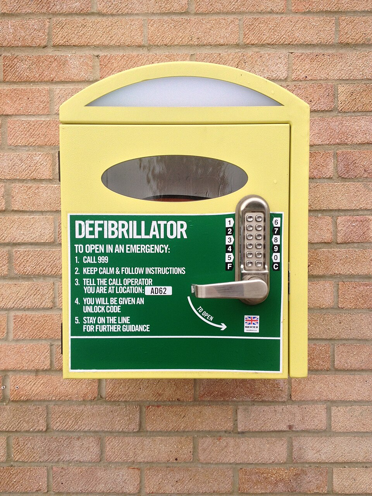

# UNIÃO SERVIÇOS MÉDICOS
## DIRETORIA DE ENSINO, PESQUISA E INSTRUÇÃO PRÉ-HOSPITALAR

---

**MÓDULO A06 — PLANO DE EMERGÊNCIA E SIMULAÇÕES EM ACADEMIAS**
*Biblioteca Curricular: Emergências em Academias (Fitness & Sports Emergency)*
*Versão Editorial: 1.0.0 — Padrão Editorial USM*
*Carga Horária: 1 hora teórica + 1 hora prática | Público-alvo: Proprietários, gestores técnicos, coordenadores de musculação e instrutores de academias*

---

## SUMÁRIO

- [Seção 1 — Em 30 Segundos](#seção-1--em-30-segundos)
- [Seção 2 — Objetivos de Aprendizagem](#seção-2--objetivos-de-aprendizagem)
- [Seção 3 — Introdução e Governança da Resposta Emergencial no Esporte](#seção-3--introdução-e-governança-da-resposta-emergencial-no-esporte)
- [Seção 4 — Fundamentos do Plano de Ação de Emergência (EAP) em Fitness](#seção-4--fundamentos-do-plano-de-ação-de-emergência-eap-em-fitness)
- [Seção 5 — Desenvolvimento dos Subtemas](#seção-5--desenvolvimento-dos-subtemas)
  - [5.1 Mapeamento Espacial de Riscos e Pontos Críticos da Academia](#51-mapeamento-espacial-de-riscos-e-pontos-críticos-da-academia)
  - [5.2 Disponibilidade Estratégica e Prontidão Operacional do DEA](#52-disponibilidade-estratégica-e-prontidão-operacional-do-dea)
  - [5.3 Atribuição Formal de Funções: Matriz de Comando e Equipe de Resposta](#53-atribuição-formal-de-funções-matriz-de-comando-e-equipe-de-resposta)
  - [5.4 Protocolo de Comunicação Ágil com o SAMU (192) e Corpo de Bombeiros (193)](#54-protocolo-de-comunicação-ágil-com-o-samu-192-e-corpo-de-bombeiros-193)
  - [5.5 Treinamento Periódico Obrigatório e Reciclagem das Equipes](#55-treinamento-periódico-obrigatório-e-reciclagem-das-equipes)
  - [5.6 Metodologia de Simulações Práticas de Incidentes Esportivos](#56-metodologia-de-simulações-práticas-de-incidentes-esportivos)
- [Seção 6 — Quadros Práticos, Matrizes Operacionais e Checklists de Auditoria](#seção-6--quadros-práticos-matrizes-operacionais-e-checklists-de-auditoria)
- [Seção 7 — Erros Frequentes e Vulnerabilidades Administrativas em Academias](#seção-7--erros-frequentes-e-vulnerabilidades-administrativas-em-academias)
- [Seção 8 — Estudo de Caso Prático Contextualizado (Simulação de PCR no Salão)](#seção-8--estudo-de-caso-prático-contextualizado-simulação-de-pcr-no-salão)
- [Seção 9 — Pulo do Gato](#seção-9--pulo-do-gato)
- [Seção 10 — Mapa Mental do Plano de Ação de Emergência (EAP) Esportivo](#seção-10--mapa-mental-do-plano-de-ação-de-emergência-eap-esportivo)
- [Seção 11 — O Que Você Precisa Lembrar](#seção-11--o-que-você-precisa-lembrar)
- [Seção 12 — Referências Bibliográficas e Metadados Editoriais](#seção-12--referências-bibliográficas-e-metadados-editoriais)

---

## GUIA DE ATUAÇÃO — PARA QUEM NÃO É DA ÁREA DA SAÚDE

> **EM UMA EMERGÊNCIA REAL:** Proteja-se, peça ajuda e ligue **192 (SAMU)**. Para fogo, resgate em altura, água, espaço confinado ou ambiente perigoso, ligue **193 (Bombeiros)**. Diga o endereço e siga as instruções da central. Este roteiro orienta as primeiras ações, mas não substitui o treino supervisionado das técnicas práticas.

### Situação: Plano de emergência e simulado da academia

**Reconheça os sinais:** Equipe hesita, não sabe onde fica o DEA, acesso ao salão está bloqueado ou ninguém coordena a resposta.

### O que fazer — passo a passo

1. Atribua funções por turno: líder, ligação 192, busca do DEA e acesso da ambulância.
2. Deixe o endereço completo e as referências visíveis junto aos telefones de emergência.
3. Sinalize equipamentos de primeira resposta e confira sua validade e funcionamento conforme fabricante.
4. Simule o colapso de um aluno: quem reconhece a parada e inicia RCP?
5. Verifique se o DEA chega à vítima sem obstáculos e se a equipe conhece as mensagens do aparelho.
6. Após cada treino, registre falhas, corrija o fluxo e repita a simulação.

### Não faça isto

Não presuma obrigação legal federal universal de DEA. Verifique normas estaduais e municipais. Não simule choques reais em participantes.

### Exercício prático de aprendizagem

Cronometre uma simulação completa e avalie qualidade, não um tempo arbitrário obrigatório.

**Ao entregar a vítima:** informe horário de início, mudanças na respiração e na consciência, riscos e medidas aplicadas.

**Limites:** não faça procedimentos invasivos, administração de fármacos não prescritos, resgates técnicos ou intervenções que dependam de habilitação profissional. Pratique presencialmente RCP, DEA, controle de sangramento e desengasgo em manequins antes de assumir atendimento.

**Referências operacionais:** Ministério da Saúde — SAMU 192 (https://www.gov.br/saude/pt-br/composicao/saes/samu-192/samu-192); AHA/AAP — RCP e primeiros socorros 2025 (https://cpr.heart.org/en/resuscitation-science/cpr-and-ecc-guidelines); AHA/Cruz Vermelha — Primeiros Socorros 2024 (https://cpr.heart.org/en/resuscitation-science/2024-first-aid-guidelines).

---

## SEÇÃO 1 — EM 30 SEGUNDOS

> **VISÃO RÁPIDA DE SOBREVIVÊNCIA E GESTÃO DE EMERGÊNCIA NO FITNESS**
> 1. **O EAP é a diferença entre a vida e a morte:** O Plano de Ação de Emergência (*Emergency Action Plan - EAP*) não é um certificado na parede, mas um procedimento operacional padrão (POP) ensaiado que garante socorro e DEA na vítima em **menos de 90 segundos** de qualquer ponto da academia [1, 2].
> 2. **O DEA não pode ficar trancado:** É ilegal e contraproducente manter o Desfibrilador Externo Automático guardado na gaveta do gerente ou em salas fechadas a chave. Ele deve estar em suporte de parede visível, sinalizado e desimpedido no salão principal [3, 4].
> 3. **Funções designadas por crachá e escala:** Em uma emergência, quem liga para o 192? Quem busca o DEA? Quem opera a catraca para a maca do SAMU entrar? Se isso não estiver pré-definido no início de cada turno, ocorre paralisia coletiva e difusão de responsabilidade [1, 5].
> 4. **A catraca é a primeira barreira do resgate:** A recepção deve dispor de um botão manual de liberação de pânico ou catraca basculante que abra livremente para a passagem da maca rígida retrátil dos socorristas públicos [2, 6].
> 5. **Simulações periódicas são recomendadas:** Treine identificação da parada, acionamento do 192, compressões e uso do DEA. A periodicidade deve seguir o plano institucional e as regras locais. Não há percentual único de sobrevida garantida.
> 6. **Debriefing pós-incidente:** Todo evento real ou simulado deve ser seguido de uma reunião técnica de 15 minutos para analisar falhas, checar reposição de materiais da maleta e aperfeiçoar a resposta institucional [2, 7].

---

## SEÇÃO 2 — OBJETIVOS DE APRENDIZAGEM

Ao concluir o estudo deste módulo, o gestor, coordenador e professor de academia serão capazes de:

1. **Desenvolver e implantar um Plano de Ação de Emergência (EAP)** completo, alinhado aos padrões internacionais da ACSM, NATA e AHA.
2. **Mapear espacialmente as áreas de risco da instalação esportiva**, definindo rotas desobstruídas para viaturas e macas de suporte pré-hospitalar.
3. **Auditar e assegurar a prontidão operacional contínua do Desfibrilador Externo Automático (DEA)** e dos kits de trauma e vias aéreas.
4. **Estruturar a Matriz de Funções Operacionais por turno de trabalho**, integrando atendentes de recepção, professores, estagiários e equipe de higienização.
5. **Padronizar a chamada telefônica de emergência (SAMU 192 e Bombeiros 193)** com transmissão de dados clínicos e logísticos sem ruídos.
6. **Planejar, executar e mediar simulações realísticas periódicas de incidentes esportivos**, mensurando métricas de tempo e promovendo melhoria contínua.

---

## SEÇÃO 3 — INTRODUÇÃO E GOVERNANÇA DA RESPOSTA EMERGENCIAL NO ESPORTE

As instalações dedicadas à prática de exercícios físicos concentram diariamente centenas de indivíduos submetendo seus sistemas cardiovascular, respiratório e musculoesquelético a exigências mecânicas e metabólicas intensas. Conforme demonstrado nos módulos anteriores da Biblioteca de Emergências em Academias, eventos graves — como infartos do miocárdio, paradas cardíacas por arritmias ventriculares, concussões cerebrais, fraturas e crises térmicas — são ocorrências perfeitamente previsíveis ao longo da operação anual de uma academia [1, 2].

A existência de equipamentos de ponta e de professores tecnicamente graduados não garante, por si só, um atendimento seguro se a instituição não dispuser de **governança e organização procedimental de emergência**. A desorganização institucional diante de um colapso súbito é caracterizada por comportamentos caóticos clássicos: funcionários correndo sem rumo pelo salão, ligações desencontradas para familiares antes de chamar a ambulância, ausência da chave do armário do DEA e a ambulância do SAMU presa do lado de fora porque ninguém sabe quem tem o controle do portão de carga [1, 5].

O Plano de Ação de Emergência (EAP) é a espinha dorsal da segurança jurídica, ética e operacional de um centro esportivo. Criar, documentar, treinar e simular periodicamente esse plano é dever legal dos responsáveis técnicos perante o Código de Defesa do Consumidor e os Conselhos Regionais de Educação Física (CREF) [6, 8].

---

## SEÇÃO 4 — FUNDAMENTOS DO PLANO DE AÇÃO DE EMERGÊNCIA (EAP) EM FITNESS

O EAP moderno baseia-se nos padrões do American College of Sports Medicine (ACSM) e da National Athletic Trainers' Association (NATA) [1, 2]:


*Figura 1 — Técnica de ventilação com bolsa-válvula-máscara executada por dois socorristas. Crédito: Baedr-9439. Licença: CC0. Fonte: Wikimedia Commons.*

```
+---------------------------------------------------------------------------------+
|                    PILARES ESTRUTURAIS DO EAP EM ACADEMIAS                      |
|                                                                                 |
|  [ PILAR 1: EQUIPAMENTOS E INSUMOS ]                                            |
|  - DEA visível e testado; Maleta de Primeiros Socorros completa; Prancha/Talas. |
|                                                                                 |
|  [ PILAR 2: PESSOAL E ATRIBUIÇÕES ]                                             |
|  - Equipe 100% certificada em RCP/DEA; Divisão de papéis claros por escala.     |
|                                                                                 |
|  [ PILAR 3: COMUNICAÇÃO INTEGRADA ]                                             |
|  - Roteiro colado no telefone fixo para 192; Rádios comunicadores internos.     |
|                                                                                 |
|  [ PILAR 4: ACESSO E LOGÍSTICA DE EVACUAÇÃO ]                                   |
|  - Catracas com destravamento de pânico; Vaga livre de resgate na calçada.      |
|                                                                                 |
|  [ PILAR 5: SIMULAÇÕES E MELHORIA CONTÍNUA ]                                    |
|  - Exercícios práticos trimestrais cronometrados e registro de debriefing.       |
+---------------------------------------------------------------------------------+
```

---

## SEÇÃO 5 — DESENVOLVIMENTO DOS SUBTEMAS

### 5.1 Mapeamento Espacial de Riscos e Pontos Críticos da Academia

Toda instalação esportiva deve possuir uma planta baixa esquemática de riscos e rotas de socorro afixada na recepção e nas salas de professores [1, 6]:
- **Zona A: Salão de Musculação e Peso Livre:** Área com alto risco de esmagamento, queda de barras e paradas cardíacas por esforço estático pesado. Demanda rota livre de obstáculos até as saídas principais.
- **Zona B: Sala Cardiovascular e Spinning:** Risco crítico de Fibrilação Ventricular e quedas de esteiras em alta velocidade. O DEA deve estar posicionado preferencialmente nessa transição.
- **Zona C: Vestiários e Sanitários:** Locais frequentemente isolados onde alunos podem colapsar no banho ou sofrer síncope sem testemunhas. Devem possuir portas com fechaduras de emergência que possam ser abertas por fora em caso de sinistro.
- **Zona D: Áreas Aquáticas e Piscinas:** Piso escorregadio, maquinário de bombas com risco de aprisionamento e necessidade de acesso desobstruído para macas rígidas [2, 6].

---

### 5.2 Disponibilidade Estratégica e Prontidão Operacional do DEA


*Figura 2 — Desfibrilador Externo Automático (DEA). Crédito: VoLid27. Licença: CC0. Fonte: Wikimedia Commons.*

A Lei Federal nº 14.428/2022 não trata de DEA. A obrigatoriedade de instalar desfibriladores deve ser verificada na legislação estadual ou municipal aplicável e nas normas locais. A presença do equipamento e o treinamento da equipe são recomendáveis mesmo quando não houver exigência específica.

#### Diretrizes de Gestão do DEA na Academia:
- **Localização de Visibilidade Máxima:** Suporte de parede metálico ou gabinete acrílico com sinalização internacional (coração verde com raio branco), instalado a uma altura de 1,20 a 1,40 m do piso.
- **Tempo de Acesso (*Drop-to-Shock Time*):** Em qualquer ponto da academia, o tempo para um funcionário deslocar-se a pé até o DEA, apanhar o aparelho, retornar ao lado da vítima e colar os eletrodos adesivos não pode ultrapassar **90 segundos** [1, 3].
- **Kit Acessório Acoplado à Bolsa do DEA:**
  - 1 tesoura de ponta romba tipo corta-vestes;
  - 2 aparelhos descartáveis de lâmina de barbear (tricotomia rápida de tórax com pelos grossos);
  - 1 toalha absorvente de microfibra (secagem instantânea de suor ou água);
  - 1 máscara de bolso para RCP com válvula unidirecional antirretorno (Pocket Mask);
  - 2 pares de luvas de procedimento de nitrilo [1, 4].
- **Checklist Diário de Abertura:** Conferir visualmente se o LED indicador de autoteste do DEA está piscando em verde (indicando bateria operacional e ausência de falha eletrônica interna).

---

### 5.3 Atribuição Formal de Funções: Matriz de Comando e Equipe de Resposta

O sucesso no atendimento a uma PCR ou politrauma depende da designação antecipada de funções por escala de serviço [1, 5]:

| PAPEL OPERACIONAL | ATRIBUIÇÃO ESPECÍFICA | QUEM EXECUTA NO TURNO |
| :--- | :--- | :--- |
| **Socorrista 1 (Líder da Cena)** | Avalia a responsividade, checa respiração/pulso e inicia compressões torácicas contínuas de alta qualidade. | Professor de musculação mais próximo da vítima. |
| **Socorrista 2 (Operador do DEA)** | Corre até o suporte, traz o DEA, abre o aparelho, seca o tórax da vítima e aplica as pás adesivas imediatamente. | Instrutor assistente / Estagiário de Educação Física. |
| **Socorrista 3 (Comunicações 192)** | Liga para a central do SAMU (192), transmite o roteiro padronizado e cronometra os tempos de ciclo e choques. | Recepcionista de plantão na portaria. |
| **Socorrista 4 (Logística e Acesso)** | Destranca portão de carga, desativa catraca de entrada, aguarda a ambulância na calçada e guia os paramédicos. | Auxiliar de serviços gerais / Porteiro da unidade. |
| **Socorrista 5 (Gestão de Salão)** | Afasta aglomerações de curiosos, desliga músicas altas do ambiente e preserva a dignidade da vítima. | Coordenador técnico / Professor da sala vizinha. |

---

### 5.4 Protocolo de Comunicação Ágil com o SAMU (192) e Corpo de Bombeiros (193)

A ligação de emergência deve ser desprovida de hesitações e termos vagos. Um cartão plastificado deve ficar fixado ao lado de cada ramal telefônico da academia [2, 5]:

```
+---------------------------------------------------------------------------------+
|                   ROTEIRO DE CHAMADA DE EMERGÊNCIA NO FITNESS                   |
|                                                                                 |
|  1. IDENTIFICAÇÃO: "Aqui é [Nome], da Academia [Nome], localizada em [Cidade]." |
|  2. ENDEREÇO EXATO: Rua/Avenida [Nome], nº [Número], Bairro [Bairro].           |
|  3. PONTO DE REFERÊNCIA: "Em frente ao posto de gasolina / Próximo à praça."    |
|  4. SITUAÇÃO CLÍNICA: "Temos um adulto colapsado em PARADA CARDÍACA confirmada, |
|     com RCP em andamento e DESFIBRILADOR (DEA) sendo aplicado no salão."        |
|  5. LOGÍSTICA DE ENTRADA: "A catraca principal está liberada e temos um        |
|     funcionário uniformizado na calçada sinalizando para a ambulância."         |
|  6. NÃO DESLIGUE: Permaneça na linha respondendo às instruções da regulação.    |
+---------------------------------------------------------------------------------+
```

---

### 5.5 Treinamento Periódico Obrigatório e Reciclagem das Equipes



*Figura 3 — DEA de acesso público em gabinete sinalizado. Crédito: Christian P. Nielsen. Licença: CC0. Fonte: Wikimedia Commons.*

A certificação em Suporte Básico de Vida (BLS/SBV) possui prazo de validade técnica. Estudos da AHA comprovam que **as habilidades motoras de compressão torácica e operação do DEA começam a degradar após 3 a 6 meses sem prática física** [1, 3]:
- **Capacitação de Entrada:** Nenhum profissional de educação física ou recepcionista deve iniciar atividades de salão sem treinamento prático formal de Suporte Básico de Vida e DEA ministrado por instituição qualificada.
- **Reciclagem Trimestral Interna:** Sessões práticas rápidas de 30 minutos a cada trimestre, utilizando manequim de RCP e simulador de DEA (*trainer*) para manutenção dos reflexos motores.
- **Certificação Formal Bienal:** Revalidação de credenciamento oficial a cada 24 meses conforme diretrizes da AHA/SBC [1, 3].

---

### 5.6 Metodologia de Simulações Práticas de Incidentes Esportivos

A realização periódica de simulações com cenários realísticos é o coração do EAP [1, 7]:

#### Passo a Passo da Simulação Periódica:
1. **Planejamento do Cenário:** Definir o sinistro a ser testado (Ex.: Parada cardíaca na esteira rolante em velocidade máxima; fratura exposta de tíbia por barra de agachamento; choque térmico com convulsão no box).
2. **Deflagração sem Aviso Prévio do Minuto:** A equipe é informada do mês em que ocorrerá o exercício, mas o dia e a hora do alarme de socorro são surpresa para testar a resposta sob estresse real.
3. **Métricas de Avaliação Cronometrada:**
   - Tempo 1: Da queda até o início da primeira compressão torácica (< 20 segundos).
   - Tempo 2: Do colapso até a chegada do DEA na cena (< 60 segundos).
   - Tempo 3: Do colapso até a entrega do primeiro choque elétrico (< 120 segundos).
   - Tempo 4: Da chamada até o destravamento total dos acessos de maca (< 90 segundos) [1, 3].
4. **Debriefing Pedagógico:** Imediatamente após a simulação, toda a equipe reúne-se para avaliar o que funcionou perfeitamente, quais foram os pontos de atrito (ex.: a fita da atadura sumiu da maleta; o telefone demorou a ser atendido) e registrar as ações corretivas na ata de segurança [2, 7].

---

---

## SEÇÃO 6 — QUADROS PRÁTICOS, MATRIZES OPERACIONAIS E CHECKLISTS DE AUDITORIA

### Matriz de Prioridades Operacionais no Plano de Emergência da Academia

| FASE DA EMERGÊNCIA | AÇÃO CRÍTICA DO SALÃO | RESPONSÁVEL | META DE TEMPO |
| :--- | :--- | :--- | :--- |
| **0 a 20 segundos** | Reconhecer a PCR / colapso, deitar no chão firme e iniciar compressões torácicas contínuas. | Socorrista 1 (Líder da Cena). | **< 20 segundos.** |
| **20 a 60 segundos** | Buscar o DEA no suporte, trazer correndo e ligar o aparelho ao lado da vítima. | Socorrista 2 (Operador do DEA). | **< 60 segundos.** |
| **30 a 90 segundos** | Acionar o SAMU 192 com script completo e liberar acessos físicos da academia para a ambulância. | Socorrista 3 (Recepção) e 4 (Apoio). | **< 90 segundos.** |
| **60 a 120 segundos** | Secar o tórax, aplicar as pás adesivas, afastar a equipe e disparar o primeiro choque do DEA. | Socorrista 1 e 2 trabalhando em dupla. | **< 120 segundos.** |
| **2 a 10 minutos** | RCP contínua revezando socorristas a cada 2 minutos até a chegada da equipe da ambulância do SAMU. | Equipe completa em revezamento. | **Ininterrupto.** |


*Figura 4 — Posicionamento anterolateral padrão das pás adesivas do DEA no tórax desnudo. Crédito: Baedr-9439. Licença: CC0. Fonte: Wikimedia Commons.*

---

### Checklist Mensal de Auditoria de Prontidão da Academia

```
[ ] DEA - Luz de autoteste verde piscando sem alarmes sonoros
[ ] ELETRODOS ADESIVOS DO DEA - Dois pares de pás adultas na validade e lacradas
[ ] ACESSÓRIOS DO DEA - Tesoura de trauma, lâmina de barbear e toalha de microfibra presentes
[ ] MALETA DE SOCORRO - Gazes estéreis, ataduras, micropore, soro fisiológico e luvas checados
[ ] PROIBIÇÃO DE REMÉDIOS - Confirmada ausência total de qualquer medicamento na maleta
[ ] TALAS MOLDÁVEIS - 2 talas de alumínio e espuma intactas
[ ] CATRACA DE ENTRADA - Botão de pânico/liberação rápida testado e destravando com fluidez
[ ] PORTÃO DE MACA - Trancas e cadeados desobstruídos com chave disponível na portaria
[ ] SINALIZAÇÃO DE EMERGÊNCIA - Placas indicativas do DEA e saídas de emergência iluminadas
[ ] CARTÃO DO 192 - Adesivo com dados da academia fixado em todos os aparelhos telefônicos
```

---

## SEÇÃO 7 — ERROS FREQUENTES E VULNERABILIDADES ADMINISTRATIVAS EM ACADEMIAS

1. **Inexistência de um plano formal escrito:** Achar que "cada um sabe o que fazer na hora" resulta em pânico desordenado e atropelo de funções em situações de estresse severo [1, 2].
2. **DEA instalado em local escondido ou atrás de balcões:** O DEA deve ser tão visível quanto um extintor de incêndio; perder minutos preciosos procurando o aparelho condena o atleta em parada cardíaca [3, 4].
3. **Catracas eletrônicas que travam no corte de energia:** Se houver um apagão ou pane no sistema de controle de acesso, a catraca deve ter destravamento mecânico automático à prova de falhas para evacuação e passagem de macas [2, 6].
4. **Treinar apenas os professores e esquecer a recepção e a limpeza:** Em muitas academias, quem atende o telefone ou quem está no portão na hora do acidente é o recepcionista ou o profissional de apoio predial. Todos devem participar das simulações [1, 5].
5. **Não registrar nem debater incidentes ocorridos:** Omissão de relatórios internos impede o aprendizado institucional e fragiliza a defesa jurídica da academia perante fiscalizações e litígios [6, 8].

---

## SEÇÃO 8 — ESTUDO DE CASO PRÁTICO CONTEXTUALIZADO (SIMULAÇÃO DE PCR NO SALÃO)

### Cenário: Simulação Semestral de PCR na Área de Musculação
Às 15h de uma terça-feira, a gerência da Academia Performance Total dispara uma simulação sem aviso de horário. Um estagiário simula um colapso súbito ao lado do rack de agachamento, caindo desacordado no chão sobre um manequim de reanimação pré-posicionado.

O cronômetro do avaliador técnico é acionado no momento da queda.

### Execução da Resposta Integrada da Academia:
1. **Ativação Inicial (0 a 15 segundos):** O professor de salão André corre até o manequim, checa a responsividade batendo nos ombros e avalia o tórax: ausência de respiração.
2. **Ordens Diretas (15 a 25 segundos):** André aponta para o instrutor Bruno: *"Bruno, traga o DEA agora!"*. Grita para o interfone com a recepção: *"Renata, ligue para o 192 agora! Simulação de PCR no salão de musculação, libere a catraca!"*.
3. **Início da RCP (25 segundos):** André posiciona as mãos no esterno e inicia compressões a 110 por minuto com profundidade de 5,5 cm.
4. **Chegada do DEA (55 segundos):** Bruno entra correndo com o DEA. Posiciona o aparelho, liga e remove a camiseta do manequim.
5. **Aplicação das Pás e Choque (85 segundos):**
   - Bruno fixa as pás adesivas. O simulador anuncia: *"Analisando... Afaste-se"*.
   - André ergue os braços e comanda: *"Todos afastados!"*.
   - O simulador comanda: *"Choque recomendado"*. Bruno aperta o botão piscando aos **98 segundos** do início do evento. Choque simulado disparado com sucesso!
6. **Logística de Recepção (90 segundos):**
   - Na recepção, Renata executa a ligação simulada com dados perfeitos em 40 segundos e pressiona o botão de emergência da catraca, que se abre totalmente. O auxiliar de limpeza aguarda na calçada externa com um colete refletivo para simular a recepção da ambulância.
7. **Debriefing Pedagógico:** O exercício é encerrado aos 3 minutos com parabéns à equipe: tempo total até o primeiro choque inferior a 100 segundos. A única ressalva identificada foi a falta de uma lâmina de tricotomia reserva no kit, prontamente reposta no mesmo dia.

---

## SEÇÃO 9 — PULO DO GATO

> **MACETES OPERACIONAIS DE GOVERNANÇA DE EMERGÊNCIAS NO FITNESS**
>
> 1. **O Apito de Emergência do Professor de Salão:** Mantenha um apito profissional de som agudo preso ao cordão do crachá do professor líder de cada turno. Em um salão amplo com música alta e dezenas de aparelhos batendo anilhas, um funcionário gritando não é ouvido a 20 metros. **Três silvos curtos e estridentes de apito** indicam código vermelho: a recepção corta a música central no mesmo segundo e a equipe de socorro converge imediatamente para o ponto do som [1, 2].
> 2. **O Botão de Mudo Geral da Música:** Instale um interruptor de corte rápido da sonorização do salão ao lado do gabinete do DEA. Durante o atendimento a uma parada cardíaca, ouvir os comandos de voz em português emitidos pelo computador do DEA é mandatório. Cortar a música da academia em um clique elimina o estresse acústico e clareia a comunicação [2, 5].
> 3. **O Plastificado no Chassi da Maca:** Deixe na recepção um cartão de instruções rápidas para a equipe do SAMU contendo a senha do elevador de serviço (se houver múltiplos andares) e a indicação do portão mais largo para retirada da maca retrátil, sem curvas de 90 graus [2, 6].

---

## SEÇÃO 10 — MAPA MENTAL DO PLANO DE AÇÃO DE EMERGÊNCIA (EAP) ESPORTIVO

```
                             GOVERNANÇA DO EAP EM ACADEMIAS
                                           │
         ┌─────────────────────────────────┴─────────────────────────────────┐
         │                                                                   │
  [ LOGÍSTICA E EQUIPAMENTO ]                                        [ PESSOAL E OPERAÇÃO ]
         │                                                                   │
  ┌──────┴──────┐                                                    ┌──────┴──────┐
  │ DEA Visível │                                                    │ Matriz de   │
  │ < 90 seg de │                                                    │ Funções por │
  │ qualquer    │                                                    │ Turno       │
  │ ponto       │                                                    └──────┬──────┘
  └──────┬──────┘                                                           │
         │                                                    ┌─────────────┴─────────────┐
         ▼                                                    ▼                           ▼
  Catraca com Botão                                      Líder de Cena:              Comunicação 192:
  de Pânico + Portão                                     RCP de Alta                 Script colado
  Desobstruído para                                      Qualidade                   ao lado do
  Macas do SAMU                                          sem interrupção             telefone fixo
         │                                                                                │
         └───────────────────────────────┬────────────────────────────────────────────────┘
                                         │
                                         ▼
                               [ SIMULAÇÕES TRIMESTRAIS ]
                               - Métricas com cronômetro
                               - Debriefing e melhoria contínua
```

---

## SEÇÃO 11 — O QUE VOCÊ PRECISA LEMBRAR

- O Plano de Ação de Emergência (EAP) é um sistema operacional vivo que deve ser conhecido e praticado por todos os funcionários.
- O DEA deve permanecer desimpedido, com checagem diária da luz verde de autoteste e acessível em menos de 90 segundos do salão.
- Designe formalmente por turno quem lidera a RCP, quem busca o DEA, quem aciona o 192 e quem destranca os portões para a ambulância.
- A catraca e as portas de acesso devem possuir sistema mecânico ou de pânico para passagem desobstruída de macas.
- O roteiro de chamada ao SAMU 192 deve estar afixado ao lado de cada aparelho de telefone fixo.
- Execute simulações práticas periódicas trimestrais cronometradas e realize o debriefing imediato com a equipe.

---

## SEÇÃO 12 — REFERÊNCIAS BIBLIOGRÁFICAS E METADADOS EDITORIAIS

### Referências Científicas e Normativas

1. AMERICAN COLLEGE OF SPORTS MEDICINE (ACSM). **ACSM's Health/Fitness Facility Standards and Guidelines**. 5. ed. Champaign, IL: Human Kinetics, 2019.
2. DREZNER, J. A. et al. **Cardiovascular Preparticipation Screening and Emergency Action Planning in Athletics: The National Athletic Trainers' Association Position Statement**. *Journal of Athletic Training*, v. 50, n. 3, p. 317-333, 2015. Reafirmado em 2021.
3. AMERICAN HEART ASSOCIATION (AHA). **2020 American Heart Association Guidelines for Cardiopulmonary Resuscitation and Emergency Cardiovascular Care: Part 3: Adult Basic and Advanced Life Support**. *Circulation*, v. 142, suppl. 2, p. S366-S468, 2020.
4. BRASIL. **Legislação local sobre DEA:** conferir leis estaduais e municipais vigentes, com escopo e exigências específicas. Consultar texto oficial no portal legislativo correspondente. *A Lei Federal nº 14.428/2022 não se refere a desfibriladores.*
5. SOCIEDADE BRASILEIRA DE CARDIOLOGIA (SBC). **Diretriz em Cardiologia do Esporte e do Exercício da Sociedade Brasileira de Cardiologia e da Sociedade Brasileira de Medicina do Exercício e do Esporte**. *Arquivos Brasileiros de Cardiologia*, v. 112, n. 3, p. 326-368, 2019.
6. BRASIL. **Lei Federal nº 8.078, de 11 de setembro de 1990**. Código de Defesa do Consumidor (Art. 6º, I - Proteção da vida, saúde e segurança). Brasília, DF: Presidência da República, 1990.
7. CASA, D. J. et al. **The Inter-Association Task Force for Preventing Sudden Death in Secondary School Athletics Programs: Best-Practices Recommendations**. *Journal of Athletic Training*, v. 48, n. 4, p. 546-553, 2013.
8. CONSELHO FEDERAL DE EDUCAÇÃO FÍSICA (CONFEF). **Resolução CONFEF nº 307/2015: Código de Ética dos Profissionais de Educação Física**. Rio de Janeiro: CONFEF, 2015.
9. CORPO DE BOMBEIROS DA POLÍCIA MILITAR DO ESTADO DE SÃO PAULO (CBPMESP). **Instrução Técnica nº 17: Brigada de Incêndio e Planos de Emergência**. São Paulo: CBPMESP, 2019.
10. FEDERAL EMERGENCY MANAGEMENT AGENCY (FEMA). **Developing and Maintaining Emergency Operations Plans: Comprehensive Preparedness Guide (CPG) 101**. Washington, DC: FEMA, 2020.
11. ASTM INTERNATIONAL. **ASTM F2276-23: Standard Specification for Fitness Equipment**. West Conshohocken, PA: ASTM International, 2023.
12. MINISTÉRIO DA SAÚDE (BRASIL). **Portaria GM/MS nº 2.048, de 5 de novembro de 2002**. Regulamento Técnico dos Sistemas Estaduais de Urgência e Emergência. Brasília, DF: Ministério da Saúde, 2002.

---

### Metadados Editoriais Institucionais

| CAMPO | ESPECIFICAÇÃO TÉCNICA |
| :--- | :--- |
| **Identificador do Módulo** | MÓDULO A06 — Plano de Emergência e Simulações em Academias |
| **Biblioteca Curricular** | Emergências em Academias (*Fitness & Sports Emergency*) |
| **Instituição Responsável** | União Serviços Médicos — Ensino e Instrução Pré-Hospitalar |
| **Padrão Gráfico e Editorial** | Diretrizes Editoriais Integradas LURIA / USM |
| **Status Editorial** | Aguardando Aprovação Científica |
| **Data da Revisão Técnica** | Outubro de 2026 |
| **Versão Curricular** | Versão 1.0.0 — Revisão Quinquenal Vigente |
| **Classificação de Acesso** | Conteúdo Didático Restrito aos Treinamentos e Capacitações da União Serviços Médicos |
