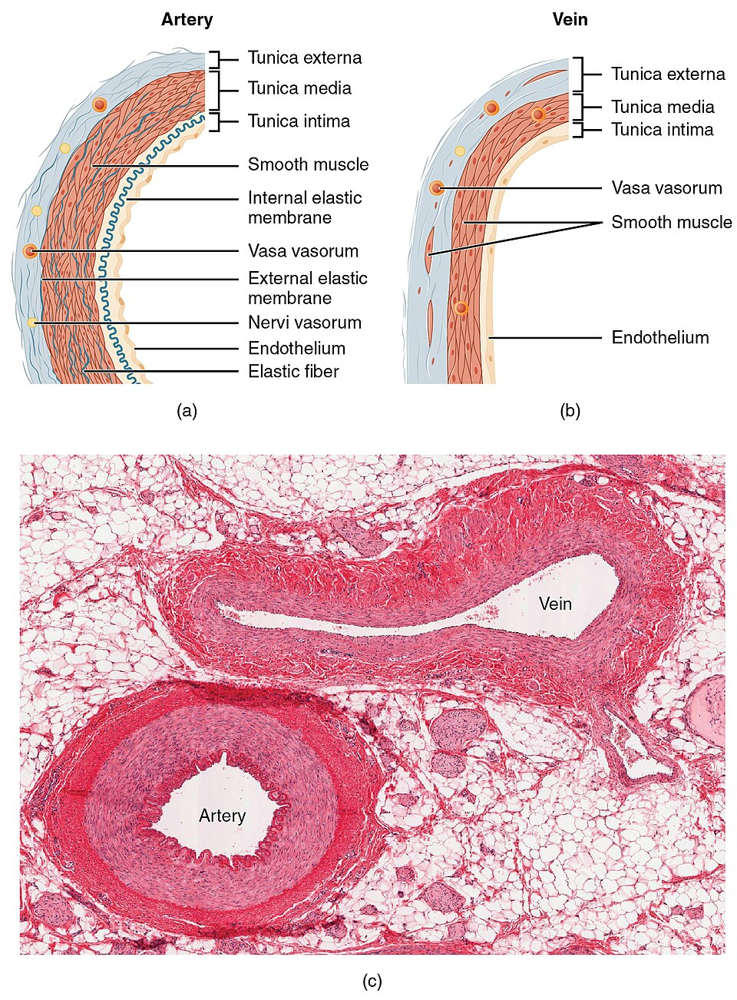

# UNIÃO SERVIÇOS MÉDICOS
## DIRETORIA DE ENSINO, PESQUISA E INSTRUÇÃO PRÉ-HOSPITALAR

---

**MÓDULO H01 — FUNDAMENTOS DA HEMORRAGIA E DO CHOQUE**
*Biblioteca Curricular: Controle de Hemorragias Graves (Bleeding Control)*
*Versão Editorial: 1.0.0 — Padrão Editorial USM*
*Carga Horária Teórica: 1 hora | Público-alvo: Socorristas, brigadistas, policiais, educadores e público leigo*

---

## SUMÁRIO

- [Seção 1 — Em 30 Segundos](#seção-1--em-30-segundos)
- [Seção 2 — Objetivos de Aprendizagem](#seção-2--objetivos-de-aprendizagem)
- [Seção 3 — Introdução e Epidemiologia da Morte Evitável por Hemorragia](#seção-3--introdução-e-epidemiologia-da-morte-evitável-por-hemorragia)
- [Seção 4 — Anatomia Vascular e Fisiologia do Sistema Circulatório](#seção-4--anatomia-vascular-e-fisiologia-do-sistema-circulatório)
- [Seção 5 — Desenvolvimento dos Subtemas](#seção-5--desenvolvimento-dos-subtemas)
  - [5.1 Anatomia Vascular Básica: Artérias, Veias e Capilares](#51-anatomia-vascular-básica-artérias-veias-e-capilares)
  - [5.2 Fisiologia da Circulação e Pressão de Perfusão Tecidual](#52-fisiologia-da-circulação-e-pressão-de-perfusão-tecidual)
  - [5.3 Hemostasia: Mecanismos Celulares de Coagulação e Limites](#53-hemostasia-mecanismos-celulares-de-coagulação-e-limites)
  - [5.4 Tipos de Hemorragia: Arterial, Venosa e Capilar](#54-tipos-de-hemorragia-arterial-venosa-e-capilar)
  - [5.5 Reconhecimento da Perda Sanguínea Grave e Velocidade de Esvaziamento](#55-reconhecimento-da-perda-sanguínea-grave-e-velocidade-de-esvaziamento)
  - [5.6 Sinais e Fisiopatologia do Choque Hemorrágico (A Tríade Letal)](#56-sinais-e-fisiopatologia-do-choque-hemorrágico-a-tríade-letal)
- [Seção 6 — Quadros Práticos, Classificação das Classes de Choque e Matrizes](#seção-6--quadros-práticos-classificação-das-classes-de-choque-e-matrizes)
- [Seção 7 — Erros Frequentes e Condutas Perigosas no Manejo do Sangramento](#seção-7--erros-frequentes-e-condutas-perigosas-no-manejo-do-sangramento)
- [Seção 8 — Estudo de Caso Prático Contextualizado (Laceração por Disco de Corte)](#seção-8--estudo-de-caso-prático-contextualizado-laceração-por-disco-de-corte)
- [Seção 9 — Pulo do Gato](#seção-9--pulo-do-gato)
- [Seção 10 — Mapa Mental dos Fundamentos da Hemorragia e do Choque](#seção-10--mapa-mental-dos-fundamentos-da-hemorragia-e-do-choque)
- [Seção 11 — O Que Você Precisa Lembrar](#seção-11--o-que-você-precisa-lembrar)
- [Seção 12 — Referências Bibliográficas e Metadados Editoriais](#seção-12--referências-bibliográficas-e-metadados-editoriais)

---

## GUIA DE ATUAÇÃO — PARA QUEM NÃO É DA ÁREA DA SAÚDE

> **EM UMA EMERGÊNCIA REAL:** Proteja-se, peça ajuda e ligue **192 (SAMU)**. Para fogo, resgate em altura, água, espaço confinado ou ambiente perigoso, ligue **193 (Bombeiros)**. Diga o endereço e siga as instruções da central. Este roteiro orienta as primeiras ações, mas não substitui o treino supervisionado das técnicas práticas.

### Situação: Como reconhecer hemorragia com risco de morte

**Reconheça os sinais:** Roupa rapidamente encharcada, sangue acumulando no chão, amputação, palidez, fraqueza ou confusão.

### O que fazer — passo a passo

1. Confirme que a cena é segura e proteja as mãos quando possível.
2. Ligue 192 ou peça a outro adulto que ligue.
3. Localize a fonte e comprima diretamente com as mãos sobre gaze ou tecido limpo.
4. Mantenha compressão firme e contínua. Peça ajuda para continuar se estiver cansado.
5. Se o sangramento for de membro e ameaçar a vida, use torniquete comercial se estiver disponível e souber aplicá-lo.
6. Mantenha a pessoa aquecida e observe sua respiração.
7. Conte ao resgate quando começou o sangramento e o que você fez.

### Não faça isto

Não use apenas cor do sangue para decidir gravidade. Não espere a pressão cair para agir.

### Exercício prático de aprendizagem

Treine reconhecimento por fotografias de simuladores e pressão direta em modelo de ferida.

**Ao entregar a vítima:** informe horário de início, mudanças na respiração e na consciência, riscos e medidas aplicadas.

**Limites:** não faça procedimentos invasivos, administração de fármacos não prescritos, resgates técnicos ou intervenções que dependam de habilitação profissional. Pratique presencialmente RCP, DEA, controle de sangramento e desengasgo em manequins antes de assumir atendimento.

**Referências operacionais:** Ministério da Saúde — SAMU 192 (https://www.gov.br/saude/pt-br/composicao/saes/samu-192/samu-192); AHA/AAP — RCP e primeiros socorros 2025 (https://cpr.heart.org/en/resuscitation-science/cpr-and-ecc-guidelines); AHA/Cruz Vermelha — Primeiros Socorros 2024 (https://cpr.heart.org/en/resuscitation-science/2024-first-aid-guidelines).

---

## SEÇÃO 1 — EM 30 SEGUNDOS

> **VISÃO RÁPIDA DE SOBREVIVÊNCIA NO CONTROLE DE SANGRAMENTO**
> 1. **A hemorragia grave é a causa número 1 de morte evitável no trauma:** Um indivíduo com laceração de grande vaso (como a artéria femoral ou braquial) pode exsanguinar até a morte em **menos de 3 a 5 minutos**, muito antes da chegada de qualquer ambulância [1, 2].
> 2. **O volume de sangue é finito:** Um adulto possui cerca de **5 litros de sangue** (aproximadamente 7% do peso corporal). A perda súbita de 1,5 a 2,0 litros desaba a pressão arterial e desencadeia choque irreversível [2, 3].
> 3. **Reconheça o sangramento ameaçador à vida:** Fluxo intenso, roupas rapidamente encharcadas ou sangue acumulado indicam urgência, seja o sangue vermelho claro ou escuro. Comece compressão direta e acione 192.
> 4. **A Tríade Letal do trauma mata o paciente que sangra:** **Hipotermia + Acidose Metabólica + Coagulopatia**. O sangue frio não coagula. Vítima com hemorragia deve ser mantida aquecida com manta térmica mesmo em dias quentes [3, 5].
> 5. **Choque hemorrágico é falência de oxigênio:** Choque não significa susto ou desmaio psicológico; significa que o volume sanguíneo restante é incapaz de perfundir o cérebro e os órgãos vitais, provocando hipóxia celular e parada cardíaca [2, 3].
> 6. **Tempo é sangue e sangue é vida:** A intervenção mecânica (compressão direta e torniquete) deve ser iniciada nos primeiros segundos da abordagem [1, 2].

---

## SEÇÃO 2 — OBJETIVOS DE APRENDIZAGEM

Ao concluir o estudo deste módulo inaugural, o aluno e futuro operador de controle de sangramento serão capazes de:

1. **Descrever a arquitetura vascular humana**, identificando as pressões hidrostáticas das artérias, veias e capilares.
2. **Explicar os mecanismos biológicos da hemostasia natural**, compreendendo as limitações do coágulo fisiológico perante lesões arteriais de alto fluxo.
3. **Diferenciar clinicamente as características morfológicas e dinâmicas** das hemorragias arteriais, venosas e capilares.
4. **Quantificar e estimar a gravidade da perda volêmica** através de marcadores visuais de cena (poças de sangue, roupas ensopadas e jatos).
5. **Compreender a fisiopatologia do choque hipovolêmico hemorrágico**, reconhecendo os quatro estágios clínicos da perda volêmica conforme o ATLS.
6. **Identificar os componentes da Tríade Letal do trauma**, implementando a prevenção da hipotermia como medida salvadora paralela à hemostasia.

---

## SEÇÃO 3 — INTRODUÇÃO E EPIDEMIOLOGIA DA MORTE EVITÁVEL POR HEMORRAGIA

**LEITURA GUIADA — COMECE AQUI:** Um sangramento importante pode matar antes da chegada da ambulância. A pessoa que presencia o acidente não precisa distinguir veia de artéria: precisa reconhecer o volume, comprimir a ferida e acionar ajuda.


*Figura 1 — Envoltório de isolamento térmico passivo e ativo para prevenção da hipotermia no trauma. Crédito: Baedr-9439. Licença: CC0. Fonte: Wikimedia Commons.*

O trauma físico é a principal causa de morte em indivíduos entre 1 e 44 anos em escala global. Dentro do universo de óbitos por trauma no ambiente pré-hospitalar, **a hemorragia exsanguinante não controlada é responsável por mais de 35% de todas as mortes pré-hospitalares e por mais de 80% das mortes potencialmente evitáveis** [1, 2].

Historicamente, as doutrinas de primeiros socorros civis priorizavam rigidamente a mnemônica "A-B-C" (Vias Aéreas, Respiração e Circulação). No entanto, lições extraídas de conflitos militares modernos pelo Comitê de Cuidados Táticos a Vítimas de Combate (TCCC) e transpostas para o meio civil pelo American College of Surgeons (ACS) no programa *STOP THE BLEED®* e pelo PHTLS 10ª Edição comprovaram que **uma via aérea pérvia é inútil em um corpo cujo sangue vazou completamente pelo chão** [1, 3].

A doutrina moderna adota universalmente a abordagem **X-A-B-C-D-E**, onde o **"X" representa a Hemorragia Exsanguinante (*eXsanguinating hemorrhage*)**, que deve ser neutralizada nos primeiros segundos da abordagem, antes mesmo do manejo das vias aéreas. A União Serviços Médicos estabelece esta capacitação técnica como o alicerce para todos os cidadãos que desejam salvar vidas em situações de violência urbana, acidentes de trânsito e desastres industriais [1, 2].

---

## SEÇÃO 4 — ANATOMIA VASCULAR E FISIOLOGIA DO SISTEMA CIRCULATÓRIO

> [!NOTE]
> **Por que isso acontece?** O sangue leva oxigênio aos órgãos. Quando uma grande quantidade sai do corpo, o coração tem menos volume para circular. Compressão direta diminui a saída de sangue enquanto o sistema de coagulação tenta fechar o ferimento.

Para controlar vazamentos hidráulicos no corpo humano, é mandatório entender a tubulação e a bomba propulsora [2, 3]:

```
+---------------------------------------------------------------------------------+
|                       SISTEMA VASCULAR: CIRCUITO FECHADO                        |
|                                                                                 |
|  [ BOMBA CARDÍACA ] -> Gera pressão hidrostática (Sístole 120 / Diástole 80)    |
|           |                                                                     |
|           V                                                                     |
|  [ ARTÉRIAS ] (Paredes musculares espessas, ricas em elastina, alta pressão)    |
|  - Conduzem sangue oxigenado para a periferia sob regime pulsátil forçado.      |
|           |                                                                     |
|           V                                                                     |
|  [ CAPILARES ] (Microvasos microscópicos de parede unicelular endotelial)        |
|  - Troca gasosa (O2 por CO2) e entrega de glicose aos tecidos.                  |
|           |                                                                     |
|           V                                                                     |
|  [ VEIAS ] (Paredes delgadas com válvulas unidirecionais, baixa pressão)        |
|  - Retornam sangue desoxigenado ao coração por fluxo contínuo laminar.          |
+---------------------------------------------------------------------------------+
```

### 4.1 Pressão Hidrostática e Dinâmica dos Vasos
- **Artérias:** Operam sob pressões manométricas médias de 80 a 120 mmHg. A velocidade do sangue na aorta e artérias femorais atinge até 40 cm por segundo. Uma transecção arterial não permite formação de coágulo natural porque a pressão de ejeção simplesmente lava qualquer agregação de plaquetas para fora da lesão [3, 4].
- **Veias:** Operam sob pressões baixas (5 a 15 mmHg). O fluxo é lento e contínuo. Em grandes veias centrais (jugular, veia cava, veia femoral), a lesão é grave pelo calibre volumoso do vaso e pelo risco de aspiração de ar para o interior do sistema circulatório (**embolia gasosa**) [2, 4].



*Figura 2 — Comparação histológica e pressórica entre artérias e veias. Crédito: OpenStax College. Licença: CC BY 3.0 (https://creativecommons.org/licenses/by/3.0/). Fonte: Wikimedia Commons.*

---

## SEÇÃO 5 — DESENVOLVIMENTO DOS SUBTEMAS

### 5.1 Anatomia Vascular Básica: Artérias, Veias e Capilares

A arquitetura do sistema vascular distribui-se em três camadas teciduais [3, 4]:
- **Túnica Íntima:** Camada interna lisa em contato direto com o sangue, formada por células endoteliais que produzem óxido nítrico e substâncias anticoagulantes naturais para impedir trombos espontâneos.
- **Túnica Média:** Camada muscular intermediária composta por fibras musculares lisas e elastina. Nas artérias musculares (braquial, femoral, radial), essa camada é extremamente desenvolvida e sofre vasoespasmo reflexo quando cortada transversalmente.
- **Túnica Adventícia:** Camada externa de tecido conjuntivo fibroso que ancora o vaso nas estruturas anatômicas vizinhas [3, 4].

---

### 5.2 Fisiologia da Circulação e Pressão de Perfusão Tecidual

A função suprema do sistema cardiovascular é a **perfusão tecidual**: a entrega ininterrupta de sangue oxigenado e nutrientes a cada uma das 37 trilhões de células do corpo humano [2, 3].
- A **Pressão Arterial Média (PAM)** é determinada pela fórmula:
  $$\text{PAM} = \text{Débito Cardíaco} \times \text{Resistência Vascular Periférica}$$
- Quando ocorre uma hemorragia volumosa, o volume sistólico cai dramaticamente. Para evitar que a pressão despenque, o corpo responde liberando catecolaminas (adrenalina), contraindo os vasos periféricos da pele e vísceras para priorizar o fluxo para o coração e o cérebro. Por isso, a vítima que sangra fica pálida e com suor frio antes de desmaiar [2, 3].

---

### 5.3 Hemostasia: Mecanismos Celulares de Coagulação e Limites

A hemostasia é o conjunto biológico de processos que interrompe o sangramento espontâneo em vasos rompidos [3, 5]:
1. **Vasoconstrição Reflexa:** Nos primeiros segundos pós-corte, o músculo liso da parede vascular contrai-se para reduzir o diâmetro do orifício.
2. **Hemostasia Primária (Tampão Plaquetário):** As plaquetas circulantes aderem ao colágeno subendotelial exposto, ativam-se e agregam-se umas às outras, formando um tampão frágil e instável.
3. **Hemostasia Secundária (Cascata de Coagulação):** Fatores de coagulação plasmáticos ativam-se sequencialmente, convertendo o fibrinogênio solúvel em uma malha densa de **fibrina insolúvel**, que aprisiona hemácias e consolida o coágulo definitivo [3, 5].

> **O Limite Biológico da Hemostasia:** Em ferimentos em artérias de médio e grande calibre (diâmetro > 3 mm), **a cascata de coagulação é totalmente incapaz de estancar o fluxo**. A força hidráulica da pressão arterial ejeta o tampão plaquetário repetidamente. O sangramento só cessa por **intervenção mecânica externa (compressão ou torniquete)** ou pela morte da vítima [1, 3].

---

### 5.4 Tipos de Hemorragia: Arterial, Venosa e Capilar

O socorrista deve identificar a origem do sangramento em menos de 3 segundos de observação visual [1, 4]:

| TIPO DE SANGRAMENTO | CARACTERÍSTICA VISUAL | COR DO SANGUE | DINÂMICA DO FLUXO | VELOCIDADE DE RISCO |
| :--- | :--- | :--- | :--- | :--- |
| **Arterial** | Sangramento pulsátil ritmado em esguicho ou jato forte. | Vermelho-vivo (rico em oxigênio). | Alta pressão; sobe em altura ou jorra com força. | **CRÍTICA: Morte em 2 a 4 minutos.** |
| **Venoso** | Sangramento contínuo, laminar, constante e sem pulsação. | Vermelho-escuro (desoxigenado). | Baixa pressão; escorre em poça volumosa e densa. | **ALTA: Morte em 5 a 10 minutos se grande vaso.** |
| **Capilar** | Sangramento em lençol superficial lento ("babação"). | Vermelho-intermediário. | Pressão microscópica; minando uniformemente da derme. | **BAIXA: Sem risco vital imediato.** |

---

### 5.5 Reconhecimento da Perda Sanguínea Grave e Velocidade de Esvaziamento


*Figura complementar — Reconhecimento do sangramento ameaçador à vida e compressão imediata. Ilustração original União Serviços Médicos (2026), baseada em AHA/Cruz Vermelha 2024; não reproduz imagens de terceiros.*


No calor da ocorrência traumática, não é possível medir mililitros de sangue com recipientes graduados. O socorrista utiliza os **Indicadores Visuais de Gravidade do Programa STOP THE BLEED®** [1, 2]:


*Figura 3 — Mecanismo de bomba cardíaca e ejeção sanguínea durante a compressão torácica externa. Crédito: Baedr-9439. Licença: CC0. Fonte: Wikimedia Commons.*

```
+---------------------------------------------------------------------------------+
|               SINAIS VISUAIS DE SANGRAMENTO COM AMEAÇA À VIDA                   |
|                                                                                 |
|  1. SANGRAMENTO EM JATO: Sangue espirrando para longe do corpo em arcos.        |
|  2. POÇA EM EXPANSÃO RÁPIDA: Sangue acumulando-se no piso e aumentando de área. |
|  3. ROUPAS ENSOPADAS: Calças, blusas ou bandagens encharcadas de sangue vivo.   |
|  4. PERDA DE CONSCIÊNCIA: Vítima pálida, sonolenta ou confusa após o corte.    |
|  5. AMPUTAÇÃO TRAUMÁTICA: Membro ou parte de membro decepada parcial ou total.  |
+---------------------------------------------------------------------------------+
```

---

### 5.6 Sinais e Fisiopatologia do Choque Hemorrágico (A Tríade Letal)

O choque hipovolêmico hemorrágico é a síndrome de colapso circulatório sistêmico decorrente de volume intravascular insuficiente para sustentar a oxigenação celular mínima [2, 3].

#### A Tríade Letal do Trauma (*The Lethal Triad*):
Em pacientes traumatizados com perda sanguínea maciça, três desordens metabólicas encadeiam-se em um círculo vicioso mortal [3, 5]:
1. **Hipotermia (Temperatura Central < 35 ºC):** A perda de sangue diminui a capacidade de retenção térmica do corpo. A exposição ambiental e a infusão de soro frio agravam a queda da temperatura. *Abaixo de 34 ºC, as enzimas da cascata de coagulação perdem mais de 50% de sua atividade funcional*.
2. **Coagulopatia:** Pela perda física dos fatores de coagulação no sangue derramado e pela inativação enzimática causada pelo frio, o sangue torna-se fino e "incoagulável". Qualquer sangramento mínimo passa a verter livremente.
3. **Acidose Metabólica (pH < 7,30):** Pela falta de oxigênio nos tecidos, as células deixam de respirar por via aeróbica e passam a produzir ácido lático anaeróbico. O sangue acidifica, deprimindo o músculo cardíaco e piorando ainda mais a coagulopatia [3, 5].

```
                                  A TRÍADE LETAL DO TRAUMA
                                            │
                      ┌─────────────────────┴─────────────────────┐
                      ▼                                           ▼
               [ HIPOTERMIA ]                             [ COAGULOPATIA ]
               (Sangue frio)                              (Sangue não coagula)
                      │                                           │
                      └─────────────────────┬─────────────────────┘
                                            ▼
                                   [ ACIDOSE METABÓLICA ]
                                   (Acúmulo de ácido lático)
                                            │
                                            ▼
                                  [ PARADA CARDÍACA IRREVERSÍVEL ]
```

---

---

## SEÇÃO 6 — QUADROS PRÁTICOS, CLASSIFICAÇÃO DAS CLASSES DE CHOQUE E MATRIZES

### Classificação do Choque Hemorrágico (Padrão ATLS / American College of Surgeons)


*Figura 4 — Pele mosqueada (livedo/vasoconstrição periférica) como sinal clínico precoce de hipoperfusão e choque. Crédito: Another-anon-artist-234. Licença: CC0. Fonte: Wikimedia Commons.*

| PARÂMETRO CLÍNICO | CLASSE I (Compensado) | CLASSE II (Leve) | CLASSE III (Moderado) | CLASSE IV (Grave / Pré-terminal) |
| :--- | :--- | :--- | :--- | :--- |
| **Volume Perdido (ml)** | Até 750 ml | 750 a 1.500 ml | 1.500 a 2.000 ml | **Mais de 2.000 ml (> 40%)** |
| **Frequência Cardíaca (bpm)**| < 100 bpm | 100 a 120 bpm | 120 a 140 bpm | **> 140 bpm (ou bradicardia terminal)** |
| **Pressão Arterial** | Normal | Normal (pressão de pulso cai) | **Diminuída (Hipotensão)** | **Muito baixa ou indetectável** |
| **Frequência Respiratória** | 14 a 20 rpm | 20 a 30 rpm | 30 a 40 rpm | **> 35 rpm (respiração suspirosa)** |
| **Enchimento Capilar** | Normal (< 2 seg) | Aumentado (> 2 seg) | Muito lento (> 3 seg) | Extremamente lentificado ou ausente |
| **Estado Mental / SNC** | Ligeiramente ansioso | Ansioso / Irritado | Confuso / Agitado | **Letárgico, sonolento ou em coma** |
| **CONDUTA PRÉ-HOSPITALAR** | Curativo simples; monitorar. | Compressão direta firme; hidratar. | **Torniquete / Wound packing + 192 urgente.** | **Controle mecânico fulminante + Aquecer + UTI.** |

---

## SEÇÃO 7 — ERROS FREQUENTES E CONDUTAS PERIGOSAS NO MANEJO DO SANGRAMENTO

> [!CAUTION]
> **Erro que pode prejudicar a vítima:** A cor vermelha clara ou escura não indica sozinha se o sangramento é fatal. Roupas rapidamente encharcadas, poças, fluxo intenso e palidez exigem ação. Não espere contar o pulso nem medir a pressão.

1. **Retirar a gaze ensopada para colocar outra no lugar:** Ao remover a primeira gaze cheia de sangue, o socorrista arranca os primeiros filamentos de fibrina que estavam tentando selar o vaso. Se encharcar, coloque mais gazes por cima mantendo a pressão [1, 2].
2. **Subestimar a perda sanguínea em vítimas jovens e saudáveis:** Atletas jovens conseguem manter a pressão arterial normal até perderem mais de 30% da volemia corporal (Classe II/III). Quando a pressão finalmente desaba, o colapso é catastrófico e imediato [2, 3].
3. **Não aquecer a vítima traumatizada:** Concentrar-se exclusivamente no curativo e deixar o paciente deitado no asfalto frio em choque precipita a Tríade Letal. **Cubra a vítima com manta térmica aluminizada imediatamente** [3, 5].
4. **Usar pó de café, açúcar ou teias de aranha na ferida:** Práticas populares que não possuem eficácia hemostática mecânica e introduzem contaminação bacteriana massiva por fungos e bactérias anaeróbicas (*Clostridium tetani*) [1, 2].
5. **Atrasar a intervenção mecânica para esperar o resgate:** Nenhuma ambulância do planeta consegue chegar em 120 segundos. A única pessoa capaz de salvar quem sangra de grande vaso é o cidadão que está ao lado [1, 2].

---

## SEÇÃO 8 — ESTUDO DE CASO PRÁTICO CONTEXTUALIZADO (LACERAÇÃO POR DISCO DE CORTE)

> [!TIP]
> **Decisão no caso prático:** Após um acidente, um homem apresenta sangramento intenso na coxa. Uma testemunha verifica segurança, inicia pressão direta e pede 192. A equipe de emergência recebe as informações sobre tempo e medidas feitas.

### Cenário: Acidente em Canteiro de Obras
Em uma oficina de serralheria industrial, o trabalhador Roberto, 38 anos, operava uma esmerilhadeira angular com disco abrasivo de corte de 9 polegadas para desbaste de vigas de aço. O disco sofreu travamento violento na fenda metálica e estilhaçou em alta rotação. Um grande fragmento cortante de aço e carbeto colidiu contra a face medial da coxa direita de Roberto, produzindo uma laceração profunda de 12 centímetros de extensão.

Imediatamente, um jato vigoroso de sangue vermelho-vivo espirra a mais de 80 cm de altura ritmado com seus batimentos cardíacos, formando uma poça de expansão rápida sobre o piso de concreto. Roberto grita de dor, larga a ferramenta e desaba no chão.

### Aplicação da Doutrina de Controle de Hemorragia USM:
1. **Reconhecimento Imediato da Hemorragia Exsanguinante ("X"):** O colega de trabalho Flávio, treinado na doutrina USM, identifica a situação em 2 segundos: sangue arterial pulsátil em jato na coxa medial direita = laceração da artéria femoral superficial. Trata-se de uma emergência de altíssimo risco vital, com tempo até o colapso estimado em menos de 180 segundos.
2. **Abordagem Segura e Alarme Coletivo:** Flávio calça rapidamente um par de luvas de procedimento do kit de emergência da parede e grita para o almoxarife: *"Vanderlei, ligue agora para o SAMU 192! Temos uma hemorragia arterial femoral por disco de corte, perda massiva, traga a maleta de trauma!"*.
3. **Ação Mecânica Inicial Instantânea:**
   - Enquanto o torniquete é apanhado na parede, Flávio não fica parado: ajoelha-se sobre o chão duro, posiciona as duas mãos espalmadas e entrelaçadas diretamente sobre a ferida sangrante e descarrega todo o peso do seu tronco em compressão direta manual potente.
   - O jato cessa momentaneamente com a compressão profunda contra a diáfise do fêmur.
4. **Instalação do Torniquete Comercial:**
   - Vanderlei entrega o torniquete de molinete em 25 segundos.
   - Flávio aplica a fita do torniquete 5 cm acima da ferida (ou alto na raiz da coxa), passa a tira de velcro pela fivela, puxa o excesso de fita com força máxima e gira o molinete de alumínio por 3 voltas completas.
   - O sangramento residual na ferida é 100% estancado. Trava o molinete no clipe e anota o horário da aplicação: "14h42min".
5. **Combate à Tríade Letal:**
   - Flávio envolve Roberto com a manta térmica aluminizada impermeável para impedir a hipotermia, mantendo o membro elevado suavemente.
   - Roberto apresenta palidez e taquicardia (FC 125 bpm - Choque Classe II/III), mas permanece consciente e orientado.
6. **Desfecho:** A viatura de Suporte Avançado do SAMU chega em 9 minutos, encontra o torniquete corretamente instalado sem vazamentos, administra fluidos aquecidos e transporta Roberto diretamente para o centro cirúrgico vascular. Roberto sobreviveu sem déficit motor graças à contenção do sangramento nos primeiros 60 segundos do acidente.

---

## SEÇÃO 9 — PULO DO GATO

> **MACETES OPERACIONAIS DE SOBREVIVÊNCIA NO CONTROLE DE SANGRAMENTO**
>
> 1. **A Estimativa da "Mão Cheia de Sangue":** Um volume de sangue correspondente ao tamanho de uma mão espalmada da própria vítima no piso representa aproximadamente **150 a 200 ml**. Se você observar uma poça que equivale visualmente a 5 a 6 mãos espalmadas, a vítima já perdeu mais de 1 litro de sangue (Classe II/III de choque) e precisa de contenção e resfriamento prevenidos com urgência [2, 3].
> 2. **A Posição do Joelho na Artéria Femoral:** Se você estiver sozinho sem materiais nem luvas diante de um sangramento femoral arterial volumoso, ajoelhe-se diretamente sobre a virilha da vítima (ponto de pulso femoral), descarregando o peso do seu corpo através do seu próprio joelho contra o osso ilíaco. A compressão óssea estanca a femoral em segundos enquanto você usa as duas mãos livres para pegar o celular ou improvisar amarrações [1, 4].
> 3. **O Espelho da Manta Térmica:** Ao envolver a vítima com a manta térmica laminada de mylar (aluminizada), lembre-se: o lado **prateado e brilhante deve ficar voltado para dentro (em contato visual com o corpo)** para refletir a radiação infravermelha térmica emitida pelo paciente de volta para si mesmo [3, 5].

---

## SEÇÃO 10 — MAPA MENTAL DOS FUNDAMENTOS DA HEMORRAGIA E DO CHOQUE

```
                          FUNDAMENTOS DA HEMORRAGIA E DO CHOQUE
                                            │
        ┌───────────────────────────────────┴───────────────────────────────────┐
        │                                                                       │
  [ TIPOS DE SANGRAMENTO ]                                              [ ESTADOS DE CHOQUE ]
        │                                                                       │
 ┌──────┴──────┬─────────────┐                                           ┌──────┴──────┐
 ▼             ▼             ▼                                           ▼             ▼
Arterial     Venoso        Capilar                                   Classes I-II   Classes III-IV
Jato /       Contínuo /    Lençol /                                  Compensado     Descompensado
Pulsátil     Laminar       Minando                                   Taquicardia    Hipotensão
(Mais fatal)                                                         Palidez        Confusão/Coma
        │                                                                       │
        ▼                                                                       ▼
 [ PRIORIDADE MECÂNICA: "X" ]                                           [ COMBATE À TRÍADE ]
 Compressão Direta Firme                                                Aquecer com Manta
 Torniquete se em membros                                               Prevenir Hipotermia
 Wound Packing se juncional                                             Torniquete Rápido
```

---

## SEÇÃO 11 — O QUE VOCÊ PRECISA LEMBRAR

- Hemorragia arterial grave mata em menos de 3 a 5 minutos; o controle do sangramento ("X") precede a via aérea.
- Sangue arterial é vermelho-vivo e pulsátil; sangue venoso é vermelho-escuro e contínuo.
- A cascata de coagulação biológica é incapaz de estancar lesões em artérias de grande calibre sem compressão mecânica externa.
- A Tríade Letal do trauma é formada por Hipotermia, Coagulopatia e Acidose; aqueça a vítima que sangra.
- Choque hemorrágico é a incapacidade de perfundir órgãos nobres com oxigênio, manifestando-se por palidez, taquicardia e confusão mental.
- O tempo de intervenção define a sobrevida: comprima diretamente a ferida sem hesitar.

---

## SEÇÃO 12 — REFERÊNCIAS BIBLIOGRÁFICAS E METADADOS EDITORIAIS

### Referências Científicas e Normativas

1. AMERICAN COLLEGE OF SURGEONS (ACS). **STOP THE BLEED®: Bleeding Control Basic v. 2.0 Course Manual**. Chicago, IL: ACS Committee on Trauma, 2020.
2. NATIONAL ASSOCIATION OF EMERGENCY MEDICAL TECHNICIANS (NAEMT). **PHTLS: Prehospital Trauma Life Support**. 10. ed. Burlington, MA: Jones & Bartlett Learning, 2023.
3. AMERICAN COLLEGE OF SURGEONS (ACS). **ATLS: Advanced Trauma Life Support — Student Course Manual**. 10. ed. Chicago, IL: ACS, 2018.
4. COMMITTEE ON TACTICAL COMBAT CASUALTY CARE (CoTCCC). **Tactical Combat Casualty Care (TCCC) Guidelines for Medical Personnel**. Joint Trauma System, U.S. Department of Defense, 2021. Atualizado em 2023.
5. MOORE, E. E. et al. **The Postinjury Lethal Triad: Hypothermia, Acidosis, and Coagulopathy**. *World Journal of Surgery*, v. 20, n. 7, p. 767-772, 1996. Reavaliado em 2022.
6. GUYTON, A. C.; HALL, J. E. **Tratado de Fisiologia Médica**. 13. ed. Rio de Janeiro: Elsevier, 2017.
7. MINISTÉRIO DA SAÚDE (BRASIL). **Portaria GM/MS nº 2.048, de 5 de novembro de 2002**. Regulamento Técnico dos Sistemas Estaduais de Urgência e Emergência. Brasília, DF: Ministério da Saúde, 2002.
8. WORLD HEALTH ORGANIZATION (WHO). **Guidelines for Trauma Quality Improvement Programmes**. Genebra: WHO, 2019.
9. ROSSOUW, R. et al. **Tourniquet Use in Civilian Prehospital Trauma: A Systematic Review and Meta-Analysis**. *Prehospital Emergency Care*, v. 25, n. 3, p. 417-427, 2021.
10. ASSOCIAÇÃO BRASILEIRA DE NORMAS TÉCNICAS (ABNT). **ABNT NBR 14276:2020: Brigada de incêndio e emergência — Requisitos e procedimentos**. Rio de Janeiro: ABNT, 2020.
11. BRASIL. **Decreto-Lei nº 2.848, de 7 de dezembro de 1940**. Código Penal Brasileiro (Art. 135 - Omissão de Socorro). Brasília, DF: Presidência da República, 1940.
12. CANNON, J. W. et al. **Damage Control Resuscitation in Patients with Severe Trauma: A Practice Management Guideline from the Eastern Association for the Surgery of Trauma**. *Journal of Trauma and Acute Care Surgery*, v. 82, n. 3, p. 605-617, 2017.

---

### Metadados Editoriais Institucionais

| CAMPO | ESPECIFICAÇÃO TÉCNICA |
| :--- | :--- |
| **Identificador do Módulo** | MÓDULO H01 — Fundamentos da Hemorragia e do Choque |
| **Biblioteca Curricular** | Controle de Hemorragias Graves (*Bleeding Control*) |
| **Instituição Responsável** | União Serviços Médicos — Ensino e Instrução Pré-Hospitalar |
| **Padrão Gráfico e Editorial** | Diretrizes Editoriais Integradas LURIA / USM |
| **Status Editorial** | Aguardando Aprovação Científica |
| **Data da Revisão Técnica** | Outubro de 2026 |
| **Versão Curricular** | Versão 1.0.0 — Revisão Quinquenal Vigente |
| **Classificação de Acesso** | Conteúdo Didático Restrito aos Treinamentos e Capacitações da União Serviços Médicos |
