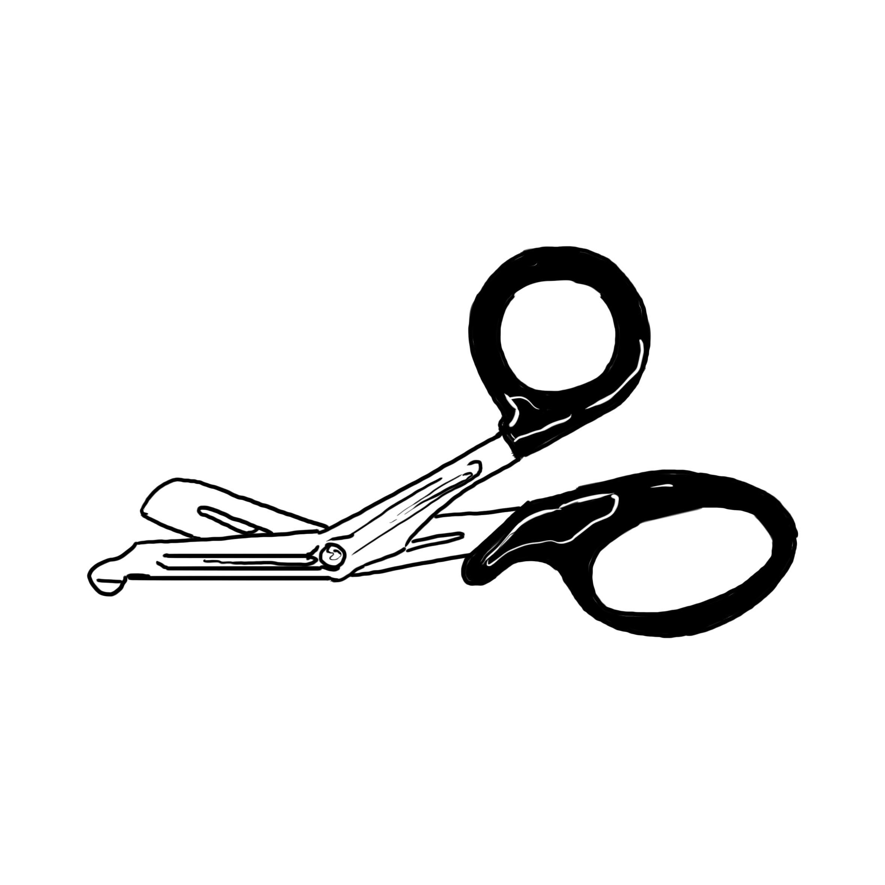
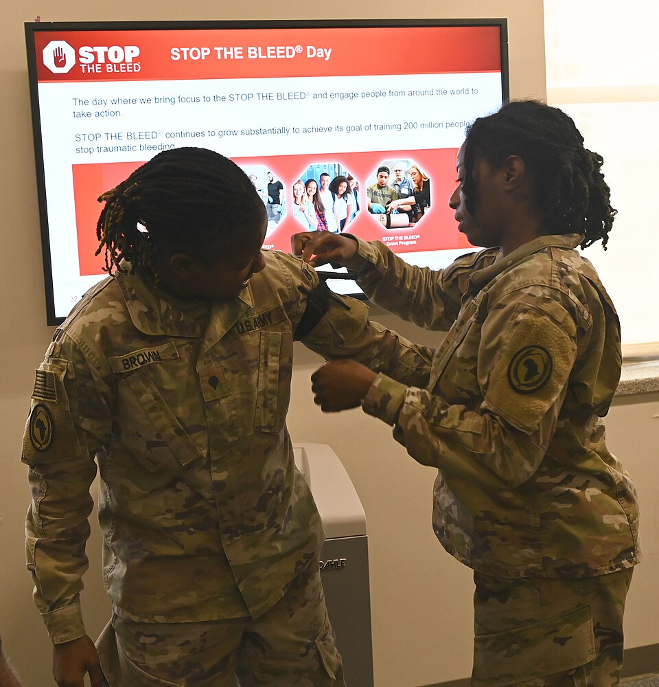
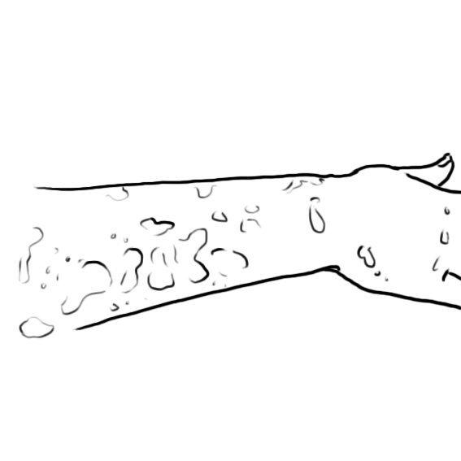

# UNIÃO SERVIÇOS MÉDICOS
## DIRETORIA DE ENSINO, PESQUISA E INSTRUÇÃO PRÉ-HOSPITALAR

---

**MÓDULO H02 — RECONHECIMENTO DE SANGRAMENTOS POTENCIALMENTE FATAIS**
*Biblioteca Curricular: Controle de Hemorragias Graves (Bleeding Control)*
*Versão Editorial: 1.0.0 — Padrão Editorial USM*
*Carga Horária Teórica: 1 hora | Público-alvo: Socorristas, policiais, brigadistas, instrutores de tiro, condutores e cidadãos socorristas*

---

## SUMÁRIO

- [Seção 1 — Em 30 Segundos](#seção-1--em-30-segundos)
- [Seção 2 — Objetivos de Aprendizagem](#seção-2--objetivos-de-aprendizagem)
- [Seção 3 — Introdução e a Janela Crítica de Ação no Trauma Hemorrágico](#seção-3--introdução-e-a-janela-crítica-de-ação-no-trauma-hemorrágico)
- [Seção 4 — Fisiopatologia da Exsanguinação Rápida e Perda Crítica](#seção-4--fisiopatologia-da-exsanguinação-rápida-e-perda-crítica)
- [Seção 5 — Desenvolvimento dos Subtemas](#seção-5--desenvolvimento-dos-subtemas)
  - [5.1 Identificação Imediata de Hemorragias com Ameaça à Vida](#51-identificação-imediata-de-hemorragias-com-ameaça-à-vida)
  - [5.2 Avaliação Rápida da Vítima sob a Doutrina X-A-B-C-D-E](#52-avaliação-rápida-da-vítima-sob-a-doutrina-x-a-b-c-d-e)
  - [5.3 Segurança da Cena e Autoproteção em Ambientes Hostis](#53-segurança-da-cena-e-autoproteção-em-ambientes-hostis)
  - [5.4 Priorização Dinâmica de Medidas de Contenção de Sangramento](#54-priorização-dinâmica-de-medidas-de-contenção-de-sangramento)
  - [5.5 Acionamento Estruturado de Emergência (SAMU 192 e Bombeiros 193)](#55-acionamento-estruturado-de-emergência-samu-192-e-bombeiros-193)
  - [5.6 Limites da Intervenção Leiga e Princípio do "Não Piore o Paciente"](#56-limites-da-intervenção-leiga-e-princípio-do-não-piore-o-paciente)
- [Seção 6 — Quadros Práticos, Algoritmos Visuais de Reconhecimento e Triagem](#seção-6--quadros-práticos-algoritmos-visuais-de-reconhecimento-e-triagem)
- [Seção 7 — Erros Frequentes e Falhas Críticas de Reconhecimento na Cena](#seção-7--erros-frequentes-e-falhas-críticas-de-reconhecimento-na-cena)
- [Seção 8 — Estudo de Caso Prático Contextualizado (Colisão com Lâmina de Vidro)](#seção-8--estudo-de-caso-prático-contextualizado-colisão-com-lâmina-de-vidro)
- [Seção 9 — Pulo do Gato](#seção-9--pulo-do-gato)
- [Seção 10 — Mapa Mental do Reconhecimento de Sangramentos Potencialmente Fatais](#seção-10--mapa-mental-do-reconhecimento-de-sangramentos-potencialmente-fatais)
- [Seção 11 — O Que Você Precisa Lembrar](#seção-11--o-que-você-precisa-lembrar)
- [Seção 12 — Referências Bibliográficas e Metadados Editoriais](#seção-12--referências-bibliográficas-e-metadados-editoriais)

---

## GUIA DE ATUAÇÃO — PARA QUEM NÃO É DA ÁREA DA SAÚDE

> **EM UMA EMERGÊNCIA REAL:** Proteja-se, peça ajuda e ligue **192 (SAMU)**. Para fogo, resgate em altura, água, espaço confinado ou ambiente perigoso, ligue **193 (Bombeiros)**. Diga o endereço e siga as instruções da central. Este roteiro orienta as primeiras ações, mas não substitui o treino supervisionado das técnicas práticas.

### Situação: Sangramento perigoso: decisão em segundos

**Reconheça os sinais:** Jato, fluxo contínuo intenso, grande poça ou sangue atravessando sucessivas compressas.

### O que fazer — passo a passo

1. Acione 192 e peça um kit de controle de sangramento.
2. Comprima imediatamente a ferida, com peso das mãos e material limpo.
3. Para braço ou perna com hemorragia ameaçadora à vida, considere torniquete comercial se treinado.
4. Para virilha, axila e áreas sem possibilidade de torniquete, mantenha pressão direta; packing exige prática adequada.
5. Não interrompa o atendimento para identificar artéria ou veia.
6. Se a vítima ficar inconsciente, verifique respiração. Inicie RCP se não for normal.

### Não faça isto

Não atrase o controle para classificar o sangramento. Não use torniquete no pescoço, tronco ou cabeça.

### Exercício prático de aprendizagem

Treine identificar, com fotos e simulação, quando pressão direta deve começar sem demora.

**Ao entregar a vítima:** informe horário de início, mudanças na respiração e na consciência, riscos e medidas aplicadas.

**Limites:** não faça procedimentos invasivos, administração de fármacos não prescritos, resgates técnicos ou intervenções que dependam de habilitação profissional. Pratique presencialmente RCP, DEA, controle de sangramento e desengasgo em manequins antes de assumir atendimento.

**Referências operacionais:** Ministério da Saúde — SAMU 192 (https://www.gov.br/saude/pt-br/composicao/saes/samu-192/samu-192); AHA/AAP — RCP e primeiros socorros 2025 (https://cpr.heart.org/en/resuscitation-science/cpr-and-ecc-guidelines); AHA/Cruz Vermelha — Primeiros Socorros 2024 (https://cpr.heart.org/en/resuscitation-science/2024-first-aid-guidelines).

---

## SEÇÃO 1 — EM 30 SEGUNDOS

> **VISÃO RÁPIDA DE IDENTIFICAÇÃO DE SANGRAMENTO LETAL**
> 1. **Reconheça antes de tocar:** O sangue que jorra em jato pulsátil, a poça que cresce a olhos vistos no chão e as roupas encharcadas de sangue vivo denunciam **sangramento potencialmente fatal que mata em 180 segundos** [1, 2].
> 2. **A regra suprema da autoproteção:** *"Vítima viva não justifica socorrista ferido"*. Se a cena oferecer perigo iminente (vidros caindo, tráfego descontrolado, agressor armado ou maquinário ligado), não entre. Use Equipamentos de Proteção Individual (luvas) sempre [2, 3].
> 3. **O "X" vem antes do "A":** Pare o sangramento exsanguinante primeiro. Se uma artéria femoral está jorrando, aplicar colar cervical ou checar a boca da vítima é perder os últimos mililitros vitais de sangue do paciente [1, 4].
> 4. **Três locais anatômicos de sangramento:** Extremidades (braços e pernas = **Torniquete**); Junções (virilha, axila e pescoço = **Wound Packing / Preenchimento de ferida com compressão contínua**); Tronco (tórax e abdômen = **Transporte cirúrgico urgente, incompressível por socorristas**) [1, 2].
> 5. **O sangue espalhado assusta, mas precisa de método analítico:** Um ferimento na testa sangra muito e parece catastrófico, mas raramente mata em poucos minutos. Por outro lado, uma perfuração profunda na virilha sangra para dentro e para fora de forma silenciosa e mata em menos de 3 minutos [3, 5].
> 6. **Acione o 192 com dados precisos e estruturados:** Ao ligar para a regulação médica do SAMU, afirme taxativamente: *"Hemorragia grave ativa de grande vaso com torniquete aplicado e choque evidente"*. Isso garante o envio prioritário de Suporte Avançado de Vida (USA) tripulado por médico e com capacidade de reposição hemodinâmica [2, 6].

---

## SEÇÃO 2 — OBJETIVOS DE APRENDIZAGEM

Ao concluir o estudo detalhado deste módulo, o operador de emergência, brigadista e cidadão socorrista serão plenamente capazes de:

1. **Identificar em menos de 5 segundos os sinais visuais patognomônicos** de sangramento com risco imediato de morte (jatos arteriais pulsáteis, poças em rápida expansão, roupas ensopadas e amputações traumáticas).
2. **Aplicar a avaliação primária sistemática baseada na mnemônica X-A-B-C-D-E**, priorizando a intervenção hemostática mecânica imediata antes da abordagem convencional das vias aéreas.
3. **Avaliar e mitigar riscos ambientais dinâmicos e de biossegurança** antes de abordar a vítima em vias públicas, plantas industriais, áreas de recreação e cenários hostis.
4. **Categorizar anatomicamente o sangramento com exatidão**, distinguindo lesões de extremidades (membros), lesões juncionais (axilas, virilhas e pescoço) e hemorragias intracavitárias incompressíveis de tronco.
5. **Estruturar e executar a chamada de emergência ao SAMU 192 e Bombeiros 193**, comunicando o status hemodinâmico, a localização precisa e as intervenções mecânicas já instaladas.
6. **Reconhecer os limites estritos da atuação pré-hospitalar leiga**, evitando procedimentos invasivos proscritos, manipulação de corpos estranhos empalados e atrasos fatais no encaminhamento cirúrgico definitivo.

---

## SEÇÃO 3 — INTRODUÇÃO E A JANELA CRÍTICA DE AÇÃO NO TRAUMA HEMORRÁGICO

**LEITURA GUIADA — COMECE AQUI:** Nas hemorragias graves, alguns segundos são mais úteis aplicados na ferida do que tentando entender qual vaso sangra. Comece pressionando. Depois decida, conforme treinamento e local da lesão, se será preciso torniquete ou outra medida.

No atendimento pré-hospitalar ao trauma, existe o consagrado conceito clássico da *"Hora de Ouro"* (*Golden Hour*), período dentro do qual a vítima politraumatizada deve idealmente receber tratamento definitivo em ambiente cirúrgico hospitalar. Todavia, quando se trata de **Hemorragia Exsanguinante Arterial**, a escala de tempo não é medida em horas, mas em **segundos e minutos**: é a chamada **"Janela dos Três Minutos"** [1, 2].

Uma laceração completa da artéria femoral profunda ou da artéria braquial drena mais de 500 a 800 ml de sangue a cada 30 segundos. Em um adulto médio com 5 litros de volemia total, a perda de um terço do volume total (aproximadamente 1.500 ml) conduz à perda de consciência e ao colapso cardiovascular por choque hipovolêmico irreversível. Se os presentes na cena demorarem 2 minutos para decidir o que fazer e outros 2 minutos procurando panos ou discutindo quem vai ligar para a ambulância, a vítima estará clinicamente morta antes que qualquer curativo toque sua pele [1, 4].

O reconhecimento rápido não exige equipamentos laboratoriais sofisticados nem formação acadêmica médica: exige **alfabetização visual do socorrista**. Saber olhar para uma cena de acidente e distinguir um ferimento superficial dramático de uma hemorragia profunda letal é o diferencial absoluto entre o espectador paralisado e o operador que preserva uma vida humana [1, 3].

A mortalidade pré-hospitalar por sangramento não controlado decorre, em sua quase totalidade, do atraso na identificação da lesão. Ao abordar um acidente com maquinário, atropelamento ou ferimento por arma de fogo, a busca ativa por sangramentos ocultos sob vestimentas grossas e a inspeção das áreas anatômicas de maior calibre vascular devem ocorrer antes de qualquer outra medida de suporte de vida [1, 2].

---

## SEÇÃO 4 — FISIOPATOLOGIA DA EXSANGUINAÇÃO RÁPIDA E PERDA CRÍTICA

> [!NOTE]
> **Por que isso acontece?** O sangue pode sair mais rápido do que o corpo consegue compensar. A pressão direta comprime o vaso rompido. Em membros, o torniquete pode interromper o fluxo para controlar hemorragia ameaçadora à vida. A região do corpo determina quais técnicas são possíveis.

A velocidade de esvaziamento vascular dita a gravidade e a resposta biológica de sobrevivência do organismo traumatizado [2, 3]:

```
+---------------------------------------------------------------------------------+
|                   CRONOLOGIA DA EXSANGUINAÇÃO DE GRANDE VASO                    |
|                                                                                 |
|  [ 0 a 30 SEGUNDOS ]: Ruptura arterial (Ex.: Femoral / Axilar)                  |
|  - Perda de 400 a 600 ml; descarga adrenérgica violenta; taquicardia reflexa.  |
|                                                                                 |
|  [ 30 a 90 SEGUNDOS ]: Volemia reduzida em mais de 25%                          |
|  - Vasoconstrição periférica máxima; palidez facial intensa; suor frio;        |
|  - Hipoperfusão cerebral inicial -> Tontura, agitação, sensação de morte.      |
|                                                                                 |
|  [ 90 a 180 SEGUNDOS ]: Perda ultrapassa 1.500 a 2.000 ml (> 35-40% do total)   |
|  - Queda abrupta da Pressão Arterial Média (PAM < 50 mmHg);                     |
|  - Perda súbita de consciência; respiração em gasping; assistolia miocárdica.   |
|                                                                                 |
|  [ APÓS 3 A 5 MINUTOS ]: Morte biológica por colapso cardiovascular anóxico.    |
+---------------------------------------------------------------------------------+
```

### 4.1 A Dinâmica do Fluxo sob Pressão Arterial
O sistema arterial funciona como uma rede de distribuição hidráulica de alta pressão pulsátil. Quando uma artéria de grande calibre, como a carótida, a subclávia, a braquial ou a femoral, sofre transecção completa ou laceração tangencial, a pressão hidrostática interna (que varia de 80 a 120 mmHg) impede que o sangue coagule naturalmente na borda do corte. O sangue é ejetado violentamente para o meio externo, convertendo o sistema circulatório fechado em um sistema aberto com rápido esvaziamento do reservatório central [3, 4].

### 4.2 O Colapso da Perfusão Cerebral e Miocárdica
À medida que a pressão arterial média despenca abaixo de 60 mmHg, os mecanismos autorregulatórios dos leitos vasculares cerebral e coronariano entram em falência. Sem oxigenação suficiente no córtex cerebral, a vítima perde a sustentação postural, entra em confusão mental aguda e desmaia. No miocárdio, a falta de perfusão pelas coronárias despolariza as células marca-passo cardíacas, gerando bradicardia extrema sucedida por Fibrilação Ventricular (FV) ou Atividade Elétrica Sem Pulso (AESP), culminando na parada cardiorrespiratória irreversível por exsanguinação pura [2, 3].

---

## SEÇÃO 5 — DESENVOLVIMENTO DOS SUBTEMAS

### 5.1 Identificação Imediata de Hemorragias com Ameaça à Vida

A doutrina do *American College of Surgeons Committee on Trauma* e do programa *STOP THE BLEED®* padronizou **quatro marcadores visuais universais** para que qualquer pessoa identifique uma hemorragia grave imediatamente [1, 2]:

```
+---------------------------------------------------------------------------------+
|               OS 4 MARCADORES VISUAIS DE SANGRAMENTO LETAL                      |
|                                                                                 |
|  1. SANGUE ESPIRRANDO EM JATO (Pulsátil ou em arco contínuo):                   |
|     - Indica lesão arterial sob alta pressão hidrostática.                      |
|                                                                                 |
|  2. POÇA DE SANGUE NO CHÃO QUE NÃO PARA DE CRESCER:                             |
|     - Sangue líquido se expandindo rapidamente ao redor do corpo.               |
|                                                                                 |
|  3. ROUPAS ENSOPADAS DE SANGUE VIVO:                                            |
|     - Calças jeans, bermudas ou jaquetas completamente encharcadas de sangue.   |
|                                                                                 |
|  4. AMPUTAÇÃO PARCIAL OU TOTAL DE MEMBRO:                                       |
|     - Braços, pernas, mãos ou pés decepados com cotos ósseos e vasos expostos.  |
+---------------------------------------------------------------------------------+
```

#### Reconhecimento em Ambientes Desafiadores e Iluminação Escassa:
- **Ferimentos Ocultos sob Vestimentas:** Vítimas usando roupas pesadas de inverno, jaquetas de couro de motociclista, capas de chuva ou uniformes industriais grossos podem estar sangrando intensamente por baixo do tecido sem que o sangue apareça de imediato na superfície externa. Se o paciente apresentar palidez, sudorese fria, confusão mental ou fraqueza súbita após um mecanismo de trauma violento, **rasgue ou corte imediatamente as roupas com tesoura corta-vestes para expor integralmente a pele** [1, 3].
- **Sangramento em Poças Ilusórias:** Em pisos absorventes (como grama, terra, cascalho ou carpetes grossos), o sangue é rapidamente sugado pelo solo, não formando uma poça reflexiva visível. Nesses cenários, o socorrista deve apalpar o solo sob a vítima ou checar o peso das roupas encharcadas para confirmar a hemorragia maciça oculta [2, 3].

---

### 5.2 Avaliação Rápida da Vítima sob a Doutrina X-A-B-C-D-E

A abordagem sistemática do trauma no atendimento pré-hospitalar contemporâneo (PHTLS 10ª Edição) organiza as prioridades clínicas segundo a velocidade cronológica com que cada agravo mata o ser humano [2, 4]:

| ETAPA | SIGNIFICADO CLÍNICO | FOCO DE INTERVENÇÃO IMEDIATA | TEMPO MÁXIMO |
| :---: | :--- | :--- | :---: |
| **X** | **eXsanguinating Hemorrhage** (Hemorragia Exsanguinante) | **Contenção mecânica imediata: Torniquete em membros / Preenchimento de ferida em junções.** | **< 30 seg.** |
| **A** | **Airway & Spine** (Vias Aéreas e Coluna Cervical) | Abertura manual de vias aéreas, desobstrução, aspiração e estabilização neutra cervical. | < 60 seg. |
| **B** | **Breathing** (Respiração e Ventilação) | Avaliar expansão do tórax, respiração ruidosa, curativo valvulado em pneumotórax aberto. | < 90 seg. |
| **C** | **Circulation** (Circulação e Perfusão) | Checar pulsos periféricos e centrais, tempo de enchimento capilar e cor/temperatura da pele. | < 2 min. |
| **D** | **Disability** (Avaliação Neurológica) | Avaliar nível de consciência (AVDI ou Glasgow), reatividade e simetria das pupilas. | < 3 min. |
| **E** | **Exposure & Environment** (Exposição e Hipotermia) | Expor ferimentos ocultos e cobrir com manta térmica aluminizada imediatamente. | < 4 min. |

> **A Revolução Conceitual do "X":** Antigamente, socorristas perdiam minutos preciosos estabilizando a coluna cervical de vítimas de atropelamento enquanto a artéria femoral da perna jorrava sangue no asfalto. A moderna medicina de combate e resgate provou que a lesão medular leva horas ou dias para consolidar sequelas, mas a exsanguinação mata o paciente em 180 segundos. **Controle o sangramento grave antes de qualquer outro ato** [1, 4].

---

### 5.3 Segurança da Cena e Autoproteção em Ambientes Hostis

A primeira regra inegociável de qualquer atendimento pré-hospitalar é a preservação da vida e da integridade física do socorrista. Em ocorrências com hemorragias graves — frequentemente associadas a colisões veiculares violentas em rodovias, agressões com armas de fogo ou facas, esmagamentos em canteiros industriais ou atentados —, a cena pode conter perigos dinâmicos ativos [2, 3]:

#### Diretrizes Estritas de Segurança Ambiental:
- **Cena Insegura = Entrada Proibida:** Se o agressor ainda estiver na área armada, se houver risco de explosão de combustível, vazamento de corrente elétrica de alta tensão ou tráfego veicular descontrolado na via, **o socorrista não deve entrar**. Aguarde a chegada e a neutralização da cena pelo Corpo de Bombeiros ou Polícia Militar. *"Vítima viva não justifica socorrista ferido"*.
- **Biossegurança e Patógenos Transmitidos pelo Sangue:** O contato de sangue contaminado com mucosas oculares ou lesões microscópicas na pele do socorrista transmite vírus de elevada gravidade, incluindo o Vírus da Imunodeficiência Humana (HIV) e os vírus da Hepatite B (HBV) e Hepatite C (HCV).
  - O uso de **luvas de procedimento descartáveis de nitrilo ou látex** é mandatório antes de tocar no sangue.
  - Se você estiver na rua sem luvas e presenciar um sangramento crítico, utilize barreiras impermeáveis improvisadas (como sacolas plásticas limpas e sem furos) ou instrua verbalmente a própria vítima consciente a pressionar a ferida com força máxima utilizando suas próprias mãos [2, 3].



*Figura 1 — Tesoura ponta-romba de APH para exposição rápida e segura de lesões graves. Crédito: Another-anon-artist-234. Licença: CC0. Fonte: Wikimedia Commons.*

---

### 5.4 Priorização Dinâmica de Medidas de Contenção de Sangramento

O operador de controle de sangramento deve categorizar visualmente a localização anatômica da ferida para escolher a ferramenta adequada em questão de segundos [1, 4]:

```
+---------------------------------------------------------------------------------+
|                   MAPEAMENTO ANATÔMICO DO CONTROLE DE SANGRAMENTO               |
|                                                                                 |
|  1. EXTREMIDADES (Braços, Antebraços, Coxas e Pernas):                          |
|     - FERRAMENTA PRINCIPAL: TORNIQUETE COMERCIAL DE MOLINETE.                   |
|     - Aplique alto e apertado na raiz do membro ou 5 cm acima da lesão.         |
|     - Se o sangramento não parar totalmente, aplique um segundo torniquete logo |
|       acima do primeiro.                                                        |
|                                                                                 |
|  2. ÁREAS JUNCIONAIS (Virilha, Axila e Base do Pescoço):                        |
|     - FERRAMENTA PRINCIPAL: WOUND PACKING (PREENCHIMENTO DE FERIDA).            |
|     - O torniquete de membro não pode ser aplicado na virilha ou axila.         |
|     - Empacote gaze hemostática ou comum na cavidade até o fundo ósseo e         |
|       descarregue o peso do corpo em compressão direta contínua por 3 a 5 min.  |
|                                                                                 |
|  3. TRONCO / CAVIDADES CENTRAIS (Tórax e Abdômen):                              |
|     - SANGRAMENTO INCOMPRESSÍVEL POR PRIMEIROS SOCORROS.                        |
|     - Não tente empacotar gazes dentro do tórax ou da cavidade abdominal.      |
|     - Aplique curativo oclusivo selante se houver orifício aberto no tórax e   |
|       exija transporte cirúrgico imediato com Suporte Avançado de Vida.         |
+---------------------------------------------------------------------------------+
```

---

### 5.5 Acionamento Estruturado de Emergência (SAMU 192 e Bombeiros 193)

A precisão técnica da chamada telefônica com o médico regulador da central de emergência dita a prioridade de despacho e a tripulação da viatura enviada [2, 6]:

#### Roteiro Operacional da Chamada Telefônica:
1. **Identificação e Qualificação:** *"Aqui é [Nome do Socorrista], brigadista/socorrista no local da ocorrência."*
2. **Localização Exata e Logística:** *"Estamos na Avenida Brasil, nº 1.200, próximo à passarela do metrô. Há acesso livre para ambulância pelo portão lateral."*
3. **Mecanismo e Gravidade da Lesão:** *"Temos 1 vítima adulta, masculina, com HEMORRAGIA ARTERIAL GRAVE em membro inferior direito decorrente de laceração mecânica por disco de corte."*
4. **Intervenção em Curso:** *"Foi aplicado torniquete comercial de molinete na coxa às 14h20min com cessação do jato pulsátil ativo."*
5. **Estado Hemodinâmico do Paciente:** *"Vítima pálida, com sudorese fria, pulso radial fraco de 130 bpm, confusa, em choque hipovolêmico de Classe III."*
6. **Importância Clínica Desses Dados:** Ao ouvir o relato objetivo de choque hipovolêmico e uso de torniquete, o médico regulador despacha uma **Unidade de Suporte Avançado (USA)** com médico, equipada com bolsas de sangue ou plasma, ácido tranexâmico (antifibrinolítico) e dispositivos de infusão rápida aquecida [2, 6].

---

### 5.6 Limites da Intervenção Leiga e Princípio do "Não Piore o Paciente"

O profissional treinado e o cidadão socorrista devem conhecer com clareza a fronteira entre as medidas eficazes de primeiro atendimento e os procedimentos médicos invasivos proscritos [1, 2]:

#### Condutas Terminantemente Proibidas no Pré-Hospitalar:
- **PROIBIÇÃO 1: NUNCA remova corpos estranhos empalados:** Se a vítima tiver uma faca, vergalhão de ferro, estilhaço de vidro ou fragmento de madeira cravado profundamente no corpo, **JAMAIS TENTE RETIRAR O OBJETO**. O corpo estranho está comprimindo mecanicamente os vasos rompidos em sua trajetória. Removê-lo provocará sangramento fulminante incontrolável no local. Estabilize o objeto com ataduras e panos ao redor e transporte a vítima com ele fixo [2, 4].
- **PROIBIÇÃO 2: NUNCA aplique torniquete no pescoço ou tronco:** O torniquete destina-se exclusivamente à anatomia circular dos membros superiores e inferiores. No pescoço, o controle de sangramentos jugulares ou carotídeos é feito exclusivamente por **compressão manual direta focal com gaze estéril**, sem comprimir a traqueia ou a carótida do lado oposto [1, 4].
- **PROIBIÇÃO 3: NUNCA utilize pós caseiros ou substâncias estranhas na ferida:** Pós de café, cal virgem, teias de aranha, pasta dental ou cinzas introduzem contaminação bacteriana profunda, induzem necrose tecidual química e não possuem nenhuma eficácia mecânica de retenção vascular [1, 3].
- **PROIBIÇÃO 4: NUNCA afrouxe o torniquete periodicamente:** A antiga instrução errônea de "afrouxar o torniquete a cada 15 minutos para oxigenar o membro" foi banida da medicina moderna mundial. Afrouxar o dispositivo provoca perda sanguínea maciça, choque e óbito. O torniquete só deve ser manipulado por cirurgiões no bloco cirúrgico [1, 4].



*Figura 2 — Estação prática de controle de sangramentos ameaçadores à vida. Crédito: U.S. Air Force, Staff Sgt. Juan Paz. Licença: Domínio público. Fonte: Wikimedia Commons.*

---

---

## SEÇÃO 6 — QUADROS PRÁTICOS, ALGORITMOS VISUAIS DE RECONHECIMENTO E TRIAGEM

### Algoritmo Decisório de Reconhecimento e Ação Inicial

```
                          IDENTIFICAÇÃO DE SANGRAMENTO GRAVE
                                           │
                   ┌───────────────────────┴───────────────────────┐
                   ▼                                               ▼
         SANGRAMENTO NÃO GRAVE                            SANGRAMENTO COM AMEAÇA
         (Arranhões, cortes rasos)                        À VIDA (Jato, Poça, Ensopado)
                   │                                               │
         Curativo simples com gaze                        CALÇAR LUVAS DE PROTEÇÃO!
         e atadura de crepom.                                      │
         Observação ambulatorial.                         ONDE ESTÁ A FERIDA?
                                                                   │
                         ┌─────────────────────────────────────────┼─────────────────────────────────────────┐
                         ▼                                         ▼                                         ▼
                   [ EXTREMIDADE ]                           [ JUNCIONAL ]                             [ TRONCO ]
                  Braço ou Perna                            Virilha ou Axila                          Tórax ou Abdome
                         │                                         │                                         │
                 APLICAR TORNIQUETE                        WOUND PACKING                             Curativo Oclusivo
                 de molinete 5 cm acima                    Preencher cavidade                        se tórax;
                 da ferida e apertar!                      com gaze + Comprimir!                     Transporte Cirúrgico!
```

---

### Matriz Comparativa: Sangramentos Críticos vs. Sangramentos Não Críticos

| CRITÉRIO DE AVALIAÇÃO | SANGRAMENTO POTENCIALMENTE FATAL | SANGRAMENTO CONVENCIONAL NÃO FATAL |
| :--- | :--- | :--- |
| **Comportamento do Sangue** | Jatos pulsáteis rítmicos; borbulhamento sob pressão contínua. | Minando lentamente da ferida; escorrendo em gotas isoladas. |
| **Volume Aparente no Chão** | Poça líquida que aumenta de diâmetro em menos de 30 segundos. | Pequenas manchas isoladas no piso ou na compressa. |
| **Estado das Roupas** | Tecido encharcado de sangue vermelho-vivo que pinga no solo. | Apenas manchado superficialmente no ponto de contato do corte. |
| **Sinais Clínicos Sistêmicos** | Palidez cutânea intensa, suor frio, confusão mental, sonolência. | Vítima lúcida, corada, queixando-se apenas de dor localizada. |
| **RESPOSTA EXIGIDA** | **Doutrina X-A-B-C-D-E: Torniquete / Packing + 192 urgente.** | Compressão local com curativo convencional e observação. |

---

## SEÇÃO 7 — ERROS FREQUENTES E FALHAS CRÍTICAS DE RECONHECIMENTO NA CENA

> [!CAUTION]
> **Erro que pode prejudicar a vítima:** Nunca coloque torniquete no pescoço, no tronco ou sobre uma articulação. Em axila e virilha, mantenha pressão direta; preenchimento de feridas exige prática supervisionada e material adequado.



*Figura 3 — Pele mosqueada (livedo/vasoconstrição periférica) como sinal clínico precoce de hipoperfusão e choque. Crédito: Another-anon-artist-234. Licença: CC0. Fonte: Wikimedia Commons.*

1. **Assustar-se com sangue espalhado na face e esquecer as pernas:** Ferimentos no couro cabeludo ou nariz sangram profusamente pela alta vascularização dérmica, mas raramente causam choque em poucos minutos. Um corte puntiforme na coxa que atinge a artéria femoral profunda pode drenar 2 litros de sangue silenciosamente para dentro da roupa enquanto o socorrista limpa o rosto da vítima [2, 3].
2. **Afrouxar o torniquete para "ver se o sangramento parou":** Soltar a pressão de um torniquete comercial após a sua fixação drena todo o sangue novo acumulado, desfaz os primeiros trombos fisiológicos e precipita o choque hipovolêmico irreversível. **O torniquete é mantido fechado até o cirurgião assumir o paciente** [1, 4].
3. **Utilizar torniquetes improvisados ineficazes:** Tiras elásticas finas de garrote laboratorial, cadarços de sapato, cintos finos de couro ou arames cortam a pele e a musculatura e não possuem a largura necessária (mínimo de 3,8 cm) para ocluir a artéria femoral profunda. Utilize torniquetes comerciais certificados ou tiras largas de tecido resistente acopladas a bastão rígido de torção [1, 4].
4. **Tratar ferimento juncional profundo com curativo plano superficial:** Colocar um maço de gaze sobre uma laceração profunda na virilha sem preencher o interior da cavidade anatômica é inútil; o sangue continuará jorrando por baixo do curativo para o interior dos planos fasciais da pelve [1, 2].
5. **Retardar o acionamento do 192:** Esperar para "ver se a compressão vai segurar o sangramento" antes de discar para o resgate consome os minutos preciosos do deslocamento da ambulância [2, 6].

---

## SEÇÃO 8 — ESTUDO DE CASO PRÁTICO CONTEXTUALIZADO (COLISÃO COM LÂMINA DE VIDRO)

> [!TIP]
> **Decisão no caso prático:** Um ferimento no braço sangra muito. Uma pessoa mantém compressão direta enquanto outra chama 192 e traz um kit. Um socorrista treinado avalia o uso de torniquete comercial caso a hemorragia ameace a vida.

### Cenário: Acidente em Edifício Comercial
Em um centro empresarial movimentado de grande circulação, um jovem mensageiro de 24 anos correndo apressado colide violentamente contra uma grande porta de vidro blindex de 10 mm que não possuía sinalização reflexiva regulamentar. A vidraça estilhaça-se em grandes lâminas pontiagudas sob o impacto. Um fragmento cortante de formato triangular colide contra a face medial do braço esquerdo do jovem, logo acima da prega do cotovelo, seccionando profundamente a musculatura e a artéria braquial.

O jovem cai sentado no chão de mármore branco. O sangue vermelho-vivo jorra em pulsos contínuos a cada sístole cardíaca, empapando rapidamente sua camisa azul-marinho e formando uma poça de mais de 1 metro de diâmetro no piso em menos de 45 segundos. Ele empalidece rapidamente e balbucia com voz trêmula: *"Socorro... tá saindo muito sangue... minha vista tá escurecendo"*.

### Aplicação do Reconhecimento e Protocolo USM:
1. **Reconhecimento Imediato (3 Segundos):** A brigadista predial Camila, que passava pelo hall de entrada, ouve o estalo dos vidros e avista a cena. Ela identifica instantaneamente os sinais de gravidade: jato pulsátil arterial de sangue vermelho-vivo + poça em rápida expansão no mármore + roupa encharcada pingando no piso = **Hemorragia Exsanguinante de Extremidade com Risco Fatal Iminente**.
2. **Segurança e Abordagem:** Camila calça rapidamente as luvas de nitrilo que mantém no bolso de seu uniforme e afasta cacos pontiagudos de vidro com os pés para criar uma área segura e desobstruída ao redor da vítima.
3. **Comando Direto de Acionamento e Logística:**
   - Para o segurança da portaria: *"Carlos, ligue 192 do SAMU agora mesmo! Diga que temos uma laceração de artéria braquial por vidro, choque hemorrágico grave e torniquete sendo aplicado. Traga o kit de controle de sangramento da recepção correndo!"*.
4. **Ação Mecânica Direta Instantânea:**
   - Enquanto Carlos corre para buscar o torniquete comercial, Camila não fica paralisada: ajoelha-se no chão, posiciona os dois polegares espalmados diretamente sobre o ponto de sangramento no braço do rapaz e descarrega a força do peso do seu tronco, esmagando a artéria braquial contra a diáfise do osso úmero. O jato cessa imediatamente sob a força focal profunda.
5. **Aplicação do Torniquete Comercial em 20 Segundos:**
   - O segurança retorna e entrega o torniquete de molinete certificado.
   - Camila passa a fita do torniquete de 5 a 7 cm acima do corte no braço esquerdo (no terço médio do braço), puxa a fita de velcro com força total para retirar qualquer folga mecânica e gira a haste do molinete por 2,5 voltas completas até o estancamento absoluto de qualquer sangramento residual na ferida.
   - Trava a haste no clipe de retenção de náilon e fecha a tira branca de segurança, anotando com marcador indelével: "11h15".
6. **Manejo e Prevenção do Choque:**
   - A vítima está sonolenta, pálida e com pulso radial ausente no braço ferido (confirmação da oclusão vascular eficaz pelo torniquete). Camila deita o jovem no chão, eleva suavemente suas pernas a 30 graus e o cobre completamente com a manta térmica aluminizada impermeável.
7. **Desfecho Clínico:** A viatura de Suporte Avançado do SAMU chega em 7 minutos. O médico regulador encontra o torniquete perfeitamente posicionado, com sangramento contido e sinais vitais estáveis. O paciente recebe reposição volêmica aquecida na ambulância e é conduzido diretamente para a sala de cirurgia vascular, onde a artéria é reconstruída com sucesso por anastomose término-terminal, preservando o braço e a vida do jovem graças ao reconhecimento e intervenção nos primeiros 60 segundos do acidente.

---

## SEÇÃO 9 — PULO DO GATO

> **MACETES OPERACIONAIS DE IDENTIFICAÇÃO RÁPIDA NO SALÃO**
>
> 1. **O Teste da Calça Jeans Escura:** Se a vítima estiver usando calça jeans azul-escura ou calça tática preta, o sangue arterial não aparenta a cor vermelha viva, mas sim uma mancha úmida escura disfarçada. Para confirmar se a vestimenta está apenas suja ou completamente encharcada de sangramento grave, passe a mão com luva sobre o tecido e aperte firmemente: se o sangue escorrer entre seus dedos ou a luva sair avermelhada com temperatura quente ao toque, a hemorragia é grave, contínua e oculta [2, 3].
> 2. **A Regra dos "Dois Dedos Acima da Articulação":** Ao aplicar torniquete em ferimentos muito próximos ao cotovelo ou joelho, nunca posicione a fita diretamente sobre a articulação (onde há relevos ósseos e tendões que impedem o colabamento vascular). Suba a fita e posicione **sempre no osso único (braço ou coxa)** para esmagar a artéria com eficácia contra o úmero ou fêmur [1, 4].
> 3. **A Pergunta do Nome no Monitoramento do Choque:** Para avaliar o nível de perfusão cerebral de uma vítima que sangra sem dispor de monitores de pressão arterial, pergunte em voz alta: *"Qual é o seu nome completo e que dia é hoje?"*. Se o paciente responder rápido e com firmeza, o cérebro ainda está adequadamente oxigenado. Se ele demorar a responder, sussurrar palavras arrastadas ou fechar os olhos de forma sonolenta, a perda volêmica já atingiu a Classe III do choque hipovolêmico [3, 5].

---

## SEÇÃO 10 — MAPA MENTAL DO RECONHECIMENTO DE SANGRAMENTOS POTENCIALMENTE FATAIS

```
                    RECONHECIMENTO DE SANGRAMENTO POTENCIALMENTE FATAL
                                            │
        ┌───────────────────────────────────┴───────────────────────────────────┐
        │                                                                       │
  [ SINAIS VISUAIS CRÍTICOS ]                                           [ PROTOCOLO X-A-B-C-D-E ]
        │                                                                       │
 ┌──────┴──────┬─────────────┐                                           ┌──────┴──────┐
 ▼             ▼             ▼                                           ▼             ▼
Jato         Poça em       Roupas                                      "X": Parar o  "A-B-C":
Pulsátil     Expansão      Ensopadas                                   Sangramento   Vias Aéreas
Arterial     Rápida        completamente                               em < 30 seg   e Respiração
        │                                                                       │
        ▼                                                                       ▼
 [ CLASSIFICAÇÃO ANATÔMICA ]                                             [ ACIONAMENTO 192 ]
 - Extremidades -> TORNIQUETE                                            "Hemorragia Grave
 - Junções -> WOUND PACKING                                              com Torniquete
 - Tronco -> CIRÚRGICO URGENTE                                           e Choque Instalado"
```

---

## SEÇÃO 11 — O QUE VOCÊ PRECISA LEMBRAR

- Hemorragias potencialmente fatais manifestam-se por jatos pulsáteis, poças em rápida expansão no piso e roupas encharcadas de sangue vivo.
- A doutrina de trauma X-A-B-C-D-E determina que o controle mecânico da hemorragia exsanguinante ("X") deve preceder a via aérea e a coluna.
- Garanta sempre a autoproteção e a avaliação de riscos ambientais antes de tocar no paciente; use luvas descartáveis de procedimento.
- Sangramentos graves em braços e pernas são tratados com torniquete de molinete; ferimentos em virilha e axila exigem preenchimento de ferida (*wound packing*).
- Nunca remova facas, vergalhões ou corpos estranhos empalados no local da ocorrência; estabilize o objeto e transporte.
- Ao ligar para o SAMU 192, informe explicitamente que há sangramento de grande vaso com torniquete aplicado para viabilizar o envio de Suporte Avançado de Vida.

---

## SEÇÃO 12 — REFERÊNCIAS BIBLIOGRÁFICAS E METADADOS EDITORIAIS

### Referências Científicas e Normativas

1. AMERICAN COLLEGE OF SURGEONS (ACS). **STOP THE BLEED®: Bleeding Control Basic v. 2.0 Course Manual**. Chicago, IL: ACS Committee on Trauma, 2020.
2. NATIONAL ASSOCIATION OF EMERGENCY MEDICAL TECHNICIANS (NAEMT). **PHTLS: Prehospital Trauma Life Support**. 10. ed. Burlington, MA: Jones & Bartlett Learning, 2023.
3. AMERICAN COLLEGE OF SURGEONS (ACS). **ATLS: Advanced Trauma Life Support — Student Course Manual**. 10. ed. Chicago, IL: ACS, 2018.
4. COMMITTEE ON TACTICAL COMBAT CASUALTY CARE (CoTCCC). **Tactical Combat Casualty Care (TCCC) Guidelines for Medical Personnel**. Joint Trauma System, U.S. Department of Defense, 2021. Atualizado em 2023.
5. ROSSOUW, R. et al. **Tourniquet Use in Civilian Prehospital Trauma: A Systematic Review and Meta-Analysis**. *Prehospital Emergency Care*, v. 25, n. 3, p. 417-427, 2021.
6. MINISTÉRIO DA SAÚDE (BRASIL). **Portaria GM/MS nº 2.048, de 5 de novembro de 2002**. Regulamento Técnico dos Sistemas Estaduais de Urgência e Emergência. Brasília, DF: Ministério da Saúde, 2002.
7. BULGER, E. M. et al. **An Evidence-Based Prehospital Guideline for External Hemorrhage Control: American College of Surgeons Committee on Trauma**. *Prehospital Emergency Care*, v. 18, n. 2, p. 163-173, 2014.
8. WORLD HEALTH ORGANIZATION (WHO). **Guidelines for Essential Trauma Care**. Genebra: WHO, 2018.
9. ASSOCIAÇÃO BRASILEIRA DE NORMAS TÉCNICAS (ABNT). **ABNT NBR 14276:2020: Brigada de incêndio e emergência — Requisitos e procedimentos**. Rio de Janeiro: ABNT, 2020.
10. BRASIL. **Decreto-Lei nº 2.848, de 7 de dezembro de 1940**. Código Penal Brasileiro (Art. 135 - Omissão de Socorro). Brasília, DF: Presidência da República, 1940.
11. CANNON, J. W. et al. **Damage Control Resuscitation in Patients with Severe Trauma: A Practice Management Guideline from the Eastern Association for the Surgery of Trauma**. *Journal of Trauma and Acute Care Surgery*, v. 82, n. 3, p. 605-617, 2017.
12. HOLCOMB, J. B. et al. **Transfusion of Plasma, Platelets, and Red Blood Cells in a 1:1:1 vs a 1:1:2 Ratio and Mortality in Patients With Severe Trauma: The PROPPR Randomized Clinical Trial**. *JAMA*, v. 313, n. 5, p. 471-482, 2015.

---

### Metadados Editoriais Institucionais

| CAMPO | ESPECIFICAÇÃO TÉCNICA |
| :--- | :--- |
| **Identificador do Módulo** | MÓDULO H02 — Reconhecimento de Sangramentos Potencialmente Fatais |
| **Biblioteca Curricular** | Controle de Hemorragias Graves (*Bleeding Control*) |
| **Instituição Responsável** | União Serviços Médicos — Ensino e Instrução Pré-Hospitalar |
| **Padrão Gráfico e Editorial** | Diretrizes Editoriais Integradas LURIA / USM |
| **Status Editorial** | Aguardando Aprovação Científica |
| **Data da Revisão Técnica** | Outubro de 2026 |
| **Versão Curricular** | Versão 1.0.0 — Revisão Quinquenal Vigente |
| **Classificação de Acesso** | Conteúdo Didático Restrito aos Treinamentos e Capacitações da União Serviços Médicos |
