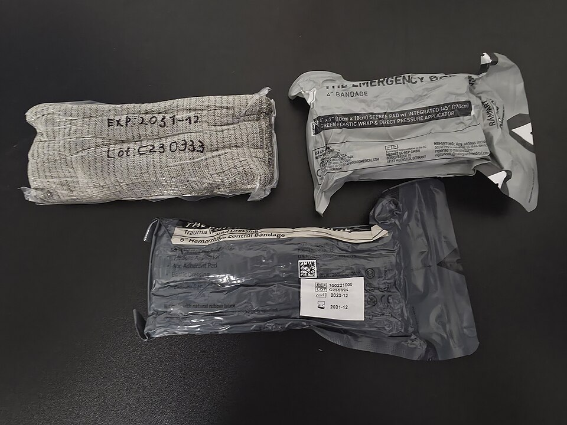

# UNIÃO SERVIÇOS MÉDICOS
## DIRETORIA DE ENSINO, PESQUISA E INSTRUÇÃO PRÉ-HOSPITALAR

---

**MÓDULO H03 — COMPRESSÃO DIRETA E CURATIVOS HEMOSTÁTICOS**
*Biblioteca Curricular: Controle de Hemorragias Graves (Bleeding Control)*
*Versão Editorial: 1.0.0 — Padrão Editorial USM*
*Carga Horária: 1 hora teórica + 1 hora prática | Público-alvo: Socorristas, policiais, brigadistas, instrutores de tiro e profissionais de emergência*

---

## SUMÁRIO

- [Seção 1 — Em 30 Segundos](#seção-1--em-30-segundos)
- [Seção 2 — Objetivos de Aprendizagem](#seção-2--objetivos-de-aprendizagem)
- [Seção 3 — Introdução e a Primazia da Pressão Mecânica Focal](#seção-3--introdução-e-a-primazia-da-pressão-mecânica-focal)
- [Seção 4 — Fisiopatologia da Oclusão Vascular por Compressão Externa](#seção-4--fisiopatologia-da-oclusão-vascular-por-compressão-externa)
- [Seção 5 — Desenvolvimento dos Subtemas](#seção-5--desenvolvimento-dos-subtemas)
  - [5.1 Princípios Fisiomecânicos da Compressão Direta](#51-princípios-fisiomecânicos-da-compressão-direta)
  - [5.2 Posicionamento Anatômico, Vetor de Força e Manutenção da Pressão](#52-posicionamento-anatômico-vetor-de-força-e-manutenção-da-pressão)
  - [5.3 Curativos Compressivos e Bandagens Elásticas de Emergência (Tipo Israelense)](#53-curativos-compressivos-e-bandagens-elásticas-de-emergência-tipo-israelense)
  - [5.4 Materiais Hemostáticos Tópicos: Quitosana e Caulim (Mecanismos de Ação)](#54-materiais-hemostáticos-tópicos-quitosana-e-caulim-mecanismos-de-ação)
  - [5.5 Erros Frequentes na Compressão e Complicações Isquêmicas](#55-erros-frequentes-na-compressão-e-complicações-isquêmicas)
  - [5.6 Avaliação Prática Contínua e Transição para Métodos Avançados](#56-avaliação-prática-contínua-e-transição-para-métodos-avançados)
- [Seção 6 — Quadros Práticos, Matrizes Comparativas de Agentes e Algoritmos](#seção-6--quadros-práticos-matrizes-comparativas-de-agentes-e-algoritmos)
- [Seção 7 — Mitos e Falhas Operacionais Críticas no Uso de Hemostáticos](#seção-7--mitos-e-falhas-operacionais-críticas-no-uso-de-hemostáticos)
- [Seção 8 — Estudo de Caso Prático Contextualizado (Laceração por Lâmina Circular)](#seção-8--estudo-de-caso-prático-contextualizado-laceração-por-lâmina-circular)
- [Seção 9 — Pulo do Gato](#seção-9--pulo-do-gato)
- [Seção 10 — Mapa Mental de Compressão Direta e Agentes Hemostáticos](#seção-10--mapa-mental-de-compressão-direta-e-agentes-hemostáticos)
- [Seção 11 — O Que Você Precisa Lembrar](#seção-11--o-que-você-precisa-lembrar)
- [Seção 12 — Referências Bibliográficas e Metadados Editoriais](#seção-12--referências-bibliográficas-e-metadados-editoriais)

---

## SEÇÃO 1 — EM 30 SEGUNDOS

> **VISÃO RÁPIDA DE SOBREVIVÊNCIA NA COMPRESSÃO E HEMOSTÁTICOS**
> 1. **A compressão direta é o primeiro gesto hemostático da humanidade:** Mais de 70% de todas as hemorragias externas traumáticas podem ser contidas com sucesso exclusivamente através da **pressão mecânica focal contínua e potente** sobre o ponto exato da lesão vascular [1, 2].
> 2. **Pressione o osso, não o ar:** A compressão manual só funciona se o vaso sangrante for esmagado contra uma estrutura rígida de sustentação (geralmente o osso subjacente). Descarregue o peso do próprio corpo através dos braços retos estendidos a 90 graus [2, 3].
> 3. **Nunca alivie a pressão para "espiar":** Se você comprimiu por 3 minutos e aliviar os dedos por 2 segundos para ver se o sangue parou, a pressão arterial expulsará o coágulo recém-formado e o cronômetro da hemostasia voltará ao zero [1, 4].
> 4. **Agentes hemostáticos modernos não queimam:** As gazes hemostáticas contemporâneas utilizam **Quitosana** (biopolímero derivado de crustáceos que atrai hemácias por carga eletrostática independente da cascata de coagulação) ou **Caulim** (silicato mineral de alumínio que ativa o Fator XII da coagulação). São 100% seguros, estáveis e não geram calor exotérmico [5, 6].
> 5. **Tempo mínimo de compressão:** Com gaze hemostática certificada, mantenha compressão contínua ininterrupta por **3 minutos**. Com gaze comum de algodão sem hemostático, o tempo mínimo de compressão manual é de **10 minutos inteiros** no relógio [1, 5].
> 6. **Bandagem elástica de emergência (Tipo Israelense):** Combina compressa estéril, barra de pressão mecânica rígida e clipe de travamento, transformando a pressão manual em pressão mecânica sustentada contínua [2, 7].

---

## SEÇÃO 2 — OBJETIVOS DE APRENDIZAGEM

Ao concluir o estudo teórico e o treinamento prático deste módulo, o operador de controle de sangramento será capaz de:

1. **Dominar os fundamentos biofísicos da compressão direta focal**, aplicando os vetores de força corporal necessários para superar a pressão hidrostática arterial.
2. **Posicionar adequadamente a vítima e o socorrista**, utilizando técnicas ergonômicas que evitem a fadiga muscular precoce durante a compressão prolongada.
3. **Aplicar com proficiência técnica curativos compressivos avançados**, manipulando bandagens de emergência com barra de pressão tipo israelense.
4. **Compreender os mecanismos moleculares dos agentes hemostáticos de última geração** (base de caulim e quitosana), diferenciando-os dos antigos produtos exotérmicos perigosos.
5. **Calcular com rigor os tempos necessários de pressão sustentada** conforme o tipo de curativo empregado (3 minutos vs. 10 minutos).
6. **Identificar falhas de contenção da compressão direta**, executando a transição tática rápida para o torniquete ou preenchimento cavitário profundo (*wound packing*).

---

## SEÇÃO 3 — INTRODUÇÃO E A PRIMAZIA DA PRESSÃO MECÂNICA FOCAL

Em um cenário de trauma penetrante ou contuso com sangramento externo, a primeira resposta motora intuitiva do ser humano é colocar a mão sobre o ferimento. A literatura médica militar e civil demonstra que essa reação intuitiva é, do ponto de vista biofísico, absolutamente correta: **a aplicação de pressão externa superior à pressão interna do vaso sanguíneo é o mecanismo mais eficaz para interromper o vazamento hidráulico do sistema circulatório** [1, 2].

Entretanto, existe uma distância abissal entre colocar panos frouxos sobre uma perna sangrante e a execução técnica rigorosa da **Compressão Direta Focal de Alta Performance**. Muitos socorristas falham não por falta de vontade, mas por dispersão de força: pressionam uma área anatômica ampla de 15 centímetros de diâmetro com a palma da mão espalmada, dividindo a pressão exercida e permitindo que o sangue continue jorrando silenciosamente por baixo da gaze [1, 3].

Paralelamente, a biotecnologia militar dos últimos vinte anos revolucionou os curativos tópicos com a introdução de **Agentes Hemostáticos Avançados**. Antigamente restritos a forças especiais das Forças Armadas, gazes impregnadas com caulim e quitosana hoje compõem kits de primeiros socorros de brigadas industriais, viaturas policiais e academias de tiro em todo o mundo. Compreender a sinergia entre a pressão mecânica correta e a aceleração bioquímica do coágulo é uma competência mandatória para salvar vidas em segundos [4, 5].

---

## SEÇÃO 4 — FISIOPATOLOGIA DA OCLUSÃO VASCULAR POR COMPRESSÃO EXTERNA

A mecânica do controle de sangramento responde aos princípios da hidrodinâmica e da biologia endotelial [2, 3]:

```
+---------------------------------------------------------------------------------+
|               BIOFÍSICA DA COMPRESSÃO DIRETA EFICAZ                             |
|                                                                                 |
|  [ PRESSÃO INTRAVASCULAR ARTERIAL ] (Sístole ~ 120 mmHg)                        |
|                     VS.                                                         |
|  [ PRESSÃO MECÂNICA EXTERNA APLICADA ] (Vetor focal ~ 150 a 250 mmHg)           |
|                                                                                 |
|  1. A força aplicada sobre a gaze achata a parede do vaso contra o osso.        |
|  2. O fluxo sanguíneo no ponto de ruptura é interrompido (estase local).        |
|  3. As plaquetas e o fibrinogênio não são mais lavados pela correnteza.         |
|  4. Inicia-se a formação da malha estável de fibrina e hemácias.                |
|  5. Consolidação do trombo hemostático aderido à camada íntima vascular.        |
+---------------------------------------------------------------------------------+
```

### 4.1 A Fórmula da Pressão: Força Dividida por Área
A pressão física é definida pela fórmula $P = \frac{F}{A}$ (Pressão = Força dividida pela Área).
- Se o socorrista aplicar uma força de 30 kgf utilizando a palma das duas mãos abertas cobrindo uma área de $200\text{ cm}^2$, a pressão exercida sobre o vaso será relativamente baixa, frequentemente insuficiente para ocluir uma artéria sob pressão sistólica de 120 mmHg.
- Se a mesma força de 30 kgf for aplicada na ponta dos dedos polegares ou na polpa digital concentrada em uma área de apenas $10\text{ cm}^2$ diretamente sobre o ponto exato da artéria rompida, a pressão resultante será **20 vezes maior**, colabando o vaso imediatamente contra a base óssea [2, 3].

---

## SEÇÃO 5 — DESENVOLVIMENTO DOS SUBTEMAS

### 5.1 Princípios Fisiomecânicos da Compressão Direta

A compressão direta manual consiste na aplicação de força mecânica externa contínua sobre a origem vascular do sangramento para interromper o extravasamento de sangue e permitir o tempo biológico necessário para a formação do trombo primário [1, 2]:
- **Focalidade:** A pressão não deve ser distribuída aleatoriamente ao redor do membro, mas sim direcionada milimetricamente para a boca do vaso que está sangrando.
- **Continuidade Ininterrupta:** A pressão não pode oscilar. Aliviar a compressão a cada 30 segundos "para conferir se já parou" quebra as pontes de fibrina microscópicas em formação e reinicia a perda volêmica.
- **Sustentação Óssea:** Todo tecido mole humano é deformável e viscoelástico. Para ocluir uma artéria, o socorrista deve identificar a estrutura óssea mais próxima e esmagar o vaso contra ela [2, 3].

---

### 5.2 Posicionamento Anatômico, Vetor de Força e Manutenção da Pressão

Manter uma força de 20 a 30 kgf com as mãos por 10 minutos exclusivamente através da força dos músculos dos braços (bíceps e tríceps) é fisiologicamente impossível para a maioria dos adultos devido à fadiga muscular precoce e ao acúmulo de ácido lático [2, 4]:

```
+---------------------------------------------------------------------------------+
|                   ERGONOMIA E VETOR DE FORÇA DO SOCORRISTA                      |
|                                                                                 |
|  [X] ERRO COMUM: Braços flexionados e socorrista sentado longe da vítima.       |
|      - O socorrista cansa em menos de 2 minutos e a pressão diminui.             |
|                                                                                 |
|  [V] POSTURA CORRETA USM:                                                       |
|      1. Ajoelhe-se rente ao corpo da vítima no solo.                            |
|      2. Mantenha os DOIS BRAÇOS COMPLETAMENTE RETOS E ESTENDIDOS a 90 graus.    |
|      3. Bloqueie os cotovelos sem flexioná-los.                                 |
|      4. Posicione os ombros diretamente sobre as mãos apoiadas na ferida.       |
|      5. DESCARREGUE O PESO DO PRÓPRIO TRONCO sobre a ferida da vítima.          |
|      - A gravidade faz a força pelo socorrista sem fadiga muscular por 15 min.  |
+---------------------------------------------------------------------------------+
```

---

### 5.3 Curativos Compressivos e Bandagens Elásticas de Emergência (Tipo Israelense)

Quando o socorrista precisa liberar as mãos para atender outra vítima, acionar o rádio de comunicação ou preparar a evacuação, a compressão manual direta deve ser convertida em um **Curativo Compressivo Estabilizado** [2, 7]:



*Figura 1 — Bandagem compressiva tática de emergência para controle hemorrágico. Crédito: Struppig taucher. Licença: CC BY 4.0 (https://creativecommons.org/licenses/by/4.0/). Fonte: Wikimedia Commons.*

#### A Bandagem de Emergência (Emergency Bandage / Bandagem Israelense):
Projetada para combate e resgate militar, este dispositivo revolucionou o controle de sangramentos no meio civil:
1. **Compressa Estéril Não Aderente Integrada:** Almofada central estéril que cobre a ferida sem grudar no coágulo recém-formado.
2. **Barra de Pressão Mecânica Integrada (*Pressure Bar*):** Dispositivo rígido de plástico curvo localizado logo atrás da compressa. Ao passar a faixa elástica por dentro da barra e inverter o sentido da tração em 180 graus, a barra funciona como uma alavanca mecânica que empurra a almofada profundamente contra o vaso, gerando uma pressão focal equivalente à compressão manual contínua.
3. **Barra de Fechamento (*Closure Bar*):** Presilha plástica nas extremidades que trava a bandagem com firmeza, eliminando a necessidade de esparadrapos, fitas adesivas ou nós complexos [2, 7].

---

### 5.4 Materiais Hemostáticos Tópicos: Quitosana e Caulim (Mecanismos de Ação)

A evolução dos agentes hemostáticos dividiu-se historicamente em três gerações tecnológicas [5, 6]:

#### A Antiga e Perigosa Primeira Geração (Zeólitas em Pó):
No início dos anos 2000, produtos como o primeiro *QuikClot* granulado utilizavam zeólitas que absorviam água violentamente por reação exotérmica, gerando temperaturas locais de até 60 a 70 ºC que causavam queimaduras térmicas de segundo e terceiro graus nos tecidos e nos olhos do socorrista pelo vento. **ESSES PRODUTOS FORAM BANIDOS E NÃO EXISTEM MAIS NOS KITS MODERNOS** [5].

#### A Moderna Geração de Agentes Hemostáticos de Alta Performance:

| AGENTE HEMOSTÁTICO | ORIGEM / PRINCÍPIO ATIVO | MECANISMO DE AÇÃO MOLECULAR | VANTAGENS CLÍNICAS |
| :--- | :--- | :--- | :--- |
| **Caulim (Ex.: QuikClot Combat Gauze)** | Silicato mineral inorgânico natural de alumínio purificado impregnado em gaze cirúrgica de raiom/poliéster. | **Ativação da Cascata Intrínseca:** O caulim possui carga elétrica superficial negativa que ativa instantaneamente o **Fator XII (Hageman)** e o Fator XI da coagulação, acelerando a produção de trombina e fibrina em até 5 vezes. | - Não gera calor algum.<br>- Não causa reações alérgicas.<br>- Estabilidade química por mais de 5 anos.<br>- Faixa radiopaca detectável em raio-X. |
| **Quitosana (Ex.: Celox Gauze / ChitoGauze)** | Polissacarídeo catiônico natural biocompatível extraído do exoesqueleto de crustáceos marinhos (camarão/caranguejo). | **Mecanismo Eletrostático Independente:** A quitosana possui carga elétrica superficial altamente positiva ($+$). Como a membrana das hemácias possui carga negativa ($-$), elas sofrem atração eletrostática imediata, formando um gel adesivo denso e pegajoso que sela o vaso mecanicamente em 60 segundos. | - **FUNCIONA MESMO EM SANGUE HIPOTÉRMICO OU HEPARINIZADO.**<br>- Age mesmo em pacientes com coagulopatia ou usando anticoagulantes orais.<br>- Não causa reação alérgica a frutos do mar (proteínas imunogênicas são 100% removidas no refino). |

---

### 5.5 Erros Frequentes na Compressão e Complicações Isquêmicas

A compressão mal executada gera falhas catastróficas [1, 4]:
- **Erro de Superfície Ampla:** Utilizar toalhas ou panos muito volumosos enrolados como uma almofada gigante. A espessura do pano dissipa a pressão do socorrista, impedindo que a força atinja o vaso no fundo da ferida.
- **Troca Precoce de Gazes:** Remover o curativo para avaliar a ferida antes do tempo mínimo regulamentar.
- **Enfaixamento em Garrote Frouxo:** Enrolar uma atadura com pouca pressão: não fecha a artéria (que continua sangrando em profundidade), mas fecha o retorno venoso superficial, aumentando o inchaço e a congestão venosa do membro [2, 3].

---

### 5.6 Avaliação Prática Contínua e Transição para Métodos Avançados

O socorrista deve manter vigilância ininterrupta sobre a ferida após a aplicação do curativo [1, 2]:
- **Checagem de Transbordamento:** Se após 3 minutos de compressão com gaze hemostática (ou 10 minutos com gaze comum) o sangue vivo continuar empapando as camadas externas e escorrendo pelas bordas, **A COMPRESSÃO DIRETA FALHOU**.
- **Regra de Transição Imediata:**
  - Se a lesão for em membro (braço ou perna): **APLIQUE IMEDIATAMENTE UM TORNIQUETE COMERCIAL 5 CM ACIMA DA FERIDA**.
  - Se a lesão for juncional (virilha ou axila): **INICIE O PREENCHIMENTO CAVITÁRIO PROFUNDO (*WOUND PACKING*) COM MAIS GAZE HEMOSTÁTICA** [1, 4].

---

---

## SEÇÃO 6 — QUADROS PRÁTICOS, MATRIZES COMPARATIVAS DE AGENTES E ALGORITMOS

### Matriz Comparativa: Curativo Convencional vs. Gaze Hemostática Avançada

| CRITÉRIO | GAZE CIRÚRGICA COMUM DE ALGODÃO | GAZE IMPREGNADA COM HEMOSTÁTICO |
| :--- | :--- | :--- |
| **Mecanismo** | Absorção passiva de sangue e suporte físico para o coágulo biológico. | Ativação molecular direta da cascata (Caulim) ou atração eletrostática de hemácias (Quitosana). |
| **Tempo Mínimo de Compressão Manual** | **10 minutos ininterruptos no relógio.** | **3 minutos ininterruptos no relógio.** |
| **Eficácia em Vítimas Hipotérmicas** | Muito baixa (o sangue frio não coagula naturalmente). | **Altíssima (a Quitosana atrai hemácias independentemente da temperatura).** |
| **Eficácia em Uso de Anticoagulantes** | Fracassa frequentemente (fatores de coagulação inibidos). | **Alta eficácia mecânica por formação de gel adesivo instantâneo.** |
| **Custo e Disponibilidade** | Baixíssimo custo; disponível universalmente em qualquer farmácia. | Custo mais elevado; requer aquisição para kits táticos e industriais. |

---


*Figura 2 — Rolo de gaze estéril para compressão direta e preenchimento de cavidades. Crédito: im_tau. Licença: CC BY 4.0 (https://creativecommons.org/licenses/by/4.0/). Fonte: Wikimedia Commons.*

### Algoritmo Operacional da Compressão Direta e Transição

```
                        HEMORRAGIA GRAVE EXTERNA DETECTADA
                                         │
                   ┌─────────────────────┴─────────────────────┐
                   ▼                                           ▼
          FERIMENTO EM MEMBRO                        FERIMENTO JUNCIONAL
            (Braço ou Perna)                           (Virilha ou Axila)
                   │                                           │
         HÁ TORNIQUETE DISPONÍVEL?                     COMPRESSÃO DIRETA MANUAL
         ┌─────────┴─────────┐                         OU WOUND PACKING COM
         ▼                   ▼                         GAZE HEMOSTÁTICA IMEDIATO
        SIM                 NÃO                                │
   Aplicar Torniquete  Compressão Direta              Manter Pressão Contínua:
   imediatamente!      com Gaze ou Pano limpo         - Gaze hemostática: 3 min
                       Braços retos a 90º             - Gaze comum: 10 min
                             │                                 │
                   ┌─────────┴─────────┐              ┌────────┴────────┐
                   ▼                   ▼              ▼                 ▼
               CONTROLE            SANGRAMENTO     CONTROLE         CONTINUA
               EFICAZ              PERSISTE        EFICAZ           SANGRANDO
                   │                   │              │                 │
             Bandagem              Aplicar        Bandagem          Adicionar mais
             Compressiva           Torniquete     Compressiva       gaze profunda e
             + Manta 192           de Molinete    + Manta 192       pressão corporal
```

---

## SEÇÃO 7 — MITOS E FALHAS OPERACIONAIS CRÍTICAS NO USO DE HEMOSTÁTICOS

1. **"Gaze hemostática fecha o vaso sozinha sem precisar apertar":** O agente hemostático é um acelerador químico, não uma mágica. Sem compressão física contínua potente para manter a gaze em contato com a boca do vaso sob estase, o fluxo sanguíneo lava o produto e a vítima morre [1, 5].
2. **"Pessoas alérgicas a camarão não podem usar curativo de quitosana":** Estudos imunológicos comprovaram que a alergia a frutos do mar decorre de proteínas musculares (tropomiosina). A quitosana de grau médico é um carboidrato purificado livre de proteínas, aprovado pelo FDA como hipoalergênico universal seguro [5, 6].
3. **"Curativo compressivo pode substituir o torniquete em sangramento arterial femoral":** Em artérias de altíssima pressão e fluxo maciço, bandagens compressivas externas frequentemente transbordam em 2 minutos. Extremidade com sangramento arterial em jato exige torniquete [1, 4].
4. **"Colocar gelo dentro da ferida para estancar o sangue":** Aplicar gelo no sangue que vaza resfria localmente os fatores de coagulação, inibindo a hemostasia e acelerando a Tríade Letal [2, 3].


*Figura 3 — Atadura autoaderente aplicada para fixação de curativo compressivo hemostático. Crédito: Baedr-9439. Licença: CC0. Fonte: Wikimedia Commons.*

---

## SEÇÃO 8 — ESTUDO DE CASO PRÁTICO CONTEXTUALIZADO (LACERAÇÃO POR LÂMINA CIRCULAR)

### Cenário: Acidente em Fábrica de Móveis Planejados
Na marcenaria industrial Madeira Nobre, o operador de máquinas Juliano, 41 anos, realizava o corte longitudinal de pranchas de MDF em uma serra circular de bancada. Durante o avanço da madeira, a peça sofreu um coice violento (*kickback*) e o braço direito de Juliano foi arremessado contra a lâmina giratória desprotegida.

A serra causou uma laceração cortocontusa extensa de 10 centímetros de comprimento na face anterior do antebraço direito, seccionando fáscias, tendões flexores e a artéria radial, além de veias calibrosas. Juliano solta um grito estarrecedor e recua cambaleando. O sangue vermelho-vivo jorra em pulsos contínuos e vertiginosos, empapando seu avental de lona e cobrindo a bancada de serragem.

### Aplicação da Abordagem USM de Alta Performance:
1. **Reconhecimento da Hemorragia Grave e Parada Imediata:** O líder de turno Renato, brigadista treinado na doutrina USM, desliga o botão de emergência da máquina e grita: *"Vítima com sangramento grave na serra! Márcio, ligue para o 192 e traga o kit de controle de sangramento com a bandagem de emergência!"*.
2. **Intervenção Manual Instantânea:**
   - Enquanto o kit é trazido, Renato calça as luvas de nitrilo em 5 segundos, apoia o antebraço de Juliano sobre a bancada limpa e aplica os dois polegares diretamente sobre o ponto de corte do vaso contra a diáfise do osso rádio.
   - O jato arterial é interrompido imediatamente pela compressão mecânica óssea focal.
3. **Aplicação de Gaze Hemostática com Quitosana:**
   - Márcio chega com a bolsa de trauma aos 30 segundos.
   - Renato abre o pacote estéril de gaze impregnada com quitosana (Celox Gauze), acomoda a primeira dobra da gaze compactada diretamente sobre o ponto sangrante da artéria radial e preenche o restante da fenda muscular com a fita contínua em formato sanfonado.
   - Apoia as duas mãos sobre o curativo, projeta os ombros para a frente com os braços estendidos e descarrega o peso do tronco sobre o antebraço de Juliano.
4. **Cronometragem Rigorosa dos 3 Minutos:**
   - Renato olha para o relógio de pulso e comanda: *"Cronometrando 3 minutos de compressão contínua a partir de agora. Não vou aliviar um milímetro"*.
   - A quitosana atrai eletrostaticamente as hemácias do sangue em contato, transformando o coágulo em um gel adesivo denso que sela o orifício arterial.
   - Passados os 180 segundos exatos, Renato inspeciona visualmente as bordas: o sangramento está 100% contido.
5. **Instalação da Bandagem de Emergência (Tipo Israelense):**
   - Sem retirar a gaze hemostática da ferida, Renato aplica a compressa central da bandagem elástica sobre o curativo.
   - Passa a fita elástica pela barra de pressão plástica, inverte o sentido da faixa com tração firme e enfaixa todo o antebraço em espiral no sentido distal para proximal.
   - Trava a presilha de fechamento nos fios da atadura. O curativo permanece seco, firme e sem sangramento residual.
   - Checa o enchimento capilar nos dedos da mão de Juliano: dedos quentes e com retorno capilar de 1,5 segundo (a circulação colateral pela artéria ulnar foi preservada, pois o curativo é focal).
6. **Manejo Térmico e Desfecho:**
   - Juliano é sentado confortavelmente em uma poltrona com o braço machucado elevado em uma tipoia e envolvido com manta térmica aluminizada.
   - A equipe do SAMU chega em 11 minutos, encontra a hemorragia completamente controlada sem necessidade de torniquete e transporta Juliano com segurança para o hospital, onde a cirurgia reparadora restaura os tendões e a vascularização com sucesso pleno.

---

## SEÇÃO 9 — PULO DO GATO

> **MACETES OPERACIONAIS DE COMPRESSÃO DE ALTA PERFORMANCE**
>
> 1. **A Técnica do "Ponto de Gatilho com Polegares":** Se uma ferida profunda tiver 10 cm de comprimento, não tente apertar os 10 cm com igual força. Olhe para a poça e veja exatamente de onde o sangue está jorrando em jato. Posicione a ponta dos seus dois polegares (um sobre o outro) exclusivamente sobre esse orifício de 5 milímetros. A pressão focal multiplicada estanca o vaso instantaneamente enquanto você aguarda os materiais [2, 3].
> 2. **O Travamento da Barra de Pressão Israelense:** Ao passar a faixa elástica da bandagem israelense por dentro da fenda da barra plástica, não continue puxando no mesmo sentido: puxe a faixa para trás, no sentido exatamente oposto (180 graus). Essa inversão do vetor é o segredo mecânico que alavanca a barra de plástico para baixo contra a ferida, gerando uma força compressiva equivalente a 30 kgf contínuos sem soltar [2, 7].
> 3. **O Descarte de Curativos Transbordados:** Se um curativo compressivo comum falhar e o sangue começar a transbordar rapidamente, não perca tempo desenrolando a atadura cheia de sangue: **aplique imediatamente o torniquete de molinete 5 cm acima do curativo**, sem retirar nada do lugar [1, 4].

---

## SEÇÃO 10 — MAPA MENTAL DE COMPRESSÃO DIRETA E AGENTES HEMOSTÁTICOS

```
                       COMPRESSÃO DIRETA E AGENTES HEMOSTÁTICOS
                                           │
         ┌─────────────────────────────────┴─────────────────────────────────┐
         │                                                                   │
  [ COMPRESSÃO MANUAL ]                                             [ AGENTES HEMOSTÁTICOS ]
         │                                                                   │
  ┌──────┴──────┐                                                    ┌───────┴───────┐
  │ Braços      │                                                    │ Caulim        │
  │ retos a 90º │                                                    │ QuikClot      │
  │ Peso do     │                                                    │ Ativa Fator   │
  │ tronco      │                                                    │ XII cascata   │
  └──────┬──────┘                                                    └───────┬───────┘
         │                                                                   │
         ▼                                                           ┌───────┴───────┐
  Pressionar contra                                                  │ Quitosana     │
  o osso subjacente                                                  │ Celox         │
         │                                                           │ Carga elétrica│
         ▼                                                           │ atrai hemácias│
  Manter o tempo:                                                    └───────┬───────┘
  - Gaze comum: 10 min                                                       │
  - Hemostático: 3 min                                                       ▼
         │                                                           FUNCIONA MESMO
         ▼                                                           EM HIPOTERMIA
  Estabilizar com Bandagem                                           OU COM ANTICOAGULANTE!
  de Emergência (Israelense)
```

---

## SEÇÃO 11 — O QUE VOCÊ PRECISA LEMBRAR

- A compressão direta focal é o método mais universal e eficaz para conter sangramentos externos.
- Pressione o vaso contra a base óssea subjacente, descarregando o peso do tronco com os braços estendidos e bloqueados a 90 graus.
- Nunca alivie a compressão manual para conferir se o sangramento parou antes do término do tempo mínimo.
- Gaze com hemostático requer 3 minutos de compressão contínua; gaze cirúrgica comum exige 10 minutos ininterruptos.
- Quitosana funciona por atração eletrostática e é eficaz mesmo em sangue frio (hipotérmico) ou em pacientes anticoagulados.
- Se o curativo compressivo transbordar e falhar em um membro, aplique imediatamente o torniquete comercial acima da lesão.

---

## SEÇÃO 12 — REFERÊNCIAS BIBLIOGRÁFICAS E METADADOS EDITORIAIS

### Referências Científicas e Normativas

1. AMERICAN COLLEGE OF SURGEONS (ACS). **STOP THE BLEED®: Bleeding Control Basic v. 2.0 Course Manual**. Chicago, IL: ACS Committee on Trauma, 2020.
2. NATIONAL ASSOCIATION OF EMERGENCY MEDICAL TECHNICIANS (NAEMT). **PHTLS: Prehospital Trauma Life Support**. 10. ed. Burlington, MA: Jones & Bartlett Learning, 2023.
3. BULGER, E. M. et al. **An Evidence-Based Prehospital Guideline for External Hemorrhage Control: American College of Surgeons Committee on Trauma**. *Prehospital Emergency Care*, v. 18, n. 2, p. 163-173, 2014.
4. COMMITTEE ON TACTICAL COMBAT CASUALTY CARE (CoTCCC). **Tactical Combat Casualty Care (TCCC) Guidelines for Medical Personnel**. Joint Trauma System, U.S. Department of Defense, 2021. Atualizado em 2023.
5. BENNETT, B. L. et al. **Hemostatic Dressings in the Prehospital Setting: A Review of the Evidence and Practical Recommendations**. *Military Medicine*, v. 180, n. 5, p. 487-498, 2015.
6. HATTON, K. W. et al. **Topical Hemostatic Agents in Surgery and Trauma: A Comprehensive Review of Mechanisms, Efficacy, and Safety**. *Journal of Trauma and Acute Care Surgery*, v. 84, n. 4, p. 658-668, 2018.
7. BAR-EL, Y. et al. **The Emergency Bandage: An Advanced Hemostatic Device for Prehospital and Mass Casualty Trauma**. *Military Medicine*, v. 168, n. 1, p. 32-35, 2003.
8. MINISTÉRIO DA SAÚDE (BRASIL). **Portaria GM/MS nº 2.048, de 5 de novembro de 2002**. Regulamento Técnico dos Sistemas Estaduais de Urgência e Emergência. Brasília, DF: Ministério da Saúde, 2002.
9. WORLD HEALTH ORGANIZATION (WHO). **Guidelines for Trauma Quality Improvement Programmes**. Genebra: WHO, 2019.
10. ASSOCIAÇÃO BRASILEIRA DE NORMAS TÉCNICAS (ABNT). **ABNT NBR 14276:2020: Brigada de incêndio e emergência — Requisitos e procedimentos**. Rio de Janeiro: ABNT, 2020.
11. BRASIL. **Decreto-Lei nº 2.848, de 7 de dezembro de 1940**. Código Penal Brasileiro (Art. 135 - Omissão de Socorro). Brasília, DF: Presidência da República, 1940.
12. AMERICAN COLLEGE OF SURGEONS (ACS). **ATLS: Advanced Trauma Life Support — Student Course Manual**. 10. ed. Chicago, IL: ACS, 2018.

---

### Metadados Editoriais Institucionais

| CAMPO | ESPECIFICAÇÃO TÉCNICA |
| :--- | :--- |
| **Identificador do Módulo** | MÓDULO H03 — Compressão Direta e Curativos Hemostáticos |
| **Biblioteca Curricular** | Controle de Hemorragias Graves (*Bleeding Control*) |
| **Instituição Responsável** | União Serviços Médicos — Ensino e Instrução Pré-Hospitalar |
| **Padrão Gráfico e Editorial** | Diretrizes Editoriais Integradas LURIA / USM |
| **Status Editorial** | Aguardando Aprovação Científica |
| **Data da Revisão Técnica** | Outubro de 2026 |
| **Versão Curricular** | Versão 1.0.0 — Revisão Quinquenal Vigente |
| **Classificação de Acesso** | Conteúdo Didático Restrito aos Treinamentos e Capacitações da União Serviços Médicos |
