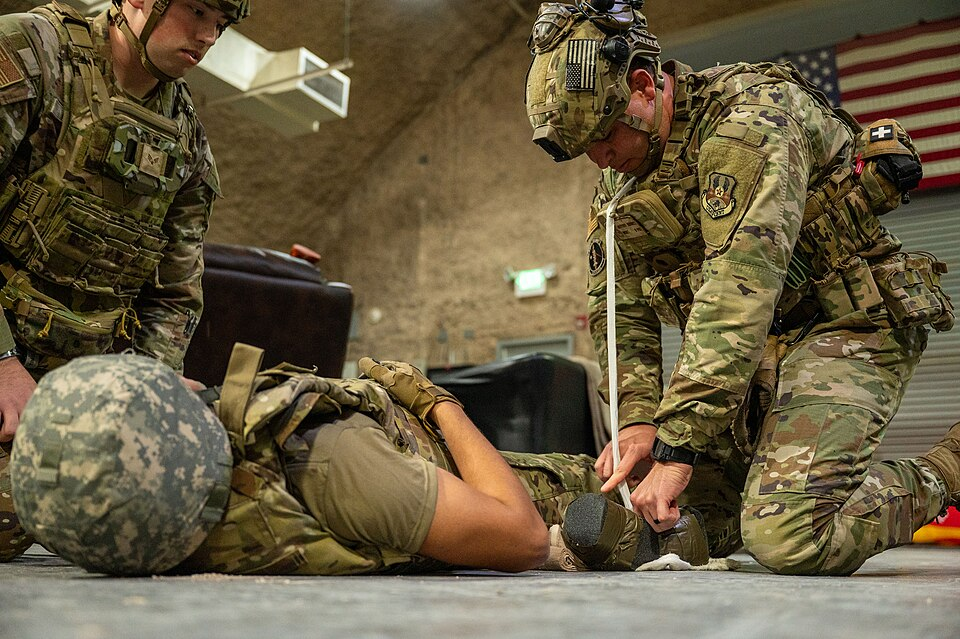
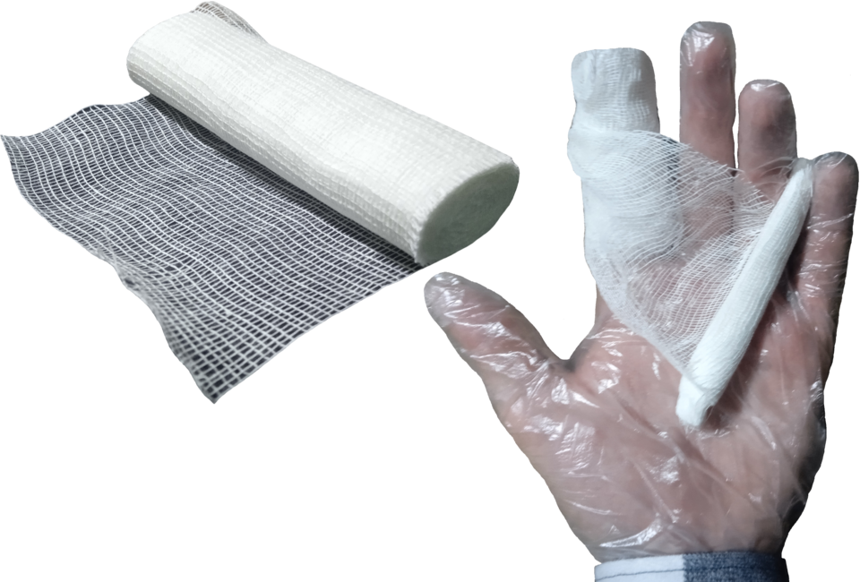
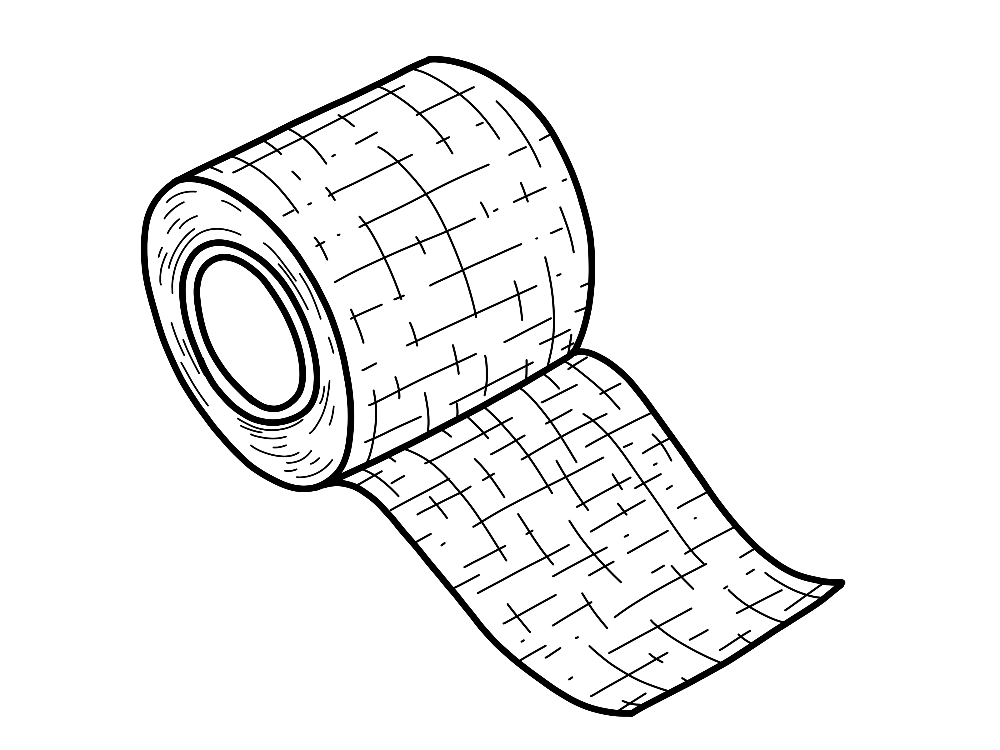

# UNIÃO SERVIÇOS MÉDICOS
## DIRETORIA DE ENSINO, PESQUISA E INSTRUÇÃO PRÉ-HOSPITALAR

---

**MÓDULO H04 — PREENCHIMENTO DE FERIDAS — WOUND PACKING**
*Biblioteca Curricular: Controle de Hemorragias Graves (Bleeding Control)*
*Versão Editorial: 1.0.0 — Padrão Editorial USM*
*Carga Horária: 1 hora teórica + 1 hora prática | Público-alvo: Socorristas táticos, policiais, militares, brigadistas e equipes de resgate*

---

## SUMÁRIO

- [Seção 1 — Em 30 Segundos](#seção-1--em-30-segundos)
- [Seção 2 — Objetivos de Aprendizagem](#seção-2--objetivos-de-aprendizagem)
- [Seção 3 — Introdução e a Lacuna Crítica das Lesões Juncionais](#seção-3--introdução-e-a-lacuna-crítica-das-lesões-juncionais)
- [Seção 4 — Anatomia Cirúrgica e Fisiopatologia das Zonas Juncionais](#seção-4--anatomia-cirúrgica-e-fisiopatologia-das-zonas-juncionais)
- [Seção 5 — Desenvolvimento dos Subtemas](#seção-5--desenvolvimento-dos-subtemas)
  - [5.1 Conceitos Fundamentais e Indicações do Wound Packing](#51-conceitos-fundamentais-e-indicações-do-wound-packing)
  - [5.2 Regiões Anatômicas Pertinentes: Virilhas, Axilas e Pescoço](#52-regiões-anatômicas-pertinentes-virilhas-axilas-e-pescoço)
  - [5.3 Materiais Utilizados: Gazes Z-Fold, Rolos e Hemostáticos Impregnados](#53-materiais-utilizados-gazes-z-fold-rolos-e-hemostáticos-impregnados)
  - [5.4 Demonstração Técnica e Prática Supervisionada do Empacotamento](#54-demonstração-técnica-e-prática-supervisionada-do-empacotamento)
  - [5.5 Situações de Contraindicação Absoluta: Tórax e Abdômen](#55-situações-de-contraindicação-absoluta-tórax-e-abdômen)
  - [5.6 Manutenção da Pressão, Curativo de Fixação e Reavaliação](#56-manutenção-da-pressão-curativo-de-fixação-e-reavaliação)
- [Seção 6 — Quadros Práticos, Algoritmos de Empacotamento e Matrizes](#seção-6--quadros-práticos-algoritmos-de-empacotamento-e-matrizes)
- [Seção 7 — Erros Críticos e Falhas Operacionais no Wound Packing](#seção-7--erros-críticos-e-falhas-operacionais-no-wound-packing)
- [Seção 8 — Estudo de Caso Prático Contextualizado (Perfuração por Faca na Virilha)](#seção-8--estudo-de-caso-prático-contextualizado-perfuração-por-faca-na-virilha)
- [Seção 9 — Pulo do Gato](#seção-9--pulo-do-gato)
- [Seção 10 — Mapa Mental do Preenchimento de Feridas (Wound Packing)](#seção-10--mapa-mental-do-preenchimento-de-feridas-wound-packing)
- [Seção 11 — O Que Você Precisa Lembrar](#seção-11--o-que-você-precisa-lembrar)
- [Seção 12 — Referências Bibliográficas e Metadados Editoriais](#seção-12--referências-bibliográficas-e-metadados-editoriais)

---

## GUIA DE ATUAÇÃO — PARA QUEM NÃO É DA ÁREA DA SAÚDE

> **EM UMA EMERGÊNCIA REAL:** Proteja-se, peça ajuda e ligue **192 (SAMU)**. Para fogo, resgate em altura, água, espaço confinado ou ambiente perigoso, ligue **193 (Bombeiros)**. Diga o endereço e siga as instruções da central. Este roteiro orienta as primeiras ações, mas não substitui o treino supervisionado das técnicas práticas.

### Situação: Preenchimento de ferida: quando NÃO improvisar

**Reconheça os sinais:** Ferida profunda em virilha, axila ou extremidade com sangramento intenso e sem local para torniquete.

### O que fazer — passo a passo

1. Acione 192 e pressione diretamente a ferida de imediato.
2. Peça gaze apropriada e ajuda de outra pessoa para manter compressão.
3. O preenchimento da ferida (wound packing) deve ser feito somente após treinamento prático específico.
4. Se você foi treinado, siga a técnica ensinada com gaze própria e mantenha pressão firme após o preenchimento.
5. Sem treinamento ou material, mantenha pressão direta contínua em vez de explorar a ferida.
6. Informe ao resgate onde foi aplicado curativo ou packing; não retire o material.

### Não faça isto

Não introduza dedos para procurar artérias. Não faça packing em ferida torácica ou abdominal; não comprima diretamente a traqueia.

### Exercício prático de aprendizagem

Utilize exclusivamente simulador de feridas profundas, com supervisão e avaliação prática.

**Ao entregar a vítima:** informe horário de início, mudanças na respiração e na consciência, riscos e medidas aplicadas.

**Limites:** não faça procedimentos invasivos, administração de fármacos não prescritos, resgates técnicos ou intervenções que dependam de habilitação profissional. Pratique presencialmente RCP, DEA, controle de sangramento e desengasgo em manequins antes de assumir atendimento.

**Referências operacionais:** Ministério da Saúde — SAMU 192 (https://www.gov.br/saude/pt-br/composicao/saes/samu-192/samu-192); AHA/AAP — RCP e primeiros socorros 2025 (https://cpr.heart.org/en/resuscitation-science/cpr-and-ecc-guidelines); AHA/Cruz Vermelha — Primeiros Socorros 2024 (https://cpr.heart.org/en/resuscitation-science/2024-first-aid-guidelines).

---

## SEÇÃO 1 — EM 30 SEGUNDOS

> **VISÃO RÁPIDA DE SOBREVIVÊNCIA NO PREENCHIMENTO CAVITÁRIO**
> 1. **O que é Wound Packing:** É a técnica de introduzir física e progressivamente metros de gaze estéril sanfonada (*Z-fold*) para dentro de uma ferida cavitária profunda até o fundo da lesão, comprimindo o vaso sangrante diretamente contra o osso [1, 2].
> 2. **Onde o torniquete não alcança:** Ferimentos em **áreas juncionais** — virilhas (onde a perna se une ao tronco), axilas (onde o braço se une ao ombro) e base do pescoço — **não permitem a colocação de torniquetes de membros**. O *wound packing* é a única salvação para essas regiões [1, 3].
> 3. **Vá até o fundo com a ponta dos dedos:** Colocar gaze superficial na borda da ferida não serve para nada. O socorrista deve introduzir a ponta de um ou dois dedos no fundo da cavidade anatômica para encontrar o ponto exato de onde o sangue está jorrando [2, 4].
> 4. **Prioridade para todos:** Acione 192 e mantenha pressão direta sem interrupções. O packing é uma habilidade prática para pessoas treinadas em ferida adequada.
> 5. **ONDE É PROIBIDO EMPACOTAR:** **JAMAIS faça preenchimento no TÓRAX ou no ABDÔMEN**. O tórax e a cavidade abdominal são cavidades gigantescas e expansíveis; enfiar gaze no tórax empurra a gaze para dentro do pulmão sem gerar pressão mecânica alguma contra os vasos [1, 5].
> 6. **Depois da intervenção:** Mantenha a pressão sobre a ferida até a chegada do resgate. O tempo de compressão depende do tipo de material e do protocolo ensinado ao socorrista.

---

## SEÇÃO 2 — OBJETIVOS DE APRENDIZAGEM

Ao concluir o estudo teórico e a prática com simuladores deste módulo, o operador de emergência será capaz de:

1. **Definir as indicações clínicas e anatômicas estritas do preenchimento de feridas (*wound packing*)**, diferenciando-o das abordagens com torniquete de extremidades.
2. **Identificar as zonas juncionais críticas do corpo humano** (trígono femoral na virilha, fossa axilar e base cervical), reconhecendo as artérias de grande calibre subjacentes.
3. **Manipular com maestria gazes de dobragem em Z (*Z-fold*) e rolos hemostáticos**, evitando a contaminação acidental do material antes da inserção na cavidade.
4. **Executar a técnica "dedo sobre dedo" (*finger-over-finger*)**, mantendo hemostasia mecânica contínua durante todo o processo de alimentação da gaze.
5. **Reconhecer as contraindicações absolutas do empacotamento** (ferimentos intracavitários de tórax, abdômen e crânio), aplicando as condutas alternativas regulamentares.
6. **Confeccionar curativos compressivos externos de travamento** e registrar a documentação do procedimento para a equipe cirúrgica do hospital receptor.

---

## SEÇÃO 3 — INTRODUÇÃO E A LACUNA CRÍTICA DAS LESÕES JUNCIONAIS

**LEITURA GUIADA — COMECE AQUI:** Algumas feridas profundas ficam perto da virilha ou axila. Nesses locais, um torniquete convencional de braço ou perna não se encaixa. A medida inicial do leigo é pressão direta; técnicas de preenchimento precisam ser ensinadas na prática.

A massificação do ensino do torniquete de extremidades em forças policiais, brigadas industriais e cursos civis de primeiros socorros reduziu substancialmente as mortes por sangramentos em antebraços, braços e pernas. No entanto, dados epidemiológicos de conflitos militares recentes e de centros de trauma civis revelaram uma vulnerabilidade anatômica alarmante: **as hemorragias juncionais continuavam matando até 20% das vítimas de trauma penetrante potencialmente sobrevivíveis** [1, 2].

As áreas juncionais — onde os membros se conectam ao tronco (fossa axilar e trígono femoral na virilha) e onde o pescoço se conecta ao tórax — concentram artérias e veias gigantescas sob regimes de altíssima vazão:
- A artéria e veia femorais na virilha;
- A artéria e veia axilares no oco do braço;
- As artérias carótidas e veias jugulares na base cervical [2, 3].

Devido à geometria do corpo humano, é fisicamente impossível posicionar uma fita de torniquete circunferencial na virilha ou na axila (a fita escorrega para a perna ou para o braço, deixando a ferida sangrante desprotegida acima do garrote). Nesses cenários, a tentativa ingênua de colocar um curativo plano superficial sobre a pele resulta em morte por exsanguinação interna rápida. A única intervenção pré-hospitalar com respaldo científico comprovado para salvar essas vítimas é o **Preenchimento de Feridas (*Wound Packing*)** [1, 4].

---

## SEÇÃO 4 — ANATOMIA CIRÚRGICA E FISIOPATOLOGIA DAS ZONAS JUNCIONAIS

> [!NOTE]
> **Por que isso acontece?** Quando a ferida forma um espaço profundo, o sangue pode continuar saindo apesar de uma compressa superficial. O preenchimento com gaze, feito por socorrista treinado em região indicada, ajuda a transmitir pressão ao interior da ferida.

Compreender o relevo ósseo e a vascularização das junções anatômicas é o pré-requisito para o sucesso do empacotamento [2, 3]:

```
+---------------------------------------------------------------------------------+
|                     ANATOMIA DAS TRÊS ZONAS JUNCIONAIS CRÍTICAS                 |
|                                                                                 |
|  [ 1. JUNÇÃO FEMORAL (VIRILHA) ]                                                |
|  - Artéria e Veia Femorais emergem sob o ligamento inguinal.                   |
|  - Vaso de altíssimo calibre (diâmetro de 8 a 10 mm).                           |
|  - Apoio ósseo de compressão: Cabeça do fêmur e ramo púbico da bacia.          |
|                                                                                 |
|  [ 2. JUNÇÃO AXILAR (OCO DO BRAÇO) ]                                            |
|  - Artéria e Veia Axilares cruzam a fossa axilar sob o peitoral maior.          |
|  - Apoio ósseo de compressão: Colo cirúrgico do úmero e grade costal lateral.  |
|                                                                                 |
|  [ 3. JUNÇÃO CERVICAL (BASE DO PESCOÇO) ]                                       |
|  - Artérias Carótidas Comuns e Veias Jugulares Internas.                        |
|  - Apoio ósseo de compressão: Processos transversos das vértebras cervicais.   |
|  - ALERTA: Comprimir SEMPRE de forma lateral e posterior, NUNCA sobre a traqueia!|
+---------------------------------------------------------------------------------+
```

### 4.1 A Dinâmica do Sangramento em Cavidade Aberta
Quando uma lâmina, fragmento de estilhaço ou projétil de arma de fogo penetra em uma área juncional, os planos musculares e fasciais são rompidos, criando uma cavidade profunda com trajeto irregular.
- Se o socorrista aplicar compressão plana na pele com a palma da mão, as bordas elásticas da pele fecham-se por fora, mas a artéria lacerada no fundo da cavidade continua jorrando sangue livremente.
- O sangue acumula-se nos planos fasciais profundos da bacia ou do tórax (**hematoma dissecante retroperitoneal**), drenando toda a volemia do paciente de forma oculta e silenciosa.
- O *wound packing* resolve essa falha hidráulica: a gaze introduzida preenche todo o espaço morto da cavidade e atua como uma barreira física que esmaga o vaso diretamente contra o osso [1, 4].

---

## SEÇÃO 5 — DESENVOLVIMENTO DOS SUBTEMAS

### 5.1 Conceitos Fundamentais e Indicações do Wound Packing



*Figura 1 — Prática em simulador de preenchimento de feridas (wound packing) e pressão direta. Crédito: U.S. Air Force, Tech. Sgt. Kristen Pittman. Licença: Domínio público. Fonte: Wikimedia Commons.*

O preenchimento de feridas é uma manobra mecânica de suporte avançado de sangramento realizada por socorristas treinados [1, 2]:
- **Indicações Formais:**
  - Ferimentos profundos, cavitários e perfurocortantes com sangramento ativo volumoso localizados em **virilhas, axilas ou nádegas/pelve**;
  - Ferimentos profundos em extremidades (braços ou coxas) em situações onde não há torniquete disponível ou onde um primeiro torniquete falhou e não há um segundo dispositivo à mão [2, 3].
- **Princípio Operacional da Densidade:** O empacotamento só funciona se a gaze for empacotada de forma **extremamente densa e compacta**. Uma gaze colocada frouxamente é esponjosa: ela absorve sangue, fica pesada e encharcada, mas não exerce contrapressão mecânica alguma contra a parede do vaso lesionado [1, 4].

---

### 5.2 Regiões Anatômicas Pertinentes: Virilhas, Axilas e Pescoço

A aplicação varia conforme as particularidades anatômicas de cada junção corporal [2, 4]:

#### 1. Junção Femoral (Virilha)
- Posição da Vítima: Deitada de costas em solo duro.
- Ponto de Compressão: Abaixo do ligamento inguinal, medialmente à cabeça do fêmur.
- Desafio: A musculatura da coxa e pelve é densa; exige grande volume de gaze (frequentemente 2 a 3 pacotes de gaze de combate) e aplicação do peso integral do corpo do socorrista sobre os punhos [2, 3].

#### 2. Junção Axilar (Fossa do Braço)
- Posição da Vítima: Deitada de costas com o braço machucado estendido suavemente.
- Ponto de Compressão: No fundo da pirâmide axilar, direcionando a força para cima e para fora contra o osso úmero ou medialmente contra as costelas superiores.
- Desafio: A cavidade axilar é elástica e espaçosa; empacote até preencher completamente o oco do braço [2, 4].

#### 3. Junção Cervical (Base do Pescoço)
- Posição da Vítima: Deitada com cabeça estabilizada.
- Ponto de Compressão: Unilateral, comprimindo diretamente contra os corpos e processos vertebrais da coluna cervical.
- **ALERTA MÁXIMO DE SEGURANÇA:**
  - **NUNCA comprima os dois lados do pescoço simultaneamente** (isquemia cerebral aguda e parada cardíaca vagal reflexa).
  - **NUNCA empurre gaze contra a traqueia ou cartilagem cricoide** (risco de colapso de via aérea e asfixia mecânica) [1, 2].

---

### 5.3 Materiais Utilizados: Gazes Z-Fold, Rolos e Hemostáticos Impregnados

O tipo de material empregado determina a velocidade da técnica e a eficácia biológica do coágulo [1, 5]:

```
+---------------------------------------------------------------------------------+
|                       MATERIAIS DE WOUND PACKING                                |
|                                                                                 |
|  [ 1. GAZE HEAVY Z-FOLD COM AGENTE HEMOSTÁTICO ] (Padrão Ouro Internacional)   |
|  - Dobrada em sanfona contínua (estilo "Z"). Não rola no chão acidentalmente.  |
|  - Impregnada com Quitosana (Celox) ou Caulim (QuikClot).                      |
|  - Permite alimentação ininterrupta para a cavidade com uma única mão.         |
|  - Tempo de compressão após empacotar: APENAS 3 MINUTOS.                        |
|                                                                                 |
|  [ 2. GAZE COMUM DE ALGODÃO EM ROLO ]                                           |
|  - Desvantagem tática: Tende a desenrolar e cair no chão sujo se soltar.        |
|  - Não possui acelerador bioquímico.                                            |
|  - Tempo de compressão após empacotar: 10 MINUTOS INTEIROS NO RELÓGIO.          |
|                                                                                 |
|  [ 3. ROUPAS LIMPAS OU BANDAGENS TRIANGULARES ] (Último Recurso de Sobrevivência)|
|  - Tiras de tecido de algodão limpo introduzidas com a ponta dos dedos.        |
+---------------------------------------------------------------------------------+
```

---

### 5.4 Demonstração Técnica e Prática Supervisionada do Empacotamento


*Figura complementar — Limites do primeiro respondedor e necessidade de treinamento no preenchimento de feridas. Ilustração original União Serviços Médicos (2026), baseada em AHA/Cruz Vermelha 2024; não reproduz imagens de terceiros.*


A execução do *Wound Packing* segue uma sequência cinemática precisa e biomecanicamente padronizada [1, 2, 4]:

#### Passo a Passo da Técnica "Dedo sobre Dedo" (*Finger-over-Finger*):
1. **Exposição Total da Ferida:** Corte ou rasgue a roupa da vítima para enxergar com perfeição a boca da lesão e a anatomia da junção.
2. **Remoção Rápida de Coágulos Soltos:** Com a mão enluvada, remova rapidamente grandes coágulos frouxos que estejam boiando na superfície da ferida para permitir visualização da origem real do sangramento.
3. **Pressão e material adequado:** Pressione diretamente a ferida e ligue 192. A exploração da ferida com dedos para encontrar vasos não faz parte dos primeiros socorros para leigos. O preenchimento com gaze exige treinamento prático e indicação anatômica correta.
4. **Alimentação Sanfonada da Gaze (Técnica Dedo sobre Dedo):**
   - Com a outra mão, pegue a ponta da gaze *Z-fold*.
   - Leve uma dobra da gaze com a ponta do dedo indicador da mão livre diretamente para o ponto de pressão no fundo do vaso.
   - **NÃO TIRE O PRIMEIRO DEDO ANTES QUE O SEGUNDO DEDO ASSUMA A PRESSÃO.**
   - Alterne os dedos de forma ritmada: um dedo empurra a gaze contra o osso enquanto o outro busca a próxima dobra sanfonada.
   - Continue introduzindo a gaze centímetro por centímetro, compactando as dobras com força no fundo e nas laterais da cavidade.
5. **Formação do Montículo Externo:** Continue empacotando até que a gaze transborde ligeiramente da ferida, formando uma almofada densa e estufada de 2 a 3 cm acima da linha da pele.
6. **Descarregamento do Peso Corporal:** Acomode as duas mãos espalmadas sobre a almofada de gaze, trave os cotovelos em extensão completa e jogue o peso do tronco para a frente, mantendo compressão manual máxima contínua [1, 4].



*Figura 2 — Rolo de gaze estéril para compressão direta e preenchimento de cavidades. Crédito: im_tau. Licença: CC BY 4.0 (https://creativecommons.org/licenses/by/4.0/). Fonte: Wikimedia Commons.*

```
+---------------------------------------------------------------------------------+
|                       TEMPO DE COMPRESSÃO SUSTENTADA                            |
|                                                                                 |
|   COM GAZE HEMOSTÁTICA (Quitosana/Caulim): COMPRIMIR POR 3 MINUTOS CONTÍNUOS.   |
|   COM GAZE CIRÚRGICA COMUM DE ALGODÃO:    COMPRIMIR POR 10 MINUTOS CONTÍNUOS.  |
|                                                                                 |
|   CRONOMETRE NO RELÓGIO. NÃO ALIVIE A PRESSÃO ANTES DO TÉRMINO DO TEMPO!        |
+---------------------------------------------------------------------------------+
```

---

### 5.5 Situações de Contraindicação Absoluta: Tórax e Abdômen

A ignorância anatômica pode matar a vítima. O socorrista deve memorizar onde o *wound packing* é estritamente **PROIBIDO** [1, 5]:

```
+---------------------------------------------------------------------------------+
|                    ONDE É TOTALMENTE PROIBIDO FAZER WOUND PACKING               |
|                                                                                 |
|  [X] CAVIDADE TORÁCICA (Peito e Costelas):                                      |
|      - O tórax é delimitado pela grade costal e contém os pulmões e o coração.  |
|      - Enfiar gazes no tórax empurra o material para o espaço pleural.          |
|      - Não há parede óssea de fundo para esmagar os vasos.                      |
|      - Complicação fatal: Colapso pulmonar, pneumotórax hipertensivo e óbito.   |
|      - CONDUTA NO TÓRAX: CURATIVO OCLUSIVO VALVULADO (Selante de Tórax) + 192.  |
|                                                                                 |
|  [X] CAVIDADE ABDOMINAL E PÉLVICA ABERTA (Barriga):                             |
|      - O abdômen é uma cavidade elástica contendo alças intestinais livres.     |
|      - É impossível gerar contrapressão mecânica contra vasos retroperitoneais. |
|      - CONDUTA NO ABDÔMEN: Cobrir com compressa úmida estéril + Transporte 192. |
|                                                                                 |
|  [X] CRÂNIO COM PERFURAÇÃO / MASSA ENCEFÁLICA EXPOSTA:                          |
|      - Empurrar gazes para dentro de orifícios cranianos lacera o cérebro.      |
|      - CONDUTA NO CRÂNIO: Curativo protetor frouxo sem compressão cavitária.   |
+---------------------------------------------------------------------------------+
```

---

### 5.6 Manutenção da Pressão, Curativo de Fixação e Reavaliação

Após completar o tempo de compressão manual (3 ou 10 minutos), o socorrista deve inspecionar e fixar o curativo [1, 2]:
1. **Inspeção Sem Aliviar:** Observe as margens da ferida. Se a gaze estiver seca ou com mancha de sangue estática e sem borbulhamento ativo, o sangramento foi controlado.
2. **Confeccionar a Bandagem de Fixação:**
   - Aplique uma bandagem de emergência (tipo israelense) ou atadura elástica compressiva em formato de "oito" ou cruzado sobre a virilha ou axila, garantindo que a pressão sobre o montículo de gaze se mantenha mesmo durante a movimentação da maca.
3. **Reavaliação Contínua dos Sinais Vitais:** Monitore o nível de consciência e os pulsos da vítima a cada 2 a 3 minutos até a passagem do caso à equipe cirúrgica do SAMU ou hospital [2, 6].



*Figura 3 — Atadura autoaderente aplicada para fixação de curativo compressivo hemostático. Crédito: Baedr-9439. Licença: CC0. Fonte: Wikimedia Commons.*

---

---

## SEÇÃO 6 — QUADROS PRÁTICOS, ALGORITMOS DE EMPACOTAMENTO E MATRIZES

### Algoritmo Técnico do Wound Packing (Passo a Passo)

```
                       FERIMENTO SANGRANTE EM ZONA JUNCIONAL
                                         │
                   ┌─────────────────────┴─────────────────────┐
                   ▼                                           ▼
          VIRILHA OU AXILA                               BASE DO PESCOÇO
                   │                                           │
         Expor a ferida e                              Comprimir contra
         remover coágulos                              vértebras cervicais
                   │                                   (NUNCA na traqueia!)
                   ▼                                           │
         LOCALIZAR O PONTO DE SANGRAMENTO COM O DEDO NO FUNDO ◄┘
         (Esmagar a artéria contra o osso - Jato para!)
                   │
                   ▼
         ALIMENTAÇÃO SANFONADA (Dedo sobre dedo)
         Introduzir gaze Z-fold densamente até preencher todo o espaço
                   │
                   ▼
         FORMAR ALMOFADA / MONTÍCULO DE GAZE EXTERNO (2 a 3 cm)
                   │
                   ▼
         DESCARREGAR O PESO DO TRONCO COM BRAÇOS RETOS A 90º
         - Com gaze hemostática: Comprimir por 3 minutos ininterruptos
         - Com gaze comum:       Comprimir por 10 minutos ininterruptos
                   │
                   ▼
         ESTABILIZAR COM BANDAGEM COMPRESSIVA CRUZADA EM OITO + 192!
```

---

### Matriz Comparativa: Torniquete vs. Wound Packing

| PARÂMETRO OPERACIONAL | TORNIQUETE DE MOLINETE | PREENCHIMENTO DE FERIDA (*WOUND PACKING*) |
| :--- | :--- | :--- |
| **Localização Anatômica Exclusiva** | Extremidades cilíndricas (Braço, Antebraço, Coxa e Perna). | Zonas Juncionais (Virilha, Axila, Nádegas, Pescoço lateral). |
| **Mecanismo de Oclusão** | Constricção circunferencial externa esmagando o vaso no membro. | Empacotamento cavitário interno esmagando o vaso contra o osso. |
| **Tempo de Aplicação** | 20 a 30 segundos. | 60 a 90 segundos de inserção + 3 min de compressão manual. |
| **Dor Relatada pela Vítima** | Dor isquêmica intensa após o aperto do molinete. | Dor mecânica aguda durante a inserção profunda dos dedos. |
| **Viabilidade em Tronco** | Impossível. | **TOTALMENTE CONTRAINDICADO EM TÓRAX E ABDÔMEN.** |

---

## SEÇÃO 7 — ERROS CRÍTICOS E FALHAS OPERACIONAIS NO WOUND PACKING

> [!CAUTION]
> **Erro que pode prejudicar a vítima:** Não introduza dedos para procurar vasos. Não faça preenchimento em pescoço, tórax ou abdome. Se não recebeu treinamento prático, mantenha pressão externa firme e contínua enquanto aguarda o resgate.

1. **Colocar um "bolo" de gaze na entrada da ferida sem ir ao fundo:** É a falha mais comum de socorristas inexperientes. Fazer uma tampa superficial de gaze deixa a cavidade interna vazia, onde a artéria continuará jorrando sangue para o interior do corpo até o choque fatal [1, 2].
2. **Empacotar ferimento de bala no tórax ou abdômen:** Provoca pneumotórax hipertensivo imediato e lesão intestinal mecânica [1, 5].
3. **Retirar o primeiro dedo que estancou a artéria para pegar a gaze:** Ao tirar o dedo, o sangue volta a jorrar com força e expulsa a pouca gaze que já havia sido colocada [2, 4].
4. **Aliviar a compressão corporal antes dos 3 minutos:** A hemostasia molecular dos hemostáticos precisa de 180 segundos ininterruptos para consolidar a malha de quitosana ou trombina [5, 6].
5. **Remover a gaze empacotada no caminho para o hospital:** A gaze colocada na cavidade só deve ser retirada pelo cirurgião vascular dentro do centro cirúrgico com instrumental de clampeamento vascular a postos [2, 3].

---

## SEÇÃO 8 — ESTUDO DE CASO PRÁTICO CONTEXTUALIZADO (PERFURAÇÃO POR FACA NA VIRILHA)

> [!TIP]
> **Decisão no caso prático:** Uma pessoa sofre corte profundo na virilha. O primeiro socorrista comprime a lesão, chama 192 e pede material. A técnica de packing só será usada se houver alguém com treinamento específico e indicação adequada.

### Cenário: Tentativa de Roubo em Posto de Combustíveis
Em uma loja de conveniência de um posto de combustíveis durante a madrugada, o frentista Cláudio, 32 anos, é atacado por um indivíduo armado com uma faca de caça de lâmina serrilhada de 18 cm. Durante a luta corporal, a lâmina perfura profundamente a raiz da coxa direita de Cláudio, exatamente na prega da virilha (trígono femoral), produzindo um orifício cavitário profundo de 4 centímetros de largura.

O agressor foge. Cláudio desaba ao lado da bomba de gasolina. Um jato maciço e pulsátil de sangue arterial vermelho-vivo jorra em arco contínuo, cobrindo o chão da pista. Cláudio empalidece em segundos, grita em desespero e entra em colapso motor.

### Resolução segura do caso — primeiro respondedor

1. **Segurança:** Antes de se aproximar, confirme que o agressor se afastou. Não intervenha se ainda existir ameaça.
2. **Acionamento:** Peça ligação ao 192. Informe o endereço do posto e descreva hemorragia intensa na virilha. Havendo risco de violência, comunique o 190.
3. **Pressão direta:** Com luvas, se disponíveis, pressione firmemente o ferimento com gaze ou pano limpo. Não solte para conferir o sangramento repetidamente.
4. **Ajuda qualificada:** Peça kit de controle de sangramento. Packing com gaze hemostática é opção apenas para socorrista que recebeu treinamento prático e segue protocolo apropriado.
5. **Monitoramento:** Mantenha a vítima protegida do frio. Observe consciência e respiração. Não ofereça alimentos ou líquidos.
6. **Entrega:** Informe a hora da lesão, o que foi feito, o local da compressão e quaisquer mudanças no estado da vítima.

**Desfecho didático:** A equipe de emergência assume o atendimento e leva a vítima para avaliação hospitalar. O resultado não pode ser previsto apenas pela aplicação de um curativo; a prioridade é reduzir o sangramento e acelerar o atendimento.

---

## SEÇÃO 9 — PULO DO GATO

> **Se o sangue está saindo muito, a primeira pergunta não é "qual artéria foi atingida?". É: "como manter pressão direta e chamar ajuda agora?"**
>
> - **Virilha e axila:** não há local adequado para torniquete convencional de braço ou perna. Faça pressão direta; packing somente com treino e material correto.
> - **Não explore a ferida:** não procure vasos com os dedos nem execute técnicas de compressão profunda sem capacitação específica.
> - **Nunca faça packing no pescoço, tórax ou abdome:** preserve respiração, mantenha o controle externo seguro e entregue à equipe especializada.

---

## SEÇÃO 10 — MAPA MENTAL DO PREENCHIMENTO DE FERIDAS (WOUND PACKING)

```
                       PREENCHIMENTO DE FERIDAS (WOUND PACKING)
                                           │
         ┌─────────────────────────────────┴─────────────────────────────────┐
         │                                                                   │
  [ ZONAS JUNCIONAIS ]                                              [ TÉCNICA OPERACIONAL ]
  - Virilhas (Artéria Femoral)                                      - Ir com o dedo até o fundo
  - Axilas (Artéria Axilar)                                         - Esmagar vaso contra o osso
  - Pescoço (Artéria Carótida)                                      - Técnica "Dedo sobre Dedo"
         │                                                          - Alimentação sanfonada Z-fold
         │                                                          - Formar montículo externo
         ▼                                                                   │
  [ CONTRAINDICAÇÕES ]                                                       ▼
  [X] PROIBIDO NO TÓRAX                                             [ TEMPO DE COMPRESSÃO ]
  [X] PROIBIDO NO ABDÔMEN                                           - Gaze hemostática: 3 minutos
  [X] PROIBIDO NO CRÂNIO                                            - Gaze comum:       10 minutos
                                                                    (Peso do tronco nos braços retos)
                                                                             │
                                                                             ▼
                                                                    Bandagem de fixação em "8"
                                                                    + Manta térmica + SAMU 192!
```

---

## SEÇÃO 11 — O QUE VOCÊ PRECISA LEMBRAR

- *Wound Packing* é a técnica mandatória para conter sangramentos graves em áreas juncionais (virilhas, axilas e pescoço), onde o torniquete não funciona.
- O socorrista deve introduzir a gaze até o fundo da cavidade anatômica com a técnica "dedo sobre dedo", esmagando o vaso contra o osso.
- É terminantemente proibido realizar *wound packing* no tórax ou no abdômen (risco de pneumotórax e perfuração visceral).
- Utilize preferencialmente gazes sanfonadas *Z-fold* impregnadas com hemostáticos de última geração (Quitosana ou Caulim).
- Comprima continuamente com o peso do tronco por 3 minutos (com hemostático) ou por 10 minutos (com gaze comum) antes de fixar a bandagem.
- Nunca retire a gaze empacotada no ambiente pré-hospitalar; a remoção é procedimento cirúrgico exclusivo do hospital.

---

## SEÇÃO 12 — REFERÊNCIAS BIBLIOGRÁFICAS E METADADOS EDITORIAIS

### Referências Científicas e Normativas

1. AMERICAN COLLEGE OF SURGEONS (ACS). **STOP THE BLEED®: Bleeding Control Basic v. 2.0 Course Manual**. Chicago, IL: ACS Committee on Trauma, 2020.
2. NATIONAL ASSOCIATION OF EMERGENCY MEDICAL TECHNICIANS (NAEMT). **PHTLS: Prehospital Trauma Life Support**. 10. ed. Burlington, MA: Jones & Bartlett Learning, 2023.
3. COMMITTEE ON TACTICAL COMBAT CASUALTY CARE (CoTCCC). **Tactical Combat Casualty Care (TCCC) Guidelines for Medical Personnel**. Joint Trauma System, U.S. Department of Defense, 2021. Atualizado em 2023.
4. BULGER, E. M. et al. **An Evidence-Based Prehospital Guideline for External Hemorrhage Control: American College of Surgeons Committee on Trauma**. *Prehospital Emergency Care*, v. 18, n. 2, p. 163-173, 2014.
5. BENNETT, B. L. et al. **Hemostatic Dressings in the Prehospital Setting: A Review of the Evidence and Practical Recommendations**. *Military Medicine*, v. 180, n. 5, p. 487-498, 2015.
6. HATTON, K. W. et al. **Topical Hemostatic Agents in Surgery and Trauma: A Comprehensive Review of Mechanisms, Efficacy, and Safety**. *Journal of Trauma and Acute Care Surgery*, v. 84, n. 4, p. 658-668, 2018.
7. BAR-EL, Y. et al. **The Emergency Bandage: An Advanced Hemostatic Device for Prehospital and Mass Casualty Trauma**. *Military Medicine*, v. 168, n. 1, p. 32-35, 2003.
8. MINISTÉRIO DA SAÚDE (BRASIL). **Portaria GM/MS nº 2.048, de 5 de novembro de 2002**. Regulamento Técnico dos Sistemas Estaduais de Urgência e Emergência. Brasília, DF: Ministério da Saúde, 2002.
9. AMERICAN COLLEGE OF SURGEONS (ACS). **ATLS: Advanced Trauma Life Support — Student Course Manual**. 10. ed. Chicago, IL: ACS, 2018.
10. ASSOCIAÇÃO BRASILEIRA DE NORMAS TÉCNICAS (ABNT). **ABNT NBR 14276:2020: Brigada de incêndio e emergência — Requisitos e procedimentos**. Rio de Janeiro: ABNT, 2020.
11. BRASIL. **Decreto-Lei nº 2.848, de 7 de dezembro de 1940**. Código Penal Brasileiro (Art. 135 - Omissão de Socorro). Brasília, DF: Presidência da República, 1940.
12. CANNON, J. W. et al. **Damage Control Resuscitation in Patients with Severe Trauma: A Practice Management Guideline from the Eastern Association for the Surgery of Trauma**. *Journal of Trauma and Acute Care Surgery*, v. 82, n. 3, p. 605-617, 2017.

---

### Metadados Editoriais Institucionais

| CAMPO | ESPECIFICAÇÃO TÉCNICA |
| :--- | :--- |
| **Identificador do Módulo** | MÓDULO H04 — Preenchimento de Feridas — Wound Packing |
| **Biblioteca Curricular** | Controle de Hemorragias Graves (*Bleeding Control*) |
| **Instituição Responsável** | União Serviços Médicos — Ensino e Instrução Pré-Hospitalar |
| **Padrão Gráfico e Editorial** | Diretrizes Editoriais Integradas LURIA / USM |
| **Status Editorial** | Aguardando Aprovação Científica |
| **Data da Revisão Técnica** | Outubro de 2026 |
| **Versão Curricular** | Versão 1.0.0 — Revisão Quinquenal Vigente |
| **Classificação de Acesso** | Conteúdo Didático Restrito aos Treinamentos e Capacitações da União Serviços Médicos |
