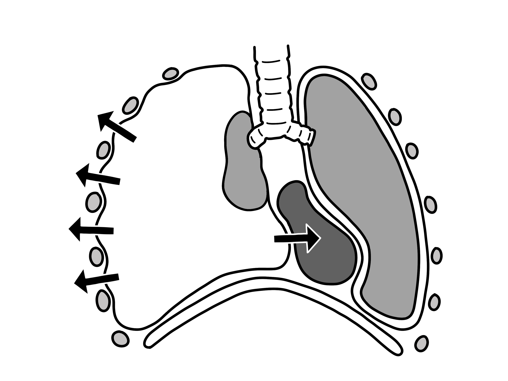
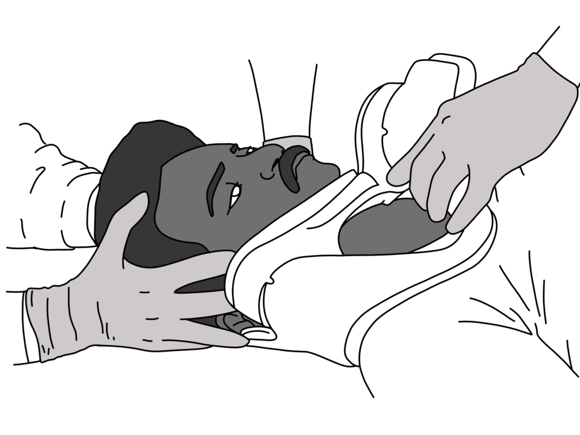
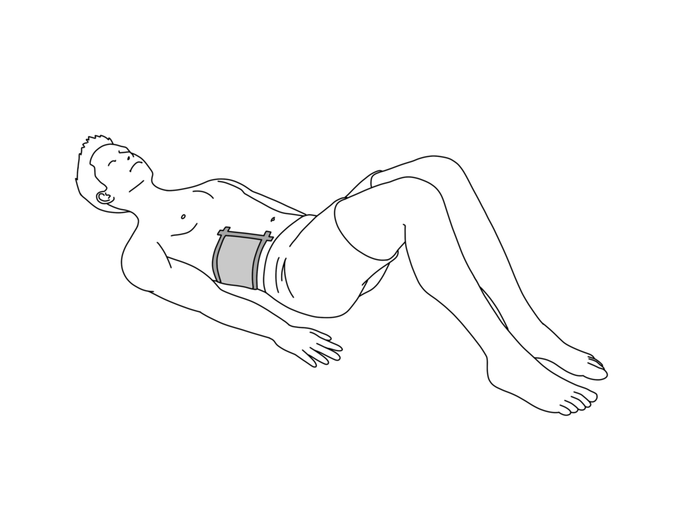
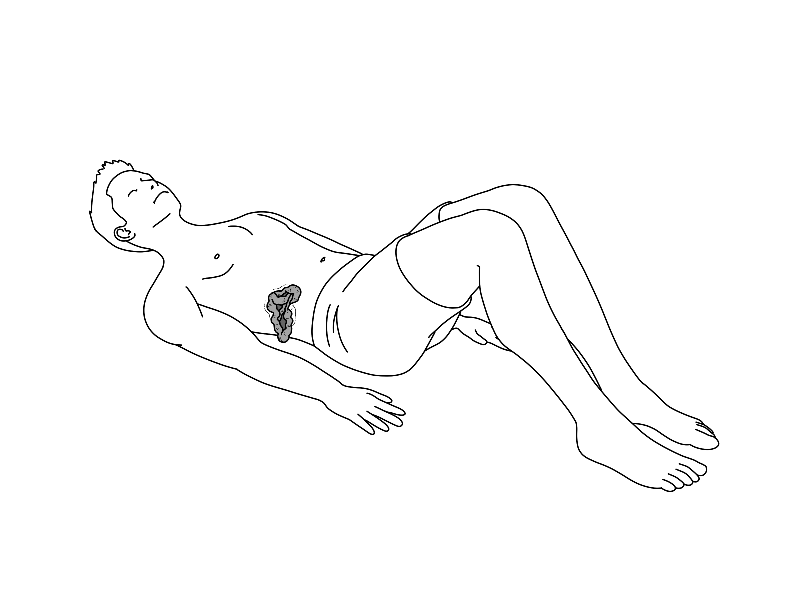
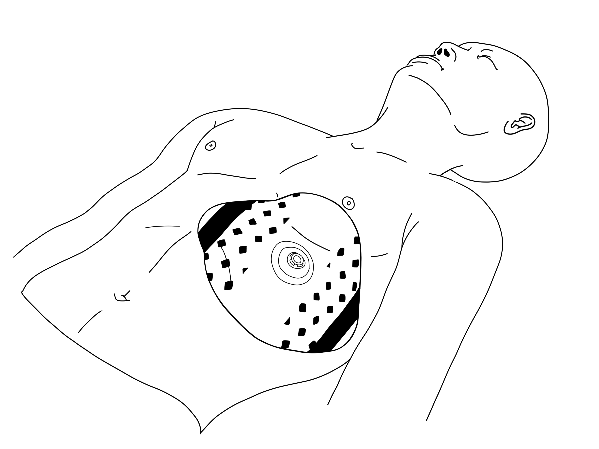

# UNIÃO SERVIÇOS MÉDICOS
## DIRETORIA DE ENSINO, PESQUISA E INSTRUÇÃO PRÉ-HOSPITALAR

---

**MÓDULO H06 — HEMORRAGIAS EM SITUAÇÕES ESPECIAIS**
*Biblioteca Curricular: Controle de Hemorragias Graves (Bleeding Control)*
*Versão Editorial: 1.0.0 — Padrão Editorial USM*
*Carga Horária Teórica: 1 hora | Público-alvo: Socorristas táticos, policiais, bombeiros, equipes de APH e brigadistas*

---

## SUMÁRIO

- [Seção 1 — Em 30 Segundos](#seção-1--em-30-segundos)
- [Seção 2 — Objetivos de Aprendizagem](#seção-2--objetivos-de-aprendizagem)
- [Seção 3 — Introdução e a Complexidade dos Cenários Atípicos de Trauma](#seção-3--introdução-e-a-complexidade-dos-cenários-atípicos-de-trauma)
- [Seção 4 — Fisiopatologia Pediátrica, Geriátrica e Mecanismos Especiais de Lesão](#seção-4--fisiopatologia-pediátrica-geriátrica-e-mecanismos-especiais-de-lesão)
- [Seção 5 — Desenvolvimento dos Subtemas](#seção-5--desenvolvimento-dos-subtemas)
  - [5.1 Ferimentos Profundos e Lesões Complexas com Múltiplos Planos](#51-ferimentos-profundos-e-lesões-complexas-com-múltiplos-planos)
  - [5.2 Hemorragias em Regiões de Difícil Compressão (Nádegas, Períneo e Face)](#52-hemorragias-em-regiões-de-difícil-compressão-nádegas-períneo-e-face)
  - [5.3 Amputações Traumáticas: Manejo Hemostático e Preservação do Coto e Segmento](#53-amputações-traumáticas-manejo-hemostático-e-preservação-do-coto-e-segmento)
  - [5.4 Múltiplos Ferimentos Simultâneos e Triagem de Hemorragias em Massa](#54-múltiplos-ferimentos-simultâneos-e-triagem-de-hemorragias-em-massa)
  - [5.5 Vítimas Pediátricas, Idosos e Populações Específicas](#55-vítimas-pediátricas-idosos-e-populações-específicas)
  - [5.6 Prioridades Táticas e Transferência de Cuidados (Passagem de Caso no APH)](#56-prioridades-táticas-e-transferência-de-cuidados-passagem-de-caso-no-aph)
- [Seção 6 — Quadros Práticos, Algoritmos de Triagem e Matrizes Anatômicas](#seção-6--quadros-práticos-algoritmos-de-triagem-e-matrizes-anatômicas)
- [Seção 7 — Erros Críticos e Mitos no Manejo de Situações Especiais](#seção-7--erros-críticos-e-mitos-no-manejo-de-situações-especiais)
- [Seção 8 — Estudo de Caso Prático Contextualizado (Atropelamento com Múltiplas Vítimas Pediátricas)](#seção-8--estudo-de-caso-prático-contextualizado-atropelamento-com-múltiplas-vítimas-pediátricas)
- [Seção 9 — Pulo do Gato](#seção-9--pulo-do-gato)
- [Seção 10 — Mapa Mental de Hemorragias em Situações Especiais](#seção-10--mapa-mental-de-hemorragias-em-situações-especiais)
- [Seção 11 — O Que Você Precisa Lembrar](#seção-11--o-que-você-precisa-lembrar)
- [Seção 12 — Referências Bibliográficas e Metadados Editoriais](#seção-12--referências-bibliográficas-e-metadados-editoriais)

---

## SEÇÃO 1 — EM 30 SEGUNDOS

> **VISÃO RÁPIDA DE SOBREVIVÊNCIA EM CENÁRIOS COMPLEXOS**
> 1. **Crianças têm pouco sangue:** Uma criança pequena de 15 kg possui apenas cerca de **1,2 litro de sangue**. A perda de uma simples xícara de sangue (250 ml) já representa mais de 20% da sua volemia total, desabando-a em choque descompensado grave [1, 2].
> 2. **Torniquetes em crianças:** O torniquete comercial para adultos (CAT / SOFTT) **deve ser usado em crianças**. Se a circunferência da coxa ou braço for muito fina e a fita não der aperto mecânico, faça preenchimento com gaze hemostática (*wound packing*) e compressão contínua [1, 3].
> 3. **Preservação de membro amputado:** NUNCA coloque a parte decepada diretamente em contato com gelo ou dentro de água fria (congelamento queima os tecidos e inviabiliza o reimplante). **Envolva a parte em gaze estéril seca, feche em saco plástico vedado e coloque o saco dentro de recipiente com gelo e água** [2, 4].
> 4. **Ferimento em nádega e períneo:** Regiões de difícil compressão por apresentarem grandes massas musculares e vasos profundos da pelve (artérias glúteas). Exigem **empacotamento cavitário agressivo (*wound packing*)** contra a asa do osso ilíaco [3, 5].
> 5. **Idosos em uso de anticoagulantes:** Praticantes da terceira idade frequentemente usam varfarina, rivaroxabana ou AAS. Sangramentos mínimos não estancam espontaneamente; o uso de **gazes com Quitosana** é a salvação, pois atuam por atração eletrostática independente da cascata de coagulação [5, 6].
> 6. **Múltiplos ferimentos sangrantes:** Priorize a lesão mais central e de maior calibre (virilha/pescoço antes de antebraço/mão). Se houver dois socorristas, trabalhem simultaneamente aplicando torniquete na perna enquanto o outro empacota o braço [1, 2].

---

## SEÇÃO 2 — OBJETIVOS DE APRENDIZAGEM

Ao concluir o estudo deste módulo avançado, o operador de emergência e socorrista serão capazes de:

1. **Adaptar as diretrizes de hemostasia para ferimentos complexos de difícil acesso anatômico**, incluindo nádegas, períneo, couro cabeludo e face.
2. **Executar com perfeição técnica os protocolos de amputação traumática**, dominando tanto o controle hemorrágico do coto quanto o acondicionamento do segmento decepado para cirurgia de reimplante.
3. **Manejar pacientes pediátricos com perda sanguínea aguda**, calculando os limites volêmicos e adaptando os dispositivos comerciais à anatomia infantil.
4. **Gerenciar hemorragias em idosos e pacientes coagulopatas**, reconhecendo a vulnerabilidade vascular e a indicação prioritária de hemostáticos tópicos.
5. **Estratificar prioridades operacionais em cenários com múltiplas lesões simultâneas**, aplicando a metodologia de triagem tática de sangramentos.
6. **Padronizar a transferência formal de cuidados (passagem de caso)** para as equipes médicas avançadas do SAMU 192 e centros de trauma cirúrgico.

---

## SEÇÃO 3 — INTRODUÇÃO E A COMPLEXIDADE DOS CENÁRIOS ATÍPICOS DE TRAUMA

Nas lições fundamentais dos módulos anteriores (H01 a H05), o socorrista aprendeu a lidar com ferimentos convencionais e lineares: uma laceração isolada no antebraço tratada com torniquete ou uma ferida cavitária na virilha tratada com preenchimento de gaze. Todavia, a realidade do trauma civil em colisões veiculares violentas, esmagamentos por maquinário industrial, desabamentos e incidentes com atiradores ativos raramente apresenta cenários isolados e laboratoriais [1, 2].

O operador de resgate frequentemente depara-se com **situações especiais de altíssima complexidade**:
- Um operário com a perna amputada na altura da coxa e, simultaneamente, um corte profundo na axila oposta;
- Uma criança de 4 anos vítima de atropelamento com sangramento arterial em membro com circunferência menor que a largura padrão do torniquete;
- Um idoso hipertenso em uso crônico de anticoagulantes com laceração na região glútea após queda de altura sobre vergalhão pontiagudo [1, 3, 5].

Nesses ambientes caóticos, a aplicação cega de procedimentos padronizados sem discernimento adaptativo leva ao insucesso terapêutico. O operador treinado da União Serviços Médicos destaca-se exatamente pela sua capacidade de raciocínio clínico e flexibilidade tática: ele sabe improvisar dentro da ciência, calcular perdas volêmicas proporcionais à idade e priorizar intervenções sem paralisar perante a gravidade extrema da cena [2, 4].

---

## SEÇÃO 4 — FISIOPATOLOGIA PEDIÁTRICA, GERIÁTRICA E MECANISMOS ESPECIAIS DE LESÃO

A resposta cardiovascular ao sangramento varia drasticamente nos extremos da idade humana [1, 2, 5]:



*Figura 1 — Fisiopatologia do pneumotórax hipertensivo com colapso pulmonar e desvio mediastinal. Crédito: Baedr-9439. Licença: CC0. Fonte: Wikimedia Commons.*

```
+---------------------------------------------------------------------------------+
|               PECULIARIDADES FISIOPATOLÓGICAS NAS IDADES EXTREMAS               |
|                                                                                 |
|  [ PACIENTE PEDIÁTRICO (CRIANÇAS) ]                                             |
|  - Volemia total reduzida (~ 70 a 80 ml/kg de peso).                            |
|  - Vasoespasmo reflexo potente: Mantém a pressão arterial normal até perder     |
|    mais de 30% a 35% de todo o seu sangue corporal.                             |
|  - "QUEDA EM PENHASCO": Quando a PA desaba, a parada cardíaca ocorre em minutos.|
|  - Sinais precoces: Taquicardia extrema, palidez e tempo de enchimento capilar  |
|    prolongado (> 3 segundos).                                                   |
|                                                                                 |
|  [ PACIENTE GERIÁTRICO (IDOSOS) ]                                               |
|  - Vasos rígidos e ateroscleróticos: Não sofrem vasoconstrição eficaz.          |
|  - Uso crônico de Betabloqueadores: O coração NÃO consegue acelerar para        |
|    compensar a perda de sangue (mascara o choque).                              |
|  - Uso de Anticoagulantes (AAS, Marevan, Eliquis): O sangue não coagula.        |
|  - Choque descompensado instala-se com perdas volêmicas muito menores.          |
+---------------------------------------------------------------------------------+
```

---

## SEÇÃO 5 — DESENVOLVIMENTO DOS SUBTEMAS

### 5.1 Ferimentos Profundos e Lesões Complexas com Múltiplos Planos

Lesões provocadas por armas brancas de lâmina longa, explosões ou fragmentos de acidentes automobilísticos frequentemente criam trajetos profundos em zigue-zague através de múltiplos planos fasciais e musculares [2, 3]:
- **O Fenômeno do Trajeto Falso:** O ponto de entrada da faca na pele pode estar 10 cm distante do ponto onde a artéria foi lacerada no fundo da carne.
- **Técnica de Exploração Digital:** Com a mão enluvada, o socorrista deve introduzir os dedos explorando a cavidade no sentido do sangramento ativo até localizar a ruptura vascular profunda contra o osso, antes de iniciar o empacotamento com gaze [3, 4].

---

### 5.2 Hemorragias em Regiões de Difícil Compressão (Nádegas, Períneo e Face)

Determinadas regiões anatômicas desafiam as regras convencionais do controle de sangramento [1, 3]:



*Figura 2 — Aplicação técnica de colar cervical para restrição de movimento. Crédito: Baedr-9439. Licença: CC0. Fonte: Wikimedia Commons.*

#### 1. Região Glútea (Nádegas)
- As artérias glúteas superior e inferior emergem diretamente da pelve através do forame isquiático maior. Lesões perfurantes nas nádegas podem sangrar para o interior da cavidade pélvica.
- **Manejo:** A aplicação de torniquete é impossível. O tratamento obrigatório é o **Wound Packing agressivo com gaze hemostática**, direcionando o empacotamento em direção à asa do osso ilíaco, seguido de compressão com o peso do corpo [3, 5].

#### 2. Face e Couro Cabeludo
- O couro cabeludo é alimentado por cinco grandes artérias com ricas anastomoses, vertendo volumes impressionantes de sangue que escorrem pelos olhos e assustam os presentes.
- **Manejo:** Não é local de torniquete nem de *packing* cavitário (risco de fratura de crânio com afundamento). Aplique **compressão direta focal firme com compressa estéril** sobre o osso craniano íntegro e envolva com bandagem elástica circunferencial tipo turbante [2, 4].

---

### 5.3 Amputações Traumáticas: Manejo Hemostático e Preservação do Coto e Segmento

A amputação traumática de extremidades impõe duas missões simultâneas e interdependentes ao socorrista: **salvar a vida da vítima através da hemostasia imediata do coto** e **preservar a viabilidade biológica do membro amputado para viabilizar o reimplante microcirúrgico** [2, 4]:

#### 1. Manejo do Coto Amputado:
- Aplique imediatamente um **Torniquete Comercial de Molinete** de 5 a 7 cm acima da borda do coto (ou alto na raiz do membro se a amputação for muito alta).
- Cubra a extremidade do coto com gazes estéreis umedecidas em soro fisiológico e proteja com atadura suave.
- Nunca faça suturas provisórias nem lave o interior dos tecidos expostos com antissépticos irritantes [1, 2].

#### 2. Preservação Correta do Segmento Decepado (A Regra dos Três Recipientes):



*Figura 3 — Proteção com curativo úmido e oclusivo em ferimento abdominal aberto. Crédito: Baedr-9439. Licença: CC0. Fonte: Wikimedia Commons.*

```
+---------------------------------------------------------------------------------+
|                   PROTOCOLO DE PRESERVAÇÃO DE MEMBRO AMPUTADO                   |
|                                                                                 |
|  [ PASSO 1 ]: Limpe detritos grosseiros do membro amputado com soro fisiológico.|
|  [ PASSO 2 ]: Envolva o membro em gaze estéril ou pano limpo SECO ou levemente |
|               umedecido (NUNCA encharcado).                                     |
|  [ PASSO 3 ]: Coloque o membro embrulhado DENTRO DE UM SACO PLÁSTICO VEDADO.   |
|               (O membro NÃO pode ter contato direto com a água ou o gelo).      |
|  [ PASSO 4 ]: Coloque esse saco plástico lacrado DENTRO DE UMA CAIXA TÉRMICA    |
|               OU RECIPIENTE CONTENDO UMA MISTURA DE GELO E ÁGUA (4 ºC).         |
|                                                                                 |
|  [ PROIBIÇÃO FATAL ]: NUNCA COLOQUE O MEMBRO DIRETO NO GELO SECO OU GELADEIRA. |
|  O congelamento destrói a microcirculação celular e inviabiliza o reimplante!  |
+---------------------------------------------------------------------------------+
```

---

### 5.4 Múltiplos Ferimentos Simultâneos e Triagem de Hemorragias em Massa

Em incidentes com múltiplos ferimentos na mesma vítima (ex.: estilhaços de explosão ou atropelamento com múltiplas fraturas expostas), a intervenção deve seguir a **Hierarquia de Letalidade Anatômica** [1, 2]:
1. **Prioridade 1:** Lesões arteriais juncionais com jatos (virilha e axila) — exigem *wound packing* imediato por ameaça de morte em menos de 120 segundos.
2. **Prioridade 2:** Lesões arteriais de membros (braços e pernas) — aplicação de torniquetes sucessivos em cada membro afetado.
3. **Prioridade 3:** Sangramentos venosos e lacerações musculares sem jato pulsátil — compressão direta com bandagens elásticas.
4. **Prioridade 4:** Escoriações superficiais e sangramentos capilares — curativo protetor tardio após estabilização hemodinâmica [1, 4].

---

### 5.5 Vítimas Pediátricas, Idosos e Populações Específicas

A adaptação técnica para perfis populacionais específicos salva vidas que seriam perdidas pela rigidez doutrinária [1, 5]:

#### O Uso de Torniquetes em Crianças:
- As diretrizes internacionais do *Pediatric Trauma Society* e do *PHTLS* estabelecem que **torniquetes comerciais modernos de adultos (como o CAT Gen 7) podem e devem ser utilizados com segurança em crianças e lactentes** quando há sangramento arterial com ameaça à vida.
- Em crianças maiores de 2 anos, a fita do CAT oclui perfeitamente a artéria femoral ou braquial.
- *Cenário Crítico (Membro Muito Fino):* Se a perna de um bebê for tão fina que a fita dê duas voltas completas e a fivela bata na base plástica sem conseguir apertar, a solução mandatória é **abandonar o torniquete e aplicar Compressão Direta Contínua com Gaze Hemostática ou Wound Packing com a ponta do dedo polegar** [1, 3].



*Figura 4 — Apresentação clínica de trauma abdominal aberto com evisceração antes da proteção úmida. Crédito: Baedr-9439. Licença: CC0. Fonte: Wikimedia Commons.*

#### Gestantes com Hemorragia Grave:
- A volemia da mulher grávida no terceiro trimestre aumenta em até 50%. A perda de sangue afeta inicialmente o fluxo placentário antes de alterar a pressão da mãe.
- Ao posicionar a gestante deitada, **incline seu corpo suavemente para o lado esquerdo (decúbito lateral esquerdo a 15–30 graus)** colocando uma almofada ou mochila sob o quadril direito. Isso impede que o útero gravídico comprima a veia cava inferior contra a coluna, mantendo o retorno venoso [2, 4].

---

### 5.6 Prioridades Táticas e Transferência de Cuidados (Passagem de Caso no APH)

Ao chegar a equipe de Suporte Avançado do SAMU 192 ou ao desembarcar na sala de choque cirúrgico do hospital de trauma, o socorrista deve fornecer um relatório estruturado segundo o protocolo mnemônico **MIST** [2, 6]:

```
+---------------------------------------------------------------------------------+
|                   PROTOCOLO MIST DE PASSAGEM DE CASO CLÍNICO                    |
|                                                                                 |
|  [ M - MECHANISM ]: "Vítima atropelada por caminhão com esmagamento de membro." |
|  [ I - INJURIES ]:  "Amputação de perna direita + corte juncional em virilha."  |
|  [ S - SIGNS ]:     "Pulso 130 bpm, pálido, Glasgow 13, pressão arterial caindo."|
|  [ T - TREATMENTS]: "Torniquete em coxa às 10h15; Wound Packing com Celox na   |
|                     virilha e manta térmica aplicada."                          |
+---------------------------------------------------------------------------------+
```

---

---

## SEÇÃO 6 — QUADROS PRÁTICOS, ALGORITMOS DE TRIAGEM E MATRIZES ANATÔMICAS

### Matriz Decisória em Cenários Especiais de Sangramento

| CENÁRIO CLÍNICO | PARTICULARIDADE ANATÔMICA | INTERVENÇÃO DE ESCOLHA | O QUE NUNCA FAZER |
| :--- | :--- | :--- | :--- |
| **Amputação Traumática** | Coto ósseo exposto com vasos retraídos. | **Torniquete comercial 5 a 7 cm acima** + acondicionar membro em saco em gelo/água. | Colocar o membro amputado diretamente no gelo ou dentro d'água pura. |
| **Ferimento em Nádega** | Artérias glúteas profundas contra a pelve. | **Wound Packing profundo com gaze hemostática** + compressão corporal. | Tentar colocar torniquete na bacia; colocar curativo plano frouxo. |
| **Criança com Coxa Fina** | Circunferência menor que a fivela do torniquete. | Compressão direta contínua com polegares sobre o osso fêmur + gaze hemostática. | Desistir do socorro; usar cadarço de sapato ou arame fino. |
| **Ferimento no Couro Cabeludo** | Vascularização rica; calota craniana subjacente. | Compressão direta com gaze estéril + atadura elástica em turbante. | Fazer wound packing craniano se houver suspeita de afundamento ósseo. |
| **Múltiplos Ferimentos Graves** | Múltiplos pontos de sangramento ativo simultâneos. | Priorizar virilhas/axilas com packing e instalar torniquetes sucessivos em membros. | Tentar fazer curativos perfeitos em escoriações antes de parar os jatos. |



*Figura 5 — Selo de tórax valvulado aplicado em ferimento torácico penetrante (pneumotórax aberto). Crédito: Baedr-9439. Licença: CC0. Fonte: Wikimedia Commons.*

---

## SEÇÃO 7 — ERROS CRÍTICOS E MITOS NO MANEJO DE SITUAÇÕES ESPECIAIS

1. **Colocar membro amputado diretamente sobre pedras de gelo:** A temperatura de zero grau congela a água intracelular das células vasculares, formando cristais de gelo que rasgam a membrana dos vasos e impedem que o cirurgião consiga suturar as artérias no microscópio [2, 4].
2. **Lavar o coto de amputação com álcool, iodo ou sabão:** A aplicação de substâncias químicas em carne viva causa necrose celular química massiva, matando os tecidos que o cirurgião precisará utilizar para o fechamento cirúrgico [2, 4].
3. **Não usar torniquete em criança por medo de lesão vascular:** As artérias infantis são mais elásticas e toleram o torniquete com extrema segurança. Deixar uma criança sangrar até a morte por preconceito contra o torniquete é erro grave e indesculpável [1, 3].
4. **Remover facas ou objetos empalados em áreas de difícil acesso:** Puxar um vergalhão cravado na nádega ou coxa drena a volemia imediatamente. O objeto deve ser imobilizado no lugar [2, 4].
5. **Esquecer de aquecer o paciente com ferimentos múltiplos:** Em politraumatizados graves, a hipotermia se instala em menos de 10 minutos no asfalto. Mantenha a manta térmica aluminizada como prioridade absoluta paralela ao controle do sangramento [3, 5].

---

## SEÇÃO 8 — ESTUDO DE CASO PRÁTICO CONTEXTUALIZADO (ATROPELAMENTO COM MÚLTIPLAS VÍTIMAS PEDIÁTRICAS)

### Cenário: Colisão em Ponto de Ônibus Escolar
Às 12h10min, na saída de uma escola primária, uma caminhonete perde o controle e colide contra o abrigo de pedestres, atingindo duas crianças que aguardavam na calçada. O motorista foge. A socorrista voluntária Renata, enfermeira civil de folga capacitada na doutrina USM, estava na padaria em frente e corre para a cena com luvas e sua mochila de emergência.

Ao chegar, Renata depara-se com duas vítimas graves caídas no solo:
- **Vítima 1 (Lucas, 6 anos, ~20 kg):** Apresenta amputação traumática completa da perna esquerda abaixo do joelho provocada pelo choque direto contra a viga metálica do ponto. O coto sangra em jatos pulsáteis contínuos no asfalto.
- **Vítima 2 (Sofia, 8 anos, ~26 kg):** Apresenta uma laceração profunda de 8 cm na dobra da virilha direita (área juncional) causada por uma chapa de aço retorcida da estrutura, com sangue vermelho-escuro borbulhando em grande volume e poça crescente.

### Aplicação da Gestão Estratégica de Situações Especiais USM:
1. **Triagem Rápida e Comando de Cena:** Renata avalia as duas crianças em 5 segundos. As duas possuem hemorragias com risco de morte iminente. Ela grita para um comerciante que correu ao local: *"Chame o 192 e o 193 imediatamente! Diga que temos duas crianças com amputação e ferimento juncional grave por atropelamento!"*.
2. **Atendimento Prioritário à Vítima 1 (Lucas - Amputação Pediátrica):**
   - Renata retira o torniquete CAT Gen 7 da bolsa.
   - Posiciona a fita na coxa esquerda de Lucas, 8 cm acima do coto de amputação.
   - Puxa o velcro com força máxima: a fita ajusta-se perfeitamente à circunferência da coxa infantil.
   - Gira a haste do molinete por duas voltas completas: o sangramento arterial estanca 100%. Trava no clipe e anota o horário ("12h12").
   - Pede a uma professora da escola que chegou ao local para segurar o coto protegido com gaze estéril e cobrir Lucas com a manta térmica aluminizada da sua bolsa.
3. **Atendimento Imediato à Vítima 2 (Sofia - Ferimento Juncional em Virilha):**
   - Renata desloca-se para Sofia aos 45 segundos do início do socorro.
   - Identifica que a lesão na virilha é juncional (onde o torniquete não cabe).
   - Introduz os dois polegares no interior da ferida da virilha, sentindo o feixe vascular femoral profundo contra a borda do osso ilíaco. A compressão digital estanca o fluxo no fundo da lesão.
   - Com a mão livre, abre um pacote de gaze hemostática com quitosana (*Celox Z-Fold*) e alimenta a cavidade com a técnica "dedo sobre dedo", compactando a gaze até o fundo e formando um montículo externo firme.
   - Descarrega o peso do tronco sobre a virilha de Sofia e mantém compressão contínua por 3 minutos ininterruptos.
   - O sangramento é contido com sucesso. Aplica bandagem elástica cruzada em "oito" ao redor da bacia para estabilizar a pressão mecânica.
4. **Preservação da Perna Amputada:**
   - Renata orienta o comerciante a recolher a perna decepada de Lucas.
   - O membro é envolvido em gazes estéreis limpas, colocado dentro de um saco plástico vedado e o saco é posicionado sobre uma bacia com gelo e água trazida da padaria.
5. **Desfecho e Passagem de Caso:**
   - As viaturas do SAMU e do Corpo de Bombeiros chegam em 9 minutos.
   - Renata faz a passagem estruturada pelo protocolo MIST aos médicos socorristas.
   - Lucas e Sofia são conduzidos ao centro cirúrgico do Hospital Universitário Infantil. Lucas foi submetido a reimplante microcirúrgico da perna com sucesso; Sofia teve a veia femoral reparada sem déficits. As duas crianças sobreviveram sem sequelas cerebrais graças à priorização técnica em múltiplos ferimentos pediátricos.

---

## SEÇÃO 9 — PULO DO GATO

> **MACETES OPERACIONAIS EM CENÁRIOS ESPECIAIS DE TRAUMA**
>
> 1. **O Saco Plástico com Zíper no Kit:** Mantenha sempre dois sacos plásticos com fecho hermético (tipo Ziploc) de 5 litros dentro da sua maleta de controle de hemorragia. Eles não ocupam espaço algum dobrados. Em caso de amputação de mão, pé ou dedo, você tem imediatamente uma embalagem impermeável estéril pronta para proteger o membro antes de colocar no gelo [2, 4].
> 2. **A Fita Microporosa nas Sobrancelhas no Sangramento Facial:** Cortes na testa e sobrancelhas sangram tanto que cegam a vítima com sangue nos olhos, gerando pânico. Antes de enfaixar, passe duas gazes estéreis sobre o corte, pressione com os polegares e passe uma tira de esparadrapo larga puxando as bordas da pele uma contra a outra ("sutura adesiva provisória"). O sangue cessa na hora e libera o campo visual [2, 3].
> 3. **O Torniquete Sobreposto em Perna Fina:** Se você for aplicar torniquete em um membro muito fino e a ponta do velcro sobrar muito, dê duas voltas completas com a fita ao redor do membro antes de passar pela fivela. A dupla volta compensa a circunferência reduzida e permite que a tração mecânica do molinete funcione com perfeição [1, 3].

---

## SEÇÃO 10 — MAPA MENTAL DE HEMORRAGIAS EM SITUAÇÕES ESPECIAIS

```
                       HEMORRAGIAS EM SITUAÇÕES ESPECIAIS
                                        │
        ┌───────────────────────────────┼───────────────────────────────┐
        │                               │                               │
  [ AMPUTAÇÕES TRAUMÁTICAS ]    [ VÍTIMAS ESPECIAIS ]           [ REGIÕES DE DIFÍCIL COMPRESSÃO ]
        │                               │                               │
 ┌──────┴──────┐                 ┌──────┴──────┐                 ┌──────┴──────┐
 │ COTO:       │                 │ CRIANÇAS:   │                 │ GLÚTEO /    │
 │ Torniquete  │                 │ Usar CAT de │                 │ PERÍNEO:    │
 │ 5-7 cm acima│                 │ adulto! Se  │                 │ Wound       │
 └──────┬──────┘                 │ fino: dedos │                 │ Packing     │
        │                        └──────┬──────┘                 │ profundo!   │
        ▼                               │                        └──────┬──────┘
  SEGMENTO DECEPADO:                    ▼                               │
  Gaze seca -> Saco plástico     IDOSOS / ANTICOAGULADOS:               ▼
  vedado -> Recipiente com       Usar gaze com Quitosana         FACE / COURO CABELUDO:
  GELO E ÁGUA (4 ºC)             (Atração eletrostática)         Compressão focal +
  NUNCA gelo direto!                                             Enfaixamento em turbante
```

---

## SEÇÃO 11 — O QUE VOCÊ PRECISA LEMBRAR

- Crianças possuem volemia reduzida; perdas volêmicas pequenas já desencadeiam choque descompensado grave.
- Torniquetes comerciais para adultos devem ser usados em crianças; se o membro for excessivamente fino, use compressão manual com gaze hemostática.
- No membro amputado, envolva em gaze estéril seca, lacre em saco plástico e coloque o saco em gelo com água (nunca no gelo direto).
- Lesões em nádegas e períneo exigem preenchimento de ferida (*wound packing*) agressivo contra o osso ilíaco.
- Em idosos e pacientes anticoagulados, utilize preferencialmente gazes com Quitosana pela independência da cascata de coagulação.
- A passagem de caso pré-hospitalar deve seguir o protocolo estruturado MIST (Mecanismo, Lesões, Sinais e Tratamentos).

---

## SEÇÃO 12 — REFERÊNCIAS BIBLIOGRÁFICAS E METADADOS EDITORIAIS

### Referências Científicas e Normativas

1. AMERICAN COLLEGE OF SURGEONS (ACS). **STOP THE BLEED®: Bleeding Control Basic v. 2.0 Course Manual**. Chicago, IL: ACS Committee on Trauma, 2020.
2. NATIONAL ASSOCIATION OF EMERGENCY MEDICAL TECHNICIANS (NAEMT). **PHTLS: Prehospital Trauma Life Support**. 10. ed. Burlington, MA: Jones & Bartlett Learning, 2023.
3. COMMITTEE ON TACTICAL COMBAT CASUALTY CARE (CoTCCC). **Tactical Combat Casualty Care (TCCC) Guidelines for Medical Personnel**. Joint Trauma System, U.S. Department of Defense, 2021. Atualizado em 2023.
4. AMERICAN COLLEGE OF SURGEONS (ACS). **ATLS: Advanced Trauma Life Support — Student Course Manual**. 10. ed. Chicago, IL: ACS, 2018.
5. PEDIATRIC TRAUMA SOCIETY (PTS). **Clinical Practice Guideline: Tourniquet Use in Pediatric Trauma**. *Journal of Trauma and Acute Care Surgery*, v. 89, n. 4, p. 820-827, 2020.
6. HATTON, K. W. et al. **Topical Hemostatic Agents in Surgery and Trauma: A Comprehensive Review of Mechanisms, Efficacy, and Safety**. *Journal of Trauma and Acute Care Surgery*, v. 84, n. 4, p. 658-668, 2018.
7. MINISTÉRIO DA SAÚDE (BRASIL). **Portaria GM/MS nº 2.048, de 5 de novembro de 2002**. Regulamento Técnico dos Sistemas Estaduais de Urgência e Emergência. Brasília, DF: Ministério da Saúde, 2002.
8. WORLD HEALTH ORGANIZATION (WHO). **Guidelines for Trauma Quality Improvement Programmes**. Genebra: WHO, 2019.
9. ASSOCIAÇÃO BRASILEIRA DE NORMAS TÉCNICAS (ABNT). **ABNT NBR 14276:2020: Brigada de incêndio e emergência — Requisitos e procedimentos**. Rio de Janeiro: ABNT, 2020.
10. BRASIL. **Decreto-Lei nº 2.848, de 7 de dezembro de 1940**. Código Penal Brasileiro (Art. 135 - Omissão de Socorro). Brasília, DF: Presidência da República, 1940.
11. CANNON, J. W. et al. **Damage Control Resuscitation in Patients with Severe Trauma: A Practice Management Guideline from the Eastern Association for the Surgery of Trauma**. *Journal of Trauma and Acute Care Surgery*, v. 82, n. 3, p. 605-617, 2017.
12. ROSSOUW, R. et al. **Tourniquet Use in Civilian Prehospital Trauma: A Systematic Review and Meta-Analysis**. *Prehospital Emergency Care*, v. 25, n. 3, p. 417-427, 2021.

---

### Metadados Editoriais Institucionais

| CAMPO | ESPECIFICAÇÃO TÉCNICA |
| :--- | :--- |
| **Identificador do Módulo** | MÓDULO H06 — Hemorragias em Situações Especiais |
| **Biblioteca Curricular** | Controle de Hemorragias Graves (*Bleeding Control*) |
| **Instituição Responsável** | União Serviços Médicos — Ensino e Instrução Pré-Hospitalar |
| **Padrão Gráfico e Editorial** | Diretrizes Editoriais Integradas LURIA / USM |
| **Status Editorial** | Aguardando Aprovação Científica |
| **Data da Revisão Técnica** | Outubro de 2026 |
| **Versão Curricular** | Versão 1.0.0 — Revisão Quinquenal Vigente |
| **Classificação de Acesso** | Conteúdo Didático Restrito aos Treinamentos e Capacitações da União Serviços Médicos |
