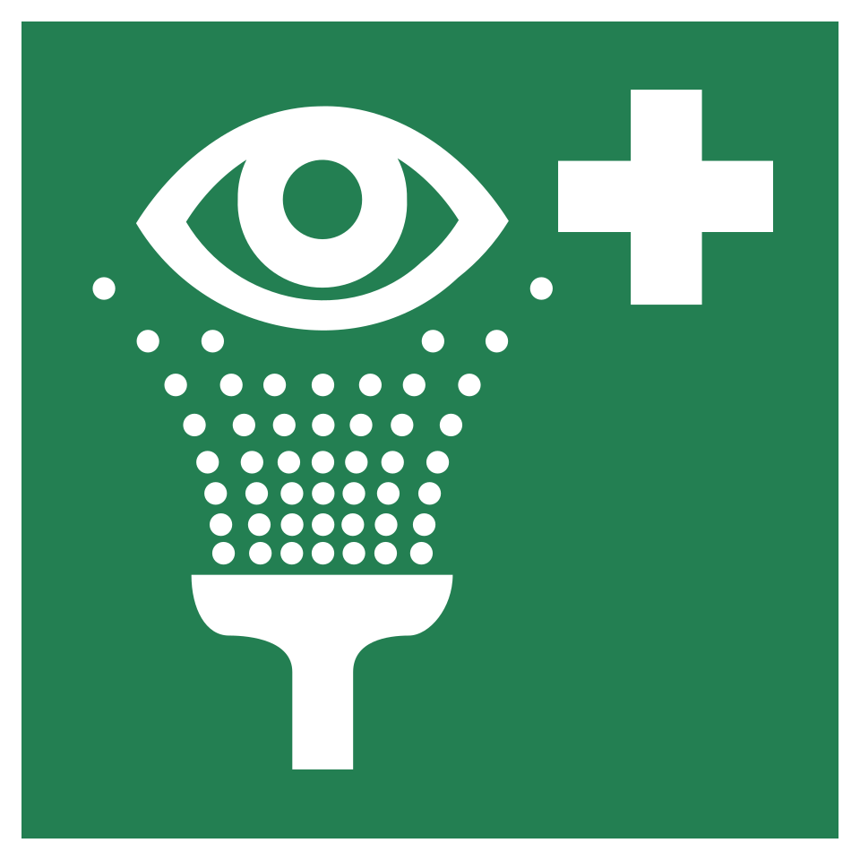
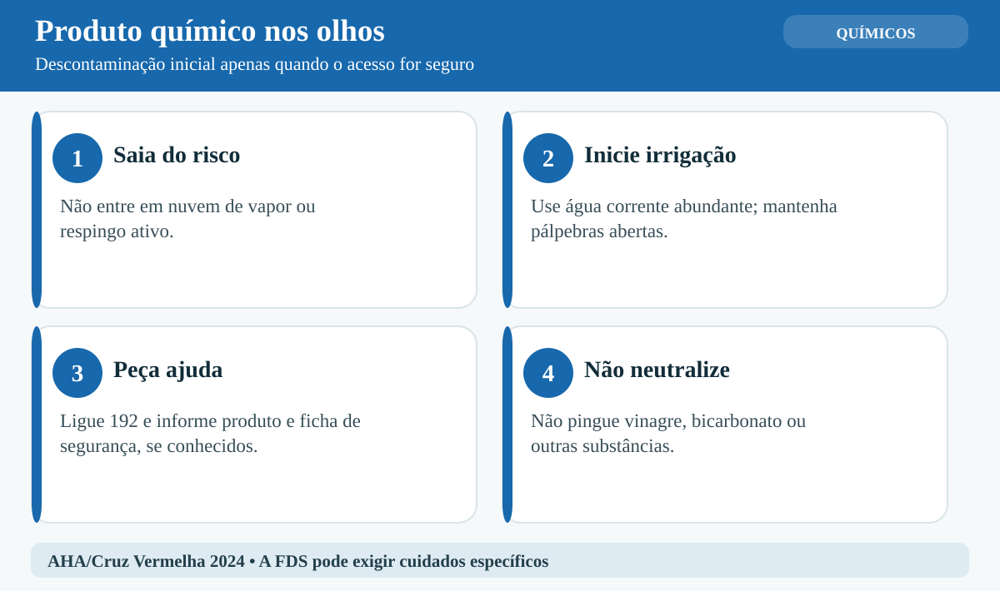
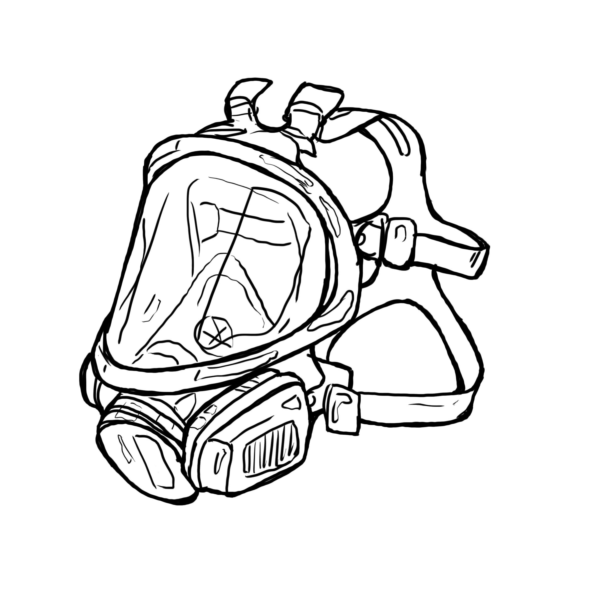
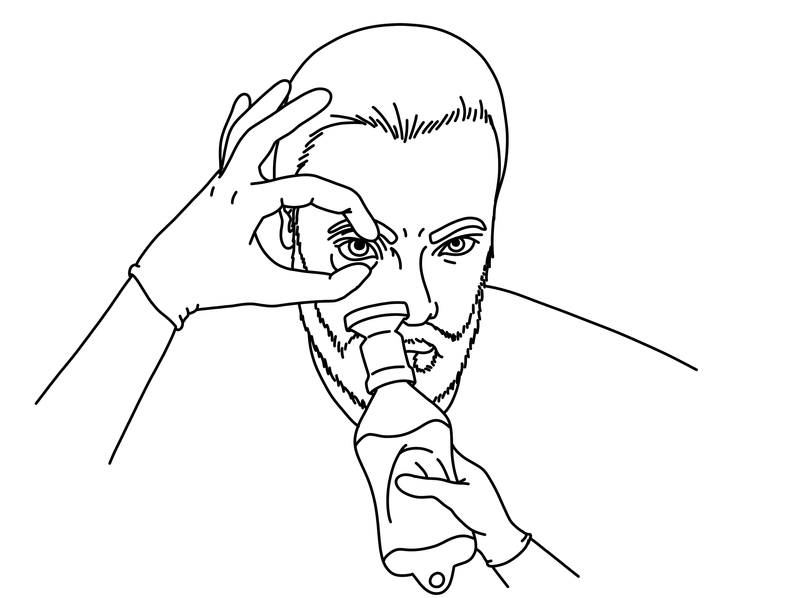
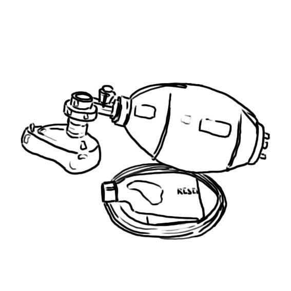

# UNIÃO SERVIÇOS MÉDICOS
## DIRETORIA DE ENSINO, PESQUISA E INOVAÇÃO — DEPI
### PROGRAMA DE FORMAÇÃO CONTINUADA EM ATENDIMENTO PRÉ-HOSPITALAR E SEGURANÇA OCUPACIONAL
---
**Biblioteca Temática:** Primeiros Socorros em Empresas (Normas Regulamentadoras)  
**Módulo:** T03 — Emergências com Substâncias Químicas  
**Código Curricular:** USM-EMP-T03  
**Carga Horária Equivalente:** 45 minutos (1 hora teórica)  
**Público-Alvo:** Trabalhadores industriais, operadores químicos, integrantes de CIPA e brigadistas  
**Status Editorial:** Revisão Final Concluída — Aguardando Homologação Médica  

---

## GUIA DE ATUAÇÃO — PARA QUEM NÃO É DA ÁREA DA SAÚDE

> **EM UMA EMERGÊNCIA REAL:** Proteja-se, peça ajuda e ligue **192 (SAMU)**. Para fogo, resgate em altura, água, espaço confinado ou ambiente perigoso, ligue **193 (Bombeiros)**. Diga o endereço e siga as instruções da central. Este roteiro orienta as primeiras ações, mas não substitui o treino supervisionado das técnicas práticas.

### Situação: Exposição química: proteger, afastar e irrigar

**Reconheça os sinais:** Vazamento, fumaça ou vapor irritante, cheiro químico, pele ardendo ou produto nos olhos.

### O que fazer — passo a passo

1. Não entre em nuvem química. Afaste pessoas para área ventilada e mantenha-se fora do vazamento.
2. Acione 193 e o plano de emergência. Informe nome do produto, se conhecido.
3. Se a pessoa já estiver em área segura, retire roupas contaminadas quando for possível fazê-lo sem contaminar você.
4. Para respingos nos olhos, irrigue imediatamente com água abundante, mantendo as pálpebras abertas, conforme orientação de segurança do produto.
5. Para pele exposta, remova o produto superficial com cuidado e lave com água abundante conforme ficha de segurança.
6. Não retorne à área contaminada. Aguarde profissionais de descontaminação.
7. Se houver falta de ar, confusão ou desmaio, acione também 192 e observe respiração.

### Não faça isto

Não neutralize ácidos com bases. Não provoque vômito, não dê leite e não tente resgate sem proteção adequada.

### Exercício prático de aprendizagem

Use ficha de segurança fictícia para treinar identificação de produto, isolamento e chamada.

**Ao entregar a vítima:** informe horário de início, mudanças na respiração e na consciência, riscos e medidas aplicadas.

**Limites:** não faça procedimentos invasivos, administração de fármacos não prescritos, resgates técnicos ou intervenções que dependam de habilitação profissional. Pratique presencialmente RCP, DEA, controle de sangramento e desengasgo em manequins antes de assumir atendimento.

**Referências operacionais:** Ministério da Saúde — SAMU 192 (https://www.gov.br/saude/pt-br/composicao/saes/samu-192/samu-192); AHA/AAP — RCP e primeiros socorros 2025 (https://cpr.heart.org/en/resuscitation-science/cpr-and-ecc-guidelines); AHA/Cruz Vermelha — Primeiros Socorros 2024 (https://cpr.heart.org/en/resuscitation-science/2024-first-aid-guidelines).

---

## 1. EM 30 SEGUNDOS (SUMÁRIO EXECUTIVO DE RESPOSTA RÁPIDA)

Emergências com produtos químicos industriais exigem resposta metódica: **nunca se torne a segunda vítima**. A contaminação química ocorre por via cutânea, ocular, inalatória ou digestiva. Frente a respingos de substâncias corrosivas (ácidos e bases fortes), a única intervenção pré-hospitalar com evidência robusta para estancar a necrose tecidual e salvar a visão é a **descontaminação imediata por irrigação contínua com água corrente limpa e abundante (chuveiro de emergência e lava-olhos)** por no mínimo **15 a 20 minutos ininterruptos**, retirando roupas contaminadas sob a ducha.

É estritamente proibido tentar "neutralizar" o produto químico na pele (aplicar vinagre sobre soda cáustica ou bicarbonato sobre ácido), pois a reação exotérmica violenta libera calor intenso, transformando queimadura química em queimadura térmica de terceiro grau. A identificação das substâncias pelo Sistema Globalmente Harmonizado (GHS) e Fichas com Dados de Segurança (FDS / SDS segundo ABNT NBR 14725) orienta a proteção da equipe e o suporte médico. Em contaminação inalatória, a remoção da vítima de ambiente contaminado deve ficar a cargo de equipe treinada com proteção adequada; caso contrário, isole a área a barlavento, acione o PAE, Bombeiros (193), SAMU (192) e CIATox (0800 722 6001).

---

## 2. OBJETIVOS DE APRENDIZAGEM E COMPETÊNCIAS OPERACIONAIS

Ao concluir este módulo didático, o socorrista e trabalhador estará capacitado a:

1. **Classificar as vias de contaminação e os mecanismos lesivos** de substâncias corrosivas (ácidos e álcalis), solventes orgânicos e gases tóxicos/asfixiantes.
2. **Interpretar a sinalização de segurança, rótulos GHS e fichas de segurança (FDS / FISPQ)** conforme ABNT NBR 14725 e NR-26 do MTE.
3. **Executar a descontaminação dérmica e ocular imediata**, utilizando chuveiros e lava-olhos de emergência de acordo com a norma ANSI/ISEA Z358.1.
4. **Compreender o risco letal da neutralização química empírica**, adotando exclusivamente a irrigação hídrica farta.
5. **Reconhecer a intoxicação inalatória aguda**, identificando sinais de edema de glote, broncoespasmo e hipóxia por gases industriais.
6. **Delimitar as zonas de controle de cena (quente, morna e fria)**, garantindo a autoproteção e o acionamento sincronizado dos serviços de emergência.

---

## 3. INTRODUÇÃO, CONTEXTO INDUSTRIAL E RELEVÂNCIA EPIDEMIOLÓGICA

**LEITURA GUIADA — COMECE AQUI:** Produto químico não identificado é risco também para quem tenta socorrer. Observe rótulos à distância, isole a área e peça a equipe competente. A lavagem de pele e olhos depende do produto e só deve ocorrer em local seguro.

O uso de produtos químicos é ubíquo no parque produtivo brasileiro, abrangendo indústrias petroquímicas, metalúrgicas, alimentícias, galvanoplastia e serviços de manutenção. Segundo dados da Fundacentro e da OIT, acidentes químicos respondem por expressiva taxa de cegueira e incapacidade permanente de trabalhadores.

Diferente do trauma mecânico, onde a energia lesiva dissipa-se no instante do impacto, o agente químico agressor **permanece ativo e destruindo tecido biológico enquanto não for removido ou diluído por completo**. Um atraso de meros 30 segundos no início da irrigação ocular ou cutânea pode significar a perda irreversível da visão ou a necrose profunda de tecidos moles. 

Conforme preconizam as Normas Regulamentadoras NR-01, NR-07 e NR-26, as organizações devem treinar os trabalhadores para o reconhecimento de perigos e resposta imediata. No APH industrial, o voluntarismo desprovido de técnica converte o pretendido socorrista em uma nova vítima grave, saturando e inviabilizando a resposta médica na cena.

---

## 4. FISIOPATOLOGIA DA AGRESSÃO QUÍMICA

> [!NOTE]
> **Por que isso acontece?** Algumas substâncias irritam tecidos, outras causam queimaduras químicas ou comprometem a respiração. A reação de neutralizar um ácido com uma base pode produzir calor e piorar a lesão. Por isso, a informação do produto e a lavagem orientada são essenciais.

Para atuar com exatidão, o socorrista ocupacional precisa compreender o comportamento biológico dos agentes químicos:

### A. Queimaduras por Ácidos Fortes (Necrose de Coagulação)
Ácidos fortes (ácido sulfúrico - H₂SO₄, ácido clorídrico - HCl e ácido nítrico - HNO₃) possuem pH inferior a 2:
- Provocam desnaturação imediata das proteínas teciduais com formação de coágulos insolúveis.
- Produzem uma escara espessa e relativamente impermeável no ponto de contato (necrose de coagulação).
- Essa escara funciona como uma barreira física parcial que limita a penetração rápida em planos anatômicos profundos.
- **Exceção crítica — Ácido Fluorídrico (HF):** O íon fluoreto (F⁻) penetra profundamente sem formar escara superficial precoce, sequestra cálcio e magnésio séricos e celulares, gerando hipocalcemia fulminante com arritmias cardíacas ventriculares fatais e dor óssea extrema. Exige aplicação imediata de gel de gluconato de cálcio e suporte médico urgente.

### B. Queimaduras por Bases / Álcalis Fortes (Necrose de Liquefação)
Bases fortes (hidróxido de sódio/soda cáustica - NaOH, hidróxido de potássio - KOH e amônia) possuem pH superior a 11,5 e causam as lesões químicas mais destrutivas:
- Provocam saponificação dos lipídios celulares e desnaturação de glicoproteínas.
- Dissolvem a matriz tecidual sem gerar barreiras protetoras (necrose de liquefação).
- O agente alcalino penetra continuamente na profundidade dos tecidos durante horas se não for lavado abundantemente.
- No olho, o álcali atravessa a córnea em menos de 15 segundos, lesando estruturas internas, gerando catarata química, glaucoma agudo e cegueira.

### C. Absorção Sistêmica e Toxicocinética
Substâncias lipossolúveis (solventes halogenados, fenol e inseticidas organofosforados) são absorvidas rapidamente através da pele íntegra, causando coma, arritmias graves, bloqueio enzimático (crise colinérgica por organofosforados) ou metemoglobinemia por anilinas.

---

## 5. DESENVOLVIMENTO DOS SUBTEMAS OFICIAIS DO CURRÍCULO

### 5.1. Tipos de Exposição a Substâncias Químicas no Ambiente Laboral

A interação danosa ocorre primordialmente por quatro vias:
1. **Exposição Cutânea:** É a mais comum na indústria, oriunda de respingos, vazamento em flanges, rupturas de tubulações ou imersão acidental. A gravidade depende do tempo de contato, concentração e pH do produto.
2. **Exposição Ocular:** Emergência médica e cirúrgica absoluta. O contato gera dor lancinante, blefaroespasmo reflexo severo (as pálpebras fecham-se involuntariamente, aprisionando o produto cáustico contra a córnea), queimadura conjuntival e risco iminente de perfuração ocular.
3. **Exposição Inalatória:** Resulta da inalação de fumos, vapores ou gases:
   - *Gases Irritantes Hidrossolúveis (Amônia, Cloro):* Reagem rapidamente com a umidade das vias aéreas superiores, causando tosse reflexa violenta, edema de laringe e estridor respiratório imediato.
   - *Gases Pouco Hidrossolúveis (Fosgênio, Dióxido de Nitrogênio):* Atingem os alvéolos pulmonares sem causar ardência prévia, gerando edema agudo de pulmão grave após horas de latência assintomática.
   - *Gases Asfixiantes Simples (Nitrogênio, Argônio, Metano):* Deslocam o oxigênio atmosférico para valores abaixo de 19,5%, provocando desmaio e anóxia súbita sem aviso de odor.
   - *Gases Asfixiantes Químicos (Monóxido de Carbono, Cianeto):* Bloqueiam a respiração celular e o transporte de oxigênio sistêmico.
4. **Exposição Digestiva:** Ocorre por ingestão acidental (líquidos armazenados inadequadamente em garrafas de bebidas), gerando lesão cáustica esofágica e gástrica grave com risco de perfuração visceral.

---

### 5.2. Sinalização e Informações de Segurança (GHS, Diamante de Hommel e FDS)

A identificação imediata do produto agressor orienta a escolha do EPI e as ações de socorro:


*Figura 1 — Diamante de Hommel (NFPA 704) para identificação de risco químico. Crédito: Denelson83. Licença: Domínio público. Fonte: Wikimedia Commons.*

```
┌────────────────────────────────────────────────────────┐
│ PADRÕES INDUSTRIAIS DE COMUNICAÇÃO DE PERIGO QUÍMICO   │
├──────────────────────────┬─────────────────────────────┤
│ SISTEMA GHS (NR-26)      │ DIAMANTE DE HOMMEL (NFPA)   │
│ • Pictogramas de perigo  │ • Azul: Perigo à Saúde (0-4)│
│ • Palavra: PERIGO/ATENÇÃO│ • Vermelho: Inflamabilidade │
│ • FDS (antiga FISPQ)     │ • Amarelo: Reatividade      │
│ • Frases de Perigo/Aviso │ • Branco: Riscos Especiais  │
└──────────────────────────┴─────────────────────────────┘
```

#### A. O Sistema GHS e a Norma ABNT NBR 14725
A rotulagem GHS obrigatória apresenta pictogramas com borda vermelha e fundo branco: corrosão (ácidos/bases), chama (inflamáveis), crânio (toxicidade aguda letal), ponto de exclamação (irritantes) e silhueta com estrela (mutagênicos/asfixia profunda).

#### B. A Ficha com Dados de Segurança (FDS / SDS)
A FDS é o manual técnico legal do composto. A equipe de atendimento pré-hospitalar deve consultar de imediato a **Seção 4: Medidas de Primeiros Socorros**, que elenca sintomas, condutas prioritárias, ações contraindicadas e informações cruciais para o transporte médico.

---

### 5.3. Manejo de Produtos Corrosivos (Ácidos e Bases)

O controle eficaz das lesões cáusticas depende da remoção mecânica e diluição hídrica imediata:

```
┌────────────────────────────────────────────────────────┐
│ PROTOCOLO PARA SUBSTÂNCIAS CORROSIVAS                  │
├────────────────────────────┬───────────────────────────┤
│ LÍQUIDOS (Ácidos e Bases)  │ PÓS SECOS (Cal viva, Soda)│
│ • Chuveiro maciço imediato │ • Escovação mecânica seca │
│ • Despir roupas sob a água │ • Retirar excesso de pó   │
│ • Lavagem por 15 a 20 min  │ • Irrigação maciça após   │
│ • NÃO APLICAR NEUTRALIZANTE│ • NÃO UMEDECER COM BORRIFO│
└────────────────────────────┴───────────────────────────┘
```

#### A. A Regra do Pó Químico Seco (Cal Virgem e Soda em Escamas)
Substâncias cáusticas sólidas nunca devem receber jatos esparsos de água sem remoção prévia. A cal viva ($CaO$) em contato com pequenas frações de água reage liberando calor extremo: $CaO + H_2O \rightarrow Ca(OH)_2 + \text{Calor}$. 
- **Conduta Correta:** Escove suavemente a pele e as roupas da vítima com tecido seco ou escova macia para remover todo o pó aparente. Logo em seguida, submeta a vítima a um **volume torrencial de água sob o chuveiro**, pois a abundância hídrica dissipa o calor gerado mais rápido do que a sua capacidade de queimar a pele.

#### B. A Proibição Absoluta de Agentes Neutralizantes
Nunca aplique vinagre ou limão sobre queimaduras por álcalis, nem bicarbonato sobre ácidos. As reações de neutralização ácido-base são intensamente exotérmicas ($\Delta H \approx -57,3\text{ kJ/mol}$), liberando calor que cozinha os tecidos vivos já lesados. O único neutralizante aceito no suporte básico é a **água corrente limpa**, que remove o produto por arraste mecânico e diluição contínua.

---



*Figura 2 — Sinal ISO 7010 E011: lava-olhos de emergência. Crédito: MaxxL. Licença: Domínio público. Fonte: Wikimedia Commons.*

### 5.4. Contaminação Cutânea e Ocular: Chuveiros de Emergência e Lava-Olhos


*Figura complementar — Condutas de primeiros socorros diante de exposição química ocular. Ilustração original União Serviços Médicos (2026), baseada em AHA/Cruz Vermelha 2024; não reproduz imagens de terceiros.*


As estações combinadas de chuveiro e lava-olhos de emergência devem estar acessíveis a no máximo **10 segundos de deslocamento desobstruído** da área de risco (norma ANSI/ISEA Z358.1).

#### A. Descontaminação no Chuveiro de Emergência
1. Conduza o acidentado imediatamente para baixo da ducha e acione a haste de fluxo contínuo.
2. Inicie a retirada de roupas, sapatos e adornos **com o chuveiro em pleno fluxo**. Roupas encharcadas funcionam como compressas tóxicas contínuas.
3. Se a camisa for de vestir pela cabeça, corte-a com tesoura de resgate de baixo para cima, evitando que a gola contaminada esfregue no rosto e nos olhos.
4. Mantenha a irrigação por **no mínimo 15 a 20 minutos contínuos**.
5. Finalizada a lavagem, envolva o paciente em lençóis limpos e manta térmica metalizada para prevenir a hipotermia.

#### B. Lavagem Ocular de Emergência
1. **Abertura Forçada das Pálpebras:** A dor desencadeia blefaroespasmo reflexo vigoroso. O socorrista calçado com luvas limpas deve tracionar manualmente as pálpebras com os dedos polegar e indicador, mantendo-as abertas sob o jato do lava-olhos.
2. **Movimentação Ocular:** Oriente a vítima a girar os olhos para cima, para baixo e em círculos para que a água atinja todos os recessos conjuntivais.
3. **Remoção de Lentes de Contato:** Mantenha a irrigação contínua; retire as lentes de contato delicadamente se não forem expelidas pela correnteza hídrica.
4. **Pós-Lavagem:** Nunca aplique colírios anestésicos ou pomadas caseiras. Cubra os olhos suavemente com gazes estéreis não compressivas e encaminhe a vítima para o oftalmologista.

---

### 5.5. Inalação de Substâncias Tóxicas e Gases Industriais

A inalação de compostos tóxicos apresenta alta letalidade devido à rápida absorção pela extensa rede vascular alveolar ($\sim 100\text{ m}^2$):

1. **Prioridade de Autoproteção:** Jamais adentre recintos com gases ou vapores sem Equipamento de Proteção Respiratória Autônoma (EPR). O socorrista sem proteção perde a consciência em segundos, transformando-se em vítima fatal adicional.
2. **Remoção e Posicionamento:** Evacue a vítima para ar fresco (zona fria, contra o vento) e mantenha-a em repouso absoluto na posição sentada ou semissentada (Fowler) para favorecer a dinâmica respiratória.
3. **Oxigenioterapia:** Administre oxigênio a 100% sob máscara com reservatório não reinalante assim que as equipes de socorro chegarem ao local.
4. **Vítima Inconsciente:** Em caso de parada cardiorrespiratória associada a gases como cianeto ou organofosforados, **é proibida a ventilação boca a boca direta**; use exclusivamente bolsa-válvula-máscara (ambu) com filtro.



*Figura 3 — Máscara respiratória facial inteira com filtro químico para ambientes contaminados. Crédito: Another-anon-artist-234. Licença: CC0. Fonte: Wikimedia Commons.*

---

### 5.6. Isolamento de Cena, Zonas de Risco e Acionamento Especializado

A gestão de sinistros químicos fundamenta-se na organização espacial rígida para impedir contaminação em cadeia:

```
┌────────────────────────────────────────────────────────┐
│ ZONAS DE ISOLAMENTO TÁTICO EM EMERGÊNCIAS QUÍMICAS     │
├────────────────────────────────────────────────────────┤
│ 1. ZONA QUENTE (Vermelha): Área do derramamento/gás.   │
│    Exclusiva para equipes de resgate com EPI Nível A/B │
├────────────────────────────────────────────────────────┤
│ 2. ZONA MORNA (Amarela): Corredor de Descontaminação.  │
│    Lavagem de vítimas e descarte de vestimentas        │
├────────────────────────────────────────────────────────┤
│ 3. ZONA FRIA (Verde): Área limpa a barlavento (vento   │
│    nas costas). Posto de comando, SAMU (192) e Bombeiro│
└────────────────────────────────────────────────────────┘
```

#### Acionamento Articulado
- **Bombeiros Militares (193):** Isolamento tático, contenção de vazamentos e resgate com ar comprimido.
- **SAMU (192):** Suporte avançado de vida, manejo ventilatório e transporte hospitalar.
- **CIATox (0800 722 6001):** Teleorientação toxicológica médica ininterrupta para indicação de antídotos específicos e condutas hospitalares.

---

---

## 6. MATRIZ DE CONDUTAS RÁPIDAS EM ACIDENTES QUÍMICOS

| Cenário Químico | Sinais Típicos | Conduta Imediata Obrigatória | Conduta Expressamente Proibida |
| :--- | :--- | :--- | :--- |
| **Ácidos Fortes (Sulfúrico, Nítrico)** | Dor em queimação, eritema, escara escura (coagulação). | Irrigação contínua por 15-20 min; despir sob água corrente. | Tentar neutralizar com bicarbonato ou sabão; aplicar pomadas. |
| **Bases Fortes (Soda cáustica, Amônia)** | Sensação viscosa e escorregadia, necrose de liquefação. | Lavagem abundante contínua por 20 a 45 min; corte de roupas. | Aplicar vinagre ou limão; interromper a lavagem precocemente. |
| **Pós Cáusticos (Cal viva seca)** | Calor intenso ao umedecer; queimação rápida. | Escovar a seco completamente antes de lavar com água farta. | Jogar borrifos finos de água sobre o pó; umedecer sem retirar pó. |
| **Respingo Ocular Corrosivo** | Blefaroespasmo doloroso, hiperemia, turvação visual. | Lava-olhos com abertura forçada manual das pálpebras por 15-20 min. | Lavar de olhos fechados; pingar colírios anestésicos sem médico. |
| **Inalação de Gases (Amônia, Cloro, CO)** | Tosse asfixiante, estridor, sufocação, confusão mental. | Retirar para ar livre com EPR; repouso sentado; oxigênio 100%. | Resgate impulsivo desprotegido sem máscara autônoma de ar. |



*Figura 4 — Irrigação ocular imediata com frasco lava-olhos portátil em exposição química. Crédito: Baedr-9439. Licença: CC0. Fonte: Wikimedia Commons.*

---

## 7. ERROS FREQUENTES E CONDUTAS PROIBIDAS NO AMBIENTE DE TRABALHO

> [!CAUTION]
> **Erro que pode prejudicar a vítima:** Não entre em nuvem química sem proteção especializada. Não provoque vômito, não dê leite e não misture produtos para neutralizar a pele. Em exposição ocular, inicie irrigação abundante quando houver segurança e siga o serviço de urgência.

1. **Apostar na "Neutralização Caseira":** Aplicar vinagre sobre soda cáustica ou pasta de bicarbonato sobre ácido. A reação libera calor instantâneo extremo e agrava a queimadura para espessura total.
2. **Resgate Impulsivo Desprotegido:** Adentrar locais com gases ou vapores sem proteção respiratória autônoma. O socorrista perde os sentidos em segundos e perece ao lado da vítima.
3. **Interrupção Prematura da Irrigação:** Lavar por 1 ou 2 minutos para correr ao hospital. O atraso durante o transporte permite que o produto continue destruindo o tecido.
4. **Indução do Vômito em Ingestão Cáustica:** Fazer a vítima vomitar ácido ou base dobra a lesão do esôfago e induz aspiração pulmonar corrosiva.
5. **Oferecer Leite ou Óleo em Intoxicações:** O mito do leite favorece a absorção gastrointestinal de compostos lipossolúveis e induz broncoaspiração de vômitos.
6. **Desprezar o Sentido do Vento:** Montar o posto de triagem na direção em que a fumaça se propaga. O socorrista deve sempre trabalhar **a barlavento (contra o vento)**.

---

## 8. ESTUDO DE CASO PRÁTICO AMBIENTADO NA INDÚSTRIA

> [!TIP]
> **Decisão no caso prático:** Durante limpeza, um líquido corrosivo atinge o olho de uma funcionária. A equipe identifica o produto na embalagem, leva-a à estação de lavagem segura, inicia irrigação e aciona o serviço de emergência.

### O Incidente: Ruptura de Mangote em Linha de Galvanoplastia
Em uma metalúrgica de autopeças, no setor de tratamento químico de superfícies, o operador Marcos (38 anos) operava uma linha pressurizada com solução aquosa de **Ácido Clorídrico (HCl a 33%)**. Uma conexão flexível rompeu a 4 bar, projetando a solução ácida contra seu tórax, pescoço e olho esquerdo. Marcos levou as mãos aos olhos aos gritos de dor intensa.

### A Atuação da Brigada de Emergência
A brigadista Patrícia estava a 8 metros e atuou com rigor metódico:
1. **Autoproteção e Condução:** Calçou luvas de proteção química e guiou Marcos imediatamente ao chuveiro e lava-olhos conjugado localizado a 6 metros.
2. **Acionamento e Desnudamento sob Água:** Acionou a haste do chuveiro e a bacia do lava-olhos simultaneamente. Com o corpo sob a ducha torrencial, cortou e retirou a camisa encharcada de Marcos.
3. **Abertura Forçada das Pálpebras:** Notando que Marcos mantinha o olho comprimido pela dor, Patrícia abriu manualmente as pálpebras superior e inferior com os dedos, mantendo o globo ocular exposto ao fluxo suave do lava-olhos por **20 minutos cronometrados**, instruindo-o a mover a vista.
4. **Acionamento Técnico:** Solicitou a convocação do SAMU (192) e resgatou a FDS do ácido clorídrico na estação de trabalho.
5. **Pós-Lavagem e Estabilização:** Após 20 minutos, Marcos apresentava eritema cutâneo sem bolhas e hiperemia ocular moderada. Foi envolvido em manta térmica para evitar hipotermia e entregue à equipe da USA do SAMU com a FDS impressa.


*Figura 5 — Técnica bimanual de abertura palpebral para lavagem contínua da superfície ocular. Crédito: Baedr-9439. Licença: CC0. Fonte: Wikimedia Commons.*

### Desfecho Clínico
No serviço oftalmológico especializado, a avaliação com fluoresceína diagnosticou apenas ceratite superficial sem perda do estroma da córnea. A rápida ação de Patrícia na irrigação contínua de 20 minutos com afastamento ativo das pálpebras impediu a perda visual de Marcos, que retornou integralmente ao trabalho em duas semanas.

---

## 9. PULO DO GATO — SEGREDOS PRÁTICOS DO SOCORRISTA INDUSTRIAL

> [!TIP]
> **1. Afastamento Ativo das Pálpebras:** A dor ocular bloqueia os olhos por espasmo muscular. O socorrista precisa abrir as pálpebras com os dedos para a água atingir a conjuntiva e a córnea.
> 
> **2. Corte as Camisas Contaminadas:** Jamais puxe uma camisa com ácido ou soda pela cabeça da vítima; corte-a com tesoura para não espalhar o produto na face e no pescoço.
> 
> **3. Regra dos 10 Segundos da ANSI Z358.1:** Chuveiros e lava-olhos devem estar acessíveis em no máximo 10 segundos de corrida desobstruída do ponto de trabalho.
> 
> **4. Vento nas Costas Salva Vidas:** Aborde qualquer vazamento de produto químico com o vento soprando pelas suas costas em direção ao incidente (a barlavento).
> 
> **5. Entregue a FDS Impressa ao SAMU:** Entregar a ficha de segurança com o nome exato e CAS do produto economiza tempo valioso da equipe médica no pronto-socorro.



*Figura 6 — Dispositivo bolsa-válvula-máscara (ambu) para ventilação de resgate. Crédito: Another-anon-artist-234. Licença: CC0. Fonte: Wikimedia Commons.*

---

## 10. MAPA MENTAL INTEGRADO (ALGORITMO OPERACIONAL)

```
                 EMERGÊNCIA QUÍMICA OCUPACIONAL
                               │
               ┌───────────────┴───────────────┐
               ▼                               ▼
      AVALIAÇÃO DE CENA               ACIONAMENTO TÁTICO
   • Abordagem a barlavento        • Brigada / SESMT interno
   • Autoproteção rigorosa         • SAMU 192 / Bombeiros 193
   • Rótulo GHS e FDS              • CIATox (0800 722 6001)
               │                               │
               └───────────────┬───────────────┘
                               │
                               ▼
                       TIPO DE EXPOSIÇÃO
                               │
       ┌───────────────────────┼───────────────────────┐
       ▼                       ▼                       ▼
 CONTATO CUTÂNEO         CONTATO OCULAR          INALAÇÃO TÓXICA
       │                       │                       │
 • Pó: escovar a seco    • Lava-olhos imediato   • Não entrar sem EPR!
 • Chuveiro imediato     • Abrir pálpebras       • Ar livre a barlavento
 • Tirar roupas sob água • Movimentar os olhos   • Posição de Fowler
 • Lavar 15 a 20 min     • Lavar 15 a 20 min     • Oxigênio 100%
 • NÃO NEUTRALIZAR       • Sem colírio caseiro   • Ambu com filtro se PCR
       │                       │                       │
       └───────────────────────┼───────────────────────┘
                               │
                               ▼
                   CUIDADOS COMPLEMENTARES
           • Cobrir com lençol limpo e manta térmica
           • Não passar pós, pomadas, café ou óleos
           • Entregar FDS impressa aos médicos do socorro
```

---

## 11. O QUE VOCÊ PRECISA LEMBRAR (PONTOS INEGOCIÁVEIS)

- **A água corrente em abundância é a intervenção principal:** 15 a 20 minutos de irrigação contínua estancam a necrose e removem o agressor químico.
- **A neutralização empírica é criminosa:** Misturar ácidos e bases na pele produz calor intenso que frita os tecidos biológicos.
- **Pálpebras devem ser abertas manualmente:** O reflexo de fechamento impede a limpeza se os olhos não forem mantidos abertos com os dedos.
- **Pós secos exigem varredura prévia:** Nunca jogue pequenas frações de água em cal viva; escove a seco antes da ducha torrencial.
- **Autoproteção respiratória inegociável:** Jamais entre em recintos com gases sem máscara autônoma de ar comprimido.
- **A FDS viaja junto com o acidentado:** A ficha com os dados de segurança é indispensável para orientar a conduta hospitalar.

---

## 12. REFERÊNCIAS CIENTÍFICAS E METADADOS EDITORIAIS

1. AMERICAN NATIONAL STANDARDS INSTITUTE; INTERNATIONAL SAFETY EQUIPMENT ASSOCIATION. **ANSI/ISEA Z358.1-2014 (R2020): Emergency Eyewash and Shower Equipment**. Arlington: ISEA, 2020.
2. BRASIL. Ministério do Trabalho e Emprego. **Norma Regulamentadora nº 26 (NR-26) — Classificação, Rotulagem Preventiva e Ficha com Dados de Segurança de Produtos Químicos**. Brasília: MTE, atualizada pela Portaria MTP nº 2.777/2022.
3. ASSOCIAÇÃO BRASILEIRA DE NORMAS TÉCNICAS. **ABNT NBR 14725:2023 — Produtos químicos — Informações sobre segurança, saúde e meio ambiente — GHS, rotulagem e ficha com dados de segurança (FDS)**. Rio de Janeiro: ABNT, 2023.
4. NATIONAL FIRE PROTECTION ASSOCIATION. **NFPA 704: Standard System for the Identification of the Hazards of Materials for Emergency Response**. Quincy: NFPA, 2022.
5. CENTRO DE INFORMAÇÃO E ASSISTÊNCIA TOXICOLÓGICA (CIATox). **Protocolos de Manejo Pré-Hospitalar de Intoxicações Agudas e Queimaduras Químicas**. São Paulo: CIATox/USP, 2023.
6. FUNDACENTRO. **Segurança Química no Trabalho: Manual de Proteção do Trabalhador contra Substâncias Tóxicas e Corrosivas**. São Paulo: Fundacentro, 2021.
7. AMERICAN COLLEGE OF SURGEONS COMMITTEE ON TRAUMA. **Advanced Trauma Life Support (ATLS) — 10th Edition: Chemical Burns and Inhalation Injury Management**. Chicago: ACS, 2018.
8. WORLD HEALTH ORGANIZATION (WHO). **Manual on Chemical Safety and the Prevention and Management of Chemical Accidents**. Geneva: WHO, 2020.

---

### Metadados e Controle Editorial
- **Instituição Proprietária:** União Serviços Médicos Ltda. — Todos os direitos reservados
- **Plataforma Pedagógica:** LURIA Framework Educacional
- **Revisor Científico Responsável:** Equipe de Medicina do Trabalho e Emergência USM
- **Status da Apostila:** Aguardando Aprovação Científica
- **Identificador de Controle:** USM-EMP-T03-REV01-2026
