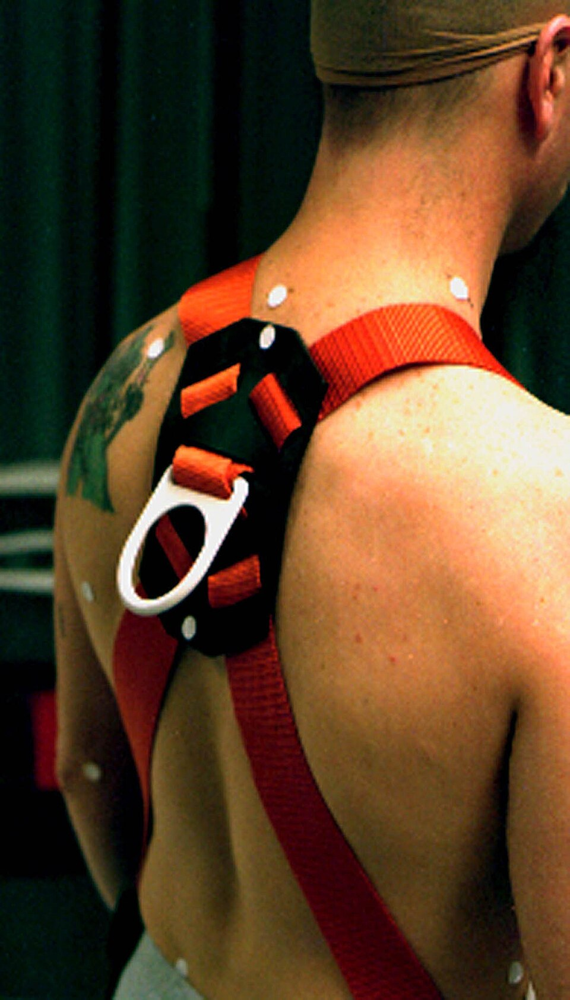
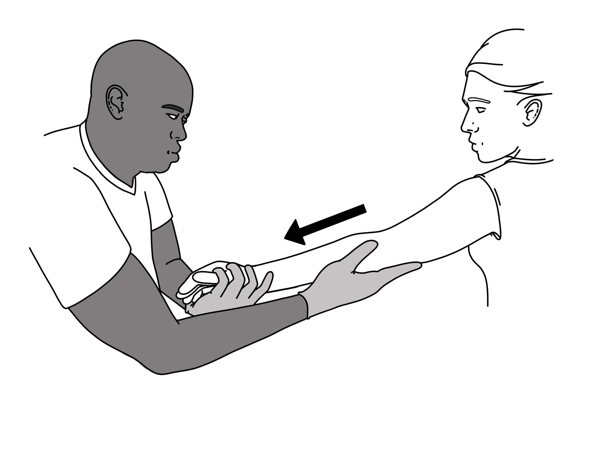

# UNIÃO SERVIÇOS MÉDICOS
## DIRETORIA DE ENSINO, PESQUISA E INOVAÇÃO — DEPI
### PROGRAMA DE FORMAÇÃO CONTINUADA EM ATENDIMENTO PRÉ-HOSPITALAR E SEGURANÇA OCUPACIONAL
---
**Biblioteca Temática:** Primeiros Socorros em Empresas (Normas Regulamentadoras)  
**Módulo:** T05 — Quedas de Altura e Traumas Ocupacionais  
**Código Curricular:** USM-EMP-T05  
**Carga Horária Equivalente:** 45 minutos (1 hora teórica)  
**Público-Alvo:** Trabalhadores em altura, montadores de andaimes, equipes de manutenção industrial, membros da CIPA e brigadistas  
**Status Editorial:** Revisão Final Concluída — Aguardando Homologação Médica  

---

## GUIA DE ATUAÇÃO — PARA QUEM NÃO É DA ÁREA DA SAÚDE

> **EM UMA EMERGÊNCIA REAL:** Proteja-se, peça ajuda e ligue **192 (SAMU)**. Para fogo, resgate em altura, água, espaço confinado ou ambiente perigoso, ligue **193 (Bombeiros)**. Diga o endereço e siga as instruções da central. Este roteiro orienta as primeiras ações, mas não substitui o treino supervisionado das técnicas práticas.

### Situação: Queda de altura e trabalhador suspenso

**Reconheça os sinais:** Pessoa caiu de andaime ou escada, está presa em arnês ou apresenta dor cervical e alteração de consciência.

### O que fazer — passo a passo

1. Pare o trabalho e isole a área abaixo do acidente.
2. Acione 193 para resgate em altura e 192 para assistência médica.
3. Não suba sem equipamento e qualificação. Não tente cortar cordas ou soltar ancoragens.
4. Quando a vítima estiver em local seguro, avalie resposta e respiração.
5. Não mova o pescoço e evite mobilizações desnecessárias. Trate sangramento grave com pressão direta.
6. Se não respira normalmente e não responde, inicie RCP quando houver acesso seguro.
7. Transmita a altura da queda, tempo suspenso e mecanismos da lesão.

### Não faça isto

Não coloque outro trabalhador em risco para retirar a vítima. Não force a pessoa a ficar em pé.

### Exercício prático de aprendizagem

Simule uma chamada ao 193 com descrição de altura, acesso, ancoragem e estado da vítima.

**Ao entregar a vítima:** informe horário de início, mudanças na respiração e na consciência, riscos e medidas aplicadas.

**Limites:** não faça procedimentos invasivos, administração de fármacos não prescritos, resgates técnicos ou intervenções que dependam de habilitação profissional. Pratique presencialmente RCP, DEA, controle de sangramento e desengasgo em manequins antes de assumir atendimento.

**Referências operacionais:** Ministério da Saúde — SAMU 192 (https://www.gov.br/saude/pt-br/composicao/saes/samu-192/samu-192); AHA/AAP — RCP e primeiros socorros 2025 (https://cpr.heart.org/en/resuscitation-science/cpr-and-ecc-guidelines); AHA/Cruz Vermelha — Primeiros Socorros 2024 (https://cpr.heart.org/en/resuscitation-science/2024-first-aid-guidelines).

---

## 1. EM 30 SEGUNDOS (SUMÁRIO EXECUTIVO DE RESPOSTA RÁPIDA)

A queda de nível é causa importante de morbidade no trabalho em construção, montagem e manutenção predial. Toda atividade acima de **2,00 metros do piso** é trabalho em altura segundo a NR-35 e exige planejamento, proteção contra quedas e plano de resgate. Após queda com impacto, reduza movimentos desnecessários, controle hemorragia ameaçadora, avalie via aérea e respiração e acione suporte especializado. Não force alinhamento cervical ou imobilização rígida por leigos se isso atrasar prioridades vitais.

Queda retida pelo cinto é emergência ocupacional que exige plano de resgate, equipe habilitada e prevenção de segunda vítima. Suspensão inerte pode causar desconforto, pré-síncope ou perda de consciência, mas o tempo de tolerância varia e não há limite fisiológico universal. Acione o resgate imediatamente. Após retirada segura, avalie a vítima pelo ABC/trauma e posicione-a conforme estado clínico; não há fundamento para manter sentado ou evitar decúbito horizontal por uma suposta “morte do resgate”.

---

## 2. OBJETIVOS DE APRENDIZAGEM E COMPETÊNCIAS OPERACIONAIS

Ao concluir este módulo instrucional e suas práticas de simulação, o socorrista e trabalhador estará apto a:

1. **Reconhecer os fatores de risco e requisitos normativos da NR-35** e ABNT NBR 15835 para trabalhos com diferença de nível superior a 2 metros.
2. **Avaliar a cinemática e biomecânica do trauma por desaceleração vertical**, antecipando padrões de lesão esquelética, visceral e vascular oculta.
3. **Manejar o politraumatizado por impacto em solo**, priorizando o controle de hemorragias graves, manutenção da permeabilidade das vias aéreas com estabilização manual da coluna cervical e monitoramento neurológico (Escala de Coma de Glasgow).
4. **Compreender a fisiopatologia da Síndrome da Suspensão Inerte**, seus sinais precoces de pré-síncope e os fatores aceleradores de colapso circulatório.
5. **Executar as manobras ativas de alívio durante a suspensão** (uso de fitas estribo, bombeamento da panturrilha) e as técnicas seguras de resgate vertical da brigada.
6. **Aplicar a avaliação pós-resgate baseada em ABC/trauma**, assegurando transferência técnica qualificada para o suporte avançado de vida.

---

## 3. INTRODUÇÃO, CONTEXTO INDUSTRIAL E RELEVÂNCIA EPIDEMIOLÓGICA

**LEITURA GUIADA — COMECE AQUI:** Quem cai de altura pode apresentar fraturas, lesões de cabeça ou coluna e sangramentos. Quem fica suspenso pelo cinto também precisa de resgate rápido. Em ambos os casos, não improvise acesso em altura.

O trabalho em altura é imprescindível no cotidiano da construção civil, na instalação de telecomunicações, em silos agroindustriais, na manutenção de telhados fabris, montagem de estruturas metálicas e refinarias de petróleo. Contudo, dados do Observatório de Segurança e Saúde no Trabalho (SmartLab / MPT / OIT) revelam que as quedas com diferença de nível representam de forma consistente **a causa isolada número um de mortes laborais no Brasil**.

O impacto decorrente de uma queda livre gera desacelerações que transferem energia cinética brutal contra o organismo. Uma queda de apenas 3 metros projeta o trabalhador contra o solo a uma velocidade de aproximadamente 27 km/h em menos de 0,8 segundo. Ao colidir contra uma superfície rígida, a interrupção súbita do movimento faz com que os órgãos internos — dotados de massa e inércia próprias — continuem em movimento, sofrendo cisalhamento vascular (como a rotura traumática da aorta torácica), contusão pulmonar, laceração hepática ou esplênica e fraturas cominutivas da coluna e bacia.

Mesmo quando o trabalhador utiliza corretamente o cinto de segurança tipo paraquedista e a queda é contida com sucesso no ar pelo talabarte com absorvedor de energia, o perigo de vida não cessa: transfere-se para o cronômetro biológico da suspensão inerte. O desconhecimento dessa condição clínica por parte de técnicos de segurança e socorristas tem levado a desfechos fatais em vítimas resgatadas sem fraturas aparentes, ressaltando a relevância do presente manual.

---

## 4. BIOMECÂNICA DO TRAUMA E FISIOPATOLOGIA DA SUSPENSÃO

> [!NOTE]
> **Por que isso acontece?** A queda transfere energia ao corpo no impacto, podendo lesar tecidos internos mesmo sem grandes feridas visíveis. A suspensão prolongada em equipamento também pode causar mal-estar. A equipe de resgate precisa ter plano e equipamentos específicos.

Para estruturar o socorro com excelência científica, é imperativo distinguir dois mecanismos de agressão física inteiramente diferentes:

```
┌────────────────────────────────────────────────────────┐
│ DUPLA AMEAÇA NO TRABALHO EM ALTURA (NR-35)             │
├──────────────────────────┬─────────────────────────────┤
│ TRAUMA DE IMPACTO DIRETO │ SÍNDROME DA SUSPENSÃO INERTE│
│ (Colisão contra o solo)  │ (Retenção suspensa no cinto)│
│ • Cinética de desaceleraç│ • Compressão de veias femor.│
│ • Fraturas axiais/bacia  │ • Sequestro volêmico venoso │
│ • Lesões viscerais e TCE │ • Pré-síncope e parada em   │
│ • Traumatismo Raquimedul.│   menos de 30 minutos       │
└──────────────────────────┴─────────────────────────────┘
```

### A. Cinemática da Queda com Impacto (Desaceleração Brusca)
Quando o corpo atinge o piso, a distribuição das lesões depende da posição de contato inicial:
1. **Queda em Pé (Padrão de Don Juan):** O choque inicial nos calcanhares transmite forças axiais ascendentes, fraturando o osso calcâneo, os platôs tibiais, o colo do fêmur e a pelve. A onda de choque sobe pela coluna vertebral, comprimindo corpos vertebrais lombares e torácicos (fraturas em cunha ou explosão) e causando fratura em anel na base do crânio.
2. **Queda de Cabeça:** Provoca TCE grave com contusão cerebral, hematomas intracranianos (subdural e extradural) e fratura com luxação da coluna cervical (C1 a C7) com transecção medular e tetraplegia imediata.
3. **Queda Horizontal (Dorso ou Ventre):** Distribui o impacto em ampla área, mas projeta órgãos mediastinais e abdominais contra as costelas e a coluna, provocando pneumotórax hipertensivo, rotura do baço, laceração do fígado e sangramento retroperitoneal fatal.

### B. Suspensão inerte: risco real, sem mito de "morte do resgate"
A pessoa suspensa e imóvel pode apresentar desconforto, pré-síncope e perda de consciência; por isso, todo trabalho em altura precisa de plano de resgate rápido, equipe habilitada e prevenção de nova queda. O tempo de tolerância é variável: não existe um limite fisiológico universal de 10, 15 ou 30 minutos.

Não há evidência científica de que colocar a vítima resgatada em posição horizontal provoque uma suposta “morte do resgate” por retorno venoso. Após a retirada segura, faça a avaliação primária usual (via aérea, respiração, circulação, sangramento e trauma), siga o mecanismo de lesão e posicione conforme o estado clínico: se estiver inconsciente e não respirar normalmente, inicie RCP; se respirar, mantenha via aérea e previna hipotermia. A posição deve ser determinada por necessidade clínica e pelo serviço de emergência, não por uma regra de manter sentado ou com joelhos ao peito.

---

## 5. DESENVOLVIMENTO DOS SUBTEMAS OFICIAIS DO CURRÍCULO

### 5.1. Riscos em Trabalhos em Altura e Requisitos da NR-35

A prevenção é o pilar estrutural do trabalho seguro em níveis elevados:
- **Planejamento e Análise de Risco (APR):** Toda atividade em altura deve ser precedida de APR e Permissão de Trabalho (PT), identificando pontos de ancoragem homologados (resistência de no mínimo 1.500 kgf / 15 kN por trabalhador conforme NBR 16325).
- **Sistema de Proteção Individual Contra Quedas (SPIQ):** Composto por elemento de fixação (ancoragem), dispositivo de retenção (cinto de segurança tipo paraquedista) e elemento de ligação (talabarte duplo com absorvedor de energia ou trava-quedas retrátil).
- **Fator de Queda (FQ):** Relação entre a distância da queda e o comprimento do talabarte ($FQ = \frac{\text{Distância}}{\text{Comprimento}}$). O FQ varia de 0 a 2. O ponto de ancoragem deve estar sempre posicionado **acima da cabeça do trabalhador** (Fator de Queda 0 ou 1) para reduzir a distância de aceleração livre. Trabalhar com a ancoragem nos pés (Fator de Queda 2) gera forças de impacto severas na retenção que podem ultrapassar os 6 kN tolerados pelo esqueleto humano, gerando lesões viscerais mesmo sem colisão no chão.



*Figura 1 — Cinturão paraquedista e ancoragem para prevenção de quedas em altura (NR-35). Crédito: National Institute for Occupational Safety and Health (NIOSH). Licença: Domínio público. Fonte: Wikimedia Commons.*

---

### 5.2. Mecanismos de Queda e Forças de Desaceleração

As quedas no ambiente industrial ocorrem principalmente por:
1. Ruptura ou ausência de guarda-corpos e rodapés em periferias de lajes.
2. Quedas em escadas portáteis e andaimes tubulares improvisados sem travamento.
3. Desabamento de telhas frágeis de cimento-amianto durante manutenções.
4. Descuido ao desconectar talabartes simples sem observar o sistema de 100% de amarração contínua (talabarte duplo em Y).
5. Quedas com efeito pêndulo: quando a ancoragem não está na vertical do operador e ele sofre queda com oscilação lateral, colidindo em alta velocidade contra vigas e colunas laterais da edificação.

---

### 5.3. Suspeita de Trauma Grave (TCE, TRM e Politrauma)


*Figura 3 — Aplicação técnica de colar cervical para restrição de movimento. Crédito: Baedr-9439. Licença: CC0. Fonte: Wikimedia Commons.*


Ao encontrar um trabalhador acidentado após colisão contra o piso:

```
┌────────────────────────────────────────────────────────┐
│ SEQUÊNCIA DE ABORDAGEM NO POLITRAUMA POR QUEDA         │
├────────────────────────────────────────────────────────┤
│ X: HEMORRAGIA EXANGUINANTE (Torniquete se houver jato) │
├────────────────────────────────────────────────────────┤
│ A: VIA AÉREA COM ESTABILIZAÇÃO MANUAL CERVICAL ALINHADA│
├────────────────────────────────────────────────────────┤
│ B: VENTILAÇÃO E RESPIRAÇÃO (Tórax e expansibilidade)   │
├────────────────────────────────────────────────────────┤
│ C: CIRCULAÇÃO COM CONTROLE DE CHOQUE E ESTABILIDADE PEL│
├────────────────────────────────────────────────────────┤
│ D: DISFUNÇÃO NEUROLÓGICA (Pupilas e nível consciência) │
├────────────────────────────────────────────────────────┤
│ E: EXPOSIÇÃO CONTROLADA COM PREVENÇÃO DE HIPOTERMIA    │
└────────────────────────────────────────────────────────┘
```

- **Restrição de movimento e via aérea:** Evite movimentos desnecessários e não force uma posição neutra. Se houver suspeita de trauma, tente inicialmente abertura de via aérea com tração da mandíbula; se ela falhar, use inclinação da cabeça/elevação do mento. Via aérea e respiração eficazes têm prioridade sobre tentativas de imobilização rígida por leigos.
- **Sinais de Gravidade Imediata:** Sangramento ou saída de líquido claro pelo nariz ou ouvidos (otoliquorreia/rinoliquorreia), equimose periorbital ("olhos de guaxinim") ou retroauricular (Sinal de Battle), assimetria de pupilas (anisocoria), deformidades na bacia com instabilidade ao toque e respiração agônica ou ausente.



*Figura 2 — Estabilização manual alinhada (in-line) da cabeça e coluna cervical no trauma. Crédito: Baedr-9439. Licença: CC0. Fonte: Wikimedia Commons.*

---

### 5.4. Proteção da Vítima no Pós-Impacto

1. **Segurança da Cena:** Antes de acessar a vítima caída, verifique se ferramentas soltas, tábuas ou peças de andaime ainda correm risco de cair da estrutura superior. Use capacete com jugular e proteja o perímetro.
2. **Manutenção da Vítima Imóvel:** Trabalhadores leigos tendem a querer "levantar a vítima para ver se quebrou algo" ou oferecer copos de água. O socorrista da CIPA/brigada deve assumir o comando da cena e proibir expressamente qualquer tentativa de sentar ou movimentar a vítima.
3. **Manejo de Hemorragias e Fraturas:** Se houver sangramento pulsátil em membros decorrente de fratura exposta, aplique torniquete imediatamente. Não tente recolocar ossos para dentro da ferida; cubra a lesão com gaze estéril ou pano limpo e imobilize na posição em que se encontra.
4. **Prevenção da Hipotermia:** O choque hipovolêmico e o traumatismo raquimedular abolem a vasoconstrição periférica, fazendo o paciente perder calor rapidamente em contato com o solo frio. Cubra o paciente com manta térmica aluminizada ou cobertores secos.

---

### 5.5. Suspensão após queda: plano de resgate baseado em segurança

1. Acione imediatamente o plano de resgate, Bombeiros (193) e SAMU (192) quando houver vítima suspensa, inconsciente, lesionada ou com dificuldade respiratória.
2. Não inicie resgate vertical sem treinamento, sistema de ancoragem e equipamento apropriados. Evite transformar o socorrista em segunda vítima.
3. Uma pessoa consciente pode seguir as orientações do fabricante/da equipe de segurança para usar estribo de alívio, se disponível, sem improvisar manobras perigosas.
4. Após a retirada, coloque a vítima em local seguro e aplique a avaliação primária de trauma. Não imponha posição sentada, joelhos ao peito ou tempo de espera para “controlar o retorno venoso”.
5. Se não houver respiração normal, inicie RCP e use DEA quando disponível. Se houver trauma, trate como possível politrauma e aguarde equipe habilitada, mantendo a via aérea e prevenindo hipotermia.

#### Medidas Ativas Durante a Suspensão (Trabalhador Consciente)
- **Uso do Estribo de Alívio de Suspensão:** Dispositivo de fita têxtil que o trabalhador desenrola da lateral do cinto, prende aos pés e estica, criando um degrau de apoio onde ele se apoia em pé, aliviando a compressão das tiras nas virilhas e acionando os músculos da panturrilha.
- **Orientações enquanto aguarda:** não peça à vítima para executar manobras extenuantes ou improvisadas. Mantenha comunicação, acione o plano de resgate e siga somente instruções do fabricante e da equipe habilitada.

---

### 5.6. Acionamento de Equipes Habilitadas e Resgate Técnico

A NR-35 exige planejamento de emergência e resgate compatível com a atividade. O plano deve definir responsabilidades, meios de comunicação, equipamentos e treinamento; não é seguro prometer um tempo fisiológico universal de retirada:
- **Acionamento Imediato das Forças Públicas:** Chame o Corpo de Bombeiros Militar (193) para intervenções verticais com cordas e autoescada mecânica, e o SAMU (192) para suporte médico e reposição volêmica.
- **Equipamentos de Resgate Dedicados:** A empresa deve manter kits de resgate industrial prontos no local de trabalho (polias com bloqueador, vara telescópica de ancoragem rápida, trava-quedas de descida controlada).
- **Abordagem da Brigada:** O resgatista qualificado em altura acessa o trabalhador por cima, conecta o sistema de resgate ao anel peitoral ou dorsal da vítima, corta com tesoura de ponta romba o talabarte antigo retido e executa a descida suave até o solo.

---

---

## 6. MATRIZ DE DECISÃO RÁPIDA EM TRAUMAS DE ALTURA

| Cenário de Acidente | Sinais e Gravidade | Conduta Imediata Obrigatória | Conduta Expressamente Proibida |
| :--- | :--- | :--- | :--- |
| **Queda Livre com Impacto no Solo** | Inconsciência, deformidades ósseas, sangramentos, dor cervical. | Estabilização manual da cabeça em posição neutra; torniquete em hemorragias; SAMU 192. | Deixar a vítima sentar-se; tentar levantá-la; dar água ou comida; puxá-la pelos membros. |
| **Trabalhador Suspenso e Consciente** | Cinto tracionado, dormência nas pernas, tontura inicial, palidez. | Orientar uso do estribo de alívio; acionar resgate imediato da brigada; descer em até 10 min. | Orientar o trabalhador a "ficar parado relaxando"; demorar o resgate aguardando ajuda externa. |
| **Trabalhador Suspenso e Inconsciente** | Inerte no cinto, cabeça pendente para frente, sem resposta a chamados. | Resgate vertical de emergência absoluta em menos de 10 min; preparar prancha e DEA no solo. | Aguardar mais de 15 minutos; tentar subir sem ancoragem segura de resgate (socorrista herói). |
| **Vítima Resgatada do Cinto Pós-Suspensão Longa** | Pálida, hipotensa, confusão mental, tempo de suspensão > 15-20 min. | Acomodar sentada ou semissentada por 30-45 min; oxigênio a 100%; monitorar ECG no SAMU. | Deitar a vítima subitamente de costas no chão com as pernas erguidas (risco de parada cardíaca). |
| **Suspeita de Fratura Exposta de Membro por Queda** | Espícula óssea visível, sangramento ativo, deformidade grave. | Controle do sangramento com compressão ou torniquete; curativo estéril; imobilização in situ. | Tentar empurrar o osso para dentro do membro; tracionar violentamente sem equipe médica. |

---

## 7. ERROS FREQUENTES E CONDUTAS PROIBIDAS NO AMBIENTE OCUPACIONAL

> [!CAUTION]
> **Erro que pode prejudicar a vítima:** Não suba em estrutura sem treinamento, não corte talabartes e não solte ancoragens por impulso. Acione 193. Após retirada segura, evite movimentar a vítima e verifique respiração.

```
┌────────────────────────────────────────────────────────┐
│ CONDUTAS PROIBIDAS E PERIGOSAS EM QUEDAS E RESGATE     │
├────────────────────────────────────────────────────────┤
│ 1. LEVANTAR A VÍTIMA APÓS QUEDA NO CHÃO: Risco fatal   │
│    de secção de medula espinhal em fratura cervical.   │
├────────────────────────────────────────────────────────┤
│ 2. IMPOR POSIÇÃO SEM AVALIAÇÃO CLÍNICA: após resgate,  │
│    aplique ABC/trauma; não use o mito da "morte do     │
│    resgate" para atrasar RCP ou cuidado da via aérea.  │
├────────────────────────────────────────────────────────┤
│ 3. USAR CINTO SEM TALABARTE COM ABSORVEDOR: Força de   │
│    retenção destrói órgãos e coluna do trabalhador.    │
├────────────────────────────────────────────────────────┤
│ 4. SUBESTIMAR QUEDAS DE PEQUENA ALTURA (< 2 metros):   │
│    TCE e hemorragias intracranianas matam de escadas.  │
└────────────────────────────────────────────────────────┘
```


1. **Movimentar a Vítima Precocemente:** Tentar erguer a pessoa caída no chão para verificar se ela "consegue andar". Se houver uma vértebra fraturada instável, esse movimento desalinha o canal vertebral e lesa a medula espinhal, transformando uma fratura consolidável em paralisia irreversível (tetraplegia ou paraplegia).
2. **Deitar a Vítima de Suspensão com Pernas Elevadas (Posição de Trendelenburg):** É o erro mais comum e fatal cometido por socorristas despreparados. Acreditando estar tratando um choque comum, deitam a vítima e levantam suas pernas. O sangue tóxico e desoxigenado acumulado nos membros inferiores retorna violentamente ao coração desfalecido, levando à assistolia ou fibrilação ventricular (*rescue death*).
3. **Improvisar Ancoragens Frágeis:** Ancorar o cinto de segurança em eletrocalhas, tubulações de PVC ou corrimãos que não resistem a 15 kN de força mecânica.
4. **Desprezar Quedas de Pequena Altura:** Considerar que quedas de escadas de 1,5 a 2,0 metros são inofensivas. O impacto direto da caixa craniana contra superfícies duras pode gerar hemorragia extradural fatal mesmo a partir de pequenas alturas.
5. **Oferecer Líquidos à Vítima:** Dar água com açúcar ou refrigerante ao acidentado com trauma grave. Isso favorece vômitos, aspiração brônquica de conteúdo gástrico e atrasa a cirurgia de emergência no hospital.

---

## 8. ESTUDO DE CASO PRÁTICO AMBIENTADO NA INDÚSTRIA

> [!TIP]
> **Decisão no caso prático:** Um trabalhador está suspenso pelo cinto após queda. Um colega aciona o plano de resgate, informa ao 193 a altura e a situação da vítima, mantém a área isolada e aguarda os profissionais habilitados.

### O Incidente: Queda Retida em Linha de Vida e Resgate Técnico
Em um galpão logístico industrial em Campinas/SP, o calheiro João (41 anos) executava a substituição de calhas metálicas na cobertura a 8 metros de altura. Estava devidamente paramentado com cinto de segurança tipo paraquedista conectado por talabarte duplo a uma linha de vida horizontal de cabo de aço. Ao pisar em uma telha translúcida ressecada, a estrutura cedeu sob seus pés e João despencou pelo vão livre.

O absorvedor de impacto abriu-se perfeitamente e a linha de vida conteve a queda. João ficou suspenso no ar a cerca de 5 metros do piso do galpão. Ele não colidiu contra o piso, mas o impacto da desaceleração projetou seu rosto contra uma viga secundária, gerando um corte profundo no supercílio e atordoamento neurológico temporário. Com as pernas inertes penduradas no cinto e atordoado pelo golpe na face, João não conseguiu desenrolar sua fita estribo.

### A Atuação da Brigada Industrial de Emergência
O técnico de segurança e líder de brigada Marcelo ouviu o estrondo da telha e a retenção do cabo:
1. **Reconhecimento do Cronômetro de Suspensão:** Marcelo constatou que João estava suspenso e imóvel. Sabendo que o tempo limite fisiológico era de no máximo 15 minutos, acionou imediatamente o Plano de Emergência: *"Trabalhador suspenso na baia 3! Peguem o kit de resgate vertical e tragam a plataforma elevatória tesoura! Chamem o SAMU 192 e Bombeiros 193 imediatamente!"*.
2. **Tentativa de Ativação Motora:** Marcelo gritou para a vítima: *"João! Chute o ar! Mova as pernas como se estivesse pedalando uma bicicleta!"*. João, com a voz fraca e confusa, conseguiu mover as pernas por apenas 2 minutos antes de parar por exaustão e entrar em síncope, ficando com a cabeça pendente para frente aos 8 minutos de suspensão.
3. **Resgate com Plataforma Elevatória:** Aos 10 minutos do acidente, a equipe da brigada manobrou a plataforma elevatória sob João. Um brigadista habilitado em trabalho em altura subiu, ancorou-se na plataforma, conectou uma fita de ancoragem curta ao anel frontal de João e usou a tesoura de resgate para cortar o talabarte esticado, acolhendo o corpo de João na cesta da plataforma.
4. **Avaliação pós-resgate:** No solo, a equipe verifica responsividade e respiração. Como João está desacordado, posiciona-o de modo que permita manter a via aérea, protege-o do frio, controla o sangramento visível e prepara DEA. Não cria uma posição obrigatória baseada em “morte do resgate”.
5. **Suporte inicial:** Oxigênio e intervenções avançadas ficam a cargo de equipe habilitada. A brigada mantém monitoramento básico, evita movimentação desnecessária e reporta mecanismo da queda, tempo suspenso e sinais observados.
6. **Transferência para o SAMU:** A equipe entrega dados objetivos: altura/mecanismo da queda, tempo de suspensão estimado, perda de consciência, intervenções e evolução. O posicionamento e o manejo subsequente são definidos pela avaliação clínica da equipe de emergência.

### Desfecho Clínico
No centro de trauma, a investigação é guiada pelo mecanismo de queda e pelos achados clínicos. Este caso ilustra a importância de resgate técnico seguro, avaliação de trauma e comunicação estruturada — não uma suposta necessidade de manter a vítima sentada após a suspensão.

---

## 9. PULO DO GATO — SEGREDOS PRÁTICOS DO SOCORRISTA INDUSTRIAL

> [!TIP]
> **1. Pós-resgate sem mito postural:** não há base para obrigar joelhos ao peito, posição sentada ou espera de 30–45 minutos. Após retirada segura, avalie e trate a vítima pelo ABC/trauma habitual; se não respirar normalmente, inicie RCP.
> 
> **2. Trauma e via aérea:** evite movimentos desnecessários, mas não force alinhamento cervical nem atrase abertura de via aérea, ventilação ou controle de hemorragia.
> 
> **3. Resgate sem prazo inventado:** suspensão inerte requer resposta urgente, mas não há limite fisiológico único. O plano deve buscar retirada rápida e segura, com recursos adequados.
> 
> **4. Verifique a Fita Estribo Antes de Subir:** Ensine todo trabalhador que usa cinto paraquedista a carregar a fitinha estribo de alívio no bolso do cinto. Ela custa poucos reais e é a diferença entre ficar em pé seguro no ar por 40 minutos ou desmaiar e morrer aos 12 minutos.
> 
> **5. Cuidado com o Choque Oculto na Bacia:** Quedas de altura frequentemente fraturam os ossos da pelve. Uma fratura de bacia pode sangrar silenciosamente até 2,5 litros de sangue para dentro da cavidade pélvica sem nenhum ferimento externo visível. Vítima de queda pálida, com suor frio e taquicardia deve ser tratada como choque hemorrágico grave imediato.


---

## 10. MAPA MENTAL INTEGRADO (ALGORITMO OPERACIONAL)

```
                     EMERGÊNCIA POR QUEDA DE ALTURA
                                   │
               ┌───────────────────┴───────────────────┐
               ▼                                       ▼
     QUEDA RETIDA NO CINTO                   QUEDA COM IMPACTO NO SOLO
     (Suspensão Inerte)                      (Politraumatizado)
               │                                       │
   • Acionar plano de resgate              • Cena segura (risco de queda objetos)
   • Consciente: seguir orientação técnica • XABCDE do trauma
   • Inconsciente: resgate seguro imediato • Evitar movimentos desnecessários
               │                           • Controle de hemorragias exanguinantes
               ▼                           • Não movimentar a vítima do local!
   RESGATE E CHEGADA AO SOLO               • Manta térmica contra hipotermia
   • ABC/trauma conforme estado clínico                • Acionar SAMU 192 e Bombeiros 193
   • RCP/DEA se não respirar normalmente               │
   • Prevenir hipotermia e reportar mecanismo          │
               │                                       │
               └───────────────────┬───────────────────┘
                                   │
                                   ▼
                       SUPORTE MÉDICO AVANÇADO
                   • Transporte em prancha rígida
                   • Avaliação tomográfica e ECG
                   • Manejo de TCE / TRM / Hemorragia
```

---

## 11. O QUE VOCÊ PRECISA LEMBRAR (PONTOS INEGOCIÁVEIS)

- **Trabalho acima de 2 metros exige conformidade irrestrita com a NR-35:** Cinto paraquedista com talabarte duplo e absorvedor de impacto ancorado acima da cabeça.
- **Suspensão inerte requer resgate urgente e seguro:** não há limite fisiológico único; o risco depende do trabalhador, do trauma e das condições de suspensão.
- **Após o resgate, não use posição sentada/joelhos ao peito como “tratamento”:** siga avaliação primária e protocolos de trauma/RCP vigentes.
- **Quedas no solo exigem redução de movimentos desnecessários:** não force alinhamento cervical e não atrase via aérea, respiração ou controle de hemorragia.
- **O plano de resgate deve ser compatível com a atividade:** equipe, comunicação, ancoragem e treinamento devem ser definidos antes do trabalho.
- **Fraturas pélvicas e hemorragias internas são comuns e traiçoeiras:** Monitore pulso, perfusão e nível de consciência de toda vítima de desaceleração brusca.

---

## 12. REFERÊNCIAS CIENTÍFICAS E METADADOS EDITORIAIS

1. BRASIL. Ministério do Trabalho e Emprego. **Norma Regulamentadora nº 35 (NR-35) — Trabalho em Altura**. Brasília: MTE, atualizada pela Portaria MTP nº 4.218/2022.
2. ASSOCIAÇÃO BRASILEIRA DE NORMAS TÉCNICAS. **ABNT NBR 15835:2020 — Equipamento de proteção individual contra queda de altura — Cinturão de segurança tipo paraquedista**. Rio de Janeiro: ABNT, 2020.
3. HEALTH AND SAFETY EXECUTIVE (HSE). **Harness suspension: review and evaluation of existing information**. Research Report 451. Sudbury: HSE Books, 2002.
4. AMERICAN COLLEGE OF SURGEONS COMMITTEE ON TRAUMA. **Advanced Trauma Life Support (ATLS) — 10th Edition: Spine and Spinal Cord Trauma & Musculoskeletal Trauma**. Chicago: ACS, 2018.
5. NATIONAL ASSOCIATION OF EMERGENCY MEDICAL TECHNICIANS (NAEMT). **PHTLS: Prehospital Trauma Life Support — 10th Edition**. Burlington: Jones & Bartlett Learning, 2023.
6. FUNDACENTRO. **Manual de Segurança em Trabalhos em Altura: Aplicação Prática da NR-35**. São Paulo: Fundacentro, 2021.
7. ROCHE, N. C. et al. **Suspension Trauma: A Pathophysiological Review and Management Guidelines**. Wilderness & Environmental Medicine, v. 23, n. 2, p. 145-153, 2012.
8. MINISTÉRIO PÚBLICO DO TRABALHO; ORGANIZAÇÃO INTERNACIONAL DO TRABALHO. **Observatório de Segurança e Saúde no Trabalho (SmartLab)**. Brasília: MPT/OIT, dados atualizados 2023.
9. INTERNATIONAL COMMISSION FOR ALPINE RESCUE (ICAR) MedCom. **Suspension syndrome: a scoping review and recommendations for rescue management**. *Scandinavian Journal of Trauma, Resuscitation and Emergency Medicine*, 2024. Revisão que não encontrou evidência para a alegação de “morte do resgate” por posicionamento horizontal.

---

### Metadados e Controle Editorial
- **Instituição Proprietária:** União Serviços Médicos Ltda. — Todos os direitos reservados
- **Plataforma Pedagógica:** LURIA Framework Educacional
- **Revisor Científico Responsável:** Equipe de Medicina do Trabalho e Emergência USM
- **Status da Apostila:** Aguardando Aprovação Científica
- **Identificador de Controle:** USM-EMP-T05-REV01-2026
