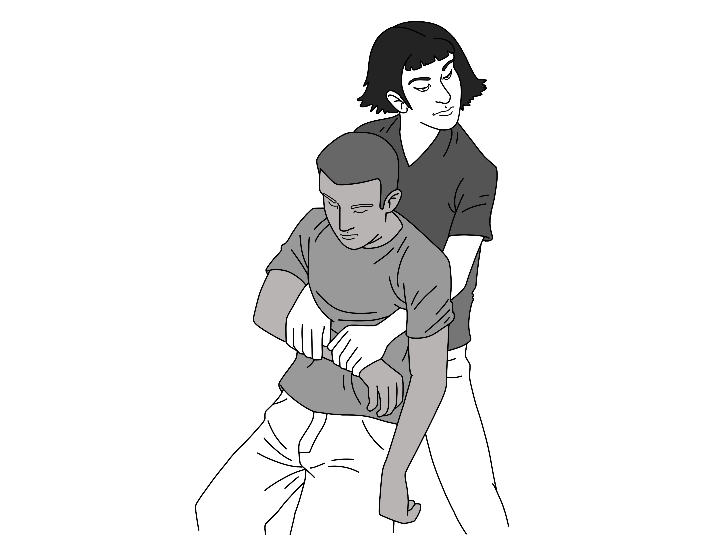
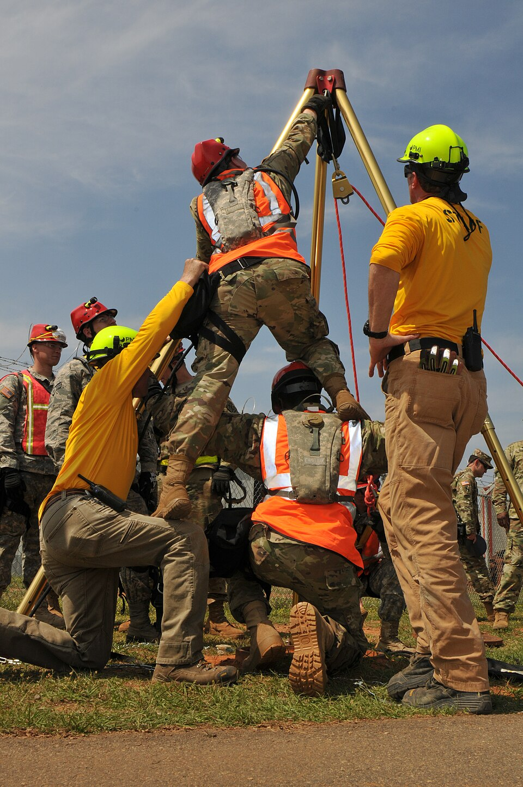

# UNIÃO SERVIÇOS MÉDICOS
## DIRETORIA DE ENSINO, PESQUISA E INOVAÇÃO — DEPI
### PROGRAMA DE FORMAÇÃO CONTINUADA EM ATENDIMENTO PRÉ-HOSPITALAR E SEGURANÇA OCUPACIONAL
---
**Biblioteca Temática:** Primeiros Socorros em Empresas (Normas Regulamentadoras)  
**Módulo:** T06 — Emergências em Espaços Confinados  
**Código Curricular:** USM-EMP-T06  
**Carga Horária Equivalente:** 45 minutos (1 hora teórica)  
**Público-Alvo:** Vigias, trabalhadores autorizados, supervisores de entrada em espaços confinados, brigadistas e equipes de resgate técnico  
**Status Editorial:** Revisão Final Concluída — Aguardando Homologação Médica  

---

## GUIA DE ATUAÇÃO — PARA QUEM NÃO É DA ÁREA DA SAÚDE

> **EM UMA EMERGÊNCIA REAL:** Proteja-se, peça ajuda e ligue **192 (SAMU)**. Para fogo, resgate em altura, água, espaço confinado ou ambiente perigoso, ligue **193 (Bombeiros)**. Diga o endereço e siga as instruções da central. Este roteiro orienta as primeiras ações, mas não substitui o treino supervisionado das técnicas práticas.

### Situação: Espaço confinado: resgate sem entrada do leigo

**Reconheça os sinais:** Trabalhador desmaia em tanque, poço, silo, câmara subterrânea ou ambiente pouco ventilado.

### O que fazer — passo a passo

1. NÃO ENTRE no espaço. Você pode desmaiar pelo mesmo gás ou falta de oxigênio.
2. Acione 193, equipe de resgate e plano de emergência da empresa.
3. Impeça a entrada de colegas. Sinalize e isole o local.
4. Informe o último contato com a vítima, tipo de espaço, produto armazenado e riscos conhecidos.
5. Somente equipe habilitada deve realizar resgate, medição da atmosfera e uso de proteção respiratória apropriada.
6. Quando a vítima estiver fora e o ambiente seguro, avalie resposta e respiração; inicie RCP se indicada.
7. Entregue ao resgate as informações de exposição disponíveis.

### Não faça isto

Não desça mesmo que a vítima esteja perto. Máscara cirúrgica ou respirador comum não fornecem oxigênio.

### Exercício prático de aprendizagem

Treine a ordem de não entrada, isolamento e dados essenciais para ligar ao 193.

**Ao entregar a vítima:** informe horário de início, mudanças na respiração e na consciência, riscos e medidas aplicadas.

**Limites:** não faça procedimentos invasivos, administração de fármacos não prescritos, resgates técnicos ou intervenções que dependam de habilitação profissional. Pratique presencialmente RCP, DEA, controle de sangramento e desengasgo em manequins antes de assumir atendimento.

**Referências operacionais:** Ministério da Saúde — SAMU 192 (https://www.gov.br/saude/pt-br/composicao/saes/samu-192/samu-192); AHA/AAP — RCP e primeiros socorros 2025 (https://cpr.heart.org/en/resuscitation-science/cpr-and-ecc-guidelines); AHA/Cruz Vermelha — Primeiros Socorros 2024 (https://cpr.heart.org/en/resuscitation-science/2024-first-aid-guidelines).

---

## 1. EM 30 SEGUNDOS (SUMÁRIO EXECUTIVO DE RESPOSTA RÁPIDA)

Emergências em espaços confinados (Norma Regulamentadora nº 33 — NR-33) apresentam uma estatística alarmante e incontestável em todo o mundo: **tentativas de resgate improvisadas também podem causar mortes entre os socorristas**. A regra basilar, soberana e inegociável é: **É TERMINANTEMENTE PROIBIDO ENTRAR NO ESPAÇO CONFINADO PARA RESGATAR UMA VÍTIMA SEM EQUIPAMENTO DE PROTEÇÃO RESPIRATÓRIA AUTÔNOMA (EPR / SCBA) OU SISTEMA DE AR MANDADO COM CILINDRO DE ESCAPE**. O instinto humano de pular para dentro de um poço, tanque, silo ou bueiro para puxar um colega desmaiado pode provocar perda de consciência e intoxicação grave rapidamente, transformando uma ocorrência com uma vítima em uma tragédia com múltiplas fatalidades.

As principais causas de desmaio e óbito rápido são atmosferas perigosas: **deficiência crítica de oxigênio** ($O_2 < 19,5\%$), **gases asfixiantes químicos letais** (como o Sulfeto de Hidrogênio / Gás Sulfídrico - $H_2S$, que paralisa o nervo olfatório no primeiro suspiro e causa colapso respiratório fulminante, e o Monóxido de Carbono - $CO$) e **gases inflamáveis** em concentrações explosivas (como o metano - $CH_4$). Todo resgate prioritário deve ser executado **a partir do exterior do espaço (resgate sem entrada)**, utilizando tripé estrutural, guincho mecânico com trava-quedas e linha de vida pré-conectada ao cinto do trabalhador antes da entrada. Caso o resgate exija entrada física, esta só poderá ser realizada por brigadistas técnicos de resgate com treinamento especializado, utilizando vestimentas adequadas, EPR de pressão positiva e monitoramento contínuo de 4 gases. Acione imediatamente o Plano de Ação de Emergência (PAE), o Corpo de Bombeiros (193) e o SAMU (192).

---

## 2. OBJETIVOS DE APRENDIZAGEM E COMPETÊNCIAS OPERACIONAIS

Ao concluir o estudo deste módulo didático e seus treinamentos técnicos, o profissional estará plenamente apto a:

1. **Definir e caracterizar espaços confinados** conforme a NR-33 e NBR 16577, identificando os papéis do Supervisor de Entrada, Vigia e Trabalhador Autorizado.
2. **Reconhecer os perigos das atmosferas atmosféricas deficientes de oxigênio** ($O_2 < 19,5\%$), enriquecidas ($O_2 > 23\%$) e contaminadas por gases tóxicos ($H_2S, CO$) ou inflamáveis ($CH_4$).
3. **Compreender o fenômeno da fadiga olfatória do gás sulfídrico ($H_2S$)** e banir o olfato humano como método de detecção de atmosferas perigosas.
4. **Analisar a epidemiologia do resgate impulsivo desprotegido**, incorporando a autoproteção intransigente como diretriz máxima de sobrevivência.
5. **Operar os sistemas mecânicos de resgate sem entrada** (tripés, guinchos retráteis e linhas de vida conectadas ao anel dorsal do cinto).
6. **Organizar o fluxo de atendimento pré-hospitalar fora do espaço confinado**, realizando avaliação inicial e RCP quando indicada; oxigenoterapia e ventilação com equipamento devem ficar com equipe habilitada.

---

## 3. INTRODUÇÃO, CONTEXTO INDUSTRIAL E RELEVÂNCIA EPIDEMIOLÓGICA

Os espaços confinados são componentes estruturais corriqueiros na infraestrutura brasileira: galerias de esgoto e drenagem pluvial, caixas de passagem subterrâneas de cabos elétricos, reatores químicos, colunas de destilação, tanques de armazenamento de combustíveis, digestores de vinhaça, silos de grãos, porões de navios e tubulações industriais. Segundo relatórios da National Institute for Occupational Safety and Health (NIOSH) e da Fundacentro, acidentes em espaços confinados possuem taxa de letalidade superior a 80%, sendo desproporcionalmente mais mortais do que qualquer outro tipo de ocorrência industrial.

A natureza trágica dessas ocorrências reside na invisibilidade das ameaças. Ao contrário de uma máquina em rotação ou de um incêndio visível, o ar dentro de um espaço confinado pode parecer completamente calmo, silencioso e límpido, enquanto esconde concentrações letais de sulfeto de hidrogênio gerado por matéria orgânica em decomposição, ou uma atmosfera anóxica onde o oxigênio foi totalmente consumido por oxidação da carcaça metálica (ferrugem). O trabalhador desce a escada de acesso e, ao respirar dois ciclos em um ambiente com menos de 10% de oxigênio, sofre dessaturação cerebral fulminante e cai desacordado no fundo do espaço.

Ao testemunhar a queda do companheiro de trabalho, o operador da superfície ou o vigia despreparado é tomado pelo instinto de socorro e desce rapidamente a escada. Ao chegar ao fundo, inala o mesmo gás ou a mesma atmosfera anóxica e desfalece sobre o primeiro trabalhador. Esse ciclo perverso de resgate impulsivo é responsável pela maioria esmagadora das mortes múltiplas registradas pela inspeção do trabalho no Brasil, demandando rigor doutrinário absoluto.

---

## 4. FISIOPATOLOGIA DA DEFICIÊNCIA DE OXIGÊNIO E TOXICOLOGIA DE GASES

Para atuar com consciência técnica, o socorrista deve dominar os impactos fisiológicos das atmosferas anormais:

```
┌────────────────────────────────────────────────────────┐
│ NÍVEIS DE OXIGÊNIO ATMOSFÉRICO E RESPOSTA HUMANA       │
├───────────────┬────────────────────────────────────────┤
│ 20,9%         │ Atmosfera Normal (Nível do Mar)        │
│ 19,5%         │ Limite Mínimo de Entrada Segura (NR-33)│
│ 16,0 a 19,4%  │ Desatenção, taquipneia, fadiga precoce │
│ 12,0 a 15,9%  │ Taquicardia, perda da coordenação,     │
│               │ julgamento embotado, tontura severa    │
│ 10,0 a 11,9%  │ Náuseas, vômitos, lábios arroxeados    │
│               │ (cianose), incapacidade de locomoção   │
│ 6,0 a 9,9%    │ Desmaio em segundos, coma e convulsão  │
│ < 6,0%        │ Síncope imediata (1 respiração),       │
│               │ parada cardiorrespiratória em 3-5 min  │
└───────────────┴────────────────────────────────────────┘
```

### A. Fisiopatologia da Anóxia por Deslocamento de Oxigênio
O ar atmosférico é composto por aproximadamente 78% de nitrogênio ($N_2$), 20,9% de oxigênio ($O_2$) e 1% de outros gases. Gases como nitrogênio comprimido, hélio, dióxido de carbono ($CO_2$) e metano ($CH_4$) são gases asfixiantes simples. Eles não agridem diretamente o tecido pulmonar, mas, ao vazarem para dentro de um ambiente sem ventilação, expulsam fisicamente o oxigênio. Quando a fração inspirada de oxigênio cai abaixo de 10%:
- A pressão parcial de oxigênio nos alvéolos pulmonares torna-se menor do que a pressão parcial de oxigênio no sangue capilar venoso desoxigenado.
- Em vez de o oxigênio entrar no sangue, **o sangue oxigenado que chega aos pulmões perde oxigênio para o ambiente alveolar!**
- Ocorre uma lavagem reversa brutal de oxigênio da circulação cerebral, levando o cérebro à perda da consciência em meros 10 a 15 segundos (o tempo que o sangue leva para viajar do pulmão ao córtex cerebral). A vítima não tem tempo sequer de pedir ajuda ou subir um degrau da escada.

### B. Sulfeto de Hidrogênio / Gás Sulfídrico ($H_2S$) — O Assassino Silencioso
O $H_2S$ é gerado pela decomposição bacteriana anaeróbia de esgotos, águas residuais, efluentes industriais e petróleo:
- **O Falso Alerta do Odor:** Em concentrações muito baixas (menos de 1 ppm), o $H_2S$ possui odor repulsivo característico de "ovo podre". No entanto, em concentrações perigosas (acima de 100 ppm), o gás provoca **paralisia imediata do nervo olfatório** por toxicidade neurológica direta. A vítima passa a achar falsamente que o gás se dissipou porque parou de sentir o cheiro.
- **Mecanismo Tóxico Celular:** Em concentrações elevadas (> 500 ppm), uma única inalação atua de forma análoga ao cianeto, inibindo a enzima citocromo c oxidase na cadeia respiratória das mitocôndrias celulares. A produção de ATP desaba instantaneamente, provocando parada respiratória central e colapso circulatório imediato ("efeito raio" ou *knockdown*).



*Figura 1 — Manobra de Rautek para extração rápida de vítima inconsciente em risco iminente. Crédito: Baedr-9439. Licença: CC0. Fonte: Wikimedia Commons.*

### C. Monóxido de Carbono ($CO$)
Emitido por motores a combustão interna (geradores, compressores e bombas a gasolina operando perto da boca do espaço confinado):
- Possui afinidade pela hemoglobina cerca de 200 a 250 vezes superior à do oxigênio, formando a **Carboxiemoglobina (COHb)**.
- Desloca a curva de dissociação da hemoglobina para a esquerda (Efeito Haldane), impedindo a liberação do oxigênio remanescente para os tecidos periféricos, resultando em hipóxia tecidual profunda e arritmias cardíacas isquêmicas.

---

## 5. DESENVOLVIMENTO DOS SUBTEMAS OFICIAIS DO CURRÍCULO

### 5.1. Características dos Espaços Confinados (Definição e NR-33)

Legalmente, de acordo com a Norma Regulamentadora nº 33 do MTE e a ABNT NBR 16577, espaço confinado é qualquer área ou ambiente que atenda simultaneamente a três critérios essenciais:
1. **Não é projetado para ocupação humana contínua.**
2. **Possui meios limitados de entrada e saída** (bueiros, bocas de visita, escadas de marinheiro, aberturas estreitas).
3. **Existe ou pode existir ventilação natural insuficiente**, capaz de conter ou produzir contaminantes tóxicos, gases inflamáveis ou deficiência/enriquecimento de oxigênio.

```
┌────────────────────────────────────────────────────────┐
│ FUNÇÕES OPERACIONAIS MANDATÓRIAS (NR-33)               │
├────────────────────────────────────────────────────────┤
│ 1. SUPERVISOR DE ENTRADA: Emite e assina a PET         │
│    (Permissão de Entrada e Trabalho), avalia riscos e  │
│    garante conformidade de todos os testes prévios.    │
├────────────────────────────────────────────────────────┤
│ 2. VIGIA: Permanece FORA do espaço junto à entrada.    │
│    Monitora continuamente os trabalhadores internos,   │
│    opera a ventilação e o detector de gases.           │
│    NUNCA ABANDONA O POSTO E NUNCA ENTRA PARA RESGATAR! │
├────────────────────────────────────────────────────────┤
│ 3. TRABALHADOR AUTORIZADO: Capacitado para a atividade,│
│    porta cinto paraquedista com linha de resgate e     │
│    detector portátil quando exigido na PET.            │
└────────────────────────────────────────────────────────┘
```

---

### 5.2. Deficiência de Oxigênio e Atmosferas Tóxicas/Inflamáveis

Antes de qualquer abertura ou entrada em espaço confinado, é obrigatória a realização de testes atmosféricos utilizando **detector portátil de 4 gases devidamente calibrado e testado (*bump test*)**:

```
       ┌────────────────────────────────────────────────────────┐
       │     ORDEM RIGOROSA DE TESTE ATMOSFÉRICO (NR-33)        │
       └──────────────────────────┬─────────────────────────────┘
                                  │
       ┌──────────────────────────┼─────────────────────────────┐
       ▼                          ▼                             ▼
┌──────────────────┐    ┌──────────────────┐          ┌──────────────────┐
│ 1º: OXIGÊNIO     │    │ 2º: INFLAMÁVEIS  │          │ 3º: GASES TÓXICOS│
│ Faixa Aceitável: │───>│ Medição em % LEL │─────────>│ Medição em ppm:  │
│ 19,5% a 23,0%    │    │ Deve ser ZERO    │          │ H2S (< 1 ppm)    │
│ Se < 19,5%: Anóx.│    │ Max. perm: < 10% │          │ CO (< 25 ppm)    │
└──────────────────┘    └──────────────────┘          └──────────────────┘
```

A medição deve ser feita no topo, meio e fundo do espaço confinado por meio de sonda extensora ou mangueira coletora antes de qualquer pessoa entrar, pois os gases possuem densidades diferentes:
- **Gases mais leves que o ar** (como o metano - densidade relativa 0,55) concentram-se no **topo** do tanque.
- **Gases com densidade semelhante ao ar** (como o monóxido de carbono - densidade 0,97) distribuem-se de maneira uniforme no **meio**.
- **Gases mais pesados que o ar** (como o gás sulfídrico - densidade 1,19, e vapores de solventes) acumulam-se no **fundo**, exatamente onde o trabalhador pisa e respira ao abaixar.

---

### 5.3. Reconhecimento de Acidentes em Espaços Confinados

O vigia deve manter vigilância ininterrupta e reconhecer os sinais de colapso no interior do espaço:
- **Perda de Comunicação Verbal ou por Rádio:** Falha do trabalhador em responder aos chamados periódicos do vigia (checagens a cada 3 a 5 minutos).
- **Disparo de Alarmes do Detector de Gases:** Bips contínuos e luzes piscantes do aparelho detector de 4 gases.
- **Ruídos de Queda ou Gemidos:** Som de ferramentas caindo ou barulho do trabalhador despencando da escada.
- **Sintomas Reportados pelo Trabalhador:** Relato súbito de tontura, dor de cabeça, fraqueza nas pernas ou falta de ar. O vigia deve ordenar **evacuação imediata** no primeiro sintoma, antes que o quadro evolua para desmaio.

---

### 5.4. Prevenção do Resgate Impulsivo Desprotegido

O resgate impulsivo é o erro comportamental mais letal da história da segurança do trabalho:

```
┌────────────────────────────────────────────────────────┐
│ A ARMADILHA FATAL DO RESGATE IMPULSIVO                 │
├────────────────────────────────────────────────────────┤
│ 1. Trabalhador desmaia no fundo por falta de O₂ ou H₂S │
├────────────────────────────────────────────────────────┤
│ 2. Vigia/colega vê o companheiro caído e entra sem EPR │
├────────────────────────────────────────────────────────┤
│ 3. O socorrista inala o gás invisível na descida       │
├────────────────────────────────────────────────────────┤
│ 4. O socorrista perde a consciência em 15 segundos     │
├────────────────────────────────────────────────────────┤
│ 5. RESULTADO: DUAS VÍTIMAS MORTAS DENTRO DO ESPAÇO     │
└────────────────────────────────────────────────────────┘
```

O vigia tem como **obrigação legal e moral expressa NÃO ENTRAR no espaço confinado sob nenhuma circunstância**, mesmo que veja o companheiro agonizando. Sua missão vital e intransferível é:
1. Acionar imediatamente o alarme de emergência da planta e convocar a Brigada de Resgate Industrial.
2. Manter e intensificar a ventilação mecânica insufladora de ar para jogar ar limpo no fundo do espaço.
3. Operar o sistema mecânico de resgate externo (guincho do tripé), se a linha de vida estiver conectada.
4. Ligar para os serviços públicos: Corpo de Bombeiros Militar (193) e SAMU (192).

---

### 5.5. Métodos de Resgate Técnico: Resgate Sem Entrada vs. Com Entrada

A NR-33 e a NBR 16577 priorizam expressamente a retirada da vítima a partir do exterior da estrutura:

```
       ┌────────────────────────────────────────────────────────┐
       │     MODALIDADES DE RESGATE EM ESPAÇO CONFINADO         │
       └──────────────────────────┬─────────────────────────────┘
                                  │
       ┌──────────────────────────┴─────────────────────────────┐
       ▼                                                         ▼
┌───────────────────────────────┐     ┌───────────────────────────────────┐
│ RESGATE SEM ENTRADA           │     │ RESGATE COM ENTRADA               │
│ (A Partir do Exterior)        │     │ (Por Equipe de Resgate Dedicada)  │
└──────────────┬────────────────┘     └─────────────────┬─────────────────┘
               │                                        │
               ▼                                        ▼
┌───────────────────────────────┐     ┌───────────────────────────────────┐
│ 1. Vítima já pré-conectada    │     │ 1. EXCLUSIVO para resgatistas     │
│    à linha de vida dorsal     │     │    técnicos capacitados           │
│ 2. Vigia aciona manivela do   │     │ 2. Uso MANDATÓRIO de EPR autônomo │
│    guincho mecânico do tripé  │     │    ou ar mandado com cilindro     │
│ 3. Içamento suave para fora   │     │ 3. Monitoramento contínuo de gases│
│ 4. ZERO RISCO para o vigia    │     │ 4. Linha de segurança e iluminação│
└───────────────────────────────┘     └───────────────────────────────────┘
```

#### A. O Resgate Sem Entrada (Preferencial)
Antes de entrar no espaço confinado para trabalhar, o operador veste cinto de segurança tipo paraquedista com ponto de ancoragem nos ombros ou dorsal alto. A extremidade do cabo de aço do guincho do tripé instalado na boca de visita fica permanentemente conectada a ele. Se o trabalhador perder a consciência, o vigia apenas gira a manivela do guincho da superfície, içando o colega desacordado em menos de 2 minutos para o ar livre, sem que ninguém precise se arriscar no interior da atmosfera contaminada.

#### B. O Resgate com Entrada Física
Necessário quando o trabalhador não estava conectado à linha do tripé ou contornou obstáculos internos que impedem o içamento direto. **Apenas a equipe de emergência e resgate formalmente treinada e paramentada com EPR de pressão positiva (ar respirável comprimido a 200/300 bar) pode cruzar a abertura.** O resgatista utiliza máscara facial inteira estanque acoplada ao cilindro de ar nas costas, calça luvas impermeáveis e leva um cinto ou fita de resgate para laçar a vítima e conectá-la ao sistema de polias para extração.

---



*Figura 2 — Tripé de içamento e linha de vida para resgate em espaço confinado (NR-33). Crédito: Georgia National Guard. Licença: CC BY 2.0 (https://creativecommons.org/licenses/by/2.0/). Fonte: Wikimedia Commons.*

### 5.6. Acionamento de Equipes Especializadas e Suporte Inicial Fora do Espaço

Assim que a vítima for extraída para a atmosfera livre:

```
┌────────────────────────────────────────────────────────┐
│ SUPORTE PRÉ-HOSPITALAR IMEDIATO PÓS-EXTRAÇÃO           │
├────────────────────────────────────────────────────────┤
│ 1. POSICIONAR EM ÁREA SEGURA A BARLAVENTO (Ar limpo)   │
├────────────────────────────────────────────────────────┤
│ 2. AVALIAÇÃO RÁPIDA: Checar responsividade e respiração│
├────────────────────────────────────────────────────────┤
│ 3. SE EM PCR: Iniciar RCP imediata (100-120/min);      │
│    Instalar DEA; Ventilação com AMBU + FILTRO QUÍMICO  │
│    (NUNCA FAZER BOCA A BOCA - RISCO DE GÁS NO PULMÃO!) │
├────────────────────────────────────────────────────────┤
│ 4. SE RESPIRANDO: Oxigênio medicinal a 100% sob        │
│    máscara não reinalante a 15 L/min contínuos         │
├────────────────────────────────────────────────────────┤
│ 5. TRANSFERÊNCIA: Bombeiros 193 e SAMU 192 (USA)       │
└────────────────────────────────────────────────────────┘
```

- **A Proibição do Boca a Boca em Intoxicação por Gases:** Se a vítima inalou sulfeto de hidrogênio, cianeto ou solventes, os pulmões e o estômago dela contêm resíduos gasosos do tóxico. Realizar ventilação boca a boca ou boca-nariz sem barreira faz o socorrista inalar o veneno exalado pela vítima, intoxicando o socorrista no chão. Utilize sempre bolsa-válvula-máscara (ambu) acoplada a filtro e oxigênio.
- **Oxigenioterapia Hiperbárica / Alto Fluxo:** O oxigênio puro a 100% desloca o monóxido de carbono da hemoglobina e combate a anóxia tecidual profunda causada pelo $H_2S$. Mantenha a vítima sob máscara de oxigênio de alto fluxo até a chegada da Unidade de Suporte Avançado (USA) do SAMU.

---

---

## 6. MATRIZ DE CONDUTAS RÁPIDAS EM EMERGÊNCIAS DE ESPAÇO CONFINADO

| Cenário Observado | Perigo Iminente | Ação Imediata Obrigatória | Ação Terminantemente Proibida |
| :--- | :--- | :--- | :--- |
| **Trabalhador Desmaia no Fundo do Tanque (Sem Linha de Vida)** | Atmosfera tóxica ou sem oxigênio; asfixia cerebral em segundos. | Manter ventilação no máximo; acionar brigada de resgate e Bombeiros (193); isolar entrada. | Vigia ou colega descer desprotegido pela escada para tentar puxar a vítima pelos braços. |
| **Trabalhador Conectado à Linha do Tripé Perde os Sentidos** | Síncope anóxica ou inalação de gás; risco de PCR em minutos. | Vigia aciona manivela do guincho imediatamente da superfície; resgatar sem entrar; SAMU 192. | Descer ao espaço antes de usar o guincho mecânico da superfície; desacoplar o tripé. |
| **Alarme do Detector de 4 Gases Dispara Enquanto Há Pessoas Dentro** | Contaminação por $H_2S$, $CO$ ou queda de $O_2$ (< 19,5%). | Vigia ordena EVACUAÇÃO IMEDIATA em voz alta; trabalhadores sobem imediatamente pela escada. | Ignorar o alarme achando que é "defeito do aparelho"; mandar continuar a solda ou pintura. |
| **Vítima Resgatada em Parada Cardiorrespiratória (PCR)** | Parada hipóxica por anóxia; ausência de pulso e respiração. | Iniciar compressões torácicas; aplicar DEA; ventilar com bolsa-válvula-máscara e filtro. | Realizar ventilação boca a boca direta; dar tapas; perder tempo procurando pulso fraco. |
| **Vítima Resgatada Consciente mas Confusa e Sonolenta** | Hipóxia cerebral aguda ou intoxicação por monóxido de carbono. | Acionar 192, observar respiração e manter repouso; oxigênio somente por equipe habilitada e conforme protocolo. | Permitir que a vítima levante e vá embora dirigindo; dar café ou água para beber. |


*Figura 3 — Máscara respiratória facial inteira com filtro químico para ambientes contaminados. Crédito: Another-anon-artist-234. Licença: CC0. Fonte: Wikimedia Commons.*

---

## 7. ERROS FREQUENTES E CONDUTAS PROIBIDAS NO AMBIENTE INDUSTRIAL

```
┌────────────────────────────────────────────────────────┐
│ ERROS CRÍTICOS EM ESPAÇOS CONFINADOS                   │
├────────────────────────────────────────────────────────┤
│ 1. O RESGATE IMPULSIVO DO VIGIA: O vigia entra e vira  │
│    o segundo cadáver da ocorrência.                    │
├────────────────────────────────────────────────────────┤
│ 2. CONFIAR NO PRÓPRIO OLFATO: Achar que a ausência de  │
│    cheiro garante ar puro (paralisia do nervo pelo H₂S)│
├────────────────────────────────────────────────────────┤
│ 3. VENTILAR COM CILINDRO DE OXIGÊNIO PURO: Risco brutal│
│    de explosão fulminante por atmosfera enriquecida.   │
├────────────────────────────────────────────────────────┤
│ 4. VENTILAÇÃO BOCA A BOCA EM INTOXICAÇÃO: O socorrista │
│    se envenena com os gases exalados pela vítima.      │
└────────────────────────────────────────────────────────┘
```

1. **O Vigia Entrar no Espaço Confinado:** O abandono da superfície pelo vigia é uma infração gravíssima e a principal causa de mortalidade dupla. O vigia é os olhos, a voz e o canal de resgate mecânico de quem está no fundo; se ele entra, perde-se a única chance de sobrevida dos trabalhadores.
2. **Confiar no Próprio Olfato:** Dizer *"Não estou sentindo cheiro nenhum, então o ar está limpo"*. Como visto, o $H_2S$ paralisa o olfato instantaneamente e gases como monóxido de carbono e metano são completamente inodoros. Somente o detector de 4 gases calibrado pode atestar a potabilidade do ar.
3. **Insuflar Oxigênio Puro para "Melhorar o Ar":** Pegar a mangueira do maçarico de oxigênio da oficina e jogar para dentro do espaço para refrescar o ambiente. O enriquecimento da atmosfera com oxigênio acima de 23% converte qualquer faísca mecânica ou fagulha de roupa sintética em uma **explosão de fogo instantânea**, incinerando vivos os trabalhadores. A ventilação deve ser feita exclusivamente com **ar atmosférico limpo insuflado por exaustores mecânicos adequados**.
4. **Desligar o Exaustor Enquanto o Pessoal Trabalha:** Desligar a ventilação forçada porque "faz muito barulho" durante o expediente. A atmosfera de um espaço confinado é dinâmica e pode degradar-se em poucos minutos se a aeração contínua for suspensa.
5. **Realizar Ventilação Boca a Boca sem Máscara de Barreira:** Em vítimas intoxicadas por sulfeto de hidrogênio ou solventes, o gás contido na árvore traqueobrônquica reflui durante a insuflação bucal direta, intoxicando e desmaiando o socorrista.

---

## 8. ESTUDO DE CASO PRÁTICO AMBIENTADO NA INDÚSTRIA

### O Incidente: Colapso por Gás Sulfídrico em Estação de Efluentes
Na estação de tratamento de efluentes industriais (ETEI) de uma fábrica de celulose em Três Lagoas/MS, foi programada a limpeza corretiva do fundo de um poço de decantação de lodo de 4 metros de profundidade, classificado formalmente como Espaço Confinado. O operador de utilidades Roberto (35 anos) desceu pela escada de marinheiro com cinto tipo paraquedista conectado ao guincho mecânico do tripé montado sobre a boca de visita de 80 cm de diâmetro. O vigia Carlos (42 anos) permaneceu na superfície ao lado do tripé.

Enquanto Roberto raspava a crosta de lodo do piso com uma pá metálica, uma bolsa anaeróbica de sulfeto de hidrogênio ($H_2S$) represada sob a lama rompeu-se abruptamente, liberando uma lufada concentrada do gás (> 300 ppm). O alarme sonoro do detector de 4 gases portátil de Roberto disparou estridentemente. Carlos ouviu o bipe estridente da superfície e viu Roberto largar a pá, levar as mãos à garganta, soltar um gemido sufocado e tombar de costas desacordado sobre a lama no fundo do poço, tudo em menos de 10 segundos.

### A Atuação Exemplar do Vigia de Espaço Confinado
Carlos sentiu a adrenalina disparar e o impulso de descer a escada para resgatar seu amigo de infância. Contudo, treinado rigorosamente na NR-33:
1. **Contenção do Instinto de Resgate Impulsivo:** Carlos repetiu em voz alta para si mesmo: *"Não posso descer! Se eu descer, morro junto!"*.
2. **Acionamento do Alarme Geral e PAE:** Carlos acionou o botão de pânico do rádio comunicador transmissor: *"Emergência ETEI! Homem caído no poço de lodo 2! Alarme de H2S disparado! Brigada de Resgate e SAMU 192 imediatamente!"*.
3. **Execução do Resgate Mecânico Sem Entrada:** Carlos travou os pés na base de apoio do tripé de resgate de alumínio estrutural, acoplou a trava de segurança da manivela do guincho mecânico retrátil e começou a girar a manivela vigorosamente no sentido horário.
4. **Içamento Rápido e Seguro:** Como a linha de vida do cabo de aço estava pré-conectada ao anel dorsal do cinto de segurança de Roberto desde o início da operação, o corpo de Roberto começou a subir verticalmente de forma suave e contínua pelo vão do poço de decantação.
5. **Chegada à Superfície e Extração:** Em 1 minuto e 40 segundos de operação do guincho, o corpo de Roberto emergiu pela boca de visita. Carlos segurou o anel peitoral do cinto de Roberto, puxou-o para a plataforma de concreto segura a barlavento (contra a direção do vento do poço) e desengatou o mosquetão do cabo.
6. **Manejo Inicial Pré-Hospitalar:** Roberto estava inconsciente, cianótico (lábios e unhas arroxeadas), com respiração superficial agônica (tipo *gasping*) e salivação espumosa. Carlos retirou o detector de gases de Roberto (que marcava 280 ppm de $H_2S$) e abriu a via aérea com a manobra de tração mandibular (*jaw thrust*).
7. **Intervenção com AMBU e Oxigênio:** A equipe de brigadistas chegou à cena em 3 minutos trazendo o cilindro de oxigênio medicinal e o kit de vias aéreas. Recusando veementemente qualquer ventilação boca a boca, o brigadista conectou a bolsa-válvula-máscara (ambu) com filtro HEPA e reservatório a 15 L/min de oxigênio, iniciando ventilações assistidas na frequência de 1 a cada 6 segundos. O DEA foi instalado e indicou "Choque não recomendado" (ritmo sinusal com bradicardia).
8. **Transferência para a USA do SAMU:** Com a oxigenação cerebral restabelecida a 100%, Roberto recuperou os movimentos respiratórios espontâneos aos 6 minutos e esboçou reflexo de tosse. A Unidade de Suporte Avançado (USA) do SAMU chegou aos 11 minutos, assumindo o paciente com suporte ventilatório mecânico e encaminhamento para o hospital terciário com diagnóstico de intoxicação aguda por gás sulfídrico.


*Figura 4 — Dispositivo bolsa-válvula-máscara (ambu) para ventilação de resgate. Crédito: Another-anon-artist-234. Licença: CC0. Fonte: Wikimedia Commons.*

### Desfecho Clínico
No hospital, Roberto foi admitido na UTI, submetido a suporte ventilatório não invasivo com FiO₂ a 100% e monitoramento eletrocardiográfico e gasométrico. Não houve evolução para edema agudo de pulmão. A tomografia cerebral demonstrou integridade dos núcleos da base. Roberto teve alta da UTI em 48 horas e alta hospitalar no quarto dia, completamente são e sem nenhum déficit neurológico motor ou cognitivo. O relatório da perícia de segurança do trabalho destacou que, **se o vigia Carlos tivesse descido para resgatar Roberto, ambos teriam falecido em menos de 3 minutos no fundo do poço**.

---

## 9. PULO DO GATO — SEGREDOS PRÁTICOS DO RESGATISTA INDUSTRIAL

> [!TIP]
> **1. A Regra do Vigia de Pedra:** O melhor vigia de espaço confinado é aquele que tem a firmeza de uma rocha: mesmo vendo seu melhor amigo desfalecer no fundo do tanque, ele **NÃO DESCE**. Ele opera o guincho do tripé, liga a ventilação e chama o socorro. O vigia que desce mata o companheiro e a si próprio.
> 
> **2. Teste os 3 Níveis Sempre:** Ao colocar a mangueira do detector de 4 gases no espaço, meça o teto, o meio e o fundo com calma (espere pelo menos 2 segundos por metro de mangueira para o ar chegar ao sensor). O metano sobe, o monóxido fica no meio e o sulfídrico ($H_2S$) senta no chão esperando a vítima pisar.
> 
> **3. Cuidado com o Motor do Gerador:** Nunca posicione o gerador a gasolina ou a viatura de socorro perto da tomada de ar do insuflador de ar do espaço confinado! O exaustor vai sugar o escapamento do motor (puro monóxido de carbono) e jogar na cara do trabalhador no fundo do tanque.
> 
> **4. Pré-Conexão do Tripé é Obrigatória:** O trabalhador não pode descer desamarrado e "esperar passar mal para jogar uma corda". A linha de vida do guincho deve descer engatada no cinto dele. Se ele desmaiar, é só rodar a manivela da superfície e puxá-lo em menos de 2 minutos.
> 
> **5. Boca a Boca em Gás Mata o Socorrista:** Nunca encoste sua boca na boca de quem foi resgatado de esgoto, fossa ou tanque químico. O gás tóxico estocado no pulmão dele vai direto para o seu. Use sempre o ambu com filtro!

---

## 10. MAPA MENTAL INTEGRADO (ALGORITMO OPERACIONAL)

```
                 EMERGÊNCIA EM ESPAÇO CONFINADO (NR-33)
                                   │
               ┌───────────────────┴───────────────────┐
               ▼                                       ▼
       CONDUTA DO VIGIA                       ACIONAMENTO TÁTICO
   • NUNCA ENTRAR NO ESPAÇO!                • Alarme geral da planta (PAE)
   • Manter ventilação mecânica no máx.     • Brigada de Emergência com EPR
   • Operar guincho mecânico do tripé       • Corpo de Bombeiros Militar 193
   • Manter linha de comunicação            • SAMU 192 (Suporte Avançado)
               │                                       │
               └───────────────────┬───────────────────┘
                                   │
                                   ▼
                       MÉTODO DE EXTRAÇÃO DA VÍTIMA
                                   │
       ┌───────────────────────────┴───────────────────────────┐
       ▼                                                       ▼
 RESGATE SEM ENTRADA (EXTERIOR)                       RESGATE COM ENTRADA FÍSICA
 • Acionar guincho mecânico da boca                  • EXCLUSIVO para brigadistas
 • Içar a vítima pelo anel dorsal                     • Uso OBRIGATÓRIO de EPR
 • Puxar para o ar livre a barlavento                  autônomo de ar comprimido
 • Tempo de extração: < 2 minutos                     • Monitor de 4 gases portátil
               │                                       │
               └───────────────────┬───────────────────┘
                                   │
                                   ▼
                       SUPORTE MÉDICO PÓS-EXTRAÇÃO
                   • Zona limpa a barlavento (ar livre)
                   • Se em PCR: RCP contínua + DEA
                   • PROIBIDO BOCA A BOCA: Usar ambu + filtro
                   • Se respirando: observar até atendimento 192
                   • Encaminhamento hospitalar urgente
```

---

## 11. O QUE VOCÊ PRECISA LEMBRAR (PONTOS INEGOCIÁVEIS)

- **O resgate impulsivo é suicídio:** Mais de 60% das vítimas fatais em espaços confinados são pessoas que tentaram salvar colegas desprotegidas.
- **O vigia jamais entra no espaço confinado:** Sua missão de vida é operar o sistema de extração externa e coordenar o socorro da superfície.
- **Resgate sem entrada com tripé e guincho é o método prioritário:** O trabalhador deve trabalhar pré-conectado à linha de vida para içamento imediato.
- **O olfato humano não serve como detector:** O gás sulfídrico ($H_2S$) paralisa o nervo olfatório em concentrações letais e o $CO$ é inodoro.
- **A deficiência de oxigênio ($< 19,5\%$) causa desmaio em segundos:** O sangue desoxigena no pulmão em respiração anóxica e paralisa o cérebro.
- **Ventilação boca a boca é terminantemente proibida em intoxicação gasosa:** Utilize exclusivamente bolsa-válvula-máscara com filtro e oxigênio medicinal a 100%.

---

## 12. REFERÊNCIAS CIENTÍFICAS E METADADOS EDITORIAIS

1. BRASIL. Ministério do Trabalho e Emprego. **Norma Regulamentadora nº 33 (NR-33) — Segurança e Saúde nos Trabalhos em Espaços Confinados**. Brasília: MTE, atualizada pela Portaria MTP nº 1.690/2022.
2. ASSOCIAÇÃO BRASILEIRA DE NORMAS TÉCNICAS. **ABNT NBR 16577:2017 — Espaço confinado — Prevenção de acidentes, procedimentos e medidas de proteção**. Rio de Janeiro: ABNT, 2017.
3. NATIONAL INSTITUTE FOR OCCUPATIONAL SAFETY AND HEALTH (NIOSH). **Preventing Occupational Fatalities in Confined Spaces**. DHHS (NIOSH) Publication No. 86-110. Cincinnati: NIOSH, 2021.
4. OCCUPATIONAL SAFETY AND HEALTH ADMINISTRATION (OSHA). **Permit-Required Confined Spaces Standard (29 CFR 1910.146)**. Washington, D.C.: OSHA, 2020.
5. FUNDACENTRO. **Manual de Segurança e Saúde em Espaços Confinados: Abordagem Técnica e Operacional**. São Paulo: Fundacentro, 2021.
6. AMERICAN HEART ASSOCIATION (AHA). **Guidelines for Cardiopulmonary Resuscitation and Emergency Cardiovascular Care: Toxic Inhalations and Special Resuscitation Circumstances**. Circulation, v. 142, supl. 2, 2020.
7. GUIDOTTI, T. L. **Hydrogen Sulfide: Advances in Understanding Human Toxicity**. International Journal of Toxicology, v. 29, n. 6, p. 569-581, 2010.
8. WORLD HEALTH ORGANIZATION (WHO). **Hydrogen Sulfide: Human Health Aspects**. Concise International Chemical Assessment Document 53. Geneva: WHO, 2003.

---

### Metadados e Controle Editorial
- **Instituição Proprietária:** União Serviços Médicos Ltda. — Todos os direitos reservados
- **Plataforma Pedagógica:** LURIA Framework Educacional
- **Revisor Científico Responsável:** Equipe de Medicina do Trabalho e Emergência USM
- **Status da Apostila:** Aguardando Aprovação Científica
- **Identificador de Controle:** USM-EMP-T06-REV01-2026
